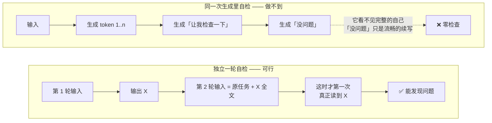
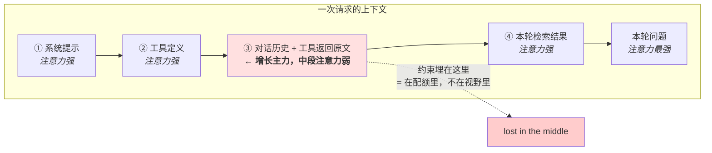
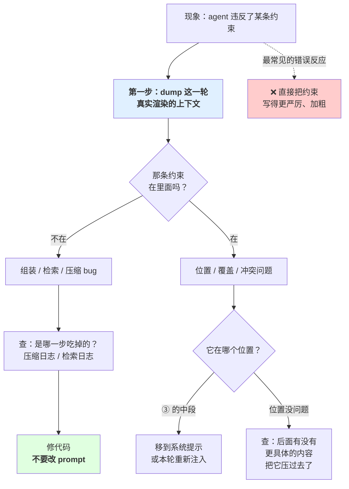
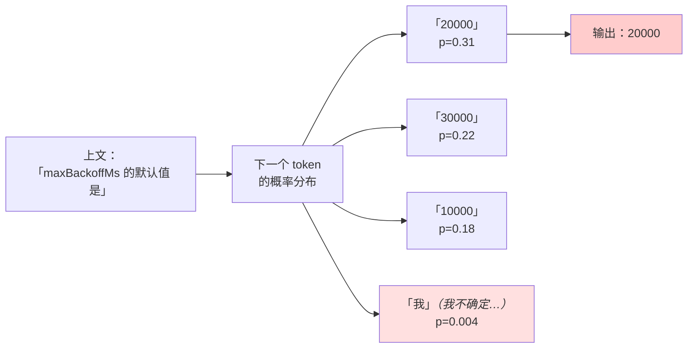
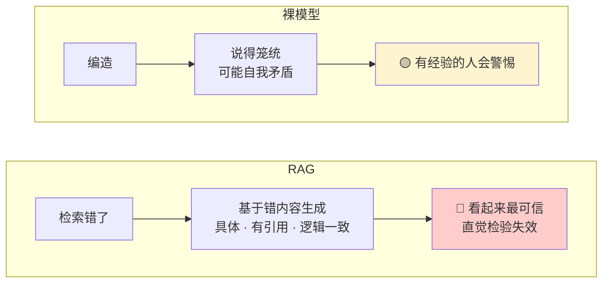
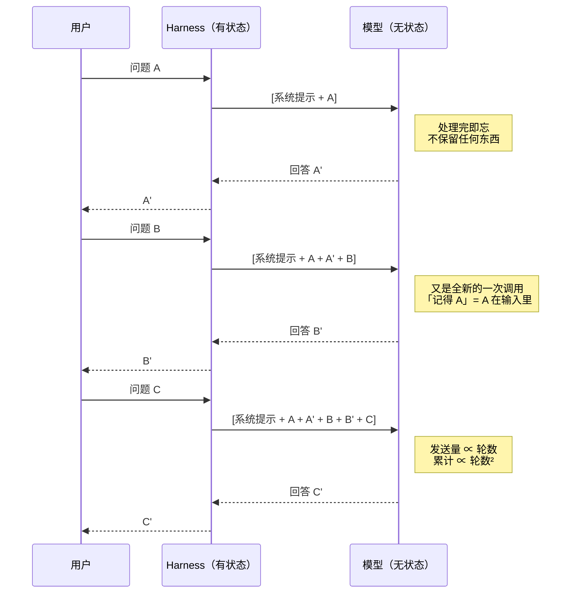

# 第 1 章 模型能力与边界

> **💡 30 秒速览**
> - 模型逐 token 生成，写出去的收不回 → 同一次生成里的"自检"是假的
> - 上下文窗口是配额，注意力是另一回事 → "塞进去了"≠"模型看得见"
> - 幻觉是生成机制的固有产物 → 越具体越可信，和越准确没有关系
> - 模型 API 是无状态纯函数 → 所有"记忆"都是外部重新组装的结果

地基章。后面每一章的机制解释，最终都落回这一章的两句话：

1. **模型是逐 token 往前生成的，写出去的收不回。**
2. **模型只能看见这一轮被真实组装进 prompt 的东西。**

四个知识点：`agent.llm.generation` / `agent.llm.context` / `agent.llm.hallucination` / `agent.llm.stateless`。

---

## 1.1 agent.llm.generation —— 生成机制

### 结论

模型一个 token 一个 token 往前采样，每一步只依赖已经存在的上文。**已经生成的 token 不能撤回、不能修改。**

### 案例：那个多出来的字段

你让 agent 生成一份配置，schema 里字段叫 `retryCount`。它写出来的是：

```json
{
  "timeout": 3000,
  "retry_count": 3,
```

写到这里它「意识到」自己用了 snake_case 而 schema 要 camelCase。它不能删掉那一行 —— 那两个 token 已经在上文里了。于是它做了唯一能做的事：**往下写，把错误圆成合理的样子**。

```json
{
  "timeout": 3000,
  "retry_count": 3,
  "retryCount": 3
}
```

两个字段，值一样。校验能过（字段都存在），语义是错的（多了一个不该有的键，下游按 `retry_count` 读的代码会读到一个不在 schema 里的字段）。

**记住这个画面：** 模型没有橡皮。它发现错误之后唯一的动作是**往前走**，而往前走的路径里，「把错误合理化」几乎总比「承认错误」概率更高 —— 因为前者是流畅的续写，后者需要一句突兀的自我否定。

### 机制

🎯 **想象用钢笔在纸上写字** —— 墨水落纸就收不回来。模型生成 token 就是这样：没有橡皮，只能继续往下写，把错误圆成合理的样子。

一次生成 = 一串条件概率采样。第 n 个 token 的分布由「输入 + 已生成的前 n-1 个 token」决定。所以：

- **没有回溯。** 模型写到第 50 个 token 时发现方向错了，它不能删掉前 49 个重来。它只能在错误的上文之上继续往下写 —— 于是要么硬圆回来，要么整段跑偏。
- **中间步骤必须落成文本才能被后续步骤使用。** 这就是 CoT 有效的真正原因：不是「让模型想清楚」，是把中间结果**写成可被下一步引用的上文**。没写出来的推理，对下一个 token 来说不存在。
- **`temperature=0` 不等于确定性。** 它只把采样从「按分布抽」变成「取最大」。同分布下最大值唯一，但分布本身受批处理、并行归约顺序、硬件浮点、模型版本影响。`temperature=0` 是「降低方差」，不是「可复现」。要复现得靠固定输入 + 记录版本，不是靠调参数。

**「让它检查一下」为什么必须是新的一轮：**



左边那条链里，「没问题」这三个字和前面的内容是同一次采样的延续 —— 它不是一个判断，是一个续写。右边那条链里 X 作为**输入**被重新读进来，模型才第一次拥有「看见整段」的条件。

### 误解靶子

**错答一：「模型会先想好再写。」**

没有「先想好」这个阶段。所谓思考就是生成，思考的痕迹就是 token。你能让它多写，不能让它先想。

**错答二：「让模型检查一下自己刚写的内容。」**

在同一次生成里做不到。写到一半的内容还没写完，模型看不见「自己刚写的整段」。要检查，必须**是新的一轮** —— 上一轮的输出作为这一轮的输入被重新读进去。这时它才第一次真正「看见」自己写的东西。

这条误解在工程上很贵：任何设计里出现「模型会自己发现刚才那句不对」，如果那个检查不是独立一轮，它就是零。

**错答三：「`temperature=0` 所以结果是固定的，测一次就够了。」**

见上。这条直接导致第 6 章的评测集只跑一次 —— 于是噪声被当成信号。

### 判据

> **这个设计依赖「模型会检查自己刚写的东西」吗？如果依赖，那个检查是不是一次独立的生成？**

不是独立一轮 → 这个检查不存在，删掉它，重新想。

### 自测题

1. 为什么 CoT（写出中间步骤）能提升表现？用「上文」这个词解释，不要用「思考」。
2. 你让模型输出一段 JSON，它在第三个字段写错了字段名。为什么它写完第四个字段时不会回头改？要让它改，最少需要做什么？
3. `temperature=0` 下同一个输入跑两次结果不同。给出至少两个不涉及「模型有 bug」的解释。

<details>
<summary>💡 卡住了？看一个提示</summary>

第 1 题：回到机制段第二条，找"中间步骤必须落成什么"。第 2 题：回到案例段"记住这个画面"那句话。第 3 题：机制段第三条列了几个影响因素。
</details>

---

*上一节讲的是"写出去的收不回"。接下来看它生成时能看到什么 —— 这决定了所有行为的边界。*

## 1.2 agent.llm.context —— 上下文窗口

> 理解模型本轮能看见什么，是后续上下文工程的前提。

### 结论

上下文窗口是**配额**，注意力是另一回事。没超窗口 ≠ 没代价。

### 案例：那句没人违反、但被忽略了的约束

第 1 轮你说：**「不要动 `config/` 目录下的任何文件。」**

第 2-14 轮 agent 在读代码、跑测试、改业务逻辑。每一轮都往上下文里追加：文件原文、测试输出、失败堆栈。到第 15 轮，上下文长这样：

```
[ 系统提示 ..................... 800 tokens ]
[ 工具定义（12 个工具）......... 3,200 tokens ]
[ 第 1 轮：不要动 config/ ...... 20 tokens ]   ← 在这里
[ 第 2 轮：read_file 返回 480 行 ]
[ 第 3 轮：test 输出 ........... 1,100 tokens ]
[ ...... 第 4-13 轮，共约 40,000 tokens ...... ]
[ 第 14 轮：又一份堆栈 ......... 900 tokens ]
[ 第 15 轮：现在该做什么 ]
```

第 15 轮 agent 改了 `config/database.yml`。

**排查时你会看到什么：**

- 窗口：46K / 200K，**没超**
- 日志：**没有任何报错**
- 上下文：那句约束**确实在里面**，一个字都没丢

于是你会得出一个错误结论 ——「模型不听指令」，然后去把那句话改得更严厉、加粗、加感叹号。

**真相是：** 那 20 个 token 埋在 46K 里，前面是系统提示和工具定义（模型注意力最强的位置），后面是刚发生的失败堆栈（注意力次强），它自己躺在最深的中段。**它在配额里，不在视野里。**

**这个案例要记住的是排查的岔路口：** 「在上下文里」和「被用上了」是两件事，而且**只看输出完全分不出来**。分不出来，就会一直修错的东西。

### 机制

🎯 **把上下文想象成一张桌子** —— 桌子很大不代表你能同时看清桌上所有文件。塞满一桌子纸，中间那几张和没放一样。

**先分清三个不同的东西，混在一起就会答成「上下文过大 → 成本上升」：**

| | 是什么 | 超了会怎样 |
|---|---|---|
| **窗口** | 一次请求能塞进的 token 上限，硬限制 | 报错，或被静默截断 |
| **注意力** | 模型实际用到每个位置的程度，软性衰减 | 不报错。信息在里面，模型没用上 |
| **成本** | 按 token 计费和计时 | 账单变大，行为不变 |

**成本是最不重要的那个。** 成本变大只是钱，行为是对的。注意力稀释会让**行为变错**而且**不报错** —— 这才是要防的东西。

**lost in the middle：** 同一条信息，放在上下文开头或结尾时模型能用上，放在中段时经常用不上。所以「塞进去了」和「模型看得见」是两件事。位置是一个工程变量，不是无关细节。

**token 不是字。** 分词器把文本切成 token，中文、代码、URL、base64 的字符/token 比例差很多。凭字数估算上下文占用会错得很离谱，尤其是工具返回的 JSON 和堆栈。

**上下文由四块组成**（第 2 章会用到，先在这里立住）：

1. 系统提示
2. **工具定义** —— 这块很容易被忘掉，工具多了它能占很大一块，而且每轮都在
3. 对话历史，**含工具返回原文**
4. 本轮注入的检索结果

增长几乎全部来自 ③④，其中工具返回原文是最大的单一来源。

**四块的排布和注意力强度：**



**关键推论：要让一条信息真被用上，把它移出 ③ 的中段** —— 提到系统提示里，或者在本轮重新注入一次（放到 ④ 或问题旁边）。这比把它写得更严厉有效得多。

**「不遵守约束」的排查决策树 —— 这张图是本节最实用的部分：**



**注意左右两支的修法完全相反：** 左支要改代码、动 prompt 没用；右支要动位置、查代码没用。而**跳过 dump 这一步，你有 50% 概率在修错的那一支上花一整天。**

### 误解靶子

**错答一：「上下文太大 → token 成本高。」**

把注意力问题答成了账单问题。成本是线性的、可预算的、不影响正确性的；注意力稀释是非线性的、无告警的、直接改变输出的。答成成本，等于说「这事的代价是钱」—— 于是解决方案会变成「换个便宜模型」，而真问题一点没动。

**错答二：「窗口够大就没问题了。」**

窗口再大不解决注意力。100 万 token 的窗口塞满 100 万 token，中段那部分和没放一样。窗口变大只是把「会报错」变成「不报错但也不生效」—— 从显性失败变成静默失败，某种意义上更糟。

**错答三：「上下文里有这条信息，所以模型知道。」**

「在上下文里」是必要条件，不是充分条件。这条误解在排查时会让你走错方向 —— 见下面的判据。

### 判据

> **这条信息会改变模型这一步的决策吗？**

不是「它有用吗」。有用的东西无穷多，会改变这一步决策的很少。

排查时另一条：

> **模型行为不对 —— 这条信息是「不在上下文里」，还是「在上下文里但没被用上」？**

这两种根因的修法完全不同（补检索 vs 调位置/裁剪/提前），而**只看最终输出分不出来**。必须把这一轮真实组装的上下文逐字 dump 出来看。这是第 7 章可观测性的入口。

### 自测题

1. 上下文由哪几块组成？哪一块最容易被忽略、哪一块是增长的主要来源？
2. 一条关键约束写在了上下文里，模型没遵守。列出两种根因，以及分别怎么验证是哪一种。
3. 把窗口从 8K 换成 200K，哪些问题解决了、哪些没有？没解决的那些为什么反而更难发现？
4. 为什么「上下文太长导致成本高」这个回答，即使成立，也没有回答「上下文预算该怎么做」？

<details>
<summary>💡 卡住了？看一个提示</summary>

第 1 题：机制段"上下文由四块组成"。第 2 题：看"不遵守约束"的排查决策树。第 3 题：机制段"lost in the middle"。第 4 题：回到误解靶子的错答一。
</details>

---

*上下文决定了模型能看见什么。但就算看见了正确的信息，它仍然可能给你一个编造的答案 ——*

## 1.3 agent.llm.hallucination —— 幻觉

### 结论

幻觉是生成机制的固有产物，**不是数据不够导致的 bug**。它没有被「修好」的那一天，只能被约束。

### 案例：越具体，越可信，越危险

你问 agent：「这个 SDK 怎么配置重试的最大退避时间？」

它答：

> 在初始化时通过 `retryPolicy` 配置：
> ```js
> client.init({
>   retryPolicy: { maxAttempts: 3, maxBackoffMs: 30000, jitter: true }
> })
> ```
> 注意 `maxBackoffMs` 默认值是 `20000`，且必须小于 `requestTimeoutMs`，否则重试会在超时之后才触发。

**这段回答里有多少是真的？** `retryPolicy` 和 `maxAttempts` 真的存在。`maxBackoffMs`、`jitter`、那个默认值 `20000`、那条「必须小于 requestTimeoutMs」的约束 —— **全是编的。**

**但它比真的更像真的。** 因为：

- 它给了默认值（真实文档经常不写默认值）
- 它给了一条**约束关系**（这种细节只有深入用过的人才知道 —— 所以它是强可信信号）
- 它解释了那条约束的**理由**（重试在超时之后才触发，逻辑上完全说得通）

同事读到这段，不会去查文档 —— 因为这段回答的信息密度已经超过了大多数文档。他会直接照着写。

**这个案例要记住的是那个反直觉的关系：** 你的直觉是「说得越细越可能是查过的」。而生成机制给出的是相反的结论 —— **细节是被采样出来的，具体程度和真实程度没有关系，甚至负相关**：越是「只有内行才知道」的细节，越没有外部信号能校正它，越容易被编，也越容易被相信。

### 机制

🎯 **模型像一个永远不会说"我不知道"的应试者** —— 每道题都必须写一个答案，而且写得越像标准答案（流畅、具体、有细节），分数越高，不管对不对。

每一步都在采样下一个最可能的 token。「最可能」和「真」是两个不同的目标函数 —— 一段流畅、格式正确、看起来像答案的文本，在概率上就是高分的，不管它对不对。

**关键：模型没有一个自然的「我不知道」出口。** 在给定上文的条件下，总有一个概率最高的 token。「我不知道」只是众多可能续写中的一个，而且训练数据里正确答案远多于「我不知道」，所以它的先验概率很低。**沉默不是默认行为，编造才是。**

**检索能缓解，不能消除**：

- 检索错了 → 模型基于错的内容生成，而且答案**披着有依据的外观**，比无依据的幻觉更难发现（第 4 章 `rag.quality`）
- 检索对了 → 模型仍可能在细节上偏离原文
- **引用本身也会被编造** —— 编一个格式完美的文献号、行号、URL，和编一句事实是同一个动作（第 4 章 `rag.grounding`）

**越具体越可信，和越具体越准确，没有关系。** 精确的数字、版本号、行号，是幻觉最容易出现也最容易被相信的地方。

**为什么没有「我不知道」这个出口：**



「我不知道」不是一个特殊状态，**它只是分布里一个概率极低的续写**。而且上文越是「一个陈述句写到一半」，它的概率就越低 —— 因为在那个位置，一个数字才是流畅的。

**RAG 改变的是幻觉的外观，不是它的存在：**



注意这两条链的终点：加 RAG 之后，可疑度**下降**了，而错误还在。所以 RAG 不是「解决了幻觉」，是**把幻觉搬到了一个你更不容易发现的地方**（详见第 4 章 4.3）。

### 误解靶子

**错答一：「训练数据再多一些 / 模型再强一些就没幻觉了。」**

模型变强会降低幻觉率，不改变幻觉的性质。把它当「暂时的 bug」，工程上就不会建外部校验 —— 于是系统的正确性押在一个概率上。

**错答二：「让它不确定的时候说不知道。」**

这是 prompt，是输入不是检查点（第 3 章会把这条讲透）。它能降低概率，不能建立保证。而且模型对自己的不确定性本身估计不准。

**错答三：「答案里给了引用，所以可查证。」**

引用是生成出来的。要可查证，引用必须由**系统记录**，不是由模型写出来。

### 判据

> **这条事实错了的代价有多大？如果代价高，它有没有一个模型之外可查证的来源？**

代价低（措辞、格式、建议） → 容忍。
代价高（数字、标识、可执行的命令、对外的结论） → 必须有外部来源，且来源由系统记录而非模型自述。

### 自测题

1. 为什么「幻觉」不能靠加数据彻底解决？用采样目标函数解释。
2. 为什么模型很少主动说「我不知道」？
3. 加了 RAG 之后幻觉的形态发生了什么变化？为什么新形态更难发现？
4. 你要让模型输出的引用可信。为什么「要求它只引用检索到的内容」不够？该在哪一层做？

<details>
<summary>💡 卡住了？看一个提示</summary>

第 1 题：机制段第一句话里"两个不同的目标函数"。第 2 题：看那张概率分布图。第 3 题：看那张"裸模型 vs RAG"的对比图。第 4 题：误解靶子错答三。
</details>

---

*幻觉来自生成机制本身。而接下来这个知识点会告诉你：模型甚至不"记得"自己上一轮编过什么 ——*

## 1.4 agent.llm.stateless —— 无状态

### 结论

模型 API 是一个**纯函数**：同样的输入给同样的分布。它不记得上一轮。所有「记忆」都是外部把内容重新组装进这一轮的结果。

### 案例：那次省钱的裁剪

一个 agent 跑到第 9 轮，账单让人不太舒服。开发者看了一眼历史，发现第 3 轮那次 `read_file` 返回了 2000 行原文，占了一大半 token，而且**agent 早就已经从里面得出结论了**（第 4 轮它说：「确认问题在 `parseHeader` 的边界处理」）。

于是他做了一件看起来完全合理的事：把第 3 轮那 2000 行从历史里删掉，只留第 4 轮那句结论。

第 10 轮，agent 说：

> 我需要先看一下 `parseHeader` 的实现。

**它「忘了」它读过这个文件。**

但注意它没忘那句结论 —— 结论还在第 4 轮里。它的状态变成了：**知道结论，不知道自己已经验证过**。所以它要重新验证一遍。

如果这时开发者的心智模型是「模型记得它读过」，这个现象就完全无法解释，只能归因成「模型变笨了」。

**正确的心智模型是：** 第 10 轮的 agent 和第 3 轮的 agent 之间**没有任何联系**。它们是同一个纯函数的两次独立调用。第 10 轮的它「读过文件」这件事，唯一的证据就是那 2000 行原文在不在输入里。删掉了，这件事就没发生过。

**这个案例还藏着第 2 章的答案：** 那次裁剪本身没有错 —— 原文确实过期了。错的是**只删不留痕**。正确的做法是把它替换成一行：

```
第 3 轮已读 src/parser.ts（2000 行），结论见第 4 轮，无需重读
```

20 个 token，把「已完成的动作」保住了。这就是 2.2 的核心动作。

### 机制

🎯 **每一轮对话就像给一个失忆症患者重新讲一遍完整的故事** —— 他不记得上次聊过什么，你必须从头说起。你省掉的每一段，对他来说就从来没发生过。

「多轮对话」是一个假象。真实发生的是：每一轮都把（系统提示 + 完整历史 + 本轮输入）重新发一遍。模型没有跨请求的状态，没有句柄，没有会话对象。



**这张图里所有的「智能」都在模型侧，所有的「记忆」都在 Harness 侧。** 两者不在一个地方 —— 这是理解后面六章的关键。你能改的是 Harness 那一列。

由此推出几个非平凡的结论：

- **成本随轮数二次增长。** 第 n 轮要重发前 n-1 轮的全部内容。不是线性（第 7 章 `cost.latency`）。
- **「记忆」= 一条选择性重新组装的通路。** 存了但这一轮没被检索出来的记忆，对模型是**字面意义上不存在** —— 不是「影响小」（第 2 章 `ctx.memory`）。
- **历史可以被编辑。** 既然每轮都是重新组装，那就可以裁剪、压缩、重排、替换。压缩和污染治理的可能性全部来自这一条。
- **排查的唯一入口是「这一轮真实组装出来的上下文」。** 不是模板，不是你以为会被拼进去的东西，是渲染后的最终字符串。

### 误解靶子

**错答一：「模型记住了我们前面说的话。」**

它读到了，不是记住了。区别在于：读到依赖于「有没有被组装进来」，这是你的代码在控制的事，会出 bug，会被压缩掉，会被检索漏掉。当成「它记住了」，这些失败就都不在你的排查范围里。

**错答二：「加记忆是为了省 token。」**

省 token 是副作用。加记忆的目的是让**跨会话的信息有机会回到这一轮**。真正的取舍是**召回率 vs 上下文预算**：召回多了挤占预算稀释注意力，召回少了该有的信息不在。不是成本取舍。

**错答三：「日志里没报错，所以上下文是对的。」**

上下文组装错了不会报错。少拼一块、拼错顺序、检索返回空 —— 全都静默通过。

### 判据

> **要判断模型「知不知道」某件事：把这一轮真实发送的上下文逐字打印出来，那件事在不在里面？**

在里面 + 行为不对 → 注意力/位置/被后文覆盖问题。
不在里面 → 组装/检索 bug。跟模型能力无关。

### 自测题

1. 模型是无状态的，那「它记得我十分钟前说的话」这个现象是怎么产生的？
2. 为什么对话轮数增加，单轮成本也在涨？涨的是什么？
3. agent 在第 8 轮忘了你在第 2 轮定下的约束。给出两种根因和各自的验证方法。
4. 「模型无状态」这个事实，为什么反而是上下文压缩能成立的前提？

<details>
<summary>💡 卡住了？看一个提示</summary>

第 1 题：看机制段那张时序图，"记忆"在哪一侧。第 2 题：同一张图，每轮发送量。第 3 题：和 1.2 的排查决策树是同一个思路。第 4 题：机制段"历史可以被编辑"。
</details>

---

## 本章小结

四点合起来是一句话：**模型是一个无状态的、逐 token 采样的函数，它这一步能做对什么，完全取决于这一步被组装进去了什么、以及那些东西放在哪个位置。**

后面六章都是这句话的推论：

- 第 2 章：怎么决定组装什么（预算、压缩、记忆、污染、注入）
- 第 3 章：工具定义也是被组装进去的文本，参数也是采样出来的 → 所以校验必须在模型之外
- 第 4 章：检索是「本轮注入」那一块的来源 → 所以召回和精度都直接变成正确性问题
- 第 5 章：循环是「反复重新组装」→ 所以终止和规划要有可判定的判据
- 第 6 章：既然输出是分布，单次结果就不是证据 → 所以要固定输入集 + 多次 + 基线
- 第 7 章：既然唯一能回答「模型看得见什么」的东西是渲染后的上下文 → 所以它必须被记下来
