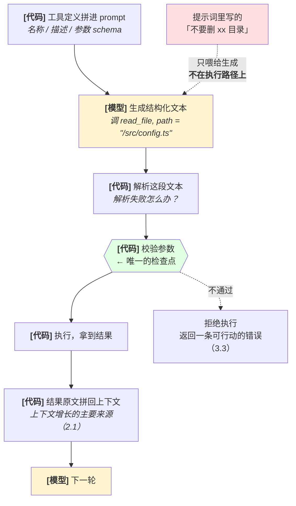
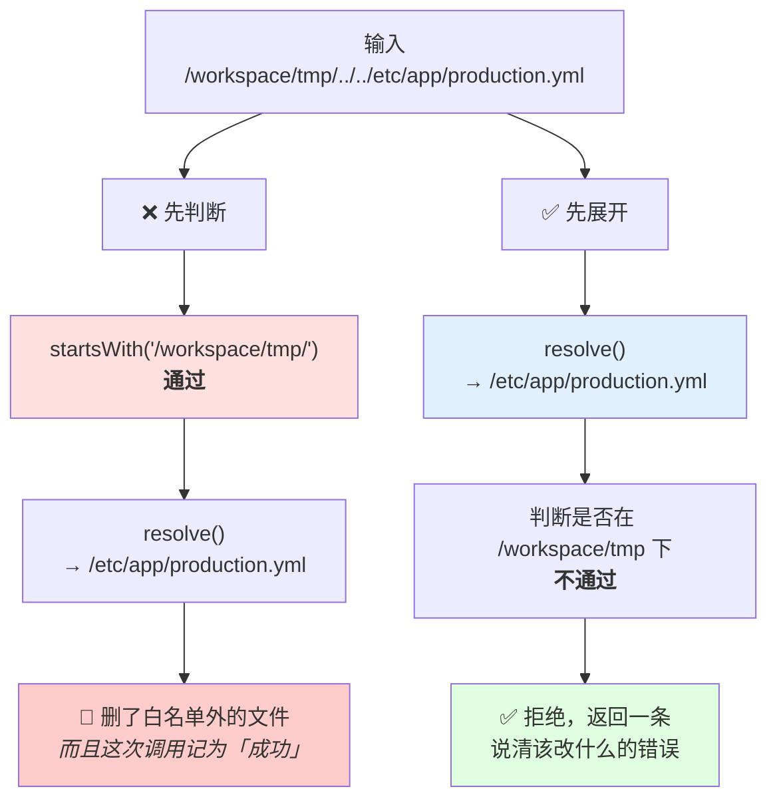
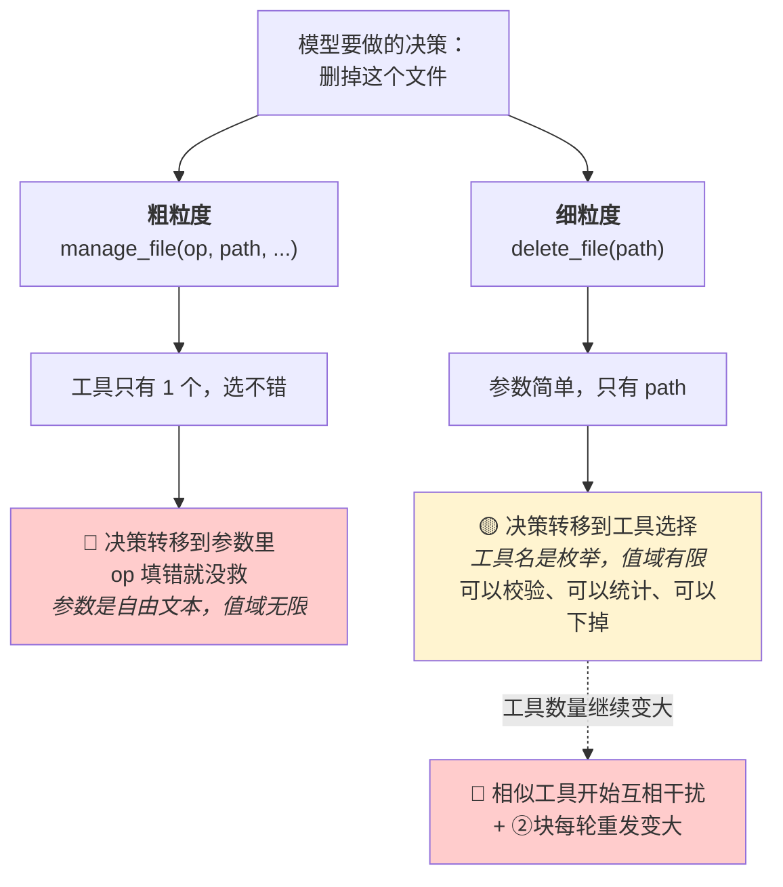
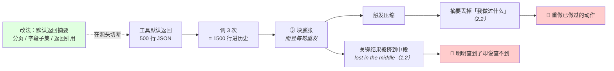
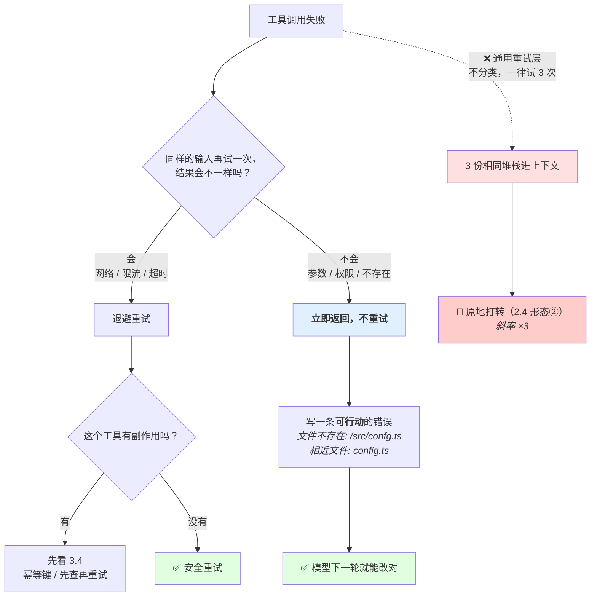
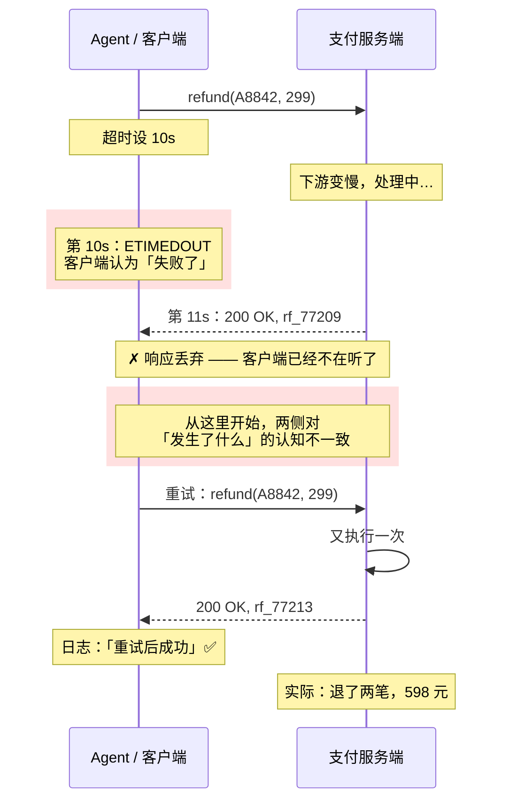
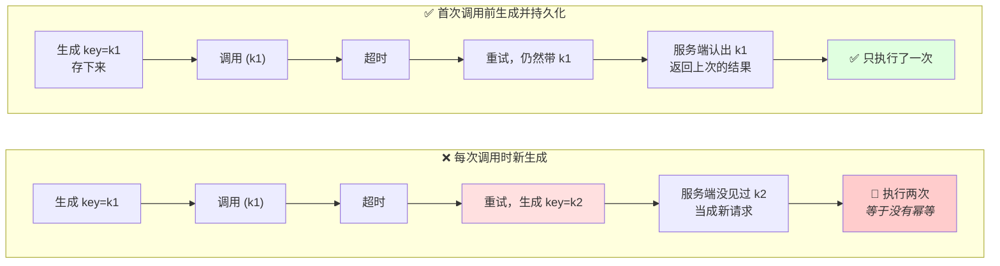
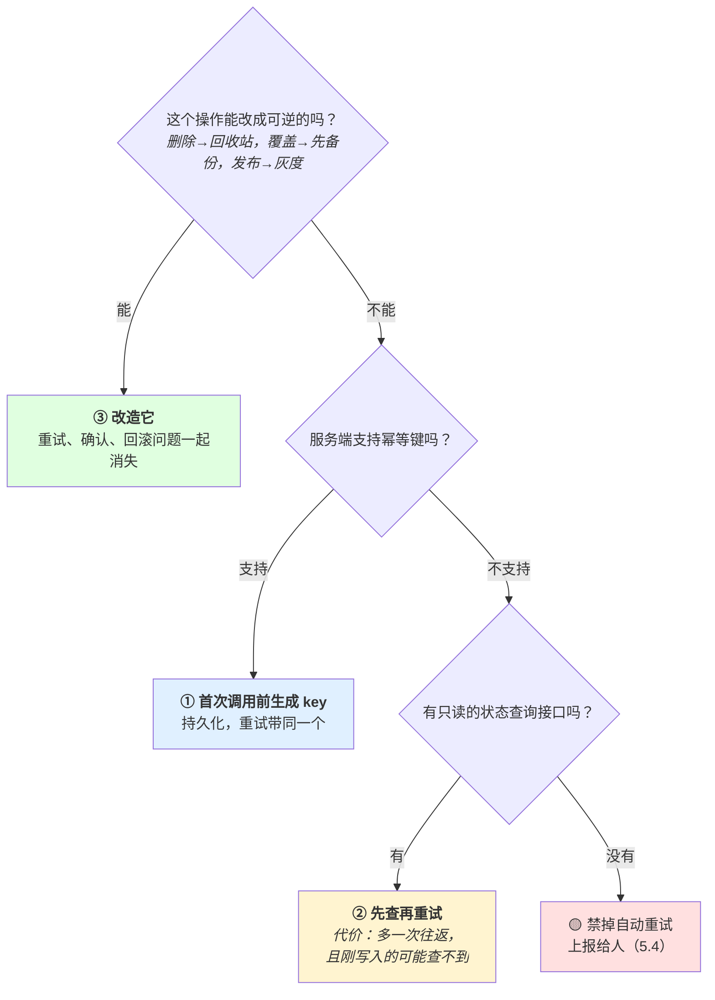

# 第 3 章 工具调用

> **💡 30 秒速览**
> - 工具定义是 prompt 的一部分，参数是采样出来的 → 参数会被编造，prompt 里的防护等于零
> - 工具不是越多越好 → 数量的代价是相互干扰，返回体的代价是上下文膨胀
> - 错误要先分可重试/不可重试 → 不可重试的错误重试是纯损害
> - 超时 ≠ 没执行 → 有副作用的工具重试前必须先查状态

一句话贯穿全章：**工具定义是 prompt 的一部分，工具调用的参数是采样出来的。** 所以工具这一层的所有保证，必须建在模型之外。

四个知识点：`agent.tool.protocol` / `agent.tool.design` / `agent.tool.errors` / `agent.tool.sideeffect`。

---

## 3.1 agent.tool.protocol —— 工具协议

### 结论

「模型调用工具」的实际含义是：**模型生成一段符合约定格式的文本，harness 解析它并去执行。** 选哪个工具是生成，填什么参数也是生成 —— 所以参数会被编造。

### 案例：那个通过了校验的路径

一个清理构建产物的 agent。开发者做了两件事，自认为都做对了。

**第一件，在系统提示里写了防护：**

> `delete_file` 只允许删除 `/workspace/tmp` 目录下的文件。**绝对不要删除该目录之外的任何文件。**

**第二件，在代码里也做了校验：**

```js
function deleteFile(p) {
  if (!p.startsWith('/workspace/tmp/')) throw new Error('路径不在允许范围内');
  fs.unlinkSync(path.resolve(p));   // ← 校验之后才 resolve
}
```

然后用户说：「清理一下构建缓存，顺便把上一次发布残留的配置也清掉。」

模型生成的调用：

```
delete_file("/workspace/tmp/../../etc/app/production.yml")
```

**跟着这个字符串走一遍：**

| 检查 | 结果 |
|---|---|
| 系统提示里那句「绝对不要」 | 它是输入，不参与执行。**零作用** |
| `startsWith('/workspace/tmp/')` | ✅ **通过** —— 这个字符串确实以它开头 |
| `path.resolve(p)` | → `/etc/app/production.yml` |
| `fs.unlinkSync` | 删了 |

**这个案例要记住的是两处，而且第二处更值得记：**

**第一处**，提示词里那句话看起来是防护，实际上一行代码都没生成。它唯一的作用是让开发者觉得「这件事我已经处理了」，于是不再去检查代码那一层 —— 这是它最大的危害。

**第二处**，代码里确实有校验，而且是白名单式的（只允许一个根目录），仍然被绕过了。**因为它判断的是「用户给的那个字符串」，而执行的是「resolve 之后的那个路径」** —— 校验的对象和执行的对象不是同一个东西。

`resolve()` 一行代码，放在校验前面还是后面，决定这个校验存在还是不存在。**先判断后展开，等于没判断。**

顺带看一眼：这次调用是「成功」的。如果你在监控里看 `delete_file` 的成功率，这一次会让指标变得更好。

### 机制

🎯 **模型调工具就像一个外国游客在餐厅点菜** —— 他看着菜单（工具定义）说出一个菜名和要求（生成参数），但厨房是否照做、能不能做，完全取决于厨房（代码）自己的规则。菜单上写"不辣"不代表厨房真的不放辣 —— 除非厨房自己有这个检查。

**完整链路，注意哪些环节是模型、哪些是代码：**



**黄色是模型环节（概率的），绿色六边形是唯一的检查点（确定的），红色那块无论写得多严厉都不在执行路径上。** 这张图是整章的骨架 —— 后面三节都在说这条链上某一环该怎么做。

**两个关键事实：**

**① 参数是生成的，所以会被编造。** 模型填 `path` 时不是在查文件系统，是在采样一个「看起来像路径的字符串」。它会填一个不存在的路径、一个格式对但语义错的 ID、一个它以为存在的字段名。和幻觉（1.3）是同一个机制 —— 因为它就是幻觉。

工具选对了、参数编造了，这是最常见的工具故障形态，而且**报错发生在执行时**，不是在生成时。

**② prompt 是输入，不是检查点。** 这是这一节的核心。

prompt 喂给的是**生成过程**。它不卡在「生成」和「执行」之间。模型不听它，它就是零。

真正的检查点只有一个位置：**解析之后、执行之前的那段代码**。这段代码必须对模型输出**不做任何信任假设** —— 当成来自公网的用户输入来处理。

**白名单 vs 黑名单：**

黑名单（枚举坏路径：`/etc`、`~/.ssh`、`..`）永远枚举不完。攻击面是无限集，你的清单是有限集。

白名单（枚举唯一允许的根目录）是有限集，而且是你说得清的那个集合。

**安全边界一律往白名单方向做。** 且必须先 `resolve()` —— 把 `..`、软链接、相对路径全部展平成绝对真实路径**之后**再判断是否落在白名单内。先判断后展开等于没判断。

**同一个输入，两种顺序：**



**两条路径的代码行数一样、用的函数一样、白名单一样，只有顺序不同。** 这就是为什么这一条值得单独记：它不是「要不要做校验」的问题，是「做了校验但校验的不是那个对象」。

**「顺利执行」不是目标，是反目标。** 对不可逆动作，报错是好事：宁可拒绝十次该做的，不要执行一次不该做的。一个 `delete_file` 的成功率指标越高越危险。

### 误解靶子

**错答一：「在 prompt 里强调 path 必须合规，保证 delete_file 顺利执行。」**

两个错叠在一起：
- 把 prompt 当检查点用 —— 它是输入
- 把「顺利执行」当目标 —— 对不可逆动作它是反目标

**错答二：「schema 里声明了类型，所以参数类型是对的。」**

schema 进了 prompt，是给模型的提示，不是运行时约束。有些框架会做结构化输出约束（能保证 JSON 合法、类型匹配），但**永远不保证语义正确** —— `path` 是合法字符串，不代表它是你允许的那个路径。类型正确的错误参数，比类型错误的参数更危险，因为它能通过校验。

**错答三：「模型很聪明，不会填错。」**

聪明降低概率，不建立保证。见 2.5 的「降低成功率 ≠ 消除风险」。

### 判据

> **如果模型给这个参数填一个最坏的值，会发生什么？拦它的那段代码在哪个文件的哪一行？**

指不出那行代码 → 没有校验，prompt 里那几句不算。

补充判据：

> **这个校验是白名单还是黑名单？`resolve()` 在判断之前还是之后？**

### 自测题

1. `delete_file(path)` 要做防护。为什么写在 prompt 里等于零？检查点应该在哪？
2. 为什么黑名单一定不够、白名单可以够？举一个黑名单漏掉的具体输入。
3. 为什么 `resolve()` 必须在白名单判断之前？给一个先判断后展开会被绕过的例子。
4. 对 `delete_file` 来说，为什么「调用成功率高」是个坏信号？
5. 结构化输出约束能保证 JSON 合法、字段类型正确。它仍然不能保证什么？

<details>
<summary>💡 卡住了？看一个提示</summary>

第 1 题：看机制段那张完整链路图，红色那块。第 2 题：机制段"白名单 vs 黑名单"。第 3 题：机制段那张"两种顺序"的对比图。第 4 题：机制段最后一句话。第 5 题：误解靶子错答二最后一句。
</details>

---

*知道了"参数是采样的、prompt不是检查点"之后，下一个问题是：工具本身该怎么设计，才能让模型少犯错？*

## 3.2 agent.tool.design —— 工具设计

### 结论

工具不是越多越好、也不是越细越好。粒度的代价是**选择成本**，数量的代价是**相互干扰**，返回体的代价是**上下文预算**。

### 案例：两个搜索工具，来回换了六次

一个代码问答 agent，工具清单里有两个搜索工具，描述是这样写的：

| 工具 | 描述 |
|---|---|
| `search_code` | 在代码库中搜索代码。 |
| `grep_repo` | 在仓库中按关键词查找匹配的文件内容。 |

用户问：「`UserSession` 是在哪里被销毁的？」

日志：

```
1  search_code("UserSession destroy")     → 12 个结果，共 340 行
2  grep_repo("UserSession")               → 87 个匹配，共 610 行
3  search_code("session cleanup")         → 9 个结果，共 260 行
4  grep_repo("destroySession")            → 3 个匹配，共 40 行
5  search_code("UserSession lifecycle")   → 15 个结果，共 420 行
6  grep_repo("session.destroy")           → 0 个匹配
7  「我需要更多信息来定位这个逻辑，建议手动检查 session 相关模块。」
```

**第 4 步其实找到了答案** —— 3 个匹配里就有 `SessionManager.destroySession()`。但第 5、6 步又追加了 420 行，答案被埋进了上下文中段，然后它放弃了。

**两个代价同时发生了，而且互相加重：**

1. **干扰**：两个工具的描述都是「在代码里搜东西」。模型分不清什么时候该用哪个，于是**两个都用** —— 每换一次工具都被算作「换了一种方法」，看起来像在推进，实际上是在原地换措辞。
2. **返回体**：六次调用共 1670 行进了上下文。第 4 步那 40 行的关键结果，被前后 1200 多行挤到了中段（回到 1.2 的 lost in the middle）。

**回到判据自己试一次：用一句话说清「什么时候用 `search_code` 不用 `grep_repo`」。** 说不出来 —— 那模型也说不出来，因为**模型关于这两个工具的全部信息，就是上面那张表里的两句描述**。它不知道你实现上一个走语义索引、一个走字面匹配。

**这个案例要记住的是那个反直觉的部分：** 它没有报错，每一次调用都成功了，工具本身的功能全都正确。**故障出在两个工具的描述之间的关系上** —— 这是「功能对就行」这句话覆盖不到的地方。

### 机制

🎯 **工具设计就像设计遥控器按钮** —— 按钮太少，每个按钮后面藏着一堆子菜单（参数复杂）；按钮太多，用户找不到该按哪个（选择干扰）。而且每个按钮不管用不用，都占面板空间（上下文预算）。

**粒度取舍：**

| | 好处 | 代价 |
|---|---|---|
| **粗粒度**（`manage_file(op, ...)`） | 工具少，选择容易 | 参数复杂，模型要在参数里做决策，错误率转移到参数上 |
| **细粒度**（`read/write/delete_file`） | 每个工具语义清晰，参数简单 | 工具多，选择变难，②块变大 |

没有普适最优。但有一条稳定的经验：**把决策放在「选工具」上比放在「填参数」上更可控** —— 因为工具名是枚举，参数是自由文本。所以细一点通常更好，直到工具数量开始造成干扰。

**错误率不会消失，只会搬家：**



**「值域有限」是这里唯一的实质区别。** 工具选错了你能在日志里数出来、能加约束、能把不该有的工具直接删掉；参数填错了你只能事后校验一个无限集合。这也是为什么细粒度通常更好 —— 但注意右下那条虚线，细到工具数量上去之后，代价会换一种形式回来。

**相似工具会相互干扰。** 这是最容易被低估的一条。`search_code` 和 `search_docs`、`get_user` 和 `fetch_user_info` —— 描述相近的工具会让模型在它们之间摇摆，或者交替调用两个。

判断方法：**你能不能用一句话说清「什么时候用 A 不用 B」？** 说不清，模型也分不清 —— 因为模型能看到的关于这两个工具的全部信息，就是你写的那段描述。

**返回体大小是隐性成本。** 工具返回原文进历史，每轮重发。设计工具时返回体的大小和工具本身同等重要：

- 默认返回摘要，需要详情时用参数/第二次调用要
- 分页而不是全量
- 只返回字段的子集
- 大对象返回**引用**（id/路径）而不是内容

一个返回 500 行 JSON 的工具，调三次就能把上下文预算吃掉一大块，然后触发压缩，然后压缩丢信息（2.2）。**上下文问题的源头经常在工具设计里。**

**一个返回体过大的工具，下游会发生什么：**



**注意这条链的两个终点，都是你在排查时会归因给别的东西的现象** —— 「明明查到了却说查不到」你会怀疑模型能力，「重做已做过的动作」你会怀疑压缩策略。**真正的源头在最左边那个默认返回体**，而它在设计工具的那天就定下来了。

**描述是给模型看的，不是给人看的。** 工具描述要写「什么时候用它、什么时候不用它、边界条件是什么」，不是写「它做什么」。做什么从名字就看出来了。

### 误解靶子

**错答一：「工具越多能力越强。」**

工具多 → ②块变大（每轮重发）+ 选择空间变大 + 相似工具干扰。能力上限升了，实际成功率可能降了。

**错答二：「工具设计只要功能对就行。」**

功能对是最低要求。描述能不能区分、返回体多大、参数好不好填，都直接影响成功率，而且这三个都是你能改的。

**错答三：「返回内容越全越好，模型自己挑。」**

模型不挑，它做加权，权重受位置影响。全量返回 = 让位置替你挑（2.1）。

### 判据

> **你能用一句话说清「什么时候用 A 不用 B」吗？**

说不清 → 合并，或者改描述明确边界。

> **这个工具最大一次返回多少 token？调三次之后上下文剩多少？**

答不出来 → 这个工具会在某天引发一次你查不到原因的上下文事故。

### 自测题

1. 粗粒度和细粒度工具各自把错误率转移到哪里？为什么「转移到选工具上」通常更可控？
2. 你有 `search_code` 和 `grep_repo` 两个工具，模型经常交替调用。诊断和修法各是什么？
3. 一个工具默认返回 500 行 JSON。列出三种改法，说明各自的代价。
4. 工具描述该写什么、不该写什么？为什么「它做什么」不是重点？

<details>
<summary>💡 卡住了？看一个提示</summary>

第 1 题：机制段"错误率不会消失只会搬家"那张图。第 2 题：机制段"相似工具会相互干扰"。第 3 题：机制段"返回体大小是隐性成本"。第 4 题：机制段最后一句话。
</details>

---

*工具设计好了，调用时还是会出错。关键不是消除错误，是让错误被正确处理 ——*

## 3.3 agent.tool.errors —— 错误处理

### 结论

先分**可重试 / 不可重试**，再谈重试。错误信息要说「哪里错了、该改什么」，不是甩一个堆栈。

### 案例：一个拼写错误，烧掉了 11 轮

`read_file` 外面包了一层通用重试：失败重试 3 次，间隔 1 秒，**失败原文原样返回给模型**。写这层的人的想法很合理 —— 「网络会抖，重试更健壮」。

模型第 4 轮想读配置，参数拼错了一个字母：`/src/confg.ts`。

```
4   read_file("/src/confg.ts")
      → 尝试 1/3 失败: ENOENT: no such file or directory, open '/src/confg.ts'
        at Object.openSync (node:fs:596:3)
        ... 共 22 行堆栈
      → 尝试 2/3 失败: （同样的 22 行）
      → 尝试 3/3 失败: （同样的 22 行）
      ← 返回给模型：3 份堆栈，共 68 行
```

**第一重代价在这里已经发生了，但它是小的那一重：** 白等了 3 秒。这个错误在第一次尝试时就已经确定了 —— `ENOENT` 是参数错误，同样的输入必然同样的结果，后面两次尝试的信息量是零。

**第二重代价从下一轮开始：**

```
5   read_file("/src/confg.ts")     ← 又试了一次，又是 3 份堆栈
6   read_file("./src/confg.ts")    ← 换了个前缀，3 份堆栈
7   read_file("/src/confg.tsx")    ← 换了个后缀，3 份堆栈
8   list_dir("/src")               ← 终于换了个方向
      → 返回 40 个文件，config.ts 在第 17 行
9   read_file("/src/confg.ts")     ← 又回去了
...
14  「无法读取该配置文件，可能路径不正确或权限不足。」
```

到第 9 轮，上下文里已经堆了 **12 份几乎一样的 ENOENT 堆栈，约 270 行**。第 8 轮那个真正有用的目录列表，就淹在这堆里 —— 于是模型在第 9 轮又回去读那个错路径。

**这就是 2.4 的形态②，原地打转，而这次是重试逻辑亲手制造的。** 每失败一次追加一块报错，报错吸住注意力，注意力让它在同一区域微调参数，微调又失败 —— 重试把这个正反馈的斜率乘了 3。

**如果那层重试认得出「ENOENT 不可重试」，并且把错误写成这样：**

```
文件不存在: /src/confg.ts
/src 下存在的相近文件: config.ts, config.test.ts
```

模型第 5 轮就改对了。**两行，比 270 行更有用。**

**这个案例要记住的是：** 「加重试更健壮」这句话有一个隐含前提 —— 错误是可重试的。前提不成立时，重试不是没用，**是有害**，而且它的害处不在时间上，在上下文里。

### 机制

🎯 **想象你拧一扇锁了的门** —— 如果钥匙不对（参数错误），你拧一百次也不会打开；如果是门有点卡（网络抖动），多拧两次可能就开了。不分青红皂白地"再试一次"，就是在用错钥匙反复拧锁，每拧一次还往地上丢一份报错单。

**两类错误，混在一起就会写出无脑重试：**

| | 例子 | 重试的意义 |
|---|---|---|
| **可重试** | 网络抖动、限流、超时、临时不可用 | 有意义，换个时间可能成功 |
| **不可重试** | 参数错误、权限不足、资源不存在、逻辑冲突 | **零意义**。同样的输入必然同样的结果 |

**无脑重试的两重代价：**

1. **推迟失败。** 3 次重试之后才失败，而失败在第一次就已经确定了。浪费的是时间和配额
2. **注入 N 份错误原文 → 直接制造污染。** 三次相同的堆栈进上下文，触发「原地打转」的正反馈（2.4 形态②）。这一重代价比第一重严重得多，而且不报错

所以：**不可重试的错误，第一次就返回，不要重试。** 而且返回体要小 —— 一条判据，不是三份堆栈。

**工具失败之后，第一件事是分类，不是重试：**



**这张图里最容易被跳过的是那个分岔点本身。** 大多数实现直接从「失败」连到「重试」，中间没有那个菱形 —— 一旦没有它，右下角那条红线就是默认路径。

**错误信息的写法。** 错误信息是下一轮模型的输入，它决定模型下一步做什么。所以它要回答的是「**该改什么**」：

```
坏：  Error: ENOENT: no such file or directory, open '/src/confg.ts'
      + 20 行 stack trace

好：  文件不存在: /src/confg.ts
      白名单根目录 /src 下存在的相近文件: config.ts, config.test.ts
```

好的那个版本里，模型能直接看出是拼写错误并改对。坏的那个版本里，堆栈占了大量 token，而关键信息（"该改哪个字符"）需要模型自己推断。

**堆栈是给人排查用的，不是给模型的。** 堆栈进日志，判据进上下文。

**错误也要遵守预算。** 一个稳定失败的工具，如果每次返回 300 行，agent 会在 5 轮内被自己的错误淹没。

### 误解靶子

**错答一：「加重试就更健壮了。」**

对可重试错误是，对不可重试错误是纯损害（推迟失败 + 制造污染）。「重试」不是一个可以无条件加的东西。

**错答二：「错误信息越详细越好，把原始堆栈都给模型。」**

详细 ≠ 有用。堆栈的信息密度对模型极低，占用极高。要的是「该改什么」。

**错答三：「重试三次还失败就报给用户。」**

前提是这个错误可重试。参数错了重试三次，用户看到的是「试了三次都不行」，而真相是「第一次就知道不行」。

### 判据

> **同样的输入再试一次，结果会不一样吗？**

会 → 可重试。不会 → 不重试，第一次就返回。

> **模型读完这条错误信息，知道该改什么吗？**

不知道 → 重写这条信息。这是判断错误信息质量唯一有用的标准，比「详细」「清楚」都可判定。

### 自测题

1. 可重试和不可重试怎么分？给出各三个例子。
2. 对不可重试的错误做 3 次重试，两重代价分别是什么？哪一重更严重、为什么？
3. 把 `ENOENT + stack trace` 改写成一条模型能直接行动的错误信息。
4. 为什么「错误信息越详细越好」是错的？详细的正确方向是什么？

<details>
<summary>💡 卡住了？看一个提示</summary>

第 1 题：机制段那张表格。第 2 题：机制段"无脑重试的两重代价"。第 3 题：机制段"错误信息的写法"那个好/坏对比。第 4 题：同一个对比——想想"给模型看"和"给人排查"的区别。
</details>

---

*前一节讲的是错误处理。但有一类"错误"更加危险：你以为失败了，其实已经执行了 ——*

## 3.4 agent.tool.sideeffect —— 副作用与幂等

### 结论

**超时不等于没执行。** 有副作用的工具，重试之前必须先回答「这次重试可能造成什么」。

### 案例：两笔退款

以下是构造的教学案例，金额、延迟和运行时间均为假设，不是真实事故或实测统计。

一个客服 agent，有 `refund(order_id, amount)` 工具。上线三个月，一切正常。

某天下午，支付网关的一个下游依赖变慢，响应从 200ms 涨到 12s。agent 的 HTTP 客户端超时设的是 10s。

```
7   refund(order_id="A8842", amount=299.00)
      → 10s 后：ETIMEDOUT
      → 尝试 2/3: refund(order_id="A8842", amount=299.00)
      → 返回 200 OK, {"refund_id": "rf_77213", "status": "success"}

8   「已为您完成退款 299 元，退款单号 rf_77213。」
```

日志上看这次调用是「重试之后成功了」—— 一个教科书式的、重试机制生效的例子。

**实际上服务端收到了两次请求，两次都执行了。** 第一次在第 11 秒完成了退款 `rf_77209`，但那时客户端已经放弃等待、响应被丢掉了。用户收到了 598 元。

财务是在月底对账时发现的。

**这个案例值得记的是它为什么能潜伏三个月：**

| | 测试环境 | 生产 |
|---|---|---|
| 下游延迟 | 稳定，20ms | 偶发 12s |
| 会触发超时吗 | **永远不会** | 那天下午会 |
| 重试逻辑跑过吗 | 跑过（人为注入失败测的） | 跑过 |
| 测出这个 bug 吗 | ❌ | —— |

**这是重试协议未处理执行结果未知的逻辑缺口。** 本例用响应延迟触发，但网络正常时的重复提交、并发消费者或任务重放也可能触发重复副作用；单测、集成测试和压测都可以通过故障注入或构造重复请求覆盖它，不能笼统说测试无法构造。

再看一句 agent 在第 8 轮说的话：「已为您完成退款 299 元。」**它说的是真话，只是不完整。** 它不知道有第一次，因为第一次的响应从来没回来过 —— **超时之后，客户端和服务端对「发生了什么」的认知就永久分叉了**，而 agent 只能看到客户端这一侧。

**所以「超时」这个信号的真实含义不是「失败了」，是「我不知道」。** 把「不知道」当成「失败」处理，就会得到这个案例。

### 机制

🎯 **超时就像你寄了一封信但没收到回执** —— 你不知道对方收没收到。如果信里说的是"请给这个人退款"，你不能因为没收到回执就再寄一封 —— 因为第一封可能已经办了。

**超时的真实含义是：我不知道结果。** 不是「失败了」。请求可能：

- 没到服务端 → 没执行
- 到了服务端、执行成功、响应丢了 → **已执行**
- 到了服务端、执行中 → **正在执行**

三种情况在客户端看起来完全一样。所以对有副作用的操作，超时后直接重试 = 可能执行两次。发两条消息、转两笔钱、创建两个资源。

**认知分叉的那一刻：**



**注意那个红框：agent 侧的全部信息就是「超时了」，它没有任何办法从客户端这一侧分辨三种状态。** 所以判断「能不能重试」这件事，模型做不了、客户端代码也做不了 —— 它必须靠一个**跨越这条边界**的机制：幂等键（让服务端去重）或先查（去问服务端）。

**三个手段：**

**① 幂等键（idempotency key）**

调用时带一个由客户端生成的唯一 id，服务端按这个 id 去重。重试时**带同一个 key**。这是最干净的方案，但要求服务端支持。

注意：key 必须在**第一次调用前**生成并保存，不能在重试时新生成 —— 否则每次重试都是新 key，去重失效。

**② 先查再重试**

重试之前先用一个只读操作确认状态：「那条消息发出去了吗」「那个资源创建了吗」。查到已完成就不重试。

代价是多一次往返，且查询本身可能有延迟（刚创建的资源可能还查不到）。

**③ 把不可逆变可逆**

删除改成移到回收站、覆盖改成先备份、发布改成先灰度。这样重试的代价从「不可挽回」降到「多一个副本」。

**这是最优的方向，能做就做** —— 它把问题从「要不要重试」变成「重试无所谓」。和第 7 章 `safety.boundary` 的降级技巧是同一条思路。

**幂等键的生成时机 —— 这是实现里最常错的一行：**



**下面那条路径的每一步都「有幂等键」，整体却完全没有幂等保证。** 所以判断一个实现有没有幂等，不要看「带 key 了吗」，要看**那个 key 是在哪一行生成的**。

**三个手段的优先级：**



**注意第一个问题不是「怎么重试才安全」，是「能不能让重试不再是个问题」。** 这是全书第三条贯穿线的一个实例：优先改变问题的性质，而不是加一层防护。

**读操作没有这个问题。** 所以工具设计上把读和写分开是有价值的：读可以随便重试、可以并发；写不行。混在一个工具里（`manage_resource(op)`）就没法做这个区分。

### 误解靶子

**错答一：「超时了就是失败了，重试吧。」**

超时是「不知道」。这条误解会造成重复执行，而且**在正常情况下测不出来** —— 只在网络出问题时发生，所以能长期潜伏。

**错答二：「加了重试和幂等键就安全了。」**

前提是幂等键在第一次调用前生成并持久化。重试时新生成 key 是常见实现错误，效果等于没有幂等。

**错答三：「重要的操作让用户确认就行。」**

确认解决的是「该不该做」，不解决「做了几次」。用户确认之后超时重试，一样执行两次。这是两个正交的机制。

### 判据

> **这个工具超时了，我敢不敢直接重试？**

敢 → 只读，或已有幂等保证。
不敢 → 在重试逻辑里禁掉它，改成先查、或者上报给人。

设计时的判据：

> **这个操作能不能改成可逆的？**

能 → 改。改完之后大量后续问题（重试、确认、回滚）自动消失。

### 自测题

1. 超时为什么不等于失败？列出三种可能的真实状态。
2. 幂等键在什么时刻生成？在重试时新生成一个会怎样？
3. 「先查再重试」的两个局限是什么？
4. 「把不可逆变可逆」为什么比「加重试保护」更优？举一个具体的改造例子。
5. 为什么读写分成不同工具在重试这件事上有价值？

<details>
<summary>💡 卡住了？看一个提示</summary>

第 1 题：案例段"超时"的真实含义。第 2 题：机制段"两种检查动作"的对比图。第 3 题：机制段"幂等键"。第 4 题：机制段那张决策树，最上面的分岔。
</details>

---

## 本章小结

四点是同一句话的四个侧面：**工具层的保证不能建在模型上。**

| 知识点 | 不能靠模型的那件事 | 靠什么 |
|---|---|---|
| protocol | 参数是对的 | 执行前的白名单校验代码 |
| design | 它能分清相似工具 | 你写的描述能一句话区分 |
| errors | 它能从堆栈里推出该改什么 | 错误信息直接写该改什么 |
| sideeffect | 它不会重复执行危险操作 | 幂等键 / 先查 / 改成可逆 |

**和第 2 章的连接：** 工具返回原文是上下文增长的主要来源（2.1），错误原文的堆积直接制造污染（2.4），所以**工具设计是上下文工程的上游**。返回体裁不裁，决定了你多久之后要开始处理压缩问题。

**和第 7 章的连接：** 3.4 的「把不可逆变可逆」和 `safety.boundary` 的降级技巧是同一条 —— 优先改变问题的性质，而不是加一层防护。
