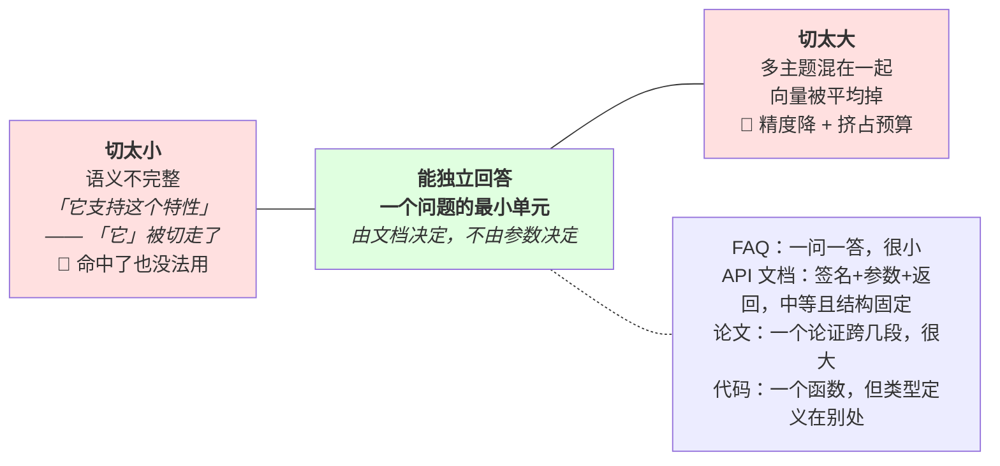
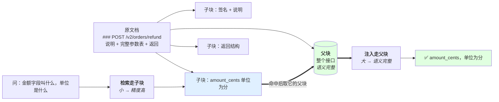
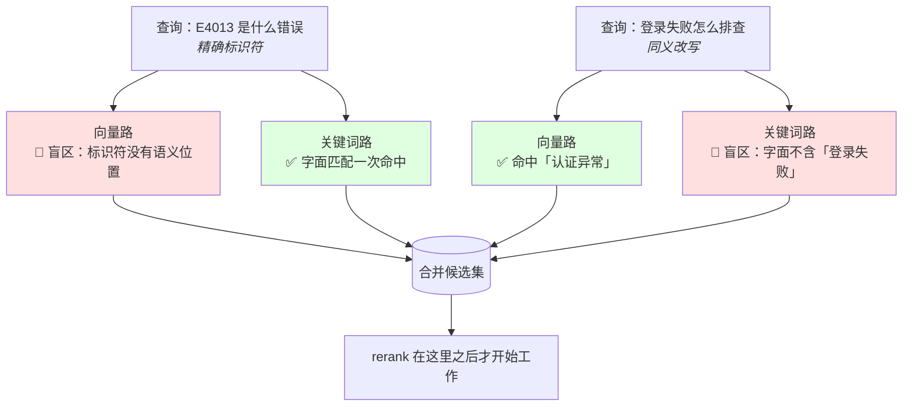
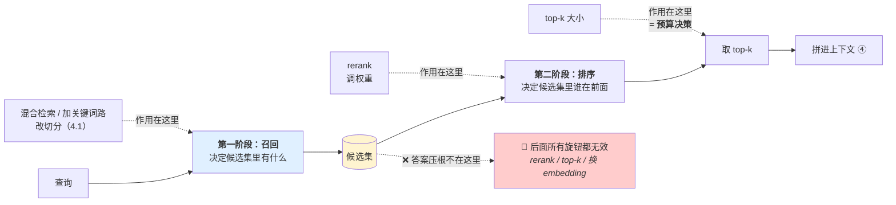
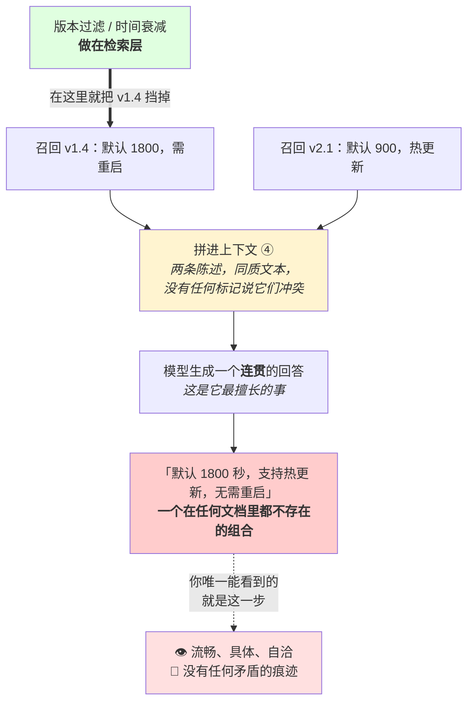
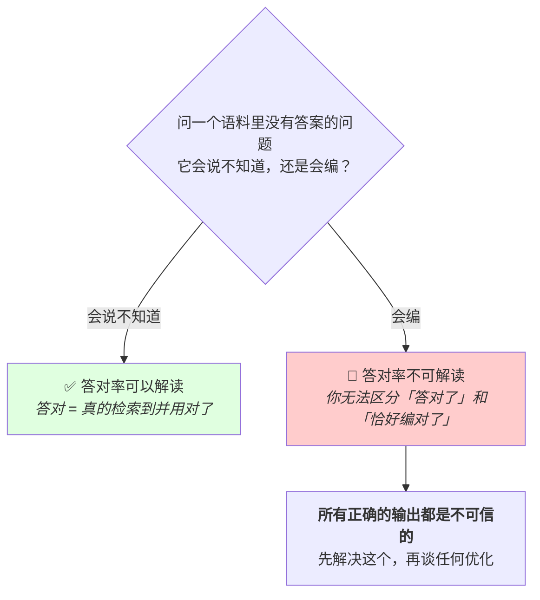
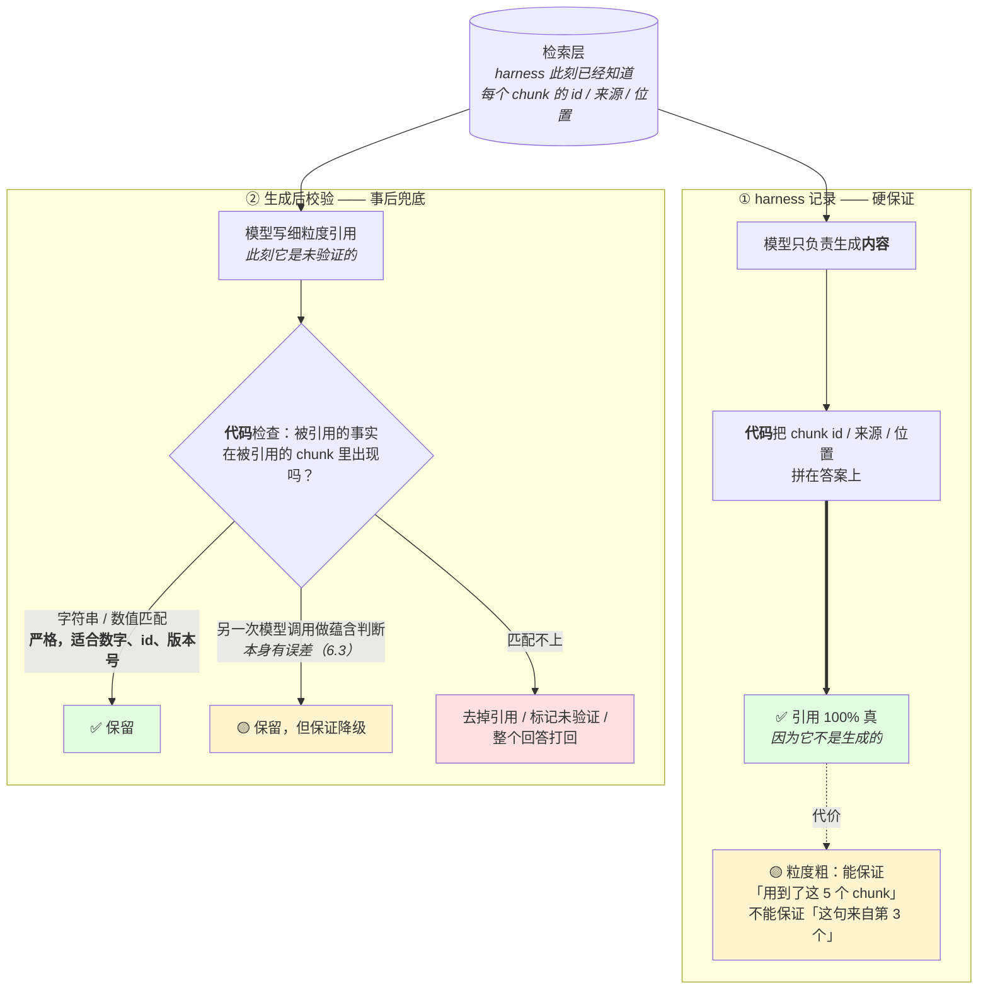
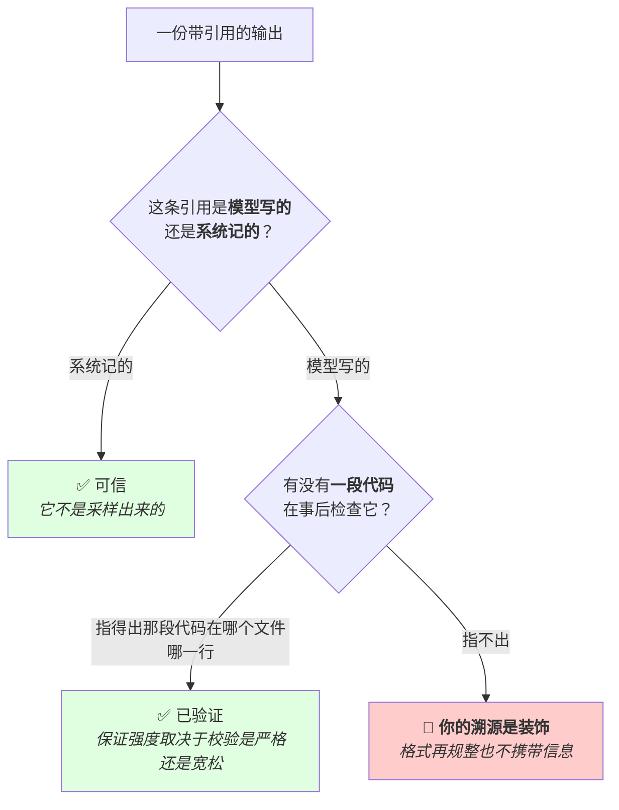
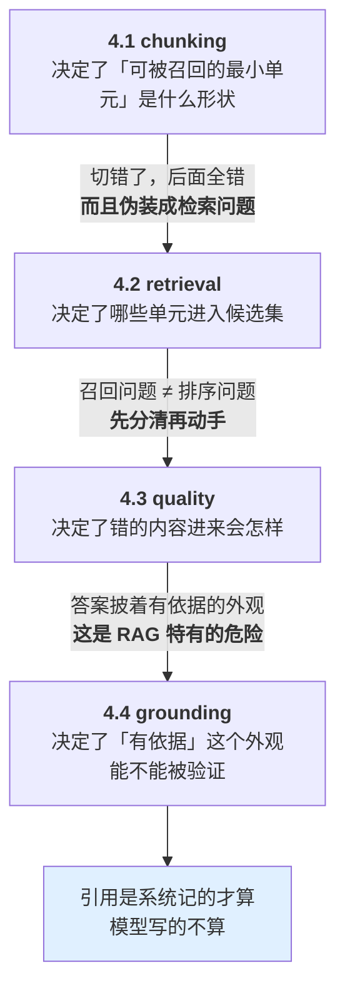
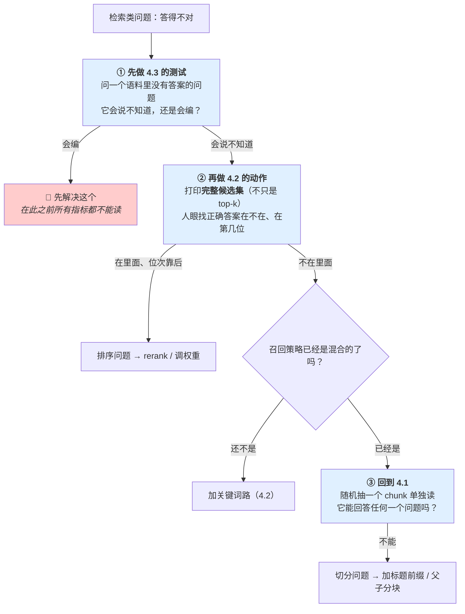

# 第 4 章 检索

> **💡 30 秒速览**
> - 切分没有最优块大小 → 关键是"单独拿出来能不能回答问题"
> - 向量检索和关键词检索各有结构性盲区 → 混合检索是默认配置不是优化项
> - RAG 不解决幻觉，只是把幻觉搬到你更不容易发现的地方
> - 引用必须由系统记录，不能靠模型自述 → 模型编引用和编事实是同一个动作

检索给上下文的第 ④ 块供货（2.1）。所以检索的每个失败都会直接变成正确性问题 —— 召回漏了等于信息不存在（1.4），召回错了等于污染（2.4）。

**这一章你全部未测。**

四个知识点：`agent.rag.chunking` / `agent.rag.retrieval` / `agent.rag.quality` / `agent.rag.grounding`。

---

## 4.1 agent.rag.chunking —— 文档切分

### 结论

切分是**两头受夹**的取舍，没有普适最优块大小 —— 因为最优取决于「一个能回答问题的最小单元有多大」，那是文档的属性，不是参数的属性。

### 案例：那份被切成三段的接口文档

一份内部 API 文档，按 512 字符切分，无重叠。其中一个接口的原文是这样的：

```markdown
### POST /v2/orders/refund

发起退款。仅支持已完成支付的订单。

| 参数 | 类型 | 必填 | 说明 |
|---|---|---|---|
| order_no | string | 是 | 订单号，注意不是订单 id |
| amount_cents | integer | 是 | 退款金额，**单位为分** |
| reason_code | integer | 否 | 见附录 B |

返回：{ "refund_no": "...", "state": "PENDING" }
```

按 512 字符切下来，它变成了：

| chunk | 内容 |
|---|---|
| `#211` | `### POST /v2/orders/refund` + 「发起退款。仅支持已完成支付的订单。」+ 表头 + `order_no` 那一行 |
| `#212` | `\| amount_cents \| integer \| 是 \| 退款金额，**单位为分** \|` + `reason_code` 那一行（**没有标题，没有表头**） |
| `#213` | `返回：{ "refund_no": ... }` + 下一个接口的标题 |

有人问：「退款接口的金额字段叫什么，单位是什么？」

检索召回了 `#211`（相似度最高 —— 它包含「退款接口」这几个字）。模型基于它回答：

> 退款接口 `POST /v2/orders/refund` 的金额参数为 `amount`，单位为元。

**两个字段都错了。** 正确答案在 `#212` 里，但 `#212` 里没有「退款」「refund」「接口」任何一个词 —— **它是一段无主的表格残片，向量表示接近于噪声，任何关于这个接口的提问都召回不到它。**

**这个案例要记住的有三层，第三层最重要：**

1. **`#212` 事实上从索引里消失了。** 它在库里，能被存储层查到，但检索不到 —— 和 2.3 的「存储里有 ≠ 上下文里有」是同一件事，只是这次的原因在切分。
2. **答错的那两个值都是编的**，而且编得很合理（`amount` / 元 是最常见的写法）。模型手里只有 `#211`，`#211` 里确实没有金额字段 —— 但它没有「我不知道」的出口（1.3）。
3. **现场看起来完全像检索问题：** 召回命中了正确的文档、相似度分数很高、排序也没错。**你会去调 top-k、加 rerank、换 embedding 模型 —— 全都没用**，因为答案根本不在任何一个可被召回的 chunk 里。

**验证只需要一个动作，不需要评测集：把 `#212` 单独拿出来读一遍。** 它能回答任何一个问题吗？不能。切分的问题在这一步就暴露了，而它比调三轮检索参数快得多。

### 机制

🎯 **把一本书撕成碎片放进抽屉** —— 撕太碎，单张纸上的话不成句（"它支持这个特性"——"它"是谁？在另一张碎片上）；撕太大，一张纸上混着三个话题，你想找退款规则时连带翻了一堆发货说明。

**两头的代价：**

| | 后果 |
|---|---|
| **切太小** | 单个 chunk 语义不完整。「它支持这个特性」—— 「它」是谁？在被切走的上一段里。检索命中了也没法用 |
| **切太大** | 一个 chunk 里混了多个主题，向量表示被平均掉，检索精度下降；命中后注入的无关内容还挤占预算 |

**为什么没有普适答案：** 最优块大小 ≈ 「能独立回答一个问题的最小单元」。这个单元的大小由文档决定：

- FAQ：一问一答就是一个单元，很小
- API 文档：一个接口 = 签名 + 参数 + 返回 + 示例，是一个单元，中等且**结构固定**
- 论文：一个论证可能跨几段，很大
- 代码：一个函数是一个单元，但它依赖的类型定义在别处

所以「chunk 512 token」这种答案的问题不是数字错，是**它回答的不是这个问题**。

**结构化文档不能按字符数切。** 一个 markdown 表格切一半、一个代码块切一半、一份 API 文档把参数表和签名切开 —— 得到的 chunk 语义上是垃圾，但检索系统不会告诉你。按结构切（标题层级、函数边界、表格边界）优先于按长度切。

**三个常用补丁：**

1. **重叠（overlap）** —— 相邻 chunk 共享一段。缓解边界处的语义断裂。代价是存储和检索结果的冗余
2. **父子（parent-child）** —— 用小 chunk 做检索（精度高），命中后返回它所属的大块（语义完整）。**通常是最优解**，因为它把「检索要小」和「使用要大」这对矛盾拆开了
3. **标题前缀** —— 每个 chunk 前面拼上它的文档标题和章节路径。极便宜，效果明显 —— 因为它把「它」「该方法」这类指代的上下文补回来了

**两头受夹，而那个「最优点」不在参数里：**



**「chunk 512」这个答案的问题不是数字选错了，是它站在这条轴上找答案，而最优点根本不在这条轴上** —— 它在右边那个方框里，是你的文档的属性。

**父子分块把那对矛盾拆开：**



**关键在那条粗箭头：检索的单位和注入的单位不再是同一个东西。** 「检索要小」和「使用要大」原本是一对必须二选一的矛盾，父子分块让它们各拿各要的 —— 这就是它通常优于调块大小的原因。

回到案例，三个补丁分别修的是不同的地方：**标题前缀**让 `#212` 带上「POST /v2/orders/refund」于是能被召回；**重叠**让表头不至于完全丢掉；**父子**则让 `#212` 命中后把整个接口一起交给模型。**只有第三个真正修掉了根因。**

### 误解靶子

**错答一：「chunk 大小设成 512 就行 / 调一下 chunk 大小。」**

把一个结构问题答成了参数问题。同一份 chunk size 在 FAQ 上很好、在论文上很差，而你不会知道，因为切分没有报错这个概念。

**错答二：「切小一点召回率高。」**

切小提高的是「命中某个片段」的概率，但命中一个语义不完整的片段等于没命中 —— 它进了上下文却回答不了问题，还占预算。召回率的分子应该是「能回答问题的命中」。

**错答三：「切分是预处理，做一次就行，问题都在检索侧。」**

切分的错误会**伪装成检索错误**。检索排序看起来正常、命中的 chunk 也「相关」，但就是答不好 —— 根因在切分。而你会一直在调 top-k 和 rerank。

### 判据

> **随机抽一个 chunk 单独读它（不看前后），它能回答任何一个问题吗？**

不能 → 切太小，或者缺标题前缀。

> **随机抽一个 chunk，它里面有几个主题？**

超过一个 → 切太大。

这两条一起用，比调参数有效得多，而且**不需要评测集就能做**。

### 自测题

1. 为什么不存在普适最优的 chunk 大小？最优由什么决定？
2. 「切小一点召回率高」哪里错了？召回率的分子应该怎么定义？
3. 一份 API 文档按 512 字符切，会出现什么具体问题？该怎么切？
4. 父子分块解决了哪一对矛盾？为什么它通常优于单纯调块大小？
5. 切分不好造成的故障，为什么会被误诊成检索问题？

<details>
<summary>💡 卡住了？看一个提示</summary>

第 1 题：机制段"为什么没有普适答案"那四个例子。第 2 题：机制段"切太小"那行。第 3 题：案例段那张 chunk 表。第 4 题：机制段"父子分块"那张图的粗箭头。第 5 题：误解靶子错答三。
</details>

---

*切分决定了"库里有什么"。接下来看检索：怎么从库里把对的东西捞出来？*

## 4.2 agent.rag.retrieval —— 召回策略

### 结论

向量检索和关键词检索各有**结构性盲区**，不是精度差别。rerank 改的是**排序**，不改召回。top-k 是一个预算决策。

### 案例：E4013 查了三个星期

内部文档助手，纯向量检索，top-k=5。用户问：

> E4013 是什么错误？

召回的五条：

```
1  《错误处理最佳实践》          相似度 0.81
2  《常见错误码说明（总览）》     相似度 0.79
3  《客户端异常上报规范》         相似度 0.77
4  《服务端错误分级定义》         相似度 0.76
5  《错误重试策略》              相似度 0.74
```

**五条全部相关，相似度全部很高，没有一条包含 `E4013`。** 模型基于它们回答：

> E4013 属于服务端 4xx 类错误，通常表示请求参数校验失败，建议检查请求体格式。

编的。真实的 `E4013` 是「支付渠道限额」，写在《渠道错误码对照表》里，那一条从头到尾没出现在候选集里。

**团队的三轮尝试：**

| 尝试 | 想法 | 结果 |
|---|---|---|
| 第一周：加 rerank | 「相关的排太后了，重排一下」 | ❌ 完全无效 |
| 第二周：top-k 5 → 20 | 「多召一点总能召到」 | ❌ 仍无 `E4013`，但上下文涨了 4 倍，模型开始给出更长、更自信、同样错误的回答 |
| 第三周：换了个更强的 embedding 模型 | 「向量不够好」 | ❌ 五条换成了另外五条讲错误处理的文档 |

**第三周末，有人做了一个动作：把第一阶段召回的完整候选集打出来（不只是 top-k），人眼找 `E4013` 在第几位。**

答案是：**不在里面。任何一位都不在。**

到这一步，前三周的方向全部被排除掉了 —— **rerank、top-k、embedding 模型这三个旋钮全都作用在「候选集内部的排序」上，而问题在「候选集之外」。**

**为什么向量检索必然查不到它：** `E4013` 是一个标识符，它在向量空间里没有有意义的位置。「E4013」和「E4014」字面上差一个字符，语义上可能是完全无关的两个错误；而「E4013」和「错误码」在向量空间里也不见得比「E4013」和「E4013」之外的任何 token 更近。**这不是精度不够，是这类查询落在向量检索的结构性盲区里。**

修法是加一条关键词/BM25 召回路 —— `E4013` 是精确字符串，字面匹配一次就命中。**混合检索之后这个问题当天就没了。**

**这个案例要记住的是那个诊断动作，而不是那个修法：** 「答案排在第 30 位」和「答案压根不在候选集里」，**在最终输出上表现完全一样**（都是答错），但修法毫无重叠。三个星期的代价全部来自跳过了这一次分辨。

而且注意第二周那一行 —— **top-k 调大让输出变得更糟了，但任何检索指标上都看不出来。**

### 机制

🎯 **向量检索像按"感觉像"找东西，关键词检索像按"字面写着"找东西** —— 你找错误码 E4013，前者给你一堆"讲错误处理的文章"（感觉像），后者直接定位到写着 E4013 那一行。反过来，你找"登录失败怎么办"，后者找不到写着"认证异常"的文档，前者能。两把钥匙各开各的锁。

**向量检索的盲区（不是调优能解决的）：**

- **精确匹配。** 错误码 `E4013`、变量名 `userIdV2`、版本号 `1.4.2` —— 这些在向量空间里没有有意义的位置。相近的字符串可能距离很远，不相关的可能很近
- **否定和反义。** 「支持 X」和「不支持 X」在向量空间里是近邻，因为它们讨论同一件事。这是最危险的一条 —— 检索出反义内容，模型会照着答
- **数值和比较。** 「大于 100 的」这种约束向量表示不了

**关键词检索的盲区：**

- **同义改写。** 查「登录失败」，文档里写「认证异常」，命中不了
- **跨语言。** 中文查、英文文档
- **语义泛化。** 查「性能问题」，文档里写「响应时间 3 秒」

**所以混合检索（向量 + 关键词）是默认选择**，不是优化项。两者的盲区几乎不重叠。

**两条路各补对方的洞：**



**注意每一行都有一个红一个绿，而且位置正好相反。** 这就是「盲区几乎不重叠」的实际含义 —— 也是为什么它是默认配置而不是优化项：单走任一条路，你都会稳定地漏掉一整类查询，而那一类查询恰好在真实场景里很常见（查错误码、查是否支持）。

**rerank 改排序不改召回。** rerank 拿到的是第一阶段召回的候选集。**不在候选集里的东西，rerank 变不出来。** 所以：

- 问题是「答案排在第 30 位」→ rerank 有用
- 问题是「答案根本没被召回」→ rerank 毫无用处，要改的是召回（换策略、加关键词路、扩大 top-k、改切分）

这两种情况**在最终输出上表现一样**（都是答不对），所以必须分开诊断。

**top-k 是预算决策，不是精度旋钮。** 每个召回结果都要拼进上下文（第 ④ 块），所以 top-k 直接换算成 token 占用和注意力稀释（2.1）。top-k 从 5 加到 20，召回率上升，但：

- 上下文占用翻 4 倍
- 15 个无关内容稀释注意力
- 其中可能有内容和正确答案矛盾（4.3）

**「多召回一点没坏处」是错的。** 有坏处，坏处在别的地方。

**每个旋钮作用在哪一段 —— 这张图能省下三个星期：**



**排查的第一个动作就是这张图上的一个位置：把 `候选集` 整个打印出来，人眼找正确答案在第几位。** 在里面 → 往右修（排序）；不在里面 → 往左修（召回和切分）。**不做这个分辨，你就是在随机试旋钮。**

### 误解靶子

**错答一：「用向量检索就够了，语义比关键词强。」**

强弱不是维度，盲区才是。精确标识符、否定语义这两个盲区在真实场景里极常见（查错误码、查「是否支持」）。

**错答二：「召回不好就加 rerank。」**

先分清是召回问题还是排序问题。召回问题加 rerank 是纯粹的无效工作，而且会消耗掉你排查的耐心。

**错答三：「top-k 调大一点，反正模型会挑。」**

模型不挑（2.1）。调大 top-k 的代价出现在上下文预算和污染上，不出现在检索指标上 —— 所以你看指标会觉得变好了。

### 判据

> **你的问题是召回还是排序？—— 正确答案是「排在第 30 位」还是「压根不在候选集里」？**

这是检索排查的第一个动作：**把召回的完整候选集（不只是 top-k）打印出来，人眼找正确答案在不在里面、在第几位。**

在里面、位次靠后 → 排序问题 → rerank / 调权重
不在里面 → 召回问题 → 换策略 / 加关键词路 / 回去看切分（4.1）

> **top-k 调大之后，上下文第 ④ 块占多少？**

答不出来 → 你在用一个不知道代价的旋钮。

### 自测题

1. 向量检索的三个结构性盲区是什么？哪一个最危险、为什么？
2. 为什么混合检索是默认选择而不是优化项？
3. rerank 能解决什么、不能解决什么？怎么判断你的问题属于哪一类？
4. 「top-k 从 5 调到 20，反正模型会挑」—— 列出三个代价。
5. 用户查「E4013 是什么错误」，纯向量检索召回了一堆讲错误处理的通用文档。诊断和修法。

<details>
<summary>💡 卡住了？看一个提示</summary>

第 1 题：机制段"向量检索的盲区"三条。第 2 题：那张"每行一红一绿"的对比图。第 3 题：机制段"rerank 改排序不改召回"。第 4 题：机制段"top-k 是预算决策"。第 5 题：判据段的第一个动作。
</details>

---

*召回策略解决的是"能不能找到"。但找到了不等于对了 —— 如果找到的内容本身是错的呢？*

## 4.3 agent.rag.quality —— 检索质量

### 结论

**检索错了，模型不会说「检索错了」—— 它会用错的内容给你一个答案，而这个答案披着「有依据」的外观。**

### 案例：那个被揉平的矛盾

文档库里有两份文档，都在库里，都没人删：

**《配置手册 v1.4》**（2024 年，仍在索引里）

> `session.timeout` 默认值为 `1800`（秒）。修改后需重启服务生效。

**《配置手册 v2.1》**（当前版本）

> `session.timeout` 默认值为 `900`（秒）。**该配置在 v2.0 起支持热更新，不需要重启。**

有人问：「session.timeout 默认多少，改了要重启吗？」

召回结果（top-k=5）里两份都在，v1.4 那条相似度还更高一点 —— 它的措辞和问题更接近。

模型的回答：

> `session.timeout` 的默认值为 1800 秒。修改该配置后支持热更新，无需重启服务。

**读一遍这个回答：它流畅、具体、直接、没有任何犹豫，而且完全自洽。**

它错在**它把两份文档各取了一半** —— 默认值取了 v1.4 的（1800，已经过期），生效方式取了 v2.1 的（热更新，正确）。**这个组合在任何一份文档里都不存在。**

运维照着改了配置、没重启。生产上会话行为和预期不符，排查了一下午。

**这个案例里最值得记的一件事：** 回过头看输出，**你看不到矛盾曾经存在过**。模型没有说「文档里有两个不同的值」，没有说「以下信息可能来自不同版本」，也没有表现出任何不确定。

它不是隐瞒。**它就是这么工作的** —— 上下文里的一切都是同质文本（2.4），两条冲突的陈述在它看来不是「冲突」，是两块需要被整合成一个连贯回答的材料。**「生成一个自洽的答案」这件事，它做得非常好。**

**所以这类故障的可观测性是负的：**

| | 裸模型编造 | 这次 |
|---|---|---|
| 措辞 | 笼统、可能自我矛盾 | 具体、自洽 |
| 有依据吗 | 没有 | **有，而且依据真实存在** |
| 你的直觉会警惕吗 | 会 | **不会** |

**并且它一定会重复发生。** 只要 v1.4 还在索引里，每一次关于这个配置的提问都可能重演，而且每次的组合方式可能不同 —— 这不是一次偶发错误，是一个稳定的、静默的故障源。

修法不在模型侧：**版本过滤或时间衰减要做在检索层**（只召回当前版本，或对旧版本降权），而不是指望模型报告矛盾。它不会报告。

### 机制

🎯 **RAG 幻觉像一个带了错误参考书进考场的学生** —— 裸考的学生编答案你一眼看出来（太笼统、自相矛盾），带了参考书的学生抄了错误的内容给你，格式规范、引用齐全、逻辑通顺，你反而更难发现他错了。

这一节是全章最重要的一节，因为它讲的是**RAG 特有的、比裸模型更危险的失败形态**。

**裸模型幻觉 vs RAG 幻觉：**

| | 表现 | 可疑度 |
|---|---|---|
| 裸模型编造 | 说得笼统、可能自我矛盾 | 有经验的人会警惕 |
| RAG 基于错内容生成 | 说得具体、有引用、格式规整、逻辑一致 | **看起来最可信** |

后者更难发现，因为「有依据」这个外观是真的（真有检索结果），只是依据是错的。**你的直觉检验在这里失效。**

**高召回低精度的双重代价：**

召回 20 条里有 1 条对的、19 条无关的，不是「至少召回了」：

1. **稀释** —— 19 条无关内容占据上下文，正确那条可能落在中段（1.2 lost in the middle）
2. **污染** —— 无关内容里的表述会被当成前提继承（2.4）

**矛盾来源会被静默消解。** 召回结果里有两条互相冲突（老版本文档 + 新版本文档、两个环境的不同配置），模型不会说「这里有矛盾」。它会选一个，或者把两个揉成一个看起来自洽的答案。**你在输出里看不到矛盾曾经存在。**

这是文档库有历史版本时最常见的故障，而且它会稳定地、静默地发生。

**矛盾在哪一步消失的：**



**这张图里你能观测到的只有最右下角那一格。** 中间三步全部发生在你看不见的地方，而且没有任何一步报错。所以治理必须往左走 —— 在矛盾进入上下文之前就把它解决掉，因为一旦进去，它消失得无声无息。

**没有答案时的行为是最重要的测试点。** 语料里根本没有答案，检索仍然会返回 top-k（它总能返回最相近的 k 条）。模型拿到 k 条不相关内容，最可能的行为是**基于它们编一个答案** —— 因为没有「我不知道」的自然出口（1.3）。

所以：**RAG 系统的第一个测试不是「能不能答对」，是「语料里没有时会不会编」。**

**语料里没有答案时，这条链上没有一处会说「没有」：**


**为什么这个测试必须排在答对率之前：**



**「答对率 85%」这个数字本身不携带信息，它的可解读性取决于上面那个分岔。** 如果系统在没有答案时会编，那 85% 里有多少是编对的，你没有办法知道 —— 而这恰好是最容易被跳过的一次检查，因为它测的不是「好」，是「诚实」。

### 误解靶子

**错答一：「加了 RAG 就没有幻觉了。」**

形态变了，危险度上升了。RAG 把「明显的编造」变成「披着依据外观的编造」。

**错答二：「多召回一点，宁可召回冗余也不要漏。」**

冗余的代价是稀释 + 污染，都是不报错的。这条思路在搜索引擎场景成立（人会挑），在 RAG 场景不成立（模型不挑）。

**错答三：「答案里引用了文档，所以是有依据的。」**

依据可能是错的文档，引用本身可能是编的（4.4）。「有引用」这个信号在 RAG 里几乎不携带信息。

### 判据

> **问一个语料里没有答案的问题，它会说不知道，还是会编？**

会编 → 在做任何优化之前先解决这个。因为这意味着**你的系统所有正确的输出都是不可信的** —— 你无法区分「答对了」和「恰好编对了」。

> **召回结果里如果有两条互相矛盾，我在输出里看得出来吗？**

看不出来 → 需要在 harness 层做矛盾检测或版本过滤，不能指望模型报告。

### 自测题

1. RAG 幻觉为什么比裸模型幻觉更难发现？
2. 「宁可召回冗余不要漏」在什么场景成立、在 RAG 里为什么不成立？
3. 召回结果里有一条老版本文档和一条新版本文档，内容冲突。模型会怎么做？你在输出里能看到什么？
4. 为什么「语料里没有答案时的行为」是 RAG 的第一个测试点、而不是「答对率」？
5. 你的 RAG 系统答对率 85%。为什么在做完第 4 题那个测试之前，这个数字不能解读？

<details>
<summary>💡 卡住了？看一个提示</summary>

第 1 题：机制段那张"裸模型 vs RAG"的表格。第 2 题：误解靶子错答二——想想"人会挑"和"模型不挑"。第 3 题：案例段"那个被揉平的矛盾"。第 4 题：机制段最后那张分岔图。第 5 题：同一张图的右边那条路。
</details>

---

*检索质量影响的是内容对不对。而用户看到的"引用"本身，也需要被验证 ——*

## 4.4 agent.rag.grounding —— 溯源与引用

### 结论

**引用是生成出来的，所以引用也会被编造。** 可信的溯源必须由系统记录，不能由模型自述。

### 案例：那个过了三层评审的引用编号

一个合规问答系统，回答内部数据留存政策的问题。这次的问题是「日志的最短留存期是多久」。

它的输出：

> 根据现行政策，应用日志的最短留存期为 **180 天**，审计日志为 **3 年**。
> [来源: `policy_2024_v3.md`, 第 4.2 节]
> [来源: `audit_baseline.md`, 第 2 节]

这份回答进了一份对外合规材料，过了三层评审。三层里没有一个人去打开 `policy_2024_v3.md` 的第 4.2 节。

后来出了问题，有人去查了。四条引用事实的真实情况：

| 输出里的内容 | 实际情况 |
|---|---|
| `policy_2024_v3.md` | 真实存在，检索时确实召回了 |
| 第 4.2 节 | 该文件只到第 3 节。**位置是编的** |
| 180 天 | 文档里写的是 **90 天**。数字是编的 |
| `audit_baseline.md`, 第 2 节 | **这个文件在语料里不存在。** 整条引用是编的 |
| 3 年 | 无来源。是模型从「审计日志通常留存更久」推出来的 |

**为什么三层评审都没拦住：** 因为这段输出的格式没有任何问题。文件名符合命名规范（`policy_年份_版本.md`），节号格式正确（`4.2` 而不是 `4.2.x.y`），两条引用分行对齐，粗体标注了关键数字。它看起来比一个只写「根据政策文档」的回答**更专业、更可核查**。

而「更可核查」这个观感，恰恰让人不去核查了 —— 有具体编号的东西，读者会默认它是从某处抄来的。

**这个案例要记住的是三层：**

**① 编造的形态是分级的，危险度不一样。**

- 编一个不存在的文件（`audit_baseline.md`）—— **最容易被发现**，一 grep 就没了
- 编一个真实文件的错误位置（第 4.2 节）—— 需要打开文件才发现
- 引真实文件，但把里面的数字改了（90 → 180）—— **最难发现**，因为文件在、章节在，只有那个数字不对

危险度和可发现性正好相反。你最可能漏掉的，正是代价最高的那一种。

**② 格式质量和真实性无关，甚至负相关。** 格式是生成模型最擅长的部分 —— 让它写一个「看起来像引用编号的字符串」，它的成功率接近 100%。所以格式完美是「这是生成的」的证据，不是「这是真的」的证据。

**③ 唯一有意义的问题不是「这条引用对不对」，是「这条引用是谁写的」。** 如果 `policy_2024_v3.md` 这个 id 是 harness 在检索时记下来、由代码拼上去的，那它一定存在 —— 因为它不是采样出来的。如果是模型写的，那它和「180 天」这个数字是同一次生成的产物，可信度完全相同（也就是：没有）。

在这个案例里，两条引用都是模型写的。所以在打开文件之前，你就该知道它们**未经验证** —— 不需要等到出问题。

### 机制

🎯 **模型编引用就像一个学生编参考文献** —— 格式完美、期刊名真实存在、页码看起来合理，但那篇论文根本不存在。编一个 `[doc_id: 847, line: 23]` 和编一个事实，对模型来说是完全一样的动作。

模型输出 `[来源: doc_47, 第 3 节]` 时，它在做的是「采样一串看起来像引用的 token」。和填工具参数（3.1）、和幻觉（1.3）是同一个动作。所以：

- 引用一个不存在的文档 id
- 引用一个真实存在但没说过这话的文档
- 引用真实文档的错误位置
- 把两个来源的内容混起来，只标一个

**这些错误的共同点：格式完美、看起来极可信。** 一个格式规整的引用编号是幻觉最容易通过检查的形态。

**两条真正的做法：**

**① harness 记录，不让模型写**

检索时 harness 已经知道每个 chunk 的 id、来源、位置。把这些**由代码**附在答案上，模型只负责生成内容。这样引用是 100% 真的 —— 因为它不是生成的。

代价：粒度粗。你能保证「这个回答用到了这 5 个 chunk」，不能保证「这句话来自第 3 个 chunk」。

**② 生成后校验**

允许模型写细粒度引用，但**生成之后由代码检查**：被引用的事实在被引用的 chunk 里出现吗？

- 严格做法：字符串/数值匹配（适合数字、标识符、版本号 —— 也正是错误代价最高的那些）
- 宽松做法：用另一次模型调用做蕴含判断（本身也有误差，见 6.3）

校验失败 → 去掉那条引用，或标记为未验证，或整个回答打回。

**两条可以叠加：** 粗粒度由系统保证（一定对），细粒度由校验兜底（有问题就摘掉）。

**两条做法的保证强度不一样，图上一眼能看出来：**



**注意 ① 里那根实线箭头和 ② 里那个菱形的区别。** ① 是「引用不经过生成」，所以不需要检查；② 是「引用经过了生成，所以必须检查」。两条路都可用，但它们保证的东西不同：① 保证引用存在，② 保证引用没说谎。案例里那份材料两条都没有 —— 引用是模型写的，也没有任何代码事后看过它。

**面对一份带引用的输出，只需要走这两步：**



**这张图里没有一格在问「这条引用对不对」。** 因为那个问题需要打开文档才能答，而这两问都只需要看你自己的代码 —— 三秒钟就能走完，而且在出问题之前就能走。这是它比人工抽查更有用的地方：抽查只能覆盖你抽到的那几条，这两问覆盖的是全部输出。

**关键分辨：** 面对一份带引用的输出，唯一有意义的问题是 **这个引用是模型写的还是系统记的**。前者不携带可信度信息，后者是硬保证。

### 误解靶子

**错答一：「要求模型只引用检索到的内容就行。」**

prompt 是输入不是检查点（3.1）。这条降低编造率，不建立保证。

**错答二：「引用格式规范说明是真的。」**

格式规范是生成模型最擅长的部分。格式和真实性正交 —— 甚至负相关，因为格式完美的假引用不会被人工抽查抓到。

**错答三：「让模型自己检查引用对不对。」**

同一次生成里做不到（1.1）。独立一轮可以做，但那就是「生成后校验」的宽松版，有误差，且要计入 6.3 的判官偏差。

### 判据

> **这条引用是模型写出来的，还是系统记下来的？**

模型写的 → 未验证，不能当依据用。
系统记的 → 可信。

> **如果引用是模型写的，有没有一段代码在事后检查它？**

指不出那段代码 → 你的溯源是装饰。

### 自测题

1. 为什么引用会被编造？和幻觉、和工具参数编造是同一个机制吗？
2. harness 记录 vs 生成后校验，各自的保证强度和局限是什么？
3. 为什么「引用格式规范」这个信号毫无价值、甚至有害？
4. 一份报告里的数字带着精确的引用编号。你只能做一个检查来判断它可信，做什么？

<details>
<summary>💡 卡住了？看一个提示</summary>

第 1 题：机制段"编引用和编事实是同一个动作"。第 2 题：机制段"系统侧溯源"。第 3 题：想想引用作为链接进入上下文后会发生什么（2.4）。第 4 题：判据段的两条。
</details>

---

## 本章小结

四点的因果链：



**注意这条链是单向的：上游的错误会伪装成下游的现象，反过来不会。** 所以看到「检索不准」这个症状时，它可能来自四点里的任何一点 —— 这就是下面那个排查顺序存在的理由。

**排查顺序（重要）：** 检索类问题**从后往前**查更快 ——



**三个蓝色格子都是动作，不是判断。** 它们的共同点是不需要评测集、不需要改代码、当天就能做完 —— 而三个案例（E4013 查了三个星期、被切成三段的接口文档、被揉平的矛盾）都是因为跳过了其中某一步，去调了一个旋钮。

**和前面章节的连接：** 检索结果是上下文第 ④ 块（2.1），所以 top-k 是预算决策；召回的错误内容会被当前提继承（2.4），所以低精度就是污染源；模型没有「我不知道」出口（1.3），所以「没答案时的行为」必须显式测。
