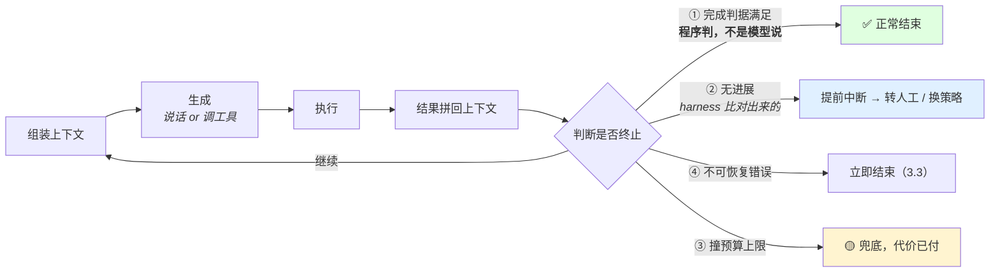
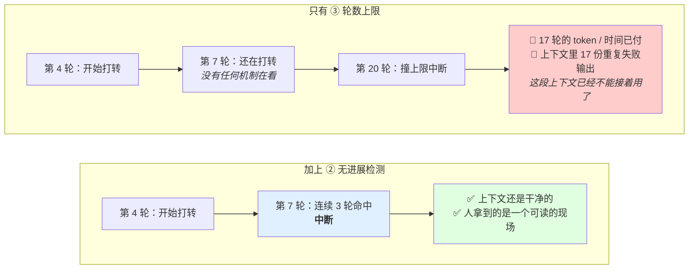
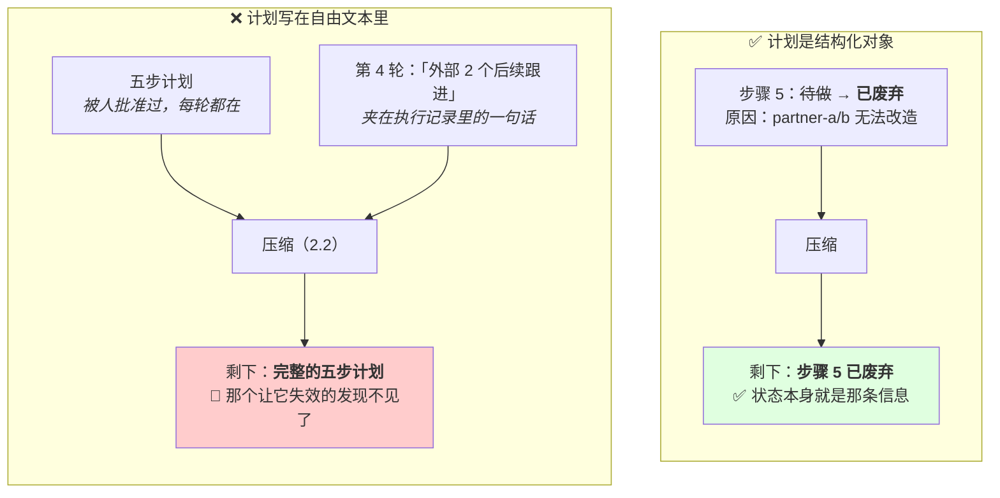
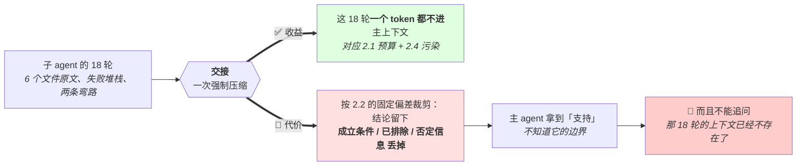
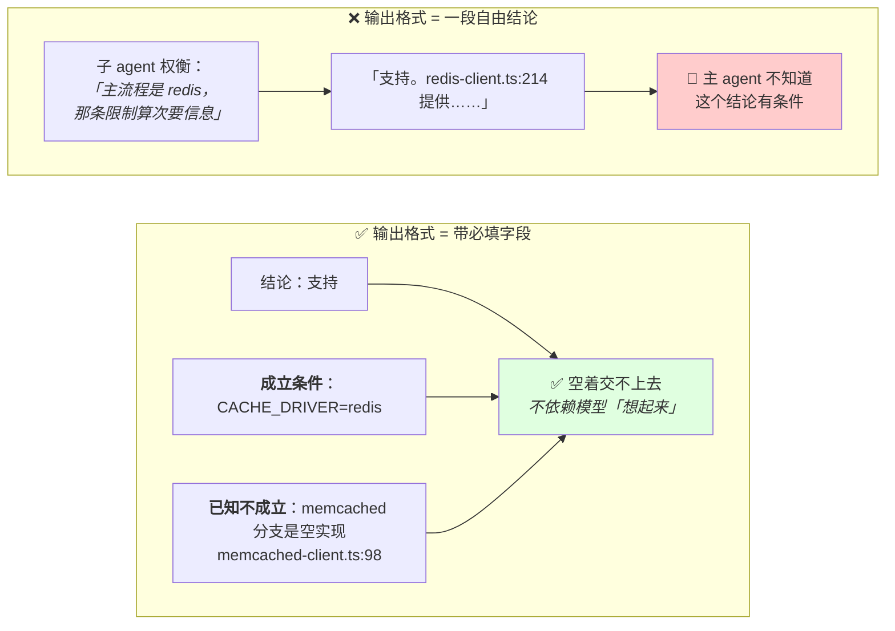
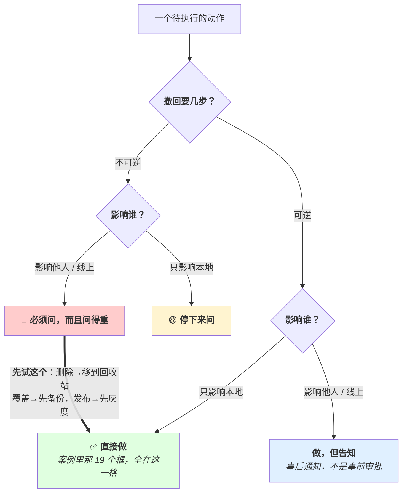
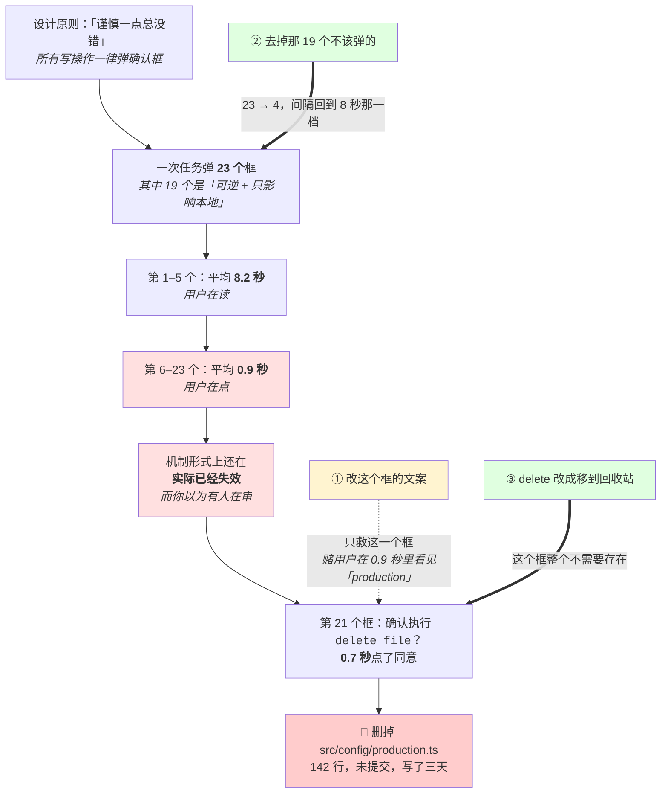
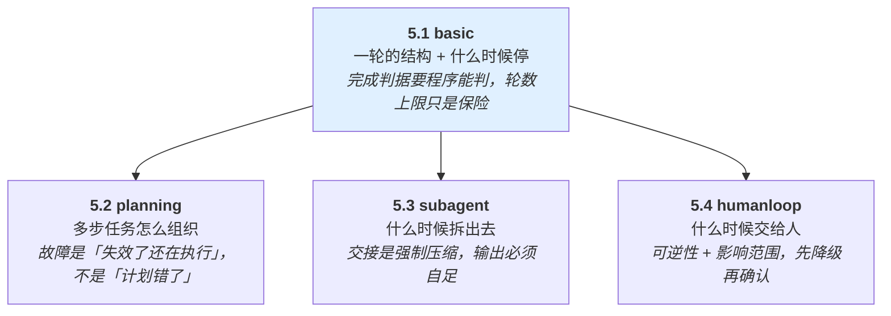
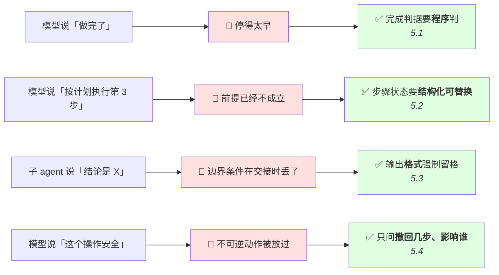

# 第 5 章 Agent 循环

> **💡 30 秒速览**
> - 循环的理由是"下一步依赖上一步的真实结果" → 终止条件 ≠ 轮数上限
> - 计划的最常见故障不是"计划错了"，是"失效了还在执行"
> - 子 agent 换来上下文隔离，代价是交接处的信息损失（方向性的，丢条件留结论）
> - 人在环的插入点按可逆性 + 影响范围决定 → 确认太密比不确认更危险

前四章讲的是「一轮里能做对什么」。这一章讲**多轮**：什么时候该继续、什么时候该停、什么时候该拆、什么时候该问人。

**这一章你全部未测。**

四个知识点：`agent.loop.basic` / `agent.loop.planning` / `agent.loop.subagent` / `agent.loop.humanloop`。

---

## 5.1 agent.loop.basic —— 基本循环

### 结论

循环存在的理由是**下一步依赖上一步的真实结果**。终止不是「设一个轮数上限」—— 那只是最后一道保险，不是终止条件。

### 案例：同一个任务，先停得太早，再停得太晚

任务：「修好 CI 上失败的那三个测试。」循环的配置只有一样东西 —— **最大轮数 20**。

**第一次跑，它在第 6 轮停了。**

第 6 轮的输出：

> 已修复全部三个失败测试。三处断言的期望值都已更新为实际行为。

任务被标记为完成。但没有人再跑一次 `npm test` —— 因为「完成」的判据就是模型说完成。实际情况是：三个里修好了一个，另外两个仍然失败。

这是缺了 ①（完成判据不可判定）。修法很直接：完成判据改成 `npm test` 退出码为 0，模型说完成不算完成。

**第二次跑，它在第 20 轮撞上限了。**

修好 ① 之后，同一个任务的日志：

| 轮 | 动作 |
|---|---|
| 1-3 | 读测试文件、跑 `npm test`、定位到 `order.spec.ts:88` |
| 4 | 把期望值从 `1500` 改成 `1502`，跑测试，仍失败 |
| 5 | 改成 `1503`，跑测试，仍失败 |
| 6 | 改成 `1501`，跑测试，仍失败 |
| 7-19 | 同样的两个动作，期望值在 `1498`–`1510` 之间来回 |
| 20 | 撞上轮数上限，中断 |

第 4 到第 20 轮，**17 轮**做的是同一件事，工具调用只有一个数字不同。

**这 17 轮的账：** token 和时间之外，更重要的是第 20 轮时上下文里堆了 **17 份几乎一样的测试失败输出**。就算这时候把控制权交给人，这段上下文也已经不能接着用了 —— 它是 2.4 形态②（原地打转）的教科书样本，而轮数上限没有阻止它，只是在它跑完之后把电源拔了。

**第三次跑，加上 ② 之后，它在第 7 轮停了。**

无进展检测的判定是 harness 做的，三条任一命中：连续 3 轮工具调用（名 + 参数）近乎相同、连续 3 轮工具返回内容哈希不变、连续 3 轮没有任何外部状态变化。

第 7 轮命中第一条，中断转人工。人看了一眼就明白：那个测试断言的是一个含真实时钟的计算结果，**改期望值永远修不好**，要改的是测试里的时间注入。

**这个案例要记住的是：① 和 ② 修的是两种相反的病。**

| 缺的是 | 现象 | 你会看到 |
|---|---|---|
| ① 完成判据不可判定 | **停得太早** | 任务标记为成功，但事情没做完 |
| ② 无进展检测 | **停得太晚** | 任务撞上限失败，代价已付掉 |

两种病的最终症状是同一个（任务没做成），但方向正好相反。所以「加个轮数上限」既治不了第一种（它根本不会跑到上限），也治不了第二种（它只在代价付完之后生效）。**轮数上限救的是系统不被拖死，不是这一次任务。**

### 机制

🎯 **像在陌生城市找路** —— 你不能在家把每个路口都规划好，必须走到路口、看了路牌才知道下一步往哪拐。而"走到第20个路口就停下来"不是导航策略，只是防走丢的保底。

**为什么需要多轮：** 单次生成里，模型只能基于已有上文推测世界的状态。它需要真实结果 —— 文件到底存不存在、命令到底报什么错、接口到底返回什么。这些只能通过「执行 → 把结果拼回上下文 → 再生成」拿到。

一轮的结构，以及四个出口：



**注意四个出口的颜色不一样。** ① 是你想要的结束方式，② 是失败时你想要的结束方式，④ 是必须有的，而 ③ 是**你不希望被走到的那一条** —— 每次走到它，都说明前三个出口没能生效。案例里第二次跑就是从 ③ 出去的。

**四种终止，缺一种就会出现特定故障：**

| 终止条件 | 缺了会怎样 |
|---|---|
| **① 完成判据满足** | 不知道什么叫做完，于是做完了还在做，或没做完就停 |
| **② 无进展检测** | 原地打转直到撞上轮数上限（2.4 形态②） |
| **③ 预算上限**（轮数/token/时间/钱） | 失控时没有兜底 |
| **④ 不可恢复错误** | 权限不足这种错，重试 20 轮 |

**① 是最重要也最容易缺的。** 「完成」必须是一个可判定的条件，不是模型说「我做完了」。可判定的例子：

- 测试通过（程序能判）
- 目标文件存在且包含某个字符串（程序能判）
- 所有待办项状态为已完成（程序能判）

不可判定的例子：「用户的需求被满足了」「代码写好了」。

**轮数上限不是终止条件，是保险。** 它能防死循环，但**防不了及时**：

跑到第 20 轮才停，这 20 轮的代价**已经付掉了** —— token 花了、时间花了，更重要的是**上下文已经被 20 轮失败污染**（2.4）。轮数上限救的是系统，不是这一次任务。

所以工程上要的是 ② 无进展检测：连续 N 轮没有新信息、工具参数近乎重复、没有产生任何可观测的状态变化 → 提前中断，转人工或换策略。这个检测能在第 3 轮而不是第 20 轮触发。

**两种机制在时间轴上的差别：**



**两条时间轴上「开始打转」的那一格是完全一样的。** 区别不在于哪个机制更能防止打转 —— 都防不了。区别在于**发现它需要多久**，而这个时长直接换算成付掉的代价。所以 ② 不是 ③ 的加强版，它是唯一能把代价控制在个位数轮次的机制。

**「无进展」怎么可判定：** 不是靠模型自省，是靠 harness 比对 ——

- 本轮的工具调用（名 + 参数）和前 N 轮之一是否近乎相同
- 本轮是否产生了任何新的工具返回内容（哈希对比）
- 是否有任何外部状态变化（文件、接口、待办项）

### 误解靶子

**错答一：「设一个最大轮数就行了。」**

只答了 ③。而且把保险当成了终止条件 —— 这意味着系统的正常终止路径是「撞上限」，那 20 轮的浪费和污染每次都会发生。

**错答二：「模型说做完了就是做完了。」**

模型判断自己是否完成的准确度不高，而且它有倾向说完成（那是流畅的续写）。完成判据要程序能判。

**错答三：「循环就是反复调模型直到成功。」**

漏了「失败也要终止」这一半。不可恢复错误、无进展、超预算，都是必须终止的路径。

### 判据

> **这个任务的「完成」，程序能不能判？**

不能 → 先把它改造成能判的。改造不了 → 这个任务不适合全自动循环，需要人在环（5.4）。

> **如果 agent 卡住了，最快在第几轮能被发现？**

答案是「第 N 轮（轮数上限）」→ 缺无进展检测。

### 自测题

1. 为什么需要多轮而不是一次生成？用「上一步的真实结果」解释。
2. 四种终止条件是什么？哪一个最容易缺、缺了的具体现象是什么？
3. 为什么「设最大轮数 20」防住了死循环但仍然不够？列出两个已经付掉的代价。
4. 「无进展」怎么用代码判定？给出三个可比对的信号。
5. 给「重构这个模块」设计一个程序能判的完成判据。

<details>
<summary>💡 卡住了？看一个提示</summary>

第 1 题：机制段第一句话。第 2 题：机制段那张四出口的流程图。第 3 题：案例段"这17轮的账"。第 4 题：机制段"无进展怎么可判定"三条信号。第 5 题：想想什么外部状态变化是程序能检查的。
</details>

---

*基本循环解决了"什么时候停"。接下来的问题是：多步任务该不该先做个计划？*

## 5.2 agent.loop.planning —— 规划与分解

### 结论

计划的价值是**约束搜索空间 + 可被人审查**。代价是它建立在不完整的信息上。最常见的故障不是「计划错了」，是**计划已经失效了还在照着执行**。

### 案例：那句「后续跟进」

任务：「把 user-service 从 REST 迁到 gRPC。」

第 1 轮它写了一份五步计划，人看过，批了：

```
1. 读 user-service 的路由定义，列出全部对外接口
2. 写 .proto
3. 生成 stub，实现 gRPC handler
4. 把 3 个调用方改成 gRPC 客户端
5. 删掉 REST 路由
```

这份计划本身是合理的。第 1 轮能看到的信息范围内，它没有错。

**第 4 轮，它发现了一件事。** 在搜调用方的时候，除了那 3 个内部服务，访问日志里还有两个来源 —— 是两家外部合作方，走公网调 REST 接口，**我们改不了它们的代码**。

第 4 轮的输出：

> 调用方共 5 个。3 个内部服务已完成客户端改造。外部 2 个（partner-a、partner-b）后续跟进。

然后它执行了第 5 步：删掉 REST 路由。

部署之后，两家合作方的调用全部 502。

**问题不在第 4 轮的发现，也不在计划。** 问题在于：

第 5 步「删掉 REST 路由」有一个**没有写出来的前提** —— 所有调用方都已经迁走。这个前提在第 4 轮就已经不成立了。而模型看到的是一份写着「4. 改调用方 → 5. 删 REST 路由」的计划，第 4 步做完了，那就该做第 5 步。

**「后续跟进」这四个字是整个故障的核心。** 它说明模型**识别到了**矛盾 —— 它知道有两个调用方没迁走。但它没有把这个识别升级成「重新规划」，而是把它降级成了一个待办项，然后继续沿着原计划走。

**为什么这个降级几乎必然发生：** 上下文里有两个东西在竞争 ——

| | 形态 | 会被压缩掉吗 |
|---|---|---|
| 原计划的五步 | 结构化、编号、被人批准过、每轮都在 | 不会 |
| 第 4 轮那句「外部 2 个后续跟进」 | 一段自由文本，夹在一大段执行记录里 | **第一批就被丢掉（2.2）** |

于是几轮之后，上下文里剩下的是一份完整、权威、看起来仍然有效的五步计划，和一堆已完成的执行记录。**那个让计划失效的发现，从上下文里消失了，而计划还在。**

**这个案例要记住的是：计划的「步骤」和步骤的「前提」被记在了两个安全等级完全不同的地方。**

步骤是结构化对象，前提是散落在执行记录里的自由文本。所以每次压缩，前提先死，步骤后死 —— 而只剩步骤的计划，读起来和一份完全有效的计划没有任何区别。

正确的做法不是让模型「更小心」，是让计划变更**替换掉旧状态**：第 4 轮该做的是把第 5 步的状态改成 `已废弃（前提不成立：partner-a/b 无法改造）`，并插入一个新步骤。改完之后第 5 步在上下文里就**不再是一个待执行的步骤**了 —— 这个保证来自数据结构，不来自模型的判断力。

### 机制

🎯 **计划就像出行前打印的路线图** —— 出发前看着挺对的，但你到了第三个路口发现那条路在修。关键不是路线图错了，是你发现路在修之后，是扔掉路线图重新规划，还是绕远路硬走原计划。

**为什么计划有用（两条，注意第二条常被忽略）：**

1. **约束搜索空间。** 没有计划，每一轮模型都在「所有可能的下一步」里选，容易漂移、重复、跳步
2. **可被人审查。** 一个写出来的计划能在执行前被人看一眼否掉。这是**唯一能在动作发生之前介入的时机** —— 比事后回滚便宜几个数量级

**代价：计划是在信息最少的时候做的。** 第 1 轮制定的计划，基于第 1 轮能看到的东西。第 5 轮发现依赖关系和想的不一样 —— 计划的后半段已经无效了。

**真正的故障形态：不是计划错了，是失效了还在执行。**

因为计划在上下文里是一段**看起来权威的文本**。模型倾向于继承它（2.4：文本就是前提）。于是：

- 第 5 轮的发现和计划矛盾 → 模型不会重新规划，会想办法把发现塞进原计划
- 第 6 步的前提已经不成立 → 照样执行第 6 步

**所以：计划变更必须被显式记录。** 只在某一轮的输出里说一句「看来要调整方案」是不够的 —— 那句话会被压缩掉（2.2 系统性丢过程），而原计划留着。结果是上下文里有一份过期计划和一堆矛盾的执行记录，直接触发自我矛盾。

正确做法：计划是一个**结构化对象**（不是一段自由文本），步骤有状态（待做/进行中/完成/已废弃），变更时改这个对象，让新状态替换旧状态，而不是追加一段说明。

**发现和计划矛盾的那一刻，只有两条路：**

```mermaid
flowchart TB
    D["第 4 轮的发现：<br/>还有 2 个外部调用方，改不了"] --> F{"这个发现<br/>和计划矛盾"}

    F -->|"❌ 默认路径<br/><i>计划在上下文里是既成前提</i>"| W1["把发现塞进原计划<br/>「外部 2 个后续跟进」"]
    W1 --> W2["继续执行第 5 步"]
    W2 --> W3["🔴 502<br/><i>第 5 步的前提已经不成立了</i>"]

    F ==>|"✅ 需要一条<b>显式的</b>重新规划路径<br/>和它的触发条件"| R1["把第 5 步状态改成<br/><b>已废弃（前提不成立）</b>"]
    R1 --> R2["插入新步骤：<br/>与 partner 约定灰度下线窗口"]
    R2 --> R3["✅ 第 5 步<b>不再是一个待执行步骤</b><br/><i>这个保证来自数据结构</i>"]

    style W3 fill:#ffcccc
    style W1 fill:#ffe0e0
    style R3 fill:#e0ffe0
```



**注意左边那条路上没有任何一步是错的动作。** 「记录一个待办」是合理的，「第 4 步完成后执行第 5 步」也是合理的。故障来自这两个合理动作的组合 —— 所以你不能靠审查单步动作发现它，只能靠让第 5 步在数据结构上不可执行。

**为什么自由文本记不住计划变更：**



**两张图的区别只有一处：那条信息是「一句话」还是「一个字段」。** 一句话会和几百行执行记录一起进摘要器，按 2.2 的固定偏差被丢掉；一个字段每轮都被原样渲染进上下文，压缩碰不到它。这就是「替换而不是追加」的实际含义 —— 不是措辞讲究，是**换一个不会被压缩的存放位置**。

**每一步要有验证点。** 「第 3 步：修改配置」—— 怎么知道这一步做完了？没有验证点的步骤，模型会在下一轮假定它成功了（乐观继承），然后在第 5 步撞墙，而根因在第 3 步。

**什么时候不要规划：** 步骤少、依赖清晰、单步可验证的任务，先规划再执行是纯开销。规划的收益随任务的不确定性和不可逆性上升。

### 误解靶子

**错答一：「先做个计划就更靠谱了。」**

漏掉了计划失效这一整类问题。而且规划本身也是生成，也会编 —— 一个包含不存在的文件、不存在的接口的计划，读起来一样通顺。

**错答二：「计划错了模型会自己改。」**

它更倾向于让发现服从计划，因为计划在上下文里是既成前提。要它改，需要有一个显式的「重新规划」路径和触发条件。

**错答三：「计划写在输出里就行。」**

写在自由文本里的计划会被压缩、会和后续变更并存、会产生矛盾。要结构化、可替换。

### 判据

> **每一步有没有「怎么知道这一步做完了」的验证点？**

没有 → 那一步的失败会在后面几步之后才暴露，且根因难追。

> **计划变更了，上下文里旧计划还在不在？**

还在 → 会被继承，会造成自我矛盾。要替换不要追加。

> **这个任务需要规划吗？—— 步骤之间有依赖吗、有不可逆动作吗？**

都没有 → 直接执行，规划是开销。

### 自测题

1. 计划的两个价值分别是什么？哪一个是「事后无法补救」的？
2. 为什么最常见的规划故障不是「计划错了」？用「上下文里的文本就是前提」解释。
3. 「计划调整」为什么必须替换而不是追加？和第 2 章哪一节相关？
4. 一个五步计划里第 3 步没有验证点。描述失败会在哪里暴露、为什么难追。
5. 什么样的任务规划是纯开销？

<details>
<summary>💡 卡住了？看一个提示</summary>

第 1 题：机制段前两条。第 2 题：案例段"后续跟进"那四个字。第 3 题：机制段那张"自由文本 vs 结构化对象"的对比图。第 4 题：机制段最后一句"乐观继承"。第 5 题：判据段第三条。
</details>

---

*规划解决的是"先做什么后做什么"。但如果任务太大、一个 agent 的上下文装不下呢？*

## 5.3 agent.loop.subagent —— 子 agent 与委派

### 结论

子 agent 换来**上下文隔离**和**并行**，代价是**交接处的信息损失**。适合能一次说清、不需要追问的子任务。

### 案例：那个正确但不完整的结论

主 agent 要实现一个功能，需要先确认一件事，于是委派了一个子 agent：

> 调研我们的缓存层是否支持按 tag 批量失效。

子 agent 探索了 18 轮 —— 读了 6 个文件、跑了几次 grep、走过两条弯路。最后返回一段结论：

> 支持。`src/cache/redis-client.ts:214` 提供 `invalidateByTag(tag: string)`，接受 tag 字符串，内部走 Redis 的 SCAN + DEL。

主 agent 拿到这段话，照此实现了功能。上线之后，缓存失效**完全不生效**，但也不报错。

**回头去看子 agent 那 18 轮的日志：**

| 轮 | 它发现了什么 |
|---|---|
| 11 | 找到 `invalidateByTag`，确认签名和实现 |
| 14 | **发现这个方法只在 `CACHE_DRIVER=redis` 时走到。生产环境用的是 memcached** |
| 15 | 找到 memcached 分支下的同名方法，是一个 `// TODO` 的空实现，直接 `return` |
| 16 | 权衡：判断「主流程是 redis」，把这条限制归为次要信息 |
| 18 | 输出结论 —— **第 14、15 轮的发现没有写进去** |

**注意这个结论没有说谎。** 在 `CACHE_DRIVER=redis` 下，它每一个字都对：方法存在、路径对、签名对、实现方式对。丢掉的不是事实，是**这个事实成立的条件**。

**为什么丢的正好是这一部分：** 因为交接就是一次压缩，而压缩带着 2.2 那个固定偏差 —— 结论留下，「在什么条件下不成立」「我排除了什么」丢掉。第 16 轮那个「归为次要信息」的判断，就是这个偏差在起作用的时刻。

**而主 agent 没法追问。** 它读完结论发现少了点什么，也没有办法回去问 —— 子 agent 已经结束，那 18 轮的上下文不存在了。它只能重新委派一次，而重跑的子 agent 未必再走到第 14 轮那个发现（那次是顺手 grep 到的）。

**这个案例要记住的是：交接的信息损失是有方向的，不是随机的。**

丢掉的总是同一类东西：**限定条件、否定信息、已排除的路径**。反过来说，从来不会丢的是那句肯定的结论 —— 因为它是摘要器最愿意保留的形态。

所以治理不在「把子任务拆得更好」，也不在「让子 agent 更严谨」。这次委派其实拿到了它最大的那个收益 —— 18 轮的探索过程、6 个文件的原文、两条弯路的失败记录，一个 token 都没有进主上下文。收益是真的，代价也是真的，它们来自同一个动作。

能做的是**在输出格式上强制留一格**：

```
结论：支持
成立条件：CACHE_DRIVER=redis
已知不成立的情况：memcached 分支下是空实现（src/cache/memcached-client.ts:98）
已排除：…
```

那两行不是靠模型「想起来」写的，是因为格式里有这两个字段、空着交不上去。**你没有办法让压缩不丢东西，但你可以规定哪些格子必须被填。**

### 机制

🎯 **委派子 agent 像派侦察兵** —— 他替你探路 18 轮，回来报告一句"路通"。好处是他那 18 轮的泥泞不会弄脏你的地图（主上下文）。代价是他可能没告诉你"路通，但只限晴天" —— 条件和限制是交接时最容易丢的东西。

**三个收益：**

1. **上下文隔离** —— 子 agent 探索 20 轮，主 agent 只拿到一段结论。20 轮的工具返回原文、失败堆栈、走过的弯路，全都不进主上下文。这是最大的收益，直接对应 2.1 和 2.4
2. **并行** —— 互不依赖的子任务同时跑
3. **工具/权限分离** —— 只读的子 agent 只给读工具。这是 2.5 注入防御的一个实际手段：处理不可信内容的子 agent 不给它任何写和外发的能力

**四个代价：**

1. **交接处的信息损失。** 这是核心代价 —— **交接就是一次强制压缩**，带着 2.2 那个固定偏差：结论留下，「我试过什么、什么被排除了」丢掉。于是主 agent 拿到一个结论，不知道它的边界条件
2. **不能追问。** 子 agent 结束了，上下文没了。主 agent 发现结论里缺一个细节，只能重跑一次。所以子任务的输出必须是**自足的结论**
3. **重复探索。** 两个子 agent 各自摸索同一份代码结构。并行省了时间，没省 token，可能更多
4. **调试更难。** 一次失败横跨主 + N 个子 agent 的日志，因果链要跨进程拼

**收益和代价来自同一个动作：**



**这张图只有一个菱形。** 收益和代价不是两个可以分开权衡的选项，是同一次压缩的两面 —— 所以「要不要拆」问的不是「能不能避免损失」（不能），而是「这个子任务的结论能不能承受这种损失」。

**并行的边界（和 3.4 同一条）：** 只读子任务并行安全。有写操作的并行要考虑冲突，且**结果合并回主上下文时顺序不确定** —— 这会让日志难以复现（7.2）。

**判断适不适合委派的核心：能不能一次说清、结果需不需要追问。**

适合：
- 「在这个仓库里找出所有调用 X 的地方，返回文件+行号」—— 输出自足
- 「读这三份文档，回答 Y」—— 只读、边界清楚

不适合：
- 「看看这个 bug 是怎么回事」—— 结论必然引发追问
- 需要和主任务频繁交换中间状态的

**给子 agent 的 prompt 要当成给一个新来的人写。** 它没有主对话的上下文：不知道你试过什么、为什么这个任务重要、什么是已经排除的。指令式的短 prompt 会得到浅层结果 —— 因为它无法做判断，只能照字面做。

**唯一能对抗方向性损失的办法，是规定哪些格子必须被填：**



**注意左边那个权衡动作在右边并没有消失。** 子 agent 照样会觉得那条限制次要 —— 区别只是它现在有一个必须填的格子，而「次要」不是「留空」的理由。你没有改变压缩的偏好，只是把一部分内容移出了压缩能决定的范围。

### 误解靶子

**错答一：「拆子 agent 能省上下文。」**

省的是**主** agent 的上下文，总 token 通常更多（重复探索 + 每个子 agent 都要重发系统提示和工具定义）。收益是主上下文的清洁度和注意力，不是总成本。

**错答二：「子 agent 拿到的信息和主 agent 一样。」**

它拿到的是你写在 prompt 里的那些。它看不到主对话。这是委派最常见的实际失败原因 —— 主 agent 写了一句 "fix the bug"，子 agent 不知道哪个 bug、试过什么。

**错答三：「拆得越细越好。」**

每次交接都是一次有损压缩。交接次数和信息损失成正比。

### 判据

> **这个子任务的产出，能不能表述成一段不需要追问的结论？**

不能 → 不要委派，或者重新划分子任务的边界直到能。

> **子 agent 的 prompt 里，有没有写「已经排除了什么」？**

没有 → 它会重走你已经走过的弯路。

### 自测题

1. 子 agent 最大的收益是什么？为什么它对应第 2 章的两个知识点？
2. 为什么「交接」是一次强制压缩？它带着什么固定偏差？
3. 为什么「拆子 agent 省上下文」这个说法不准确？省的是什么、没省的是什么？
4. 给出一个适合委派和一个不适合委派的子任务，用「需不需要追问」这个判据说明。
5. 子 agent 的 prompt 该包含哪些主对话里的信息？为什么「已排除的方案」必须写进去？

<details>
<summary>💡 卡住了？看一个提示</summary>

第 1 题：机制段"上下文隔离"那条，想想对应 2.1 和 2.4。第 2 题：机制段"交接就是一次强制压缩"。第 3 题：误解靶子错答一。第 4 题：机制段"判断适不适合委派的核心"。第 5 题：机制段最后一句"给子 agent 的 prompt"。
</details>

---

*子 agent 隔离了上下文，但有些决定不应该由 agent 单独做 —— 什么时候该把人拉进来？*

## 5.4 agent.loop.humanloop —— 人在环

### 结论

插入点按**可逆性 + 影响范围**决定。确认太密比不确认更危险 —— 因为机制形式上还在、实际已失效，而你以为有人在看。

### 案例：第 21 个确认框

一个部署 agent。设计的时候团队讨论过安全问题，结论是「谨慎一点总没错」—— **所有写操作一律弹确认框**。

一次典型任务里，它弹了 **23 个**框。按内容分：

| 类型 | 个数 | 例子 |
|---|---|---|
| 可逆 + 只影响本地 | 19 | 「确认写入 `/tmp/build-a91f.log`？」「确认创建目录 `dist/`？」 |
| 不可逆 或 影响线上 | 4 | 「确认执行 `delete_file`？」「确认推送 tag `v2.3.0`？」 |

**日志里记了每个框的点击间隔：**

- 第 1–5 个：平均 **8.2 秒**（用户在读）
- 第 6–23 个：平均 **0.9 秒**（用户在点）

第 21 个框的文案是：

```
确认执行 delete_file？
```

用户 **0.7 秒**点了同意。删掉的是 `src/config/production.ts` —— 142 行，未提交到 git，写了三天。

**这个案例最值得注意的一点：确认疲劳是可观测的。** 那条 8.2 秒 → 0.9 秒的曲线就在日志里，任何时候都能查。它不是一个理论上的心理学风险，是一个有数据的、可以监控的指标 —— 而几乎没有人去看它。

**三层修法，按效果从弱到强：**

**① 改文案。** 把第 21 个框改成：

```
将删除 /Users/x/proj/src/config/production.ts（142 行，未提交到 git）
```

有效，但**它只救这一个框**。前面 20 个框造成的疲劳还在，用户仍然处在 0.9 秒的节奏里 —— 只是这一次文案里的「production」和「未提交」有机会把他拽回来。这是在赌注意力，不是在建保证。

**② 把 19 个不该弹的去掉。** 可逆 + 只影响本地 = 直接做，不问。23 个变 4 个之后，点击间隔会回到 8 秒那一档 —— 因为每个框都真的值得读。

**这一步比 ① 重要得多，而它的方向和「谨慎一点总没错」正好相反。**

**③ 把 delete 改成移到回收站。** 那第 4 个框也不需要了。删错了，`ls ~/.trash` 就找回来。

**这个案例要记住的是：确认框的有效性是一个共享的、会被稀释的资源。**

第 21 个框失效的原因**不在第 21 个框**，在它前面那 20 个。所以「这个操作要不要加确认」这个问题问错了 —— 该问的是「加了这个之后，其他所有确认框还有人看吗」。

这是「加一层防护」这个直觉最干净的反例：在确认这件事上，**防护的数量和防护的强度是反相关的**。而团队最初那句「谨慎一点总没错」，是这次数据丢失的直接原因。

### 机制

🎯 **人在环就像手术室里的麻醉师** —— 不是每一刀都要问他，但在关键步骤（不可逆的、影响大的）必须有他确认。如果每30秒就问一次"可以继续吗"，他会开始条件反射地点"是" —— 这时候这个机制就和没有一样了。

**判据用两个维度（和 7.4 是同一套，这里讲的是「怎么插」）：**

| | 只影响本地 | 影响他人/线上/共享状态 |
|---|---|---|
| **可逆** | 直接做 | 做，但**告知**（事后，不是审批） |
| **不可逆** | 停下来问 | 必须问，而且问得重 |

注意左下和右上的区别：可逆但影响他人 → **告知而非审批**。这一格如果做成审批，确认框密度会失控。

**同一张表，画成流程是这样：**



**注意两件事。** 第一，两个菱形问的都是**事实**（几步、谁），不是「这个操作危险吗」—— 后者对着一个没见过的工具问不出答案。第二，那根从 C4 直接指回 C1 的粗箭头才是这一节的重点：它跳过了 C2 和 C3，也就是跳过了所有确认框。**能走这根箭头的时候，走它。**

**确认疲劳是真实的失效模式，不是理论风险。**

链条：确认框太密 → 用户开始不看内容直接点同意 → 机制形式上还在、实际已经失效 → **比没有确认更危险**，因为你以为有人在审。

所以确认框的数量是一个**要被控制的预算**。每加一个都在稀释所有确认框的有效性。

**这条链上每一步都有日志可查：**



**看三个修法各自挂在链条的哪个位置。** ① 挂在最下游、而且是虚线 —— 它不改变任何事实，只争取一次注意力。② 挂在最上游那个「23 个」上，链条后面几步会跟着塌掉。③ 直接把最后那个节点摘掉。**越靠上游、越是实线，才越是保证。**

**确认文案必须可判定。** 用户要能只看这一句就做判断：

```
坏：  确认执行 delete_file？
     → 用户无法判断，只能点同意

好：  将删除 /Users/x/proj/src/config.ts（142 行，未提交到 git）
     → 用户能判断
```

坏的那个版本主动生产确认疲劳 —— 因为它把判断的责任推给用户，却不给判断所需的信息。**能判断的确认框，用户会看；不能判断的，用户会学会跳过。**

要写进文案的：具体对象（哪个文件/哪条消息/发给谁）、规模（多少行/多少条/多少钱）、可逆性（能不能撤回、怎么撤回）。

**授权范围：用户批准的是一个对象，不是一个动作类别。**

「删这个文件」≠「你可以删文件」。范围必须写死，越界重新问：

```
本次会话内，src/utils/ 下的 .test.ts 文件可删
```

而不是「用户已授权删除操作」。

**优先降级，而不是加确认（和 3.4 同一条）：** 先想办法把不可逆变可逆 —— 删除改成移到回收站、覆盖前先备份、发布先灰度。搬得动的时候，把右下格搬到左上格**比问用户更好**：既没有确认疲劳，又没有风险。

**这是这一节最重要的一句：确认是最后的手段，不是第一个手段。**

### 误解靶子

**错答一：「涉及权限的都要问。」**

这是清单不是判据，拿到没见过的工具面前问不出答案。而且权限**分不开同权限下的危险与无害**：`git log` 和 `git push --force` 需要同一个仓库权限；读文件和 `rm -rf` 都是「本地文件操作」。**权限是「能不能做」，判据要建在「做错了会怎样」上。**

**错答二：「重要操作都加确认，越谨慎越好。」**

确认疲劳。越谨慎到某个点之后，实际安全性开始**下降**。

**错答三：「用户确认过了，所以后面同类操作可以直接做。」**

授权是对象级的，不是类别级的。

### 判据

> **撤回要几步？影响谁？**

两个都是能对着具体工具问出答案的事实问题。「危险」「重要」问不出来。

> **这个确认框，用户只看这一句能做判断吗？**

不能 → 重写文案。不重写就是在生产确认疲劳。

> **在加这个确认之前：这个操作能不能改成可逆的？**

能 → 改，然后不需要确认了。

### 自测题

1. 为什么「涉及权限」不能当判据？举一个「同一权限下危险与无害并存」的例子。
2. 两个维度是什么？四格各自的处理策略是什么？注意左下格和右上格的区别。
3. 确认疲劳的完整链条是什么？为什么它比「没有确认」更危险？
4. 把「确认执行 send_message？」改写成一条用户能判断的文案。
5. 「用户批准的是一个对象不是一个动作类别」—— 写一条范围写死的授权，和一条写松的对比。
6. 一个操作落在「不可逆 + 影响他人」格。在加确认之前，你应该先试什么？

<details>
<summary>💡 卡住了？看一个提示</summary>

第 1 题：机制段"可逆性 × 影响范围"那张四象限表。第 2 题：案例段那个23个确认框的故事。第 3 题：机制段"间隔"。第 4 题：判据段的两条。
</details>

---

## 本章小结

四点的关系：



后三点都挂在 5.1 下面，因为它们回答的都是同一个问题的不同分支：**这一轮之后该怎么办** —— 自己继续（planning）、拆出去（subagent）、还是交给人（humanloop）。

**四点共同的失败模式：把「模型说的」当成「事实」** ——



**四行右边那一列有一个共同点：都不是「让模型更可靠」，而是把判断权从模型手里挪到 harness 手里。** 这就是这一章和第 1 章那句话的连接 —— 模型的输出是一段流畅的续写，它可以是判断的**输入**，不能是判断的**依据**。

**和前面章节的连接：** 循环让 2.4 的污染有了积累的时间（轮数越多越严重）；子 agent 是 2.1 预算和 2.5 注入防御的实际手段；人在环的降级技巧和 3.4 的「把不可逆变可逆」是同一条。

**和后面的连接：** 5.1 的「无进展检测」需要日志能比对轮与轮之间的差异 → 7.2；「完成判据程序能判」这个要求，和 6.1 的「可判定的判据」是同一个东西，一个用在运行时、一个用在评测时。
