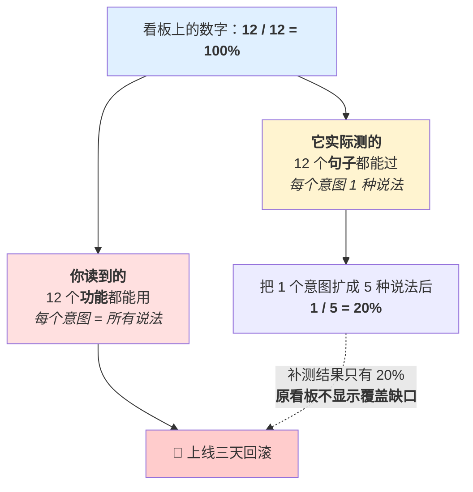
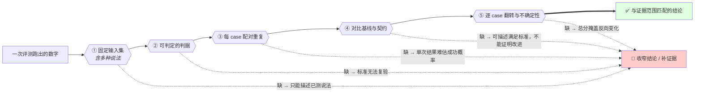
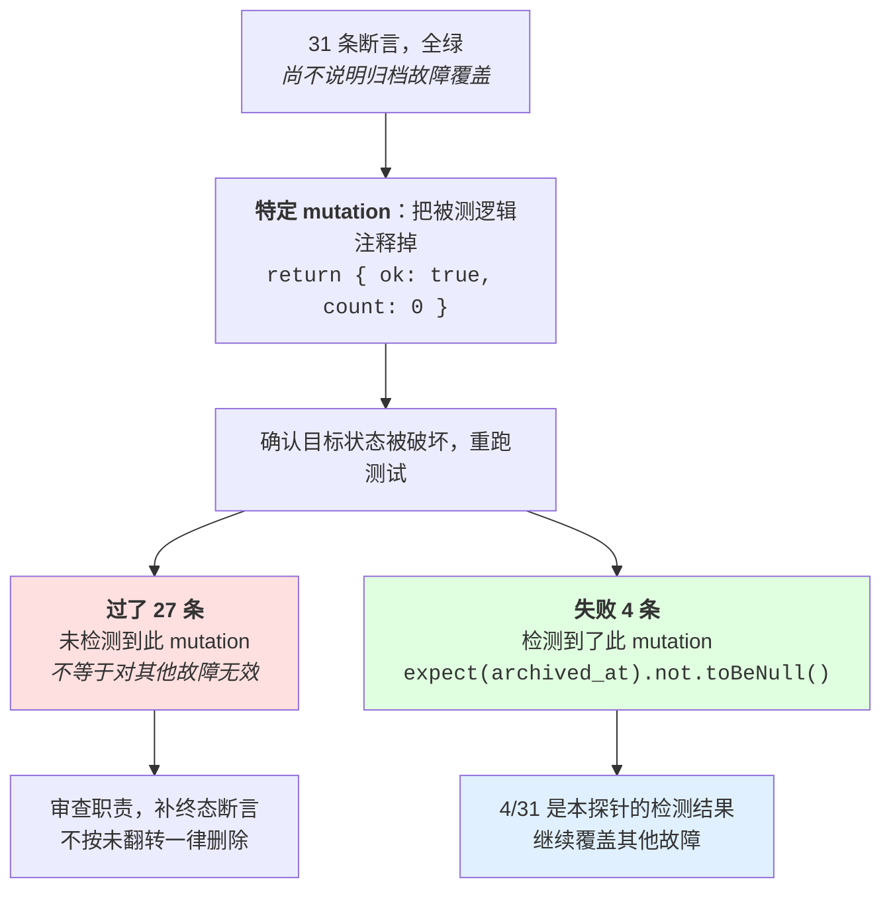
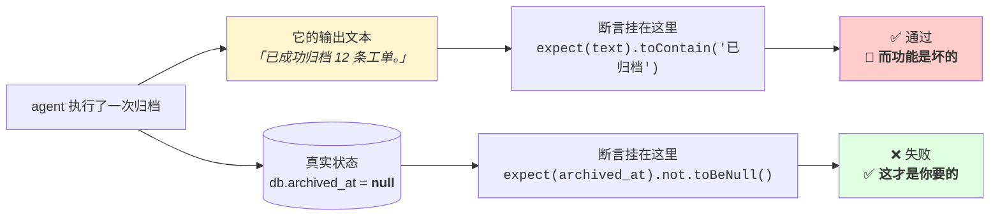
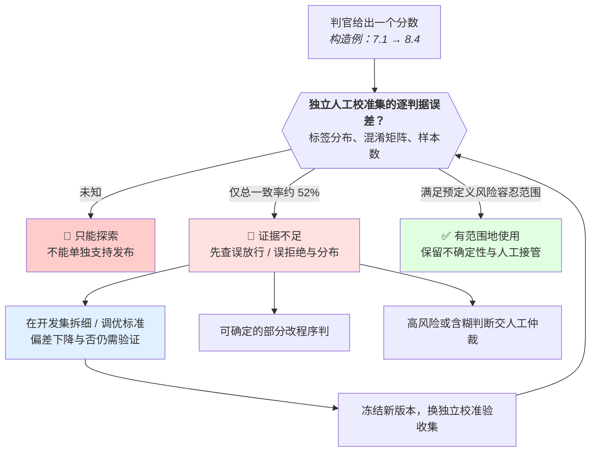
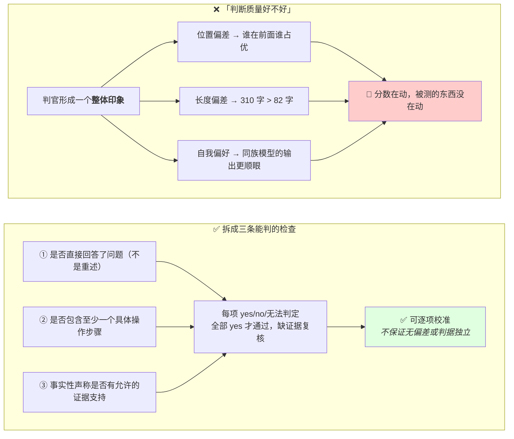
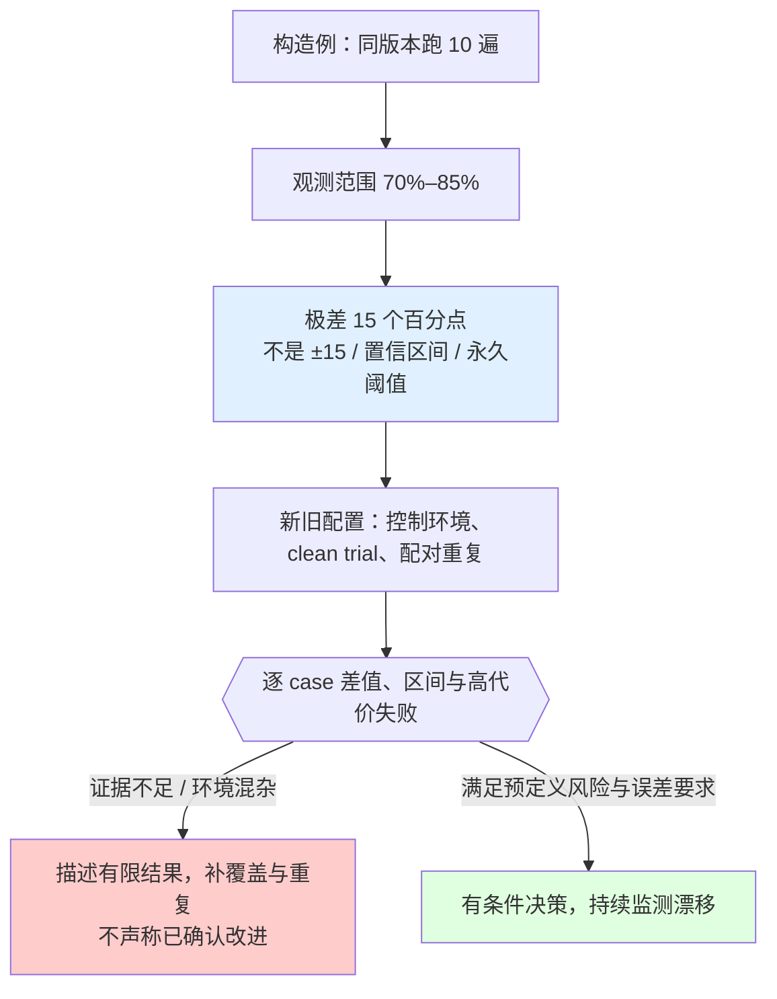
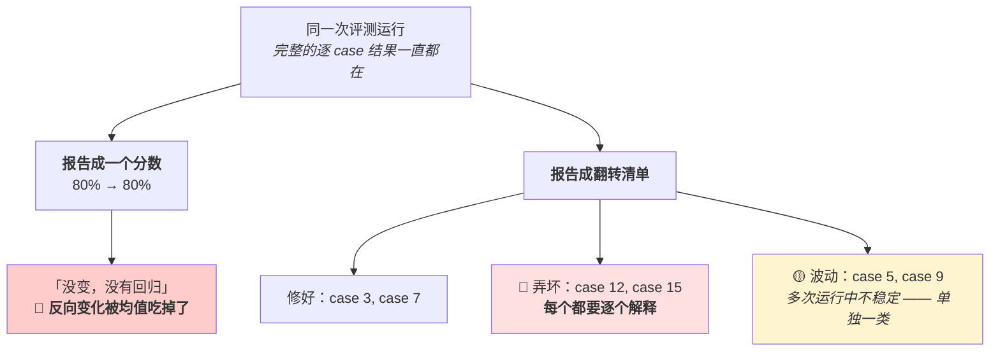
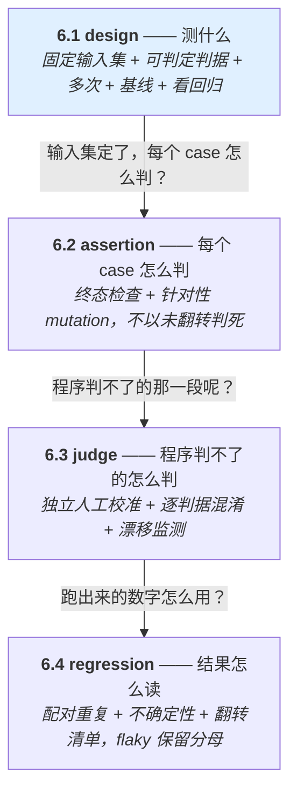
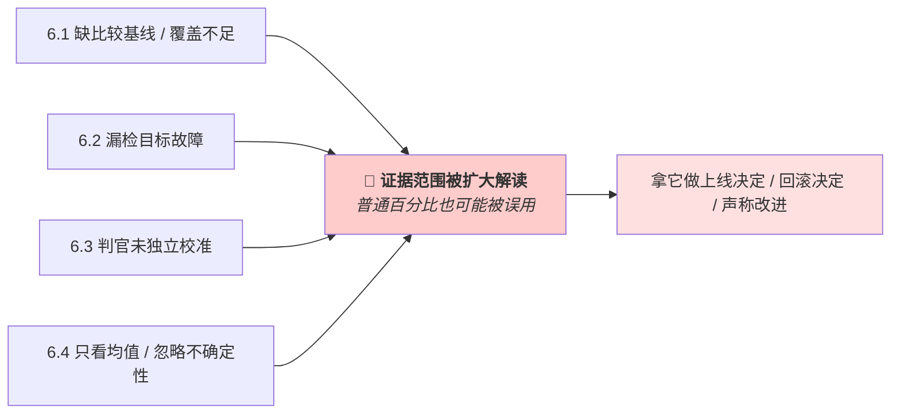

# 第 6 章 评估

> **💡 30 秒速览**
> - "看输出效果"不是验证 → 评测集五要素：固定输入集/可判定判据/跑多次/对比基线/看回归
> - 断言未随改动翻转不等于无效 → 用针对性故障注入探查检测盲区
> - 模型判官有已知偏差（位置/长度/自我偏好）→ 未校准的判官是未标定的尺子
> - 总分不动可能掩盖了"修好3个坏3个" → 看逐 case 翻转方向

前五章讲「怎么做对」。这一章讲**怎么知道做对了**。

本章讨论如何把成功判据、输入覆盖、裁判校准与回归比较变成可复验的工程证据。**除明确标为「本仓库运营案例」的归档结果外，本章所有数字案例、表格和图均为构造示例，不是实测报告，也不是当前读者的经历。**

四个知识点：`agent.eval.design` / `agent.eval.assertion` / `agent.eval.judge` / `agent.eval.regression`。

---

## 6.1 agent.eval.design —— 评测集设计

### 结论

**「看输出效果」不是验证。** 评测集五要素：固定输入集 / 可判定的判据 / 每 case 跑多次 / 对比基线 / 看回归而非总分。

### 案例：12 个 case，100% 通过，上线三天回滚

一个文件清理 agent。上线前有评测集，**12 个 case，通过率 100%**，看板全绿。

12 个 case 覆盖了 12 个功能点，每个功能点一句话：

| # | 输入 |
|---|---|
| 1 | 删掉临时文件 |
| 2 | 压缩日志目录 |
| 3 | 清空回收站 |
| … | … |
| 12 | 列出最大的十个文件 |

上线第一天，工单来了。真实用户说的是这些：

| 用户实际输入 | 结果 |
|---|---|
| 「清理一下」 | 列出了文件，没删 |
| 「把 tmp 收拾干净」 | 问「请问您指哪个目录？」 |
| 「删掉 build 产物」 | 删了 `dist/`，**也删了 `build.config.js`** |
| 「临时文件太多了，处理下」 | 回答了一段关于磁盘管理的建议 |
| 「删掉临时文件」 | ✅ 正常 |

**注意最后一行。** 唯一能正常工作的那句话，正是评测集里的第 1 个 case。

**回滚之后补测：** 把「删除临时文件」这一个意图扩成 5 种说法，重跑 —— 通过率 **1/5 = 20%**。同样的代码、同样的模型、同样的判据，只换了说法。

于是那个「100%」到底是什么意思变得很清楚了：它是 **12 个句子的通过率**，被读成了 **12 个功能的通过率**。后一个补测结果只有前一个的五分之一，而看板上完全看不出区别 —— 因为看板显示的是 `12/12`，它是对的。

**这个案例要记住的是：单说法评测集不是「测得少」，是「测出的数字含义被换掉了」。**

「测得少」还能靠「我知道覆盖不全」来打折，一个 100% 的绿色看板没有任何地方提示你该打折。它会阻止你去补测 —— 因为通过率已经是满分了，没有可以改进的方向。**它比没有评测集更危险，因为它同时消除了你的疑虑和你的下一步动作。**

起步补法：每个意图扩成 3-5 种说法（正式的、口语的、省略主语的、同义词的、带无关信息的）。12 个 case 变成 50 个左右，单轮成本约涨到四倍；数字现在描述更多表面形式，但仍须说明样本分布、覆盖缺口与重复次数，不能宣称覆盖所有说法。

### 机制

🎯 **评测集就像考试卷子** —— 每次改了教学方法都考同一套题，才能比较前后。但如果每道题只考了一种问法（"1+1等于几"），学生换个问法（"一加一是多少"）就不会了，你的100分只说明他背住了那句话，不说明他学会了加法。

**① 固定输入集**

固定 = 在同一版本输入集和执行契约下比较；新增题目要另出版本，不能把覆盖变化算成能力变化。

至少包含：
- **边界 case** —— 空输入、超长、格式异常、语义歧义
- **历史翻车 case** —— 每修一个 bug，把对应失败加入开发回归集。它是可靠来源之一；需求覆盖、风险分析、生产分布抽样和对抗构造也能增长评测集

**关键：一个意图要有多个说法。**

「删掉临时文件」这个 case 通过了，**不等于**「清理一下」「删掉 build 产物」「把 tmp 目录收拾干净」也通过。这些是同一个意图的不同表面形式，而模型对表面形式敏感。

**一个 case 的通过率不等于这类意图的通过率。** 单 case 评测集给出的数字是「这句话能不能过」，你却会把它读成「这个功能能不能用」。

**同一个 `12/12`，两种读法：**



**注意这张图里没有一个错误的数字。** `12/12` 是真的，`100%` 算得对，判据也没写错 —— 出问题的地方在于「一个 case = 一个意图」这个隐含的换算，而它不在任何一行代码里、也不在看板上，只在读数字的人脑子里。**输入集构造、覆盖审计和结果分组报告都应显式检查这个换算，不能靠总分自行揭示。**

可从每个意图 3-5 种说法起步：正式的、口语的、省略主语的、用同义词的、带无关信息的；这提高覆盖，但仍不是该意图全部输入的代表性保证。

#### 开发集与保留集：按意图组隔离（本项目工程协议）

开发集用于发现失败、调 prompt、工具和判据；保留集用于冻结版本后的独立验收。**按意图组分离，而非把同一意图的近义改写随机分到两边**；同源任务变体、模板和派生样本也要归组，避免泄漏。分组规则、分布和覆盖缺口写进版本清单。

**保留集的反馈一旦用于改动，就已污染本轮独立验证。** 不只是复制题面才算：根据失败类别调路由、据得分选版本、改 rubric 都会利用反馈。把已使用的样本转入开发集，冻结新候选后启用新的隔离保留集；不能修完同一批再称为 holdout 通过。

#### 清洁 trial、执行契约与版本化快照

每个 case 的一次完整执行叫一个 trial。每次从独立清洁状态开始：重置工作目录、数据库 fixture、会话/长期记忆、缓存和工具状态，禁止读取其他 trial 的输出。长任务续跑属于同一 trial 的状态链，不得偷偷当作新的独立采样。重试策略、上限与 attempt 计数预先声明，失败不能靠换个 run ID 擦掉。

**CLI 与 SDK 不是同名模型的两种等价外壳。** 本项目比较前要核对实际契约：

| 契约项 | 要核对什么 |
|---|---|
| 实际工具 | 工具清单、schema、实现版本与返回格式；CLI 内置 shell/文件工具不等于 SDK 自定义工具 |
| 权限与审批 | sandbox、目录/网络白名单、对象级授权、确认流程；不能用更宽权限代替能力提升 |
| 重试与循环 | CLI 自动修复、隐藏重试、轮数/超时预算；SDK 需由调用方实现的行为逐项记录 |
| 环境与状态 | 宿主/SDK 版本、cwd、运行时依赖、配置标识（非密钥）、初始文件/DB/记忆、缓存及服务状态 |

版本化快照至少关联输入集及分组版本、rubric/check/judge 版本、模型标识与采样参数、prompt/Skill 与实际 assembly 版本/hash、上述执行契约、fixture 及工具往返证据。内容采集遵守 7.2 的授权和留存边界；hash 用于校验身份，不能复原缺失正文。快照不可原地覆盖，后续更正另记版本与原因。

来源边界：[Anthropic《Demystifying evals for AI agents》](https://www.anthropic.com/research/demystifying-evals-for-ai-agents)（2026-01-09）强调独立 clean trial、与人工校准评分器、外部检查终态而非只听 agent 自述。**本节 holdout 意图分组、CLI/SDK 契约和快照清单是本项目工程协议，不是该文对这些术语的定义。**

#### 本仓库运营案例：六例 Python 单轮评测

[2026-11-16 归档协议](../../skills/knowledge-interviewer/evals/python-backend/runs/2026-11-16/README.md)、[逐项评分](../../skills/knowledge-interviewer/evals/python-backend/runs/2026-11-16/grades.json)及[新旧 benchmark](../../skills/knowledge-interviewer-workspace/iteration-1/benchmark.json)记录：先声明六例、22 条判据，每 case/configuration **n=1**；新版 **21/22 判据、5/6 case**，旧版 **17/22、2/6**。case 通过须全部判据通过；benchmark 的逐 case 比率宏平均不等于这个判据级计数。`without_skill` 指旧 Skill 快照，不是无 Skill。

这是真实归档的合成开发样本，不冒称 holdout。执行与评分同族、模型具体标识未记录、无人类评审；独立冷启动也不自动证明完整环境状态已隔离。`public_reads` 是 executor-reported 读取记录，虽与公共文件交叉核对，仍非完整独立 I/O 审计；不能由此证明无副作用或成功写档。差异含 Python 资源、路由和流程联合变化，不能归因为一句 prompt，也不能宣称人工一致率、重复稳定性或长期学习效果。新版遗漏「其他 Python 实现需单独核实」的失败必须保留，不能为提高总分重写原判据、归档或哈希。

运营下一步是另开版本补配对重复、独立人工校准与隔离验收；原档案保持不变。这个例子的价值是证据分层，而不是把一次有限比较包装成上线证明。

**② 可判定的判据**

**程序能判的就让程序判。** 优先级：

1. 精确匹配 / 数值比对 / 文件状态 / 退出码 —— 可重复的确定性检查，优先由外部读取终态
2. 结构检查（JSON 合法、字段存在、类型对）—— 只证明结构，不自动证明语义或任务成功
3. 正则 / 关键词包含 —— 覆盖有限，需检查误放行与误拒绝
4. 模型判官 —— 有偏差，见 6.3，且必须校准

**确定性 check ≠ 零误差 oracle。** 预期值、容差、查询时点、状态可见性或检查代码都可能错；退出码为 0 也可能没完成任务。检查器本身需要正反例和故障探针。

「看起来对」「回答得不错」不是判据。判据要明确证据来源、适用范围和 pass/fail/无法判定条件，避免把证据缺失默认为通过。

**③ 每 case 跑多次看通过率**

输出是采样的（1.1），**单次结果是有限证据，不是零证据**；它能说明这一 trial 的结果，不能可靠估计成功概率。`temperature=0` 也不保证复现。

3-5 次可作起步诊断，不是充分性保证。次数按风险、预算和不确定性预先安排，逐 case 保留所有真实 attempt、成功数、失败数与无法判定原因。

**④ 对比基线**

改动前后跑同一版本的输入集、判据和受控执行契约。**无 baseline 仍可描述对预定义标准的满足情况**，如「这批样本 17/20 满足标准」；但不能据此证明相对改进。

18/20 → 19/20 是观测到净增一例，**不足以单凭一次运行确认改进，也不能未经测量就断定在噪声内**。20 个 case 跑 1 次，一个净翻转就是 5 个百分点。需配对重复和不确定性分析，见 6.4。

**⑤ 看回归，不看总分**

修好 3 个、弄坏 3 个，总分不动，但**比不改更糟** —— 因为原来那 3 个是好的、你没在盯着，现在坏了而你不知道。

总分掩盖了这件事。要看的是**逐 case 的翻转方向**。

**五要素是支持比较与发布决策的五道检查；缺项时要收窄结论，而不是抹掉已获得的证据：**



**注意五条虚线都指向「收窄结论 / 补证据」。** 单次明确判据的结果可作诊断，无基线的结果可作达标描述；不足的是概率估计或改进证明。不要拿局部证据越级做高风险上线决策。「看输出效果」若没有记录判据、输入和执行条件，就难以复验。

### 误解靶子

**错答一：「看输出效果。」**

这不是一个机制。它在三处失败：单次采样、无判据、无基线；看似验证过，实际缺少可复验的标准。

**错答二：「跑一遍看看通过率。」**

单次 = 一个有限采样点。多次重复用于估计稳定性，次数不能靠固定的 3-5 次一概保证。

**错答三：「总分提高了就是改进了。」**

漏掉回归。总分是均值，均值会掩盖方向相反的变化。

**错答四：「这个 case 通过了，功能就 OK。」**

一个说法 ≠ 一类意图。

### 判据

> **这个改动前后，固定输入集上逐 case 的通过率变化是什么？有几个 case 翻负？**

答不出「有几个翻负」→ 你只有总分，没有回归信息。

> **每个意图有几种说法在集里？**

只有一种 → 已测该说法，尚不足以代表整个意图。

### 自测题

1. 五要素是什么？为了什么各自防住哪一类误判？
2. 为什么「看输出效果」在三个地方同时失败？
3. 「删掉临时文件」通过了，为什么不能说这个功能可用？该怎么补？
4. 18/20 → 19/20 为什么不足以证明改进？没有 baseline 又能描述什么？
5. 修好 3 个坏 3 个，总分不变。为什么比不改更糟？

<details>
<summary>💡 卡住了？看一个提示</summary>

第 1 题：机制段的五道检查图。第 2 题：想想有限采样、判据和比较条件。第 3 题：机制段「一个意图要有多个说法」。第 4 题：机制段④。第 5 题：机制段⑤。
</details>

---

*评测集解决了"用什么去测"。接下来看断言：怎么判断一次测试的结果是对还是错？*

## 6.2 agent.eval.assertion —— 断言设计

### 结论

**断言未随改动翻转，不等于什么都没测。** 保持通过可能是在保护未受影响的性质；要看它能否检测目标故障。「结果非空」和「没抛异常」可作基础检查，但单独不足以证明任务成功。

### 案例：把整个函数注释掉，31 条断言里过了 27 条

一个「归档旧工单」的 agent 功能，测试文件 `archive.spec.ts`，**14 个测试、31 条断言，全绿**，跑了四个月。

线上出了个问题：归档之后工单在列表里消失了，但数据库里 `archived_at` 字段是 `null` —— 也就是**根本没归档**，只是列表的过滤条件把它藏起来了。31 条断言一条都没响。

排查的时候做了一件事：把 `archiveTickets()` 的函数体整个注释掉，改成 `return { ok: true, count: 0 }`，重跑。

> **31 条断言，过了 27 条。**

翻出那 27 条看，全是这几个形状：

```ts
expect(result).not.toBeNull()              // 返回了东西就过
expect(() => archiveTickets(ids)).not.toThrow()   // 不崩就过
expect(result).toHaveProperty('count')     // 字段在就过
expect(typeof result.ok).toBe('boolean')   // 类型对就过
expect(response.status).toBe(200)          // HTTP 通了就过
expect(logSpy).toHaveBeenCalled()          // 打过日志就过
```

真正失败的那 4 条，是四个月前某个同事顺手写的：

```ts
expect(await db.ticket(id).archived_at).not.toBeNull()
```

**这个案例最值得注意的是那个比例：27 / 31 = 87%。**

**针对「归档逻辑被移除、仅返回成功外壳」这个 mutation，只有 4/31 条断言检测到了它**；另外 27/31 没有检测到此故障。这不等于后者对崩溃、字段缺失等其他故障的检测能力为零，也不等于 13% 是这套测试的全部能力。从正常运行的绿色结果里看不出这个特定盲区。

**为什么会长成这样：** 每一条单独看都不算错。`not.toBeNull()` 是一句合理的防御，`not.toThrow()` 是一句合理的检查。它们是在「多加一条断言总没错」这个直觉下一条条积累起来的 —— 和 5.4 那 23 个确认框是同一个直觉，也是同一个结果：**数量上去了，强度下来了。**

**这个案例要记住的是：代码评审和正反例检查之外，还要用针对性 mutation probe 验证故障检测能力。**

「31 条断言，全绿」说明该次运行满足了已写判据，不自动说明覆盖了归档失败。探针给出的 **27/31** 是未检测到这一个 mutation 的比例，可进 CI 看趋势；必须同时保留 mutation 定义，不能当成通用断言质量分。

### 机制

🎯 **死断言就像烟雾报警器里没装电池** —— 它挂在天花板上、看起来完全正常、让你觉得安全，但着火的时候不会响。而且你家里装了31个这样的报警器，你会更加放心 —— 这就是它比没装更危险的原因。

断言的检测能力要相对于具体性质和故障来说。正常与某个故障都通过，只说明它没区分这两种状态；一个只检查输出类型的断言可能挡住类型错误，却挡不住归档未写入。不能把「没有随这次改动翻转」当作死断言定义。

**两个最常见的空断言：**

**① `assert result is not None`**

只要函数返回了东西就通过。返回错的答案、返回空字符串、返回错误对象 —— 全都通过。

**② `assert no exception raised`**

只要不崩就通过。而 agent 的典型失败恰好**不崩** —— 它给你一个自信的错答案（1.3）。

这两条无法单独覆盖 agent 的语义失败；仍可作为基础健壮性检查保留，并补终态与业务断言。

**验证目标故障的检测能力：故意引入该故障，确认相关断言失败。**

可做成一个针对性动作：

> **把归档逻辑替换成成功外壳，跑测试。哪些断言没检测到「未归档」？需要补什么终态检查？**

mutation probe 只证明对所注入故障的检测，不证明对其他失败都有效。先确认 mutation 确实执行到、改变了目标状态且不与预期行为等价；等价 mutation 或与本断言无关的 mutation 不该触发失败。再组合「错目标、只改文本、漏写字段、重复副作用」等代表性故障，每个探针都保留定义与结果。



**这是一次有范围的测量，不替代代码评审。** `27/31` 要和故障定义、执行路径及终态一起解释；仅把比例写进 CI，会重演用断言数量代替检测能力的问题。

**agent 场景的断言要贴住可观测的状态变化，不是文本：**

| 弱 | 强 |
|---|---|
| 回答里包含「已删除」 | 那个文件真的不存在了 |
| 没报错 | 退出码为 0 **且** 目标文件包含预期内容 |
| 返回了 JSON | JSON 里 `status == "ok"` 且 `count == 3` |

左列测的是模型说了什么，右列测的是世界变成了什么样。**agent 的正确性在右列。**

**为什么这个区别对 agent 特别致命：**



**注意那句输出文本本身没有任何异常。** 它流畅、具体、带数字 —— 因为生成一句「已成功归档 12 条工单」和真的归档 12 条工单，是两件完全独立的事（1.3）。**断言挂在左边这条线上，测的是模型的文笔；挂在右边，测的才是功能。**

**断言也要能定位。** `assert final_output == expected` 失败能说明终态不符合预期，但常不足以定位哪一步坏了。补中间状态、工具往返与来源证据，并保留最终外部状态检查。

### 误解靶子

**错答一：「测试通过了所以功能是对的。」**

要先问这些断言检测的是哪些故障。通过率高的死断言套装，比没有测试更危险。

**错答二：「断言越多越好。」**

死断言的数量增加会让通过率更好看，而检测能力不变。

**错答三：「检查没抛异常就够了。」**

agent 的典型失败不抛异常。

### 判据

> **把被测逻辑注释掉，还有几条断言能过？**

先确认 mutation 有效且与目标性质相关；仍通过只说明未检测此故障。保留有职责的基础检查，补对应终态断言。

> **这条断言测的是「模型说了什么」还是「世界变成了什么样」？**

前者 → 尽量换成后者。

### 自测题

1. 为什么「改动前后都通过」不等于断言无效？举一个有效但不会翻转的断言，以及一个漏检归档故障的断言。
2. 为什么 `assert no exception` 对 agent 系统特别无效？
3. 验证断言是否有效的具体操作是什么？为什么它可判定？
4. 把「回答里包含『已创建』」改写成一条强断言。
5. 为什么死断言比没有测试更危险？

<details>
<summary>💡 卡住了？看一个提示</summary>

第 1 题：机制段"两个最常见的空断言"。第 2 题：想想 agent 的典型失败是什么形态（1.3）。第 3 题：机制段那张"注释掉逻辑"的流程图。第 4 题：机制段那张"文本 vs 世界"的对比图。第 5 题：案例段那个比例 27/31。
</details>

---

*精确匹配和程序判断能覆盖很多场景。但有些判断（语气好不好、回答切不切题）程序判不了 ——*

## 6.3 agent.eval.judge —— 模型判官（LLM-as-judge）

### 结论

判官适合判**「符不符合一个能描述清楚的标准」**，不适合判**精确正确性**。而且它有已知偏差，**未校准的判官是一把未标定的尺子**。

### 案例：那个把分数从 7.1 提到 8.4 的「优化」

一个客服 agent，回答质量用模型判官打分，prompt 就一句：

```
判断这个回答质量好不好，打 1-10 分。
```

基线分 **7.1**。有人做了一版优化 —— 主要改动是让回答更充分地展开解释。重跑，分数 **8.4**。涨了 1.3 分，团队上线了。

上线两周后的真实指标：

| 指标 | 优化前 | 优化后 |
|---|---|---|
| 判官打分 | 7.1 | **8.4** ↑ |
| 平均回答长度 | 82 字 | **310 字** ↑ |
| 用户「有帮助」点击率 | 61% | **48%** ↓ |
| 会话内追问率 | 22% | **35%** ↓ |

**回头做了两件本该在上线前做的事：**

**① 交换顺序重测。** 把优化前后的回答成对给判官比较，然后把两者位置对调再跑一次。**37% 的 case 两次结论相反** —— 也就是三分之一以上的比较结果，取决于哪个回答被放在前面。

**② 人工标注 60 条做初步校准。** 让判官跑同一批，31/60 一致，约 **52%**（构造示例，四舍五入）。

**52% 不能直接解释成「约等于抛硬币」。** 先看人工标签与判官预测的分布、逐判据混淆矩阵和多数类基线；类别不平衡时，总一致率可能掩盖大量误放行。60 条也只提供有限校准证据。

**于是那个「7.1 → 8.4」是什么就清楚了：** 它不是质量涨了 1.3 分，是**回答从 82 字变成 310 字，而判官偏爱长的**。判官测量到的是长度，团队把它读成了质量，用户读到的是啰嗦。

**注意这个案例里判官没有出故障。** 它每次都返回了一个合法的分数、格式正确、还能给出理由。它只是一把没有标定的尺子 —— 尺子本身没坏，坏的是「拿它的读数当结论」这个动作。

**这个案例要记住的是：判官给出的是一个测量值，而测量值在你知道误差之前不能参与决策。**

正式决策**之前**要获得独立人工校准的逐判据误差、分布和不确定性，不是必须先拿到某个固定一致率。先觉得涨了就上线、再考虑校准，会把探索性读数误当成质量证明。

看到该结果后，先分析分歧和错误代价，再**把「质量好不好」拆成几条能判的检查**，必要时换判官或改成人工判断。拆细可能降低整体印象造成的偏差，但要在独立人工校准集上复测，不能假定位置或长度偏差已经消失。

### 机制

🎯 **模型判官就像一把没标过刻度的尺子** —— 它每次都给你一个读数，格式完美，但你不知道它偏了多少。拿它量出来"这个比那个长1.3厘米"，在你知道它的误差之前，这句话不能用来做任何决定。

**适合 / 不适合：**

| 适合 | 不适合 |
|---|---|
| 语气是否礼貌 | 这个数字对不对 |
| 是否遵守了格式要求 | 代码能不能跑 |
| 回答是否切题 | 这个 API 名存不存在 |
| 两个回答哪个更完整 | 是否存在安全漏洞 |

分界线：**程序能判的绝不用判官**（6.1 优先级）。判官是用来处理「标准能描述但程序判不了」那一段的，不是万能替代。

**三个已知偏差：**

1. **位置偏差** —— 比较 A/B 时，位置本身影响结果。**对策：交换顺序各跑一次**，两次结论不一致的 case 单独看
2. **长度偏差** —— 倾向于认为长的更好。所以「优化后回答更长」可能只是判官被骗了
3. **自我偏好** —— 同族执行与评分可能相关、可能偏好同族输出；不能仅换一个执行体就假定评分独立客观

**更强 ≠ 已校准，也不保证每类偏差更小。** 用人工证据测误差，而不是用模型排行榜代替校准。

#### 独立人工校准集与逐判据误差（本项目运营协议）

1. **分开调优与校准验收。** 用人工标注开发样本调 judge prompt/rubric；另留独立、未参与调优的人工校准集，覆盖常见、边界、高代价失败及主要标签。几十条可起步，不是样本量充分性保证。校准集反馈若用于改判官，也须换新的独立验收集。
2. **先仲裁再比较。** 人工按同一 rubric 逐判据标注，分歧交独立人工仲裁；保留无法判定、分歧原因与证据来源，不能强迫含糊样本变成一致标签。模型结果不作为人工标签来源。
3. **逐判据报混淆矩阵与分布。** 同时报样本数、人工标签分布、判官预测分布、一致率及不确定性；不能只报一个整体百分数。
4. **按错误代价验收并监测漂移。** 用任务风险预定义逐判据容忍范围，高风险误放行可要求人工接管；不采用统一 80% 阈值。改 judge 模型、prompt、rubric、解析器或数据分布后重新校准，持续抽样人工仲裁，区分模型漂移与标签/任务分布变化。

| 人工标签 / 判官标签 | 判官通过 | 判官拒绝 |
|---|---|---|
| 人工通过 | 真放行 | **误拒绝**（FN） |
| 人工拒绝 | **误放行**（FP） | 真拒绝 |

误放行率 = FP / 人工拒绝数；误拒绝率 = FN / 人工通过数；分母为零时标「无法估计」，并单列无法判定样本。逐判据查看混淆，才能发现「礼貌性很好、事实越界常放行」这种被总体一致率盖住的问题。标签分布不同，52% 的含义也不同，不能拿它直接比随机硬币。

校准记录关联集版本、标注/仲裁协议、judge 模型与 prompt 版本/hash、rubric/解析器版本、执行日期及环境。新版本校准不能回写旧结果；未经校准的读数可供探索，不能单独充当发布质量证据。这与前述 Anthropic 官方文章的人工校准原则一致；具体分集、矩阵和漂移流程是本项目协议。

**校准是一道前置闸门，不是一次事后补充：**



**「未知」与「只有约 52% 总一致率」都不足以单独支持发布，但不是同一种证据。** 后者至少观察到了分歧，还需分析分布、错误代价和不确定性。校准须先于正式决策；事后校准仍可定位问题、改进下一轮，不能倒过来证明旧决定正确。

**判官的 prompt 要给可判定的标准和例子，不是形容词：**

```
坏：  判断这个回答质量好不好
好：  依次检查：① 是否直接回答了问题（不是重述问题）
      ② 是否包含至少一个具体的操作步骤
      ③ 事实性声称是否均有允许使用的证据支持
      每项 yes/no/无法判定，全部 yes 才算通过；缺证据交复核
```

好的那版把整体印象拆成逐项判断，且统一「yes = 满足标准」的方向，便于核对引用与分歧；是否降低偏差仍要在独立人工校准集测量。



**拆细标准减少对整体印象的依赖，不会消除所有偏差。** 长答案仍可能更容易触发关键词，位置仍可能影响证据读取，同族偏好仍可能影响解释。交换顺序、控制长度、逐项人工校准与仲裁应一起用；不能把「更少判断」当作无偏保证。

### 误解靶子

**错答一：「让另一个模型判就客观了。」**

判官也是一次生成，也有幻觉、也有偏差、也受位置和长度影响。它是一个**有系统误差的测量工具**，不是客观仲裁。

**错答二：「用最强的模型当判官就行。」**

强 ≠ 校准。偏差小但未知，仍然不能解读读数。

**错答三：「判官打了 8 分，比上次的 7 分好。」**

在不知道一致率和噪声水平的情况下，7 → 8 不可解读。

### 判据

> **判官在哪个独立人工校准版本上验收？每条判据的标签分布、误放行、误拒绝和仲裁结果是什么？**

只有总一致率或没有独立校准 → 不足以单独支持发布；先补高风险判据的证据与漂移检查。

> **这件事程序能判吗？**

能 → 不要用判官。

### 自测题

1. 判官适合判什么、不适合判什么？分界线是什么？
2. 三个已知偏差是什么？位置偏差的对策是什么？
3. 「换更强的判官」为什么不解决校准问题？
4. 校准的四步是什么？为什么总一致率、统一 80% 阈值或「52% 约等于硬币」不足以验收？反馈用于调优后怎么办？
5. 把「判断回答质量」改写成一个能降低判官偏差的 prompt。

<details>
<summary>💡 卡住了？看一个提示</summary>

第 1 题：机制段"适合/不适合"那张表。第 2 题：机制段"三个已知偏差"。第 3 题：想想"偏差小但未知"意味着什么。第 4 题：机制段那张"校准是前置闸门"的图。第 5 题：机制段最后那张"拆成三条检查"的对比图。
</details>

---

*单次评测告诉你"现在怎么样"。但你真正需要的是"和上次比，变好了还是变坏了" ——*

## 6.4 agent.eval.regression —— 回归与稳定性

### 结论

看**通过率、逐 case 变化与不确定性**，不只看均值。「噪声地板」只能作波动诊断的俗称，不是固定显著性门槛。用受控环境下的配对重复比较，并重点复核高代价回归。

### 案例：一周里两个相反方向的错误决定

一个订单处理 agent，评测集 **20 个 case，每个跑 1 次**，看总分。同一周做了两次决定，两次都错，而且方向相反。

**周二，改动 A：** 优化了意图识别的提示词。

```
改动前：16/20 = 80%
改动后：17/20 = 85%
```

涨了 5 个百分点，合并上线。三天后线上事故：**退款金额识别错误**，把「退 300 元」处理成了全额退款。

翻逐 case 的记录 —— 这个记录一直有，只是没人看：

| case | 改动前 | 改动后 | |
|---|---|---|---|
| case 4（口语化下单） | ✗ | ✓ | 修好了 |
| case 9（多商品混合） | ✗ | ✓ | 修好了 |
| case 13（**部分退款金额**） | ✓ | ✗ | ← **弄坏了** |
| 其余 17 个 | 不变 | 不变 | |

**修好 2 个、弄坏 1 个，净 +1，总分 +5 个百分点。** 而弄坏的那个是全集里业务代价最高的一个 —— 总分里它和「口语化下单」等重，线上不等重。

**周四，改动 B：** 换了一个工具描述的写法。

```
改动前：16/20 = 80%
改动后：15/20 = 75%
```

掉了 5 个百分点，判定为「让效果变差了」，回滚。

后来补做了噪声地板测量：**同一个版本、不改任何东西，跑 10 遍**，通过率在 **70% – 85%** 之间波动 —— 因为其中 3 个 case 本身就时好时坏。

**70%–85% 的观测极差是 15 个百分点，不是 ±15，也不是置信区间。** +5 与 −5 都可能受采样或环境波动影响；仅凭这十次范围，不能证明两次变化都是噪声，也不能证明改动 A 的退款失败必然由改动导致。

**这个构造案例中，一周的两种结局：**

| | 看到的 | 复核信息 | 决定 |
|---|---|---|---|
| 改动 A | +5 个百分点，改进 | 观测到最高代价 case 负向翻转，需复核因果 | 上线 → 事故 |
| 改动 B | −5 个百分点，变差 | 可能是波动，证据不足 | 回滚 → 可能扔掉了一个好改动 |

共同问题是：**20 × 1 中净增减一个 case 就是 5 个百分点；一次采样既可能漏掉高代价失败，也难以确认版本差异。**

**这个案例要记住的是：总分和噪声地板是两个独立的缺口，会同时把你推向两个相反的错误。**

只看总分 → 放过高代价负向翻转（改动 A）；忽略波动 → 过早把负向差异当退化（改动 B）。先输出翻转清单，复核退款终态，再做受控配对重复。相同版本重复是波动诊断，不是永久刻度，也不能替代新旧版本的比较。

### 机制

🎯 **回归测试就像体检** —— 重要的不是这次的绝对值，是和上次比有没有变化。而且要逐项看：总分不变可能是"血压好了但血糖高了"，掩盖了一个正在恶化的指标。

**为什么必须看方差：** 两套改动都是 80% 通过率 ——

- A：观测到每次都是 80%（总通过率方差小）→ 聚合读数稳定，但个别 case 仍可能互相翻转
- B：观测到这次 95%、下次 65%（总通过率方差大）→ 波动更大，是否可用仍由任务风险与逐 case 结果判断

均值相同，波动和失败分布可以不同。**只报均值会丢掉这些重要差异；聚合稳定也不等于所有任务可靠。**

#### 波动诊断不等于显著性判定

**先记录同版本重复的分布，再做配对比较。** 同版本 N 遍的最小值/最大值是观测范围，受次数与环境影响；不能把极差当置信区间，也不能规定「大于地板就是信号、小于地板就无信息」。控制环境后，较小差异可能稳定；很大差异也可能来自权限或工具状态变化。

> 20 个 case × 1 次，净增减一个通过 case = **5 个百分点**。

80% → 85% 表示净增一例，不一定只有一例翻转，可能是修好两例、弄坏一例。6.1 的 18/20 → 19/20 同样需要更多比较证据，而不是直接判成噪声。

#### 配对重复、环境控制与不确定性（本项目工程协议）

1. 冻结输入集、rubric、check/judge 及新旧配置；每 case 的新旧 trial 从等价且独立的 clean fixture 开始，控制运行时、工具/权限、初始记忆、缓存、服务状态和超时预算。
2. 在相近环境下成对运行新旧版本，随机或交替执行顺序，预先安排重复次数；记录配对 ID、每次结果、重试及环境偏差。配对是比较设计，不保证两次模型采样相同。
3. 报逐 case 成功数/真实 attempt 数、负向翻转和高代价终态失败；同时给配对差值及不确定性。可按意图组聚类做配对 bootstrap 等区间估计，注明假设、样本量和方法，不能把相关改写或重试当独立样本来缩窄区间。
4. 按预定义业务风险与误差容忍范围决策。样本不足、区间过宽或环境混杂时，只描述观察结果并补证据；模型、工具、输入分布、记忆策略或环境变动后重新估计，不沿用永久「地板」。



**比较证据有有效范围。** 本例的十次运行只描述当时的观测波动；新版本或新环境需要重新比较。不能仅凭 ±5 的单次差值上线，也不能仅凭历史极差否定所有小改进。

**回归要逐 case 看，不看总分。**

总分是均值，会掩盖方向相反的变化：

```
总分：  80% → 80%    看起来没变

逐 case：
  case 3   ✗ → ✓     修好了
  case 7   ✗ → ✓     修好了
  case 12  ✓ → ✗     ← 弄坏了，而且你原来不在盯它
  case 15  ✓ → ✗     ← 弄坏了
```

**只看总分，右边那两行你永远看不到。** 而它们才是这次改动真正的风险。

**同一次运行，两种报告：**



**注意分岔发生在「报告」这一步，不在「测量」这一步。** 那些翻转的 case 一直躺在运行结果里，是求均值这个动作把它们抹掉的 —— 也就是说，**发现已记录的负向翻转先要换报告格式；确认版本因果与稳定性仍可能需要配对重复。**

**输出格式应该是「翻转清单」，不是一个分数：**

```
本次改动：
  修好: case 3, case 7
  弄坏: case 12, case 15   ← 必须逐个解释
  波动（多次运行中不稳定）: case 5, case 9
```

「弄坏」那一行的每个 case 都要有解释，不能因为总分没掉就放过。

**波动（flaky）case 单独列，但每个真实 attempt 的成败保留在分母中。** 例如某 case 五次三过两败，报 `3/5` 并标 flaky，不能因单列就移出总体分母，也不能挑通过的那次。模型波动、判官误差、依赖时序和环境故障要分别归因；基础设施失败单列并保留原 attempt，另报预声明的有效 trial 口径和排除理由。单列是为了定位，不是美化通过率。

### 误解靶子

**错答一：「通过率从 80% 提到 85%，改进了。」**

先查配对重复、环境与不确定性。20 case × 1 次的净增一例可能受波动影响，还要看有没有高代价负向翻转。

**错答二：「总分没降，说明没有回归。」**

总分是均值，掩盖反向变化。这是最贵的一条误解 —— 它让你在总分不动的时候放过真实的回归。

**错答三：「有些 case 时好时坏，跑几次取通过的那次。」**

波动是需要解释的观测，可能来自模型、判官或环境。取通过的那次 = 主动删除失败与分母信息。

### 判据

> **这次改动，哪几个 case 翻负了？**

答不出具体 case → 你只有总分，没有回归信息。

> **不改任何东西跑 N 遍，通过率波动多大？**

不知道 → 稳定性证据不足；仅有范围也不能代替配对比较与区间估计。

### 自测题

1. 为什么必须看方差？给两个均值相同但可用性不同的例子。
2. 如何做同版本波动诊断与新旧配对重复？70%–85% 的极差是多少，为什么不是 ±15 或置信区间？
3. 20 个 case 跑 1 次，一个 case 翻转是几个百分点？由此说明「80% → 85%」意味着什么。
4. 总分 80% → 80%，为什么可能存在严重回归？画出逐 case 的样子。
5. flaky case 五次三过两败怎样报告？为何不能挑通过那次或从分母排除？

<details>
<summary>💡 卡住了？看一个提示</summary>

第 1 题：同版本重复的分布。第 2 题：配对重复与不确定性段。第 3 题：净变化不等于总翻转数。第 4 题：逐 case 清单。第 5 题：flaky 段的分母规则。
</details>

---

## 本章小结

四点是一条流水线：



**四点共同的敌人：超出证据范围解读一个数字。**



**四个缺口的具体效果不一样：** 缺基线 → 可描述满足预定义标准，不能证明改进；断言漏检目标故障 → 通过数可能掩盖失败；判官未校准 → 误放行与误拒绝未知；只看均值 → 反向变化被盖住。它们在看板上都像一个普通百分比，所以要先确认输入分集、clean trial、执行契约、检查器版本和证据范围，再决定这个数字能支持什么结论。

**自检建议：** 如果输入集每类只有一个例子，先为该类补充多个独立表述和失败边界，再解释汇总指标。不要把读完一节当作已有掌握记录。

**和第 5 章的连接：** 6.1 的「可判定的判据」和 5.1 的「完成判据程序能判」是同一件事，一个用在评测时、一个用在运行时。学会写一个，另一个就会了。
