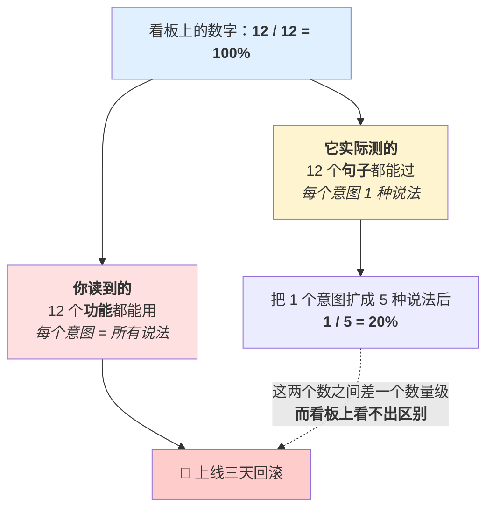
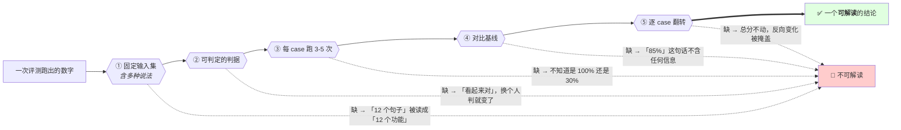
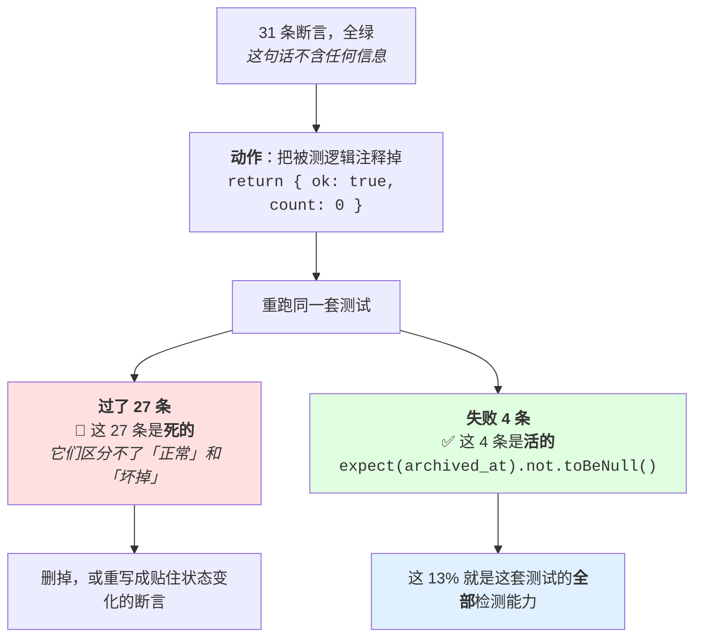
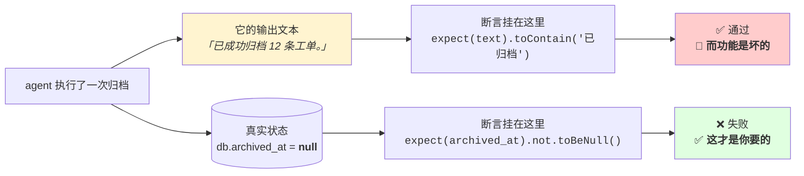
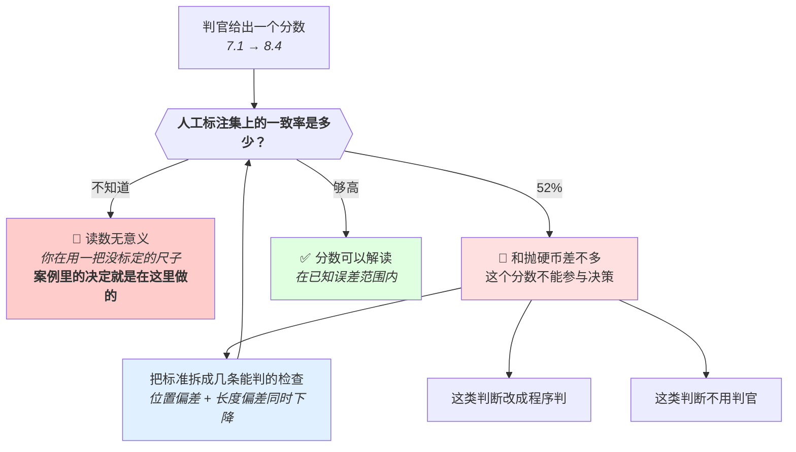
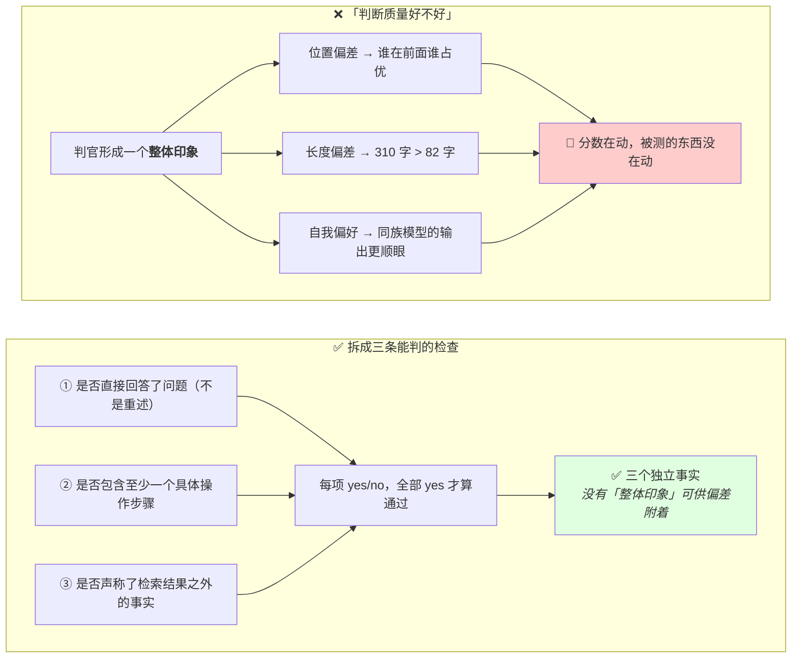
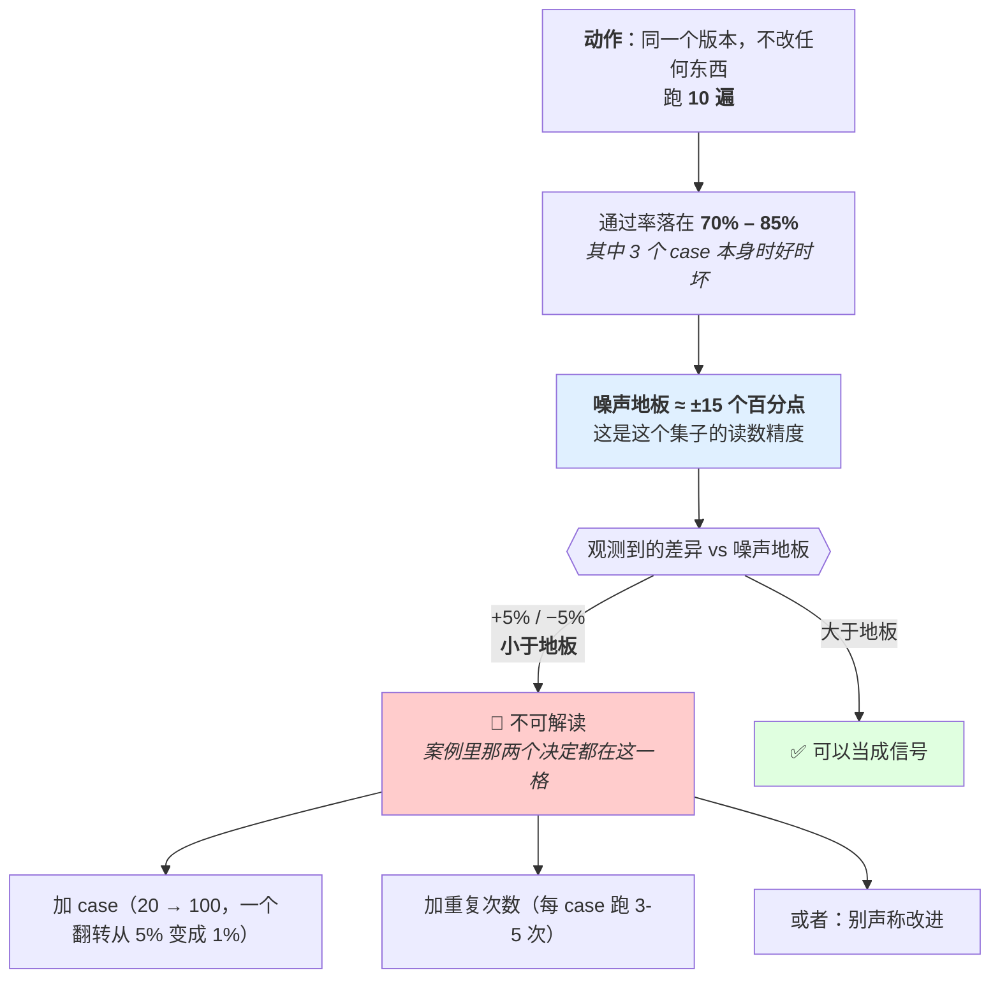
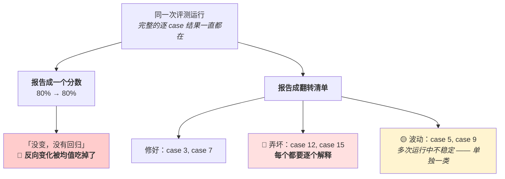
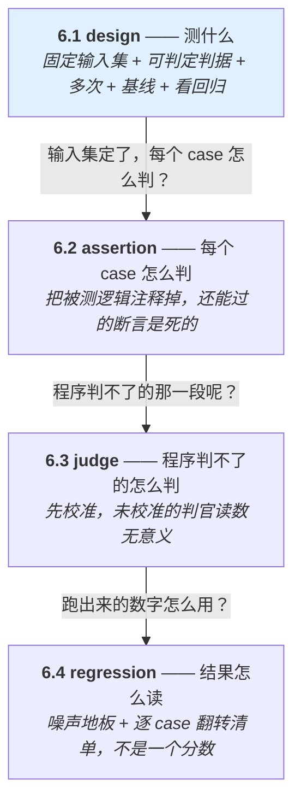
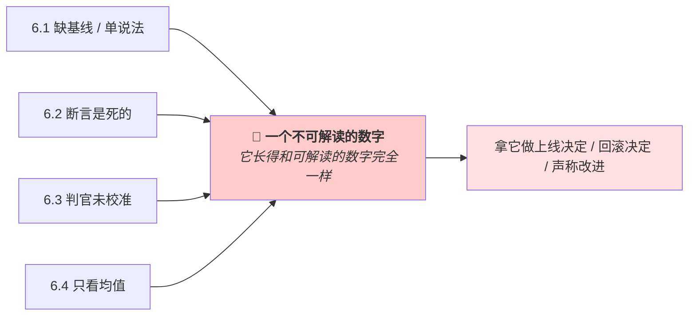

# 第 6 章 评估

> **💡 30 秒速览**
> - "看输出效果"不是验证 → 评测集五要素：固定输入集/可判定判据/跑多次/对比基线/看回归
> - 改动前后都通过的断言什么都没测 → 把逻辑注释掉看还剩几条能过
> - 模型判官有已知偏差（位置/长度/自我偏好）→ 未校准的判官是未标定的尺子
> - 总分不动可能掩盖了"修好3个坏3个" → 看逐 case 翻转方向

前五章讲「怎么做对」。这一章讲**怎么知道做对了**。

本章讨论如何把成功判据、输入覆盖、裁判校准与回归比较变成可复验的工程证据。

四个知识点：`agent.eval.design` / `agent.eval.assertion` / `agent.eval.judge` / `agent.eval.regression`。

---

## 6.1 agent.eval.design —— 评测集设计

### 结论

**「看输出效果」不是验证。** 评测集五要素：固定输入集 / 可判定的判据 / 每 case 跑多次 / 对比基线 / 看回归而非总分。

### 案例：12 个 case，100% 通过，上线三天回滚

一个文件清理 agent。上线前有评测集，**12 个 case，通过率 100%**，看板全绿。

12 个 case 覆盖了 12 个功能点，每个功能点一句话：

| # | 输入 |
|---|---|
| 1 | 删掉临时文件 |
| 2 | 压缩日志目录 |
| 3 | 清空回收站 |
| … | … |
| 12 | 列出最大的十个文件 |

上线第一天，工单来了。真实用户说的是这些：

| 用户实际输入 | 结果 |
|---|---|
| 「清理一下」 | 列出了文件，没删 |
| 「把 tmp 收拾干净」 | 问「请问您指哪个目录？」 |
| 「删掉 build 产物」 | 删了 `dist/`，**也删了 `build.config.js`** |
| 「临时文件太多了，处理下」 | 回答了一段关于磁盘管理的建议 |
| 「删掉临时文件」 | ✅ 正常 |

**注意最后一行。** 唯一能正常工作的那句话，正是评测集里的第 1 个 case。

**回滚之后补测：** 把「删除临时文件」这一个意图扩成 5 种说法，重跑 —— 通过率 **1/5 = 20%**。同样的代码、同样的模型、同样的判据，只换了说法。

于是那个「100%」到底是什么意思变得很清楚了：它是 **12 个句子的通过率**，被读成了 **12 个功能的通过率**。这两个数字之间差了一整个数量级，而看板上完全看不出区别 —— 因为看板显示的是 `12/12`，它是对的。

**这个案例要记住的是：单说法评测集不是「测得少」，是「测出的数字含义被换掉了」。**

「测得少」还能靠「我知道覆盖不全」来打折，一个 100% 的绿色看板没有任何地方提示你该打折。它会阻止你去补测 —— 因为通过率已经是满分了，没有可以改进的方向。**它比没有评测集更危险，因为它同时消除了你的疑虑和你的下一步动作。**

补法很便宜：每个意图至少 3-5 种说法（正式的、口语的、省略主语的、同义词的、带无关信息的）。12 个 case 变成 50 个左右，跑一次的成本涨了四倍，而那个数字**第一次可以按你原来以为的方式读**。

### 机制

🎯 **评测集就像考试卷子** —— 每次改了教学方法都考同一套题，才能比较前后。但如果每道题只考了一种问法（"1+1等于几"），学生换个问法（"一加一是多少"）就不会了，你的100分只说明他背住了那句话，不说明他学会了加法。

**① 固定输入集**

固定 = 每次改动都跑同一批，否则前后不可比。

必须包含两类：
- **边界 case** —— 空输入、超长、格式异常、语义歧义
- **历史翻车 case** —— 每修一个 bug，就把那个 case 加进来。**这是评测集唯一可靠的增长方式**，因为它来自真实失败，而不是你想象的失败

**关键（你的缺口在这里）：一个意图要有多个说法。**

「删掉临时文件」这个 case 通过了，**不等于**「清理一下」「删掉 build 产物」「把 tmp 目录收拾干净」也通过。这些是同一个意图的不同表面形式，而模型对表面形式敏感。

**一个 case 的通过率不等于这类意图的通过率。** 单 case 评测集给出的数字是「这句话能不能过」，你却会把它读成「这个功能能不能用」。

**同一个 `12/12`，两种读法：**



**注意这张图里没有一个错误的数字。** `12/12` 是真的，`100%` 算得对，判据也没写错 —— 出问题的地方在于「一个 case = 一个意图」这个隐含的换算，而它不在任何一行代码里、也不在看板上，只在读数字的人脑子里。**所以它不会被任何检查抓到，只能靠输入集的构造方式排除。**

所以每个意图至少 3-5 种说法：正式的、口语的、省略主语的、用同义词的、带无关信息的。

**② 可判定的判据**

**程序能判的就让程序判。** 优先级：

1. 精确匹配 / 数值比对 / 文件状态 / 退出码 —— 零误差
2. 结构检查（JSON 合法、字段存在、类型对）—— 零误差
3. 正则 / 关键词包含 —— 有误差但可控
4. 模型判官 —— 有偏差，见 6.3，且必须校准

「看起来对」「回答得不错」不是判据。判据要能写成一个返回 true/false 的函数。

**③ 每 case 跑 3-5 次看通过率**

输出是采样的（1.1），单次结果不是证据。`temperature=0` 也不保证复现。

一次通过 → 你不知道那是 100% 还是 30%。这个区别决定了能不能上线。

**④ 对比基线**

改动前后跑同一套。**没有基线的绝对数字不可读** —— 「通过率 85%」这句话本身不包含任何信息。

而且：18/20 → 19/20 **在噪声内，不算改进**。20 个 case 跑 1 次，一个 case 翻转就是 5 个百分点。见 6.4。

**⑤ 看回归，不看总分**

修好 3 个、弄坏 3 个，总分不动，但**比不改更糟** —— 因为原来那 3 个是好的、你没在盯着，现在坏了而你不知道。

总分掩盖了这件事。要看的是**逐 case 的翻转方向**。

**五要素不是五条建议，是一个数字要通过的五道闸门：**



**注意五条虚线都指向同一个格子。** 缺任何一道闸门，结果不是「数字精度差一点」，而是**这个数字不能被用来做决定** —— 它退化成一种感觉，只是穿着百分号。这也是为什么「看输出效果」不是一个弱一点的验证：它一次缺五道。

### 误解靶子

**错答一：「看输出效果。」**

这不是一个机制。它在三处失败：单次采样、无判据、无基线；看似验证过，实际缺少可复验的标准。

**错答二：「跑一遍看看通过率。」**

单次 = 一个采样点。要 3-5 次。

**错答三：「总分提高了就是改进了。」**

漏掉回归。总分是均值，均值会掩盖方向相反的变化。

**错答四（你的现存缺口）：「这个 case 通过了，功能就 OK。」**

一个说法 ≠ 一类意图。

### 判据

> **这个改动前后，固定输入集上逐 case 的通过率变化是什么？有几个 case 翻负？**

答不出「有几个翻负」→ 你只有总分，没有回归信息。

> **每个意图有几种说法在集里？**

只有一种 → 这个意图实际没有被测。

### 自测题

1. 五要素是什么？为了什么各自防住哪一类误判？
2. 为什么「看输出效果」在三个地方同时失败？
3. 「删掉临时文件」通过了，为什么不能说这个功能可用？该怎么补？
4. 18/20 → 19/20 为什么不算改进？要怎样才算？
5. 修好 3 个坏 3 个，总分不变。为什么比不改更糟？

<details>
<summary>💡 卡住了？看一个提示</summary>

第 1 题：机制段的五道闸门图。第 2 题：想想这三处：单次采样、无判据、无基线。第 3 题：机制段"关键（你的缺口在这里）"。第 4 题：机制段④。第 5 题：机制段⑤。
</details>

---

*评测集解决了"用什么去测"。接下来看断言：怎么判断一次测试的结果是对还是错？*

## 6.2 agent.eval.assertion —— 断言设计

### 结论

**改动前后都通过的断言，什么都没测。** 最常见的两个空断言是「结果非空」和「没抛异常」。

### 案例：把整个函数注释掉，31 条断言里过了 27 条

一个「归档旧工单」的 agent 功能，测试文件 `archive.spec.ts`，**14 个测试、31 条断言，全绿**，跑了四个月。

线上出了个问题：归档之后工单在列表里消失了，但数据库里 `archived_at` 字段是 `null` —— 也就是**根本没归档**，只是列表的过滤条件把它藏起来了。31 条断言一条都没响。

排查的时候做了一件事：把 `archiveTickets()` 的函数体整个注释掉，改成 `return { ok: true, count: 0 }`，重跑。

> **31 条断言，过了 27 条。**

翻出那 27 条看，全是这几个形状：

```ts
expect(result).not.toBeNull()              // 返回了东西就过
expect(() => archiveTickets(ids)).not.toThrow()   // 不崩就过
expect(result).toHaveProperty('count')     // 字段在就过
expect(typeof result.ok).toBe('boolean')   // 类型对就过
expect(response.status).toBe(200)          // HTTP 通了就过
expect(logSpy).toHaveBeenCalled()          // 打过日志就过
```

真正失败的那 4 条，是四个月前某个同事顺手写的：

```ts
expect(await db.ticket(id).archived_at).not.toBeNull()
```

**这个案例最值得注意的是那个比例：27 / 31 = 87%。**

不是「有几条断言写得比较弱」，是**这套测试的检测能力集中在 13% 的断言上**，另外 87% 在贡献通过数、贡献覆盖率、贡献安全感，检测能力为零。而这 87% 从外面看和那 4 条**完全一样** —— 都是绿的、都在 CI 里、都有名字。

**为什么会长成这样：** 每一条单独看都不算错。`not.toBeNull()` 是一句合理的防御，`not.toThrow()` 是一句合理的检查。它们是在「多加一条断言总没错」这个直觉下一条条积累起来的 —— 和 5.4 那 23 个确认框是同一个直觉，也是同一个结果：**数量上去了，强度下来了。**

**这个案例要记住的是：断言的有效性不能靠读代码判断，只能靠破坏被测对象来测量。**

那句「31 条断言，全绿」不含任何信息，直到你知道注释掉逻辑之后还剩几条。这个动作十分钟就能做完，而它给出的是一个**数**（27/31），不是一个感觉 —— 所以它可以进 CI、可以定期跑、可以看趋势。

### 机制

🎯 **死断言就像烟雾报警器里没装电池** —— 它挂在天花板上、看起来完全正常、让你觉得安全，但着火的时候不会响。而且你家里装了31个这样的报警器，你会更加放心 —— 这就是它比没装更危险的原因。

断言的信息量 = 它区分了什么。一条在「功能正常」和「功能坏掉」两种情况下都通过的断言，信息量是零 —— 它占着测试的位置、贡献着通过数、给你安全感，但不检测任何东西。

**两个最常见的空断言：**

**① `assert result is not None`**

只要函数返回了东西就通过。返回错的答案、返回空字符串、返回错误对象 —— 全都通过。

**② `assert no exception raised`**

只要不崩就通过。而 agent 的典型失败恰好**不崩** —— 它给你一个自信的错答案（1.3）。

这两条对 agent 系统尤其无效，因为 agent 的失败模式几乎全是「正常返回一个错误结果」。

**验证断言的方法：故意把功能弄坏，确认断言失败。**

这是唯一可靠的方法，而且它可以做成一个动作：

> **把被测逻辑注释掉，跑测试。还有几条断言能过？那几条就是死的。**

这个操作可判定、可重复、不需要理论。而且第一次做的时候通常会发现一半的断言是死的。



**这是一次测量，不是一次代码评审。** 评审得到的是「这几条看起来有点弱」—— 一句可以争论的意见；这个动作得到的是 `27/31` —— 一个可以写进 CI、可以看趋势、可以拿去开会的数。**能变成数的检查才会被真的执行。**

**agent 场景的断言要贴住可观测的状态变化，不是文本：**

| 弱 | 强 |
|---|---|
| 回答里包含「已删除」 | 那个文件真的不存在了 |
| 没报错 | 退出码为 0 **且** 目标文件包含预期内容 |
| 返回了 JSON | JSON 里 `status == "ok"` 且 `count == 3` |

左列测的是模型说了什么，右列测的是世界变成了什么样。**agent 的正确性在右列。**

**为什么这个区别对 agent 特别致命：**



**注意那句输出文本本身没有任何异常。** 它流畅、具体、带数字 —— 因为生成一句「已成功归档 12 条工单」和真的归档 12 条工单，是两件完全独立的事（1.3）。**断言挂在左边这条线上，测的是模型的文笔；挂在右边，测的才是功能。**

**断言也要能定位。** 一条断言失败了，你要能知道是哪一步坏的。一个把整个流程压成一条 `assert final_output == expected` 的测试，失败时不告诉你任何东西。

### 误解靶子

**错答一：「测试通过了所以功能是对的。」**

要先问那些断言是不是活的。通过率高的死断言套装，比没有测试更危险。

**错答二：「断言越多越好。」**

死断言的数量增加会让通过率更好看，而检测能力不变。

**错答三：「检查没抛异常就够了。」**

agent 的典型失败不抛异常。

### 判据

> **把被测逻辑注释掉，还有几条断言能过？**

能过的都是死的。删掉或重写。

> **这条断言测的是「模型说了什么」还是「世界变成了什么样」？**

前者 → 尽量换成后者。

### 自测题

1. 「改动前后都通过的断言什么都没测」—— 举两个你写过或见过的例子。
2. 为什么 `assert no exception` 对 agent 系统特别无效？
3. 验证断言是否有效的具体操作是什么？为什么它可判定？
4. 把「回答里包含『已创建』」改写成一条强断言。
5. 为什么死断言比没有测试更危险？

<details>
<summary>💡 卡住了？看一个提示</summary>

第 1 题：机制段"两个最常见的空断言"。第 2 题：想想 agent 的典型失败是什么形态（1.3）。第 3 题：机制段那张"注释掉逻辑"的流程图。第 4 题：机制段那张"文本 vs 世界"的对比图。第 5 题：案例段那个比例 27/31。
</details>

---

*精确匹配和程序判断能覆盖很多场景。但有些判断（语气好不好、回答切不切题）程序判不了 ——*

## 6.3 agent.eval.judge —— 模型判官（LLM-as-judge）

### 结论

判官适合判**「符不符合一个能描述清楚的标准」**，不适合判**精确正确性**。而且它有已知偏差，**未校准的判官是一把未标定的尺子**。

### 案例：那个把分数从 7.1 提到 8.4 的「优化」

一个客服 agent，回答质量用模型判官打分，prompt 就一句：

```
判断这个回答质量好不好，打 1-10 分。
```

基线分 **7.1**。有人做了一版优化 —— 主要改动是让回答更充分地展开解释。重跑，分数 **8.4**。涨了 1.3 分，团队上线了。

上线两周后的真实指标：

| 指标 | 优化前 | 优化后 |
|---|---|---|
| 判官打分 | 7.1 | **8.4** ↑ |
| 平均回答长度 | 82 字 | **310 字** ↑ |
| 用户「有帮助」点击率 | 61% | **48%** ↓ |
| 会话内追问率 | 22% | **35%** ↓ |

**回头做了两件本该在上线前做的事：**

**① 交换顺序重测。** 把优化前后的回答成对给判官比较，然后把两者位置对调再跑一次。**37% 的 case 两次结论相反** —— 也就是三分之一以上的比较结果，取决于哪个回答被放在前面。

**② 人工标注 60 条做校准。** 让判官跑同一批，算一致率：**52%**。

二选一的判断，52% 的一致率意味着这把尺子和抛硬币差不多。

**于是那个「7.1 → 8.4」是什么就清楚了：** 它不是质量涨了 1.3 分，是**回答从 82 字变成 310 字，而判官偏爱长的**。判官测量到的是长度，团队把它读成了质量，用户读到的是啰嗦。

**注意这个案例里判官没有出故障。** 它每次都返回了一个合法的分数、格式正确、还能给出理由。它只是一把没有标定的尺子 —— 尺子本身没坏，坏的是「拿它的读数当结论」这个动作。

**这个案例要记住的是：判官给出的是一个测量值，而测量值在你知道误差之前不能参与决策。**

「一致率 52%」这个数字必须在解读任何分数**之前**拿到，因为它决定了分数能不能被解读。顺序反过来 —— 先看分数、觉得涨了、再想要不要校准 —— 就已经用一把未标定的尺子做完决定了。

而 52% 之后该做的不是「换个更强的判官」，是**把那句「质量好不好」拆成几条能判的检查**（本节后面那个 prompt 例子）—— 因为让判官不比较整体印象，位置偏差和长度偏差会同时下降。

### 机制

🎯 **模型判官就像一把没标过刻度的尺子** —— 它每次都给你一个读数，格式完美，但你不知道它偏了多少。拿它量出来"这个比那个长1.3厘米"，在你知道它的误差之前，这句话不能用来做任何决定。

**适合 / 不适合：**

| 适合 | 不适合 |
|---|---|
| 语气是否礼貌 | 这个数字对不对 |
| 是否遵守了格式要求 | 代码能不能跑 |
| 回答是否切题 | 这个 API 名存不存在 |
| 两个回答哪个更完整 | 是否存在安全漏洞 |

分界线：**程序能判的绝不用判官**（6.1 优先级）。判官是用来处理「标准能描述但程序判不了」那一段的，不是万能替代。

**三个已知偏差：**

1. **位置偏差** —— 比较 A/B 时，位置本身影响结果。**对策：交换顺序各跑一次**，两次结论不一致的 case 单独看
2. **长度偏差** —— 倾向于认为长的更好。所以「优化后回答更长」可能只是判官被骗了
3. **自我偏好** —— 倾向于给同族模型的输出高分。用 X 生成、用 X 评判，分数会虚高

**换更强的判官模型，偏差更小但仍未知。** 这是关键的一句：更强 ≠ 已校准。你不知道它偏多少，就不能解读它给的分数。

**校准是必须的一步，不是可选优化：**

1. 人工标注一批样本（几十条即可，含边界和你觉得难判的）
2. 让判官跑同一批
3. 算一致率
4. 一致率低 → 改判官的 prompt / 拆细标准 / 这类判断不用判官

**一致率未知 = 你在用一把没标定的尺子量东西，读数没有意义。**

**校准是一道前置闸门，不是一次事后补充：**



**注意「不知道」和「52%」通向同一个结论。** 这两格的区别只在于你**知不知道**自己在用一把坏尺子 —— 而案例里那个上线决定，是在最左边那一格做的。所以校准的位置很重要：它必须挡在读分数**之前**，一旦顺序颠倒，你已经用未标定的读数做完决定了，事后算出的一致率只能用来解释事故。

**判官的 prompt 要给可判定的标准和例子，不是形容词：**

```
坏：  判断这个回答质量好不好
好：  依次检查：① 是否直接回答了问题（不是重述问题）
      ② 是否包含至少一个具体的操作步骤
      ③ 是否声称了检索结果之外的事实
      每项 yes/no，全部 yes 才算通过
```

好的那版把一个主观判断拆成三个能判的，同时**大幅降低位置和长度偏差** —— 因为它不再是在比较整体印象。



**三个偏差都需要一个共同的落脚点：「整体印象」。** 右边那版把它拆掉之后，偏差没有可以附着的地方了 —— 「有没有包含一个具体操作步骤」这件事，不会因为答案更长、或者被放在前面而改变。**所以降偏差的手段不是换更强的判官，是让判官少做判断。**

### 误解靶子

**错答一：「让另一个模型判就客观了。」**

判官也是一次生成，也有幻觉、也有偏差、也受位置和长度影响。它是一个**有系统误差的测量工具**，不是客观仲裁。

**错答二：「用最强的模型当判官就行。」**

强 ≠ 校准。偏差小但未知，仍然不能解读读数。

**错答三：「判官打了 8 分，比上次的 7 分好。」**

在不知道一致率和噪声水平的情况下，7 → 8 不可解读。

### 判据

> **你的判官在人工标注集上的一致率是多少？**

不知道 → 未标定的尺子，它的输出不能作为结论。

> **这件事程序能判吗？**

能 → 不要用判官。

### 自测题

1. 判官适合判什么、不适合判什么？分界线是什么？
2. 三个已知偏差是什么？位置偏差的对策是什么？
3. 「换更强的判官」为什么不解决校准问题？
4. 校准的四步是什么？一致率低了怎么办？
5. 把「判断回答质量」改写成一个能降低判官偏差的 prompt。

<details>
<summary>💡 卡住了？看一个提示</summary>

第 1 题：机制段"适合/不适合"那张表。第 2 题：机制段"三个已知偏差"。第 3 题：想想"偏差小但未知"意味着什么。第 4 题：机制段那张"校准是前置闸门"的图。第 5 题：机制段最后那张"拆成三条检查"的对比图。
</details>

---

*单次评测告诉你"现在怎么样"。但你真正需要的是"和上次比，变好了还是变坏了" ——*

## 6.4 agent.eval.regression —— 回归与稳定性

### 结论

看**通过率 + 方差**，不只看均值。要先估出**噪声地板**，否则你在解读噪声。回归 = **哪几个具体 case 翻了**，不是总分掉了。

### 案例：一周里两个相反方向的错误决定

一个订单处理 agent，评测集 **20 个 case，每个跑 1 次**，看总分。同一周做了两次决定，两次都错，而且方向相反。

**周二，改动 A：** 优化了意图识别的提示词。

```
改动前：16/20 = 80%
改动后：17/20 = 85%
```

涨了 5 个百分点，合并上线。三天后线上事故：**退款金额识别错误**，把「退 300 元」处理成了全额退款。

翻逐 case 的记录 —— 这个记录一直有，只是没人看：

| case | 改动前 | 改动后 | |
|---|---|---|---|
| case 4（口语化下单） | ✗ | ✓ | 修好了 |
| case 9（多商品混合） | ✗ | ✓ | 修好了 |
| case 13（**部分退款金额**） | ✓ | ✗ | ← **弄坏了** |
| 其余 17 个 | 不变 | 不变 | |

**修好 2 个、弄坏 1 个，净 +1，总分 +5 个百分点。** 而弄坏的那个是全集里业务代价最高的一个 —— 总分里它和「口语化下单」等重，线上不等重。

**周四，改动 B：** 换了一个工具描述的写法。

```
改动前：16/20 = 80%
改动后：15/20 = 75%
```

掉了 5 个百分点，判定为「让效果变差了」，回滚。

后来补做了噪声地板测量：**同一个版本、不改任何东西，跑 10 遍**，通过率在 **70% – 85%** 之间波动 —— 因为其中 3 个 case 本身就时好时坏。

**也就是说噪声地板是 ±15 个百分点，而这一周的两个决定，一个基于 +5，一个基于 −5。两个数字都在噪声里。**

**这一周实际发生的事：**

| | 看到的 | 真实情况 | 决定 |
|---|---|---|---|
| 改动 A | +5%，改进 | 弄坏了最贵的那个 case | 上线 → 事故 |
| 改动 B | −5%，变差 | 噪声，无法判断 | 回滚 → 可能扔掉了一个好改动 |

两次都是同一个根因：**20 × 1 的评测集里，一个 case 翻转 = 5 个百分点，而这个粒度比噪声还粗。**

**这个案例要记住的是：总分和噪声地板是两个独立的缺口，会同时把你推向两个相反的错误。**

只看总分 → 放过真实回归（改动 A）。不知道噪声地板 → 把噪声当信号（改动 B）。补的方法也是两个独立动作：**输出翻转清单**（谁翻了，逐个解释）和**空跑 N 遍**（这个集子的读数精度是多少）。两个都很便宜，而这一周的两次错误决定，任何一个都能挡掉一次。

### 机制

🎯 **回归测试就像体检** —— 重要的不是这次的绝对值，是和上次比有没有变化。而且要逐项看：总分不变可能是"血压好了但血糖高了"，掩盖了一个正在恶化的指标。

**为什么必须看方差：** 两套改动都是 80% 通过率 ——

- A：每次都是 80%（方差小）→ 稳定，可预期
- B：这次 95%、下次 65%（方差大）→ 不可用，用户体验是随机的

均值相同，可用性完全不同。**只报均值会把 B 当成和 A 一样好。**

**噪声地板必须先估出来。** 做法：**同一个版本、不改任何东西，跑 N 遍**，看通过率的波动范围。那个范围就是噪声地板。**小于它的差异不能解读。**

一个具体的算术，记住它：

> 20 个 case × 1 次 = 一个 case 翻转就是 **5 个百分点**。

所以「优化后从 80% 涨到 85%」= **一个 case 翻了**。这完全可能是噪声。要么加 case，要么加重复次数，要么别声称改进。

这就是 6.1 第 ④ 条「18/20 → 19/20 在噪声内」的来源。

**噪声地板是一次测量，而且必须先做：**



**顺序不能反。** 噪声地板是这套评测集的**属性**，不是某次改动的属性 —— 它跑一次就能一直用，而且不测出来的话，你手里所有的百分比都缺一个误差范围。案例里那两个相反的错误决定，共用的正是这一个缺口：**±5 的差异被当成结论，而尺子的刻度是 ±15。**

**回归要逐 case 看，不看总分。**

总分是均值，会掩盖方向相反的变化：

```
总分：  80% → 80%    看起来没变

逐 case：
  case 3   ✗ → ✓     修好了
  case 7   ✗ → ✓     修好了
  case 12  ✓ → ✗     ← 弄坏了，而且你原来不在盯它
  case 15  ✓ → ✗     ← 弄坏了
```

**只看总分，右边那两行你永远看不到。** 而它们才是这次改动真正的风险。

**同一次运行，两种报告：**



**注意分岔发生在「报告」这一步，不在「测量」这一步。** 那些翻转的 case 一直躺在运行结果里，是求均值这个动作把它们抹掉的 —— 也就是说，**这个缺口的修法不需要多跑一次测试，只需要换一种输出格式。**

**输出格式应该是「翻转清单」，不是一个分数：**

```
本次改动：
  修好: case 3, case 7
  弄坏: case 12, case 15   ← 必须逐个解释
  波动（多次运行中不稳定）: case 5, case 9
```

「弄坏」那一行的每个 case 都要有解释，不能因为总分没掉就放过。

**波动 case 单独一类。** 3-5 次运行中有时过有时不过的 case，不算通过也不算失败。它们是最有信息量的一批 —— 通常指向真实的脆弱点（提示词歧义、依赖时序、边界条件）。

### 误解靶子

**错答一：「通过率从 80% 提到 85%，改进了。」**

先问噪声地板。20 case × 1 次的情况下这是 1 个 case，可能是纯噪声。

**错答二：「总分没降，说明没有回归。」**

总分是均值，掩盖反向变化。这是最贵的一条误解 —— 它让你在总分不动的时候放过真实的回归。

**错答三：「有些 case 时好时坏，跑几次取通过的那次。」**

波动本身是信号，不是噪声。取通过的那次 = 主动删除信息。

### 判据

> **这次改动，哪几个 case 翻负了？**

答不出具体 case → 你只有总分，没有回归信息。

> **不改任何东西跑 N 遍，通过率波动多大？**

不知道 → 你在解读噪声。

### 自测题

1. 为什么必须看方差？给两个均值相同但可用性不同的例子。
2. 怎么估噪声地板？具体操作。
3. 20 个 case 跑 1 次，一个 case 翻转是几个百分点？由此说明「80% → 85%」意味着什么。
4. 总分 80% → 80%，为什么可能存在严重回归？画出逐 case 的样子。
5. 时好时坏的 case 该怎么处理？为什么它们信息量最大？

<details>
<summary>💡 卡住了？看一个提示</summary>

第 1 题：想想"同一轮结果的方差"。第 2 题：机制段"什么算显著"。第 3 题：机制段那张图里"红色变绿+绿色变红"。第 4 题：判据段。
</details>

---

## 本章小结

四点是一条流水线：



**四点共同的敌人：一个不可解读的数字。**



**四个缺口的具体效果不一样：** 缺基线 → 数字不含信息；断言是死的 → 数字虚高；判官未校准 → 数字来自未标定的尺子；只看均值 → 数字掩盖了反向变化。但**下游是同一个**，而且这四种数字在看板上和一个真正可解读的数字**长得完全一样** —— 都是一个百分比。所以这一章讲的全部是同一件事：**在读一个数字之前，先确认它能被读。**

**自检建议：** 如果输入集每类只有一个例子，先为该类补充多个独立表述和失败边界，再解释汇总指标。不要把读完一节当作已有掌握记录。

**和第 5 章的连接：** 6.1 的「可判定的判据」和 5.1 的「完成判据程序能判」是同一件事，一个用在评测时、一个用在运行时。学会写一个，另一个就会了。
