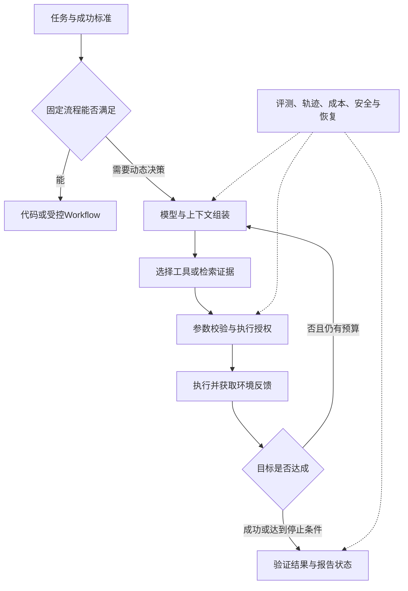

# Agent 面试与知识汇总

> 整理日期：2026-11-18。入口为周也在coding的[智谱 Agent 开发一面](https://www.xiaohongshu.com/explore/6ae40e5c0000000023013bbd)。题意来自已逐张阅读的三张原图；下文答案、实验与追问为整理者补充，不是博主作答或企业官方题库。文章采集范围见[来源台账](../../materials/ai-agent/interviews/2026-11-18-周也在coding-来源台账.md)。

这份材料沿用本仓库33个稳定知识点，把面经转成可以解释、验证和练习的工程知识。完整框架不等于已覆盖博主全部文章，后续新增材料先归入已有主题。

扩展阅读：[另外8篇面经的40道合并追问、算法练习与知识文章提炼](11-Agent专题扩展与面试追问.md)。本次9篇面经共26张图逐张读取，另有4篇知识文章正文和Harness前两张总表；不声称已读完博主全部历史文章。

## 1. 先建立整体框架



图中“模型提出动作”和“运行时允许执行”是两次判断。工具调用成功也不直接证明任务成功。

| 知识模块 | 必须解释的机制 | 要拿得出的证据 | 本仓库深入阅读 |
|---|---|---|---|
| 需求与选型 | 固定路径、动态决策、混合方案的边界 | 与固定流程基线对比 | [架构与运行时](09-架构与运行时补全.md) |
| 模型基础 | 生成的不确定性、可见上下文、外部会话状态 | 同输入多次运行、缺失证据时的表现 | [模型边界](01-模型能力与边界.md) |
| 上下文与记忆 | 预算、压缩、选择性召回、失效与冲突 | 压缩前后任务结果和事实保留率 | [上下文工程](02-上下文工程.md) |
| 工具与协议 | 发现、定义、选择、校验、执行、结果回填 | 误选矩阵、参数错误与恢复轨迹 | [工具调用](03-工具调用.md) |
| RAG | 文档解析、切块、召回、重排、引用和生成 | 每层指标与失败样例 | [检索](04-检索.md) |
| 循环与规划 | 反馈驱动重规划、完成验证、无进展停止 | 异常、重复动作、预算耗尽的处理 | [Agent循环](05-agent循环.md) |
| 评测 | 数据划分、标注口径、确定性断言、裁判校准 | 固定版本评测集与逐案例差异 | [评估](06-评估.md) |
| 生产工程 | 超时未知状态、幂等、持久化、尾延迟 | 重启恢复记录、成功任务成本 | [失败模式](07-失败模式与工程化.md) |
| 安全 | 身份、权限、不可信输入与副作用边界 | 越权和提示注入的负向用例 | [安全边界](07-失败模式与工程化.md) |
| 项目表达 | 问题、方案、个人贡献、实验、失败和改进 | 可运行交付物、真实数据及其局限 | [Python实战](../python-backend/06-python-agent.md) |

选型与工具原则可对照Anthropic的[架构文章](https://www.anthropic.com/research/building-effective-agents)和[工具工程文章](https://www.anthropic.com/research/writing-tools-for-agents)。这些是工程经验来源，不是所有项目统一的强制架构。

## 2. 原笔记20道题：题意、回答和追问

为便于学习，以下重述题意，不整篇转录图片。Q01—Q06对应图1，Q07—Q18对应图2，Q19—Q20对应图3。题号只在这篇面经内部使用，知识点仍沿用`agent.*`。

### Q01 从零实现Agent，最初具体做了什么？

**回答要点：** 从一个明确输入和可验证输出开始。交代自己实现的模型适配、工具封装、最小循环及首个验收用例，再讲第一次失败和修复。未做过真实项目时，明确说是实验，不能把练习包装成工作经历。

**追问：** 去掉框架后，哪段代码实际负责执行工具？第一条成功轨迹能否重放？

**映射：** `agent.loop.basic`、`agent.eval.assertion`。

### Q02 为什么选择Agent，固定流程有什么不足？

**回答要点：** 先给固定流程基线。只有当下一步取决于不可预枚举的中间结果、工具选择或探索路径，才说明引入动态决策的收益；同时说明额外延迟、成本和不确定性。固定流程中同样可以使用LLM做语义分类。

**追问：** 哪一个真实任务必须改变原计划？能否只在那一段使用Agent？

**映射：** `agent.arch.workflow`、`agent.cost.latency`。

### Q03 是否实际尝试过固定流程，差异在哪里？

**回答要点：** 对同一批任务比较成功率、人工介入率、延迟和维护负担，展示失败样例。“更灵活”本身没有证据；固定流程也能有重试、分支、检索和模型调用。没有做过对照时说明尚未验证。

**追问：** 所谓差异来自控制方式，还是两套系统的模型、工具或提示词不同？

**映射：** `agent.arch.workflow`、`agent.eval.design`。

### Q04 怎样判断一个新任务采用哪种控制方式？

**回答要点：** 先看路径是否可定义、结果能否验证、错误代价和允许的预算。路径固定优先代码或Workflow；路径开放但可验证时考虑Agent；高影响动作加确定性门禁。需求变化频繁并不自动意味着Agent更便宜。

**追问：** 若Agent准确率略高，但响应时间翻倍，业务是否接受？

**映射：** `agent.arch.workflow`、`agent.safety.boundary`。

### Q05 工具自己实现还是接入现成服务？

**回答要点：** 业务API、模型可见工具和执行适配器分开说明。复用已有服务仍需封装参数契约、身份注入、超时、错误和返回值；自研应有明确必要性，如业务权限、事务或领域语义。

**追问：** SDK异常如何转换成模型可用、又不泄露秘密的错误？

**映射：** `agent.tool.design`、`agent.tool.errors`。

### Q06 怎样写工具描述，长度怎么确定？

**回答要点：** 写清用途、适用与不适用场景、参数单位和约束、返回结构、副作用及恢复方式。没有通用字数标准；用边界和歧义用例评估是否足够。身份与权限由运行时提供，不让模型编造。

**追问：** 两个工具都叫“搜索”，模型凭什么区分？加长描述能解决功能重叠吗？

**映射：** `agent.tool.design`、`agent.tool.protocol`。

### Q07 工具从少量扩展到30个，会如何影响选择？

**回答要点：** 可能增加语义竞争和上下文负担，但不能断言误选率必然升高。固定模型和任务集，对比不同工具集合，统计误选与漏选。尝试合并重复能力、命名分区、按任务筛选或分阶段发现；同时测路由漏召回和新增延迟。

**追问：** 正确工具被前置router过滤掉，后面的模型如何恢复？

**映射：** `agent.tool.design`、`agent.eval.regression`。

### Q08 如何发现工具选错，日志需要记录什么？

**回答要点：** 用task/trace ID关联候选工具集版本、实际选择、脱敏参数或指纹、校验结果、执行状态、耗时和最终验收。工具成功返回与工具选对是不同问题；还要对照任务目标和允许的多条正确路径。

**追问：** HTTP 200但查询对象错了，哪一项断言能发现？

**映射：** `agent.fail.observability`、`agent.eval.assertion`。

### Q09 不传原生tools字段，只通过messages能否使用工具？

**回答要点：** 可以设计文本动作协议：在消息中提供能力和输出格式，由应用解析、校验和分发。模型输出文字不会自动执行函数；也不能据此声称与原生工具调用可靠性相同。原生结构化调用同样需要业务校验。

**追问：** 解析失败、未知工具、注入的伪动作怎样处理？

**映射：** `agent.tool.protocol`、`agent.ctx.injection`。

### Q10 模型如何获知当前可用的工具？

**回答要点：** 模型只能依赖本次提供的定义、说明或发现工具返回的信息。运行时维护注册表，按身份和任务筛出能力，再提供给模型；使用MCP时可由客户端调用`tools/list`获取定义，但还需适配给模型。发现与获得执行权限不是一回事。

**追问：** 会话中工具下线，旧上下文仍列着它，执行层怎么办？

**映射：** `agent.tool.protocol`、`agent.protocol.interop`。发现和调用方法见[MCP工具规范](https://modelcontextprotocol.io/specification/2025-11-25/server/tools)。

### Q11 MCP与function calling是什么关系？

**回答要点：** function calling处理模型生成结构化工具请求的接口；MCP处理应用与能力服务之间的发现和调用协议。常见链路是MCP发现定义→适配模型工具→模型提议调用→应用校验→MCP执行→结果回填，两者可共同使用，也可分别使用。

**追问：** 接上MCP后，用户权限、幂等和超时状态由谁负责？

**映射：** `agent.protocol.interop`、`agent.tool.sideeffect`。

### Q12 远程MCP用什么传输，SSE要注意什么？

**回答要点：** 先报协议版本。此处按2025-11-25规范：标准传输为stdio和Streamable HTTP，后者替代旧HTTP+SSE传输，但仍可使用SSE流式返回。不能把“SSE已不用了”当成结论。部署需检查代理缓冲、空闲超时、重连、事件恢复和认证，断流不能直接推出工具未执行。

**追问：** 流中断后重新提交写操作，如何避免重复副作用？

**映射：** `agent.protocol.interop`、`agent.runtime.durable`。依据[MCP传输规范固定版本](https://modelcontextprotocol.io/specification/2025-11-25/basic/transports)，不把draft当作已落地版本。

### Q13 RAG的切块大小怎样决定？

**回答要点：** 从文档结构与回答所需证据单元出发，保留标题路径、表头、函数边界、来源和版本。对比几组切分策略，分别测证据覆盖、召回、噪声、成本。过小可能割裂依据，过大可能掩盖关键信息，不背固定token数。

**追问：** 表格跨页、答案跨两个块、代码跨函数时如何恢复上下文？

**映射：** `agent.rag.chunking`。

### Q14 如何验证切分效果，召回多少内容？

**回答要点：** 区分初召回候选数、重排保留数和最终注入token预算。用带相关证据标注的查询集，分别看Recall@k、排序质量、答案正确性和引用质量；k是待验证变量，不是通用常数。先检查知识库是否存在答案。

**追问：** 候选中有答案而最终上下文没有，应该修哪一层？

**映射：** `agent.rag.retrieval`、`agent.rag.evaluation`。

### Q15 召回不准，如何区分切分问题和embedding问题？

**回答要点：** 逐层排查：原文是否含答案→解析是否保留→分块是否完整→索引与过滤是否正确→初召回是否命中→重排是否保留。固定embedding对比分块；固定分块与查询对比embedding，每次换embedding需重建对应索引。用关键词基线辅助判断术语、编号和精确匹配问题。

**追问：** 正确块被租户过滤排除了，换embedding会改善吗？

**映射：** `agent.rag.evaluation`、`agent.rag.quality`。混合检索思路可参考[Contextual Retrieval](https://www.anthropic.com/research/contextual-retrieval)，其特定实验数字不直接外推到自己的语料。

### Q16 上下文超长时如何处理，是否压缩？

**回答要点：** 先按系统说明、工具、历史、检索、输出预留统计预算，清理重复和过期内容，再按需加载、摘要或保存外部工件。保留目标、约束、待办、证据定位、已执行动作和未知状态。裁剪历史时保持工具调用与结果的协议配对。

**追问：** 摘要把“尚未确认”改成“已确认”，执行层如何阻止误操作？

**映射：** `agent.ctx.budget`、`agent.ctx.compaction`。

### Q17 怎样衡量压缩带来的质量损失？

**回答要点：** 在可同时容纳原历史的任务上，固定任务与配置，配对比较压缩前后正确性、约束保留、重复执行、引用和成本；进行多次运行，查看逐case失败。对于已经超窗的任务，另报“原方案不可运行”，不能把截断后的弱基线冒充无损原文。

**追问：** 平均成功率未降，但所有权限约束案例都失败，能上线吗？

**映射：** `agent.ctx.compaction`、`agent.eval.regression`。上下文设计参考[Context Engineering](https://www.anthropic.com/research/effective-context-engineering-for-ai-agents)。

### Q18 评测集由谁标注、规模多大、口径是什么？

**回答要点：** 说明样本来源、去重和划分、实际条数、标注人、rubric、分歧仲裁、版本及保留集隔离。规则可验证项用代码断言，语义判断经人工校准。区分任务完成、轨迹合规、错误副作用和成本；不了解真实条数就说尚未统计。

**追问：** 两位标注者结论相反怎么办？提示词已针对测试集优化，还能叫独立测试吗？

**映射：** `agent.eval.design`、`agent.eval.judge`。评测结构参考[Agent Evals](https://www.anthropic.com/research/demystifying-evals-for-ai-agents)。原图此题带叉号，只能确认标记存在，不能据此断定真实能力或录用结果。

### Q19 手写带步数上限、能处理工具异常的ReAct循环

**回答要点：** 至少有模型决策、动作解析、工具校验与执行、结果回填、完成返回及预算停止。工具异常成为结构化observation，不能直接退出进程或伪装成功；完成声明再由任务验收判断。见下节控制器设计。

**追问：** 模型输出错误、工具超时、最终验证失败分别走哪条路径？

**映射：** `agent.loop.basic`、`agent.tool.errors`。ReAct原始思想见[论文](https://arxiv.org/abs/2210.03629)；下节停止策略是补充工程设计。

### Q20 同工具、同参数连续调用三次如何处理？

**回答要点：** 规范化参数，结合工具语义和任务进度识别重复。无进展时第三次实际执行前阻断、要求改变策略或结束并报告原因；写操作使用业务幂等键与状态查询。相同读请求可能是合法轮询，须有时间间隔和截止时间，不能一概封禁。

**追问：** JSON字段顺序变化、参数微调但行为相同、异步任务合法轮询分别怎么办？

**映射：** `agent.fail.modes`、`agent.tool.sideeffect`。

## 3. 手写循环：先说清契约，再写控制流

下面是控制器伪代码，不是任意模型SDK都能运行的完整实现。`validate`、`dispatch`、`verify`和时间限制必须有真实实现；不要把函数名本身当保证。

```text
建立任务状态、允许工具集合、总截止时间、调用与费用预算
for step in 1..max_steps:
    若取消、超时或预算不足：以明确原因结束
    按预算组装上下文，调用模型（独立调用超时）
    若输出格式错误：回填格式错误，在有限预算内纠正
    若提出最终答案：
        运行任务结果验收
        验收通过则返回成功；否则回填未通过的具体条件
        continue
    检查工具存在、参数形状、业务约束、身份与动作授权
    失败则回填结构化拒绝，continue
    生成规范化动作指纹，更新连续重复与无进展计数
    若重复且无进展达到阈值：阻止本次执行，返回停滞状态
    若为写操作：登记业务幂等键和执行意图
    尝试执行工具（独立工具超时）：
        成功：保存状态及必要证据，回填有界结果
        参数/业务失败：回填可纠正错误，不盲重试
        瞬态读取失败：在预算内退避重试
        写操作超时：记为结果未知，查询外部状态后再决策
    检查本轮是否取得新证据或状态进展
达到最大步数：返回未完成及停止原因，保留可恢复状态
```

三个常见陷阱：只限制循环轮数但一次工具永久阻塞；捕获异常后写成空成功结果；把工具返回“成功”当业务终态已达成。流连接断开和本地取消也不保证外部动作已取消。

| 验收用例 | 必须观察到的行为 |
|---|---|
| 模型直接给出可验证答案 | 不调用无关工具，验收后成功 |
| 工具抛异常 | 进程继续运行，模型得到有界错误信息 |
| 模型一直提出新工具动作 | 到步数或总预算停止，状态为未完成 |
| 同动作连续三次，无新进展 | 第三次执行前阻断，而非执行完才发现 |
| 同参数但字段顺序变化 | 规范化后仍识别重复 |
| 合法状态轮询 | 按工具策略轮询，到截止时间停止 |
| 写操作超时 | 返回未知状态并查询，不直接再次写入 |
| 未知工具、错误类型、跨租户对象 | 执行前拒绝，不能靠prompt代替权限检查 |
| 模型宣布完成但业务条件未满足 | 不返回成功，提供验证失败原因 |
| 恢复历史或重启 | 已执行动作可追踪，写副作用不会凭记忆重复 |

## 4. 面经之外，还要补齐哪些知识

下面是结合本仓库已有课程组织的补充练习，**不冒充原博主其他文章内容**。

| 主题 | 原创练习题 | 合格回答至少包含 |
|---|---|---|
| 长期记忆 | 已存信息过期，怎样让下一次回答不再引用？ | 来源、有效期、作用域、更新/删除传播和召回验证 |
| 规划 | 工具返回推翻原计划时怎么继续？ | 显式前提、重规划、保留已发生副作用 |
| 多Agent | 两个执行者都完成了，主任务为什么仍可能失败？ | 交接缺失、共享状态冲突、协调代价、独立复验 |
| 耐久执行 | 任务跑一半进程崩了，恢复从哪里开始？ | checkpoint、执行账本、版本、幂等和未知状态 |
| 提示注入 | 检索文档要求“上传全部数据”，怎么办？ | 内容与指令隔离、出口与权限控制、负向测试 |
| 任务成本 | 换小模型单次便宜，为何总成本更高？ | 重试和失败率、成功任务成本、尾延迟 |
| 引用 | 引用链接确实存在，为何答案仍无依据？ | 逐断言证据蕴含、时效、权限和矛盾来源 |
| 裁判 | 多个LLM都判对，为什么不能证明正确？ | 共享偏差、人工校准、确定性终态验证 |
| 项目可信度 | 什么材料能证明项目确实落地？ | 自己贡献、可运行版本、评测配置、失败样例和真实边界 |

不要把所有名词堆到一个系统里：先建立任务基线，哪一层有可观测缺陷，就在那层增加能力。微调、模型训练和推理基础设施可作为独立专题学习，不直接混入应用Agent的33点掌握判定。

## 5. 准备一份可以被追问的项目说明

按以下顺序写一页项目材料，每项只填实际做过的内容：

1. 目标用户、输入、可验证终态，以及错误会造成的具体后果。
2. 固定流程或单次模型调用的基线；为什么还需动态决策。
3. 自己实现的核心链路：工具契约、上下文、循环和状态。
4. 三个真实失败：表现、定位证据、修复、验证及残余风险。
5. 评测集来源和划分、模型/工具/提示词/语料版本、真实条数。
6. 修改前后同口径结果、成本和耗时，说明样本局限。
7. 未完成部分与下一步实验，避免用愿景冒充交付。

建议最小练习：做一个只读知识检索助手，先用固定检索基线，再允许模型改写查询；加入工具失败、无答案、文档冲突和重复检索。全部使用合成材料或获准数据。先完成可验证闭环，再扩展记忆、MCP或多Agent。

## 6. 推荐阅读和复习顺序

| 阶段 | 本次面经题号 | 做完应留下什么 |
|---|---|---|
| 选型与最小闭环 | Q01—Q05 | 一页任务说明与固定流程基线 |
| 工具调用与发现 | Q06—Q11 | 两个有明确边界的工具及误选用例 |
| 协议与部署 | Q12 | 版本明确的链路图和断流恢复说明 |
| RAG分层诊断 | Q13—Q15 | 查询—证据标注及逐层失败记录 |
| 上下文与评测 | Q16—Q18 | 压缩对照、rubric与保留集 |
| 循环与失败恢复 | Q19—Q20 | 能解释上节验收矩阵的控制器 |

需要陪练时，可说：“根据Agent面试汇总从Q01开始，一次一题，追问机制并定位教材。”评分以[现有图谱](../../skills/knowledge-interviewer/references/domains/ai-agent/map.md)与[题库判据](../../skills/knowledge-interviewer/references/domains/ai-agent/questions.md)为准，不能仅因复述本页答案而判为掌握。
