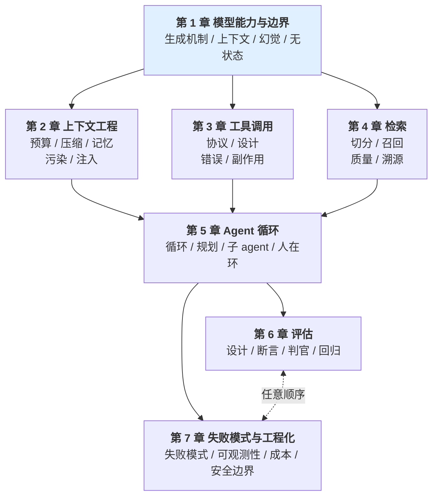

# Agent 知识小册

面试复习：[Agent面试与知识汇总](10-Agent面试与知识汇总.md)含智谱面经20题与知识框架；[专题扩展](11-Agent专题扩展与面试追问.md)从另外8篇面经合并40道追问，补充算法、平台、安全、多模态与项目实践；[采集台账](../../materials/ai-agent/interviews/2026-11-18-周也在coding-来源台账.md)区分完整原图、正文阅读与未读范围。

增量阅读：[超时、缓存、防抖的工程边界](08-增量工程练习.md)；[架构与运行时补全](09-架构与运行时补全.md)补齐四点，与技能图谱 33 点对齐。维护范围见[本轮审计](../../docs/reports/2026-11-09-knowledge-audit.md)。

## 这本册子适合谁

- 你已经让 agent 跑起来过（不管用什么框架）
- 你发现它"有时对有时错"，但说不出为什么
- 你想建立"判断它对不对"的能力，而不只是"让它跑起来"

如果你还没写过任何 agent 代码 —— 先去写一个，碰几次壁再回来。这本册子解释的是你会碰到的那些壁。

## 这本册子是什么

原七章 29 个知识点，加第 9 章四点补全，共 33 点；第 8 章为迁移练习。每个知识点固定六段：

| 段 | 作用 |
|---|---|
| **结论** | 一句话，能背的部分 |
| **案例** | 一个具体的翻车现场。带数字、带日志、带代价。**它的作用是让你先在错的那一层停留一次**，再看机制 |
| **机制** | 为什么是这样。这段是重点，缺了机制就只剩背书 |
| **误解靶子** | 最常见的错答，以及它为什么错 |
| **判据** | 一个能对着具体对象问出答案的事实问题 |
| **自测题** | 不给答案。答不出来说明前面五段没吃进去 |

机制段里穿插 mermaid 图，画的都是**结构**：哪条路是真保证（`==>`）、哪条只是减害（`-.->`）、哪个格子必须挡在前面（`{{ }}`）。图后面跟一句「注意什么」——不是重述图，是指出图里那个容易看漏的地方。

## 这本册子不是什么

**不将当前模型的窗口大小、具体框架API或厂商参数当作永久判据。** 正文以机制、取舍、验收为主；带日期的研究/工程案例可保留当时模型和架构选择，但不代表当前最佳实践或通用保证。易变事实与适用条件另见来源索引。

**不是教程。** 不教「怎么搭一个 agent」。搭起来是容易的那一半，这本册子写的是另一半：**怎么知道它对不对**。

## 全书主线：判据能不能问出答案

一条线穿到底。每章的「判据」段都在做同一件事：**把形容词换成事实问题**。

形容词式判据是假判据 —— 拿到没见过的场景面前问不出答案：

| 假判据 | 真判据 |
|---|---|
| 这条信息重要吗 | 它会改变模型这一步的决策吗 |
| 这条历史还有用吗 | 它还有有效期吗（任务已结束 = 过期） |
| 这个操作危险吗 | 撤回要几步？影响谁 |
| 提示词改好了吗 | 固定输入集上通过率对比基线动了吗 |
| 这个测试能检测目标故障吗 | 注入该故障后，针对它的断言是否失败 |
| 这个 chunk 切得对吗 | 单独读它，能回答任何问题吗 |

判断一条判据是真是假的方法：**拿它去问一个你没预设过的对象，问不出答案就是假的。**「重要」「危险」「效果好」都问不出答案，因为它们描述的是你的感受，不是对象的属性。

## 读的顺序

依赖顺序，不要跳。第 1 章是地基 —— 后面所有章的机制解释最终都落回「模型是逐 token 生成的」和「模型只能看见这一轮被组装进去的东西」这两句话。

第 6、7 章可以在第 5 章之后任意顺序读，但**不要在读完 1-5 章之前读**：没有前面的机制，第 7 章的「可观测性」会退化成「记日志」这句废话。

## 章节

| 章 | 知识模块 |
|---|---|
| 1 | 模型能力与边界 |
| 2 | 上下文工程 |
| 3 | 工具调用 |
| 4 | 检索与溯源 |
| 5 | Agent循环与控制 |
| 6 | 评估与回归 |
| 7 | 失败模式、成本、可观测与安全 |
| 8 | 超时、缓存与防抖的迁移练习 |
| 9 | Workflow、耐久执行、协议互操作、RAG分层评测 |

首次学习按依赖阅读；已有基础可用题库定位后跳转，不根据其他人的历史成绩决定自己的起点。

## 工程闭环选读

以下展开已有33点，不增加Python五天路线的必学范围。

| 主题 | 入口 | 可以检验什么 |
|---|---|---|
| 评测运营 | [评估与回归](06-评估.md) | 开发/保留/人工校准隔离、CLI/SDK契约、误判代价与逐case不确定性 |
| 长任务harness | [循环与交接](05-agent循环.md)、[耐久执行](09-架构与运行时补全.md) | 清空上下文后的交接、固定验收、外部未知效果与授权复验 |
| 记忆分层 | [上下文与记忆](02-上下文工程.md) | 原始事件与派生笔记/表示/实际注入的溯源；dreaming进阶整理 |
| 安全回放 | [轨迹可观测性](07-失败模式与工程化.md) | 默认元数据、受控内容快照与副作用桩化，不为复现永久保存秘密 |

可运行的本地合成切片见[Python Agent实验说明](../python-backend/06-python-agent.md)。模型特定的harness安排与四层记忆命名来自有日期的工程研究视角，不是所有系统必须遵循的标准；证据边界见[来源索引](../../skills/knowledge-interviewer/references/domains/ai-agent/sources.md)。

## 配套文件

- [知识图谱](knowledge-map.md)：通用知识点与依赖，不含个人成绩。
- [进度模板](../../skills/knowledge-interviewer/templates/progress.md)、[错题模板](../../skills/knowledge-interviewer/templates/mistakes.md)：共享的是空白结构。
- 个人档案位于本机忽略目录 `.local/learning/ai-agent/`，不发布到Git或云端知识库。
- [Go后端卷](../go-backend/README.md)、[前端卷](../frontend/README.md)。
