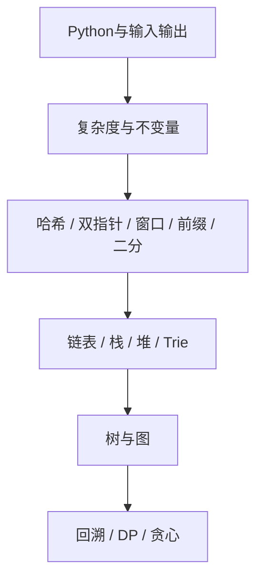

# Python算法阅读图谱

本卷26点；未学习/跳过不视为掌握，不预填个人成绩。下列唯一二级标题可由learning_content.py定位。

| 知识点 | 正文章节 | 硬前置 |
|---|---|---|
| `alg.python` | [Python 刷题与 OJ 输入输出](01-foundations.md) | 无 |
| `alg.complexity` | [复杂度、规模与不变量](01-foundations.md) | `alg.python` |
| `alg.sort` | [排序、稳定性与分治](01-foundations.md) | `alg.complexity` |
| `alg.hash` | [哈希查找与计数](02-arrays.md) | `alg.python`、`alg.complexity` |
| `alg.two-pointers` | [双指针与快慢指针](02-arrays.md) | `alg.sort`、`alg.hash` |
| `alg.window` | [滑动窗口与可维护条件](02-arrays.md) | `alg.two-pointers` |
| `alg.prefix` | [前缀和、差分与子数组计数](02-arrays.md) | `alg.hash`、`alg.complexity` |
| `alg.binary` | [二分边界与答案二分](02-arrays.md) | `alg.complexity`、`alg.sort` |
| `alg.matrix` | [矩阵、网格与边界](02-arrays.md) | `alg.python`、`alg.prefix` |
| `alg.linked` | [链表操作与身份](03-structures.md) | `alg.two-pointers` |
| `alg.stack` | [栈、括号与单调栈](03-structures.md) | `alg.complexity` |
| `alg.heap` | [堆、Top K 与优先队列](03-structures.md) | `alg.sort` |
| `alg.trie` | [字典树与前缀查询](03-structures.md) | `alg.hash` |
| `alg.tree` | [二叉树遍历与递归分解](04-trees.md) | `alg.linked`、`alg.stack` |
| `alg.bst` | [搜索树的全局约束](04-trees.md) | `alg.tree`、`alg.binary` |
| `alg.graph` | [图的 BFS/DFS 与最短步数](05-graphs.md) | `alg.matrix`、`alg.tree` |
| `alg.topo` | [拓扑排序与依赖环](05-graphs.md) | `alg.graph` |
| `alg.union` | [并查集与连通性](05-graphs.md) | `alg.graph` |
| `alg.shortest` | [最短路与非负权条件](05-graphs.md) | `alg.graph`、`alg.heap` |
| `alg.backtracking` | [回溯、剪枝与去重](06-search.md) | `alg.stack`、`alg.sort` |
| `alg.dp` | [动态规划状态与转移](07-dp.md) | `alg.complexity`、`alg.graph` |
| `alg.knapsack` | [背包与循环方向](07-dp.md) | `alg.dp` |
| `alg.sequence` | [序列 DP：LIS、LCS 与编辑距离](07-dp.md) | `alg.dp`、`alg.binary` |
| `alg.greedy` | [贪心的选择证明](08-strategies.md) | `alg.sort`、`alg.dp` |
| `alg.intervals` | [区间合并与调度](08-strategies.md) | `alg.sort`、`alg.greedy` |
| `alg.bits` | [位运算与数学工具边界](08-strategies.md) | `alg.python`、`alg.complexity` |

按表中前置从上到下推进；图示只概括主链，具体依赖以表为准。

完整依赖与首诊规则见[陪练图谱](../../skills/knowledge-interviewer/references/domains/algorithms-python/map.md)。教材不是背模板列表：每点至少解释一个不变量、一个失效条件和一个边界案例。
