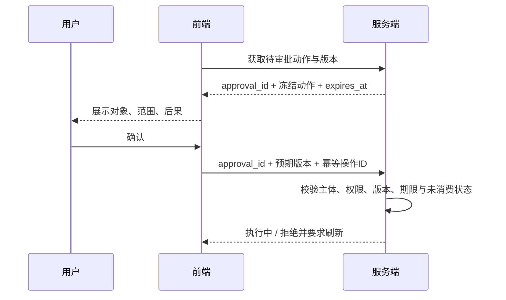

# 第 4 章 Agent 交互与审批

依赖：任务状态、HTTP 身份边界、事件恢复。本章将 Agent 卷的工具副作用与授权原则落实到用户可检查的交互。

## fe.approval.scope —— 确认要绑定到具体动作

### 结论

审批必须绑定可检查的动作与对象版本；前端负责清晰展示，服务端负责授权、失效判断与一次性消费。

### 案例

工具卡片展示“给订单 A 退 10 元”。用户点击确认前，Agent 重新规划，把参数改成“订单 B，100 元”。前端只提交 `approved: true`，后端直接执行了新参数。按钮确实由用户点击过，但点击没有授权这笔退款。

### 机制

审批卡片至少提供用户能识别的动作、对象、范围、金额或其他关键参数、不可逆后果。长列表需冻结准确对象集合，不能用“目录下全部文件”代替用户看到的三项。工具描述与模型生成的理由都不能扩大授权。

参数摘要、approval_id 和状态转移由可信服务端生成与验证，不能相信客户端传回的任意哈希。关键参数或对象版本改变时，使旧批准失效并重新展示；审批通过与执行之间仍需检查业务前置条件，必要时原子化执行，防止检查后状态变化。前端防双击改善体验，真正去重由服务端幂等与状态转移保证。[OWASP 交易授权](https://cheatsheetseries.owasp.org/cheatsheets/Transaction_Authorization_Cheat_Sheet.html)

| 用户看到的状态 | 允许表达的事实 |
|---|---|
| 等待审批 | 动作已冻结，尚未授权执行 |
| 提交确认中 | 请求已发出，结果未确认 |
| 执行中 | 服务端接受本次批准，业务还未完成 |
| 参数变化/过期 | 当前批准不能执行；刷新后重新确认 |
| 取消请求中 | 取消命令已发送，副作用是否可撤回仍未知 |

工具卡片还应区分计划、正在调用、成功、拒绝和未知结果。展示可验证进度和业务证据即可；不把不可验证的“思考中”文字当作真实执行轨迹。后端错误码映射到可行动状态，例如“权限已变化，请重新加载”，而不是无限转圈。

### 误解靶子

“弹窗里点过确认就能执行后续同类操作。”“按钮 disabled 能防重复退款。”“前端生成一个参数哈希就可信。”授权边界与可信计算层都不在这里。

### 判据

用户所确认的对象、参数和版本，与执行时的动作是否由服务端证明一致？

### 自测题

1. 审批后金额变化，只指定旧 approval 的处理结果。
2. 确认请求超时，只说明前端应显示的结果确定性。
3. 用户看到三个文件后，只写出该次删除授权的对象范围。

衔接：[Agent 副作用](../ai-agent/03-工具调用.md)、[授权边界](../ai-agent/07-失败模式与工程化.md)、[Go 持久任务](../go-backend/06-Agent后端.md)。下一章：[输出与工件安全](05-输出与工件安全.md)。
