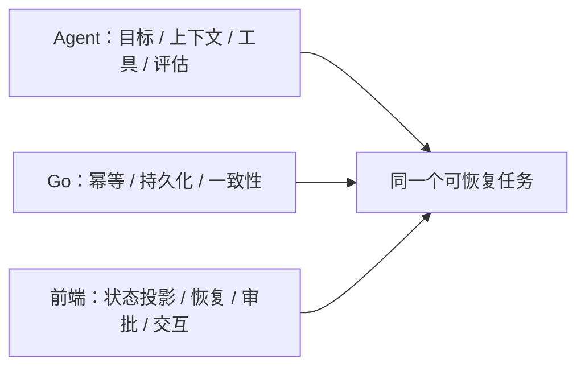

# 前端工程知识小册

把浏览器里的任务状态做对：从 HTML/CSS、JS/TS 到 React、流式恢复、审批、安全与交付。**7 章、19 个知识点，另附可运行的工作台协议实验。**

案例为教学构造，数字不代表线上统计。正文沿用 **结论 → 案例 → 机制 → 误解靶子 → 判据 → 自测题**；不靠阅读量或函数题通过数认定掌握。

## 章节与阅读顺序

| 章 | 入口 | 知识点数 | 回答的问题 |
|---|---|---:|---|
| 1 | [浏览器与语言基础](01-浏览器与语言基础.md) | 7 | 元素、布局、渲染、共享对象、闭包、异步与类型分别保证什么 |
| 2 | [状态与生命周期](02-状态与生命周期.md) | 3 | 谁能提交结果，状态存在哪里，组件为什么读到旧值 |
| 3 | [网络与流式恢复](03-网络与流式恢复.md) | 2 | 断网、重放、缺口与任务终态如何区分 |
| 4 | [Agent 交互与审批](04-Agent交互与审批.md) | 1 | 用户批准的动作怎样与实际执行绑定 |
| 5 | [输出与工件安全](05-输出与工件安全.md) | 2 | 模型内容怎样安全展示，编辑与引用怎样保留版本 |
| 6 | [性能与无障碍](06-性能与无障碍.md) | 2 | 长对话生成时如何保持输入、阅读与键盘操作 |
| 7 | [测试与交付](07-测试与交付.md) | 2 | 如何证明旅程正确，并支持旧标签页与回滚 |
| 实验 | [工作台贯穿实验](08-工作台贯穿实验.md) | 不新增ID | 将字节解析、校验、投影与故障验收连起来 |

先按 1 → 2 → 3 建立共同前提，再读审批与安全；6、7 章用于检验前面设计。熟悉 JS/TS 可先做题定位，不能因写过 React 就跳过网络与权限边界。不要求先学完整 Go 卷。

## 与 Agent、Go 两卷的连接



同一条“超时不等于未执行”在前端体现为取消意图与真实终态分离，在 Agent 中体现为工具重试边界，在 Go 中体现为幂等与未知结果查询。[三卷机制对照](knowledge-map.md)

## 配套与陪练

- [阅读图谱](knowledge-map.md)：章节点位、依赖与跨卷桥梁。
- [领域图谱](../../skills/knowledge-interviewer/references/domains/frontend/map.md)：19 个稳定 ID 的唯一清单。
- [题库](../../skills/knowledge-interviewer/references/domains/frontend/questions.md)：19 条首题、追问、判档和最小验证链。
- [来源](../../skills/knowledge-interviewer/references/domains/frontend/sources.md)：34 份官方资料与时效边界。
- [进度模板](../../skills/knowledge-interviewer/templates/progress.md)、[错题模板](../../skills/knowledge-interviewer/templates/mistakes.md)：共享空白结构；个人数据只存本地。
- [知识校验与陪练评测](../../docs/reports/2026-11-09-frontend-evaluation.md)：24条结论核验、26项代码测试、12个独立情境的首轮/复测证据。
- [陪练 Skill](../../skills/knowledge-interviewer/SKILL.md)：说“考我前端 / JS / TS / CSS / React”进入 frontend；每轮一问，到期复习优先。

真实学习记录仍保存到 `.local/learning/frontend/`；仓库模板不覆盖已有记录。跨卷题不共享档位，新增教材不会把已有 Agent 成绩迁成前端掌握。

## 练习与验证

```bash
node --test handbook/frontend/examples/*.test.mjs
python3 skills/knowledge-interviewer/scripts/check_frontend_domain.py
python3 skills/knowledge-interviewer/scripts/check_frontend_eval_results.py
```

实验无第三方依赖，只验证协议与状态核心。浏览器交互、读屏、性能、DOM 清洗与服务端授权需按[实验矩阵](08-工作台贯穿实验.md)另行验收，不能用 Node 结果代替。

力扣基础迁移：[超时、缓存、防抖](../ai-agent/08-增量工程练习.md)。牛客场景入口见[面经映射](../../skills/knowledge-interviewer/references/domains/ai-agent/interview-bank.md)，社区摘要不作技术定论。

## 本卷范围

保留原方案全部 13 个 ID，补 6 个浏览器与语言基础点，共 19 点。适用于 Web 前端及 Agent 工作台的核心工程机制；移动原生、图形引擎和特定框架的全部 API 不在本卷。框架版本、兼容矩阵和产品数字按来源即时核验。
