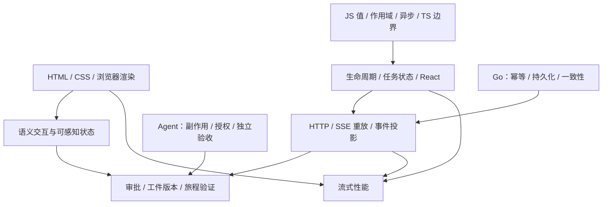

# 前端知识图谱与三卷连接

19 个稳定知识点的唯一清单在[陪练领域图谱](../../skills/knowledge-interviewer/references/domains/frontend/map.md)。本文件解释阅读依赖与跨卷关系，所有知识点当前是否掌握只看真实陪练状态文件。

## 按章定位

| 章 | 知识点 | 阅读入口 |
|---|---|---|
| 1 | `fe.web.semantic`、`fe.css.layout`、`fe.web.rendering`、`fe.js.value`、`fe.js.scope`、`fe.js.async`、`fe.ts.contract` | [浏览器与语言基础](01-浏览器与语言基础.md) |
| 2 | `fe.web.lifecycle`、`fe.state.task`、`fe.render.react` | [状态与生命周期](02-状态与生命周期.md) |
| 3 | `fe.web.http`、`fe.stream.recovery` | [网络与流式恢复](03-网络与流式恢复.md) |
| 4 | `fe.approval.scope` | [Agent 交互与审批](04-Agent交互与审批.md) |
| 5 | `fe.security.output`、`fe.product.artifact` | [输出与工件安全](05-输出与工件安全.md) |
| 6 | `fe.perf.streaming`、`fe.a11y.status` | [性能与无障碍](06-性能与无障碍.md) |
| 7 | `fe.quality.delivery`、`fe.eval.journey` | [测试与交付](07-测试与交付.md) |

## 跨卷机制对照

| 前端 | Agent 知识 | Go 知识 | 共用判据 |
|---|---|---|---|
| 超时与取消 | `agent.tool.sideeffect` | `go.conc.context`、`go.svc.idempotency` | 停止等待不证明副作用没发生 |
| 状态与续流 | `agent.runtime.durable` | `go.agent.runtime`、`go.data.consistency` | 权威状态、游标与投影怎样恢复 |
| 输入与输出边界 | `agent.tool.protocol`、`agent.ctx.injection` | `go.svc.timeout` | 形状校验与业务控制分别在哪执行 |
| 审批 | `agent.safety.boundary` | `go.svc.idempotency`、`go.data.tx` | 这次授权是否绑定到实际执行对象 |
| 引用与工件 | `agent.rag.grounding`、`agent.ctx.memory` | `go.data.consistency` | 版本与所有权是否随对象传递 |
| 性能 | `agent.cost.latency` | `go.conc.backpressure`、`go.obs.trace` | 预算、队列上限与用户侧延迟分别是什么 |
| 旅程验证 | `agent.eval.assertion`、`agent.eval.regression` | `go.obs.slo` | 期望是否独立，是否遮蔽逐场景回归 |

跨卷补阅读：[Agent 图谱](../ai-agent/knowledge-map.md)、[Go 图谱](../go-backend/knowledge-map.md)。
