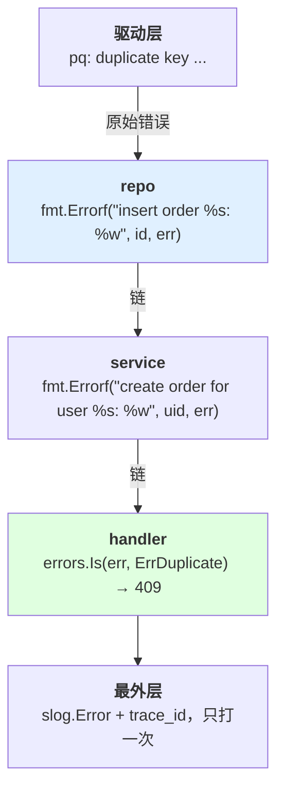
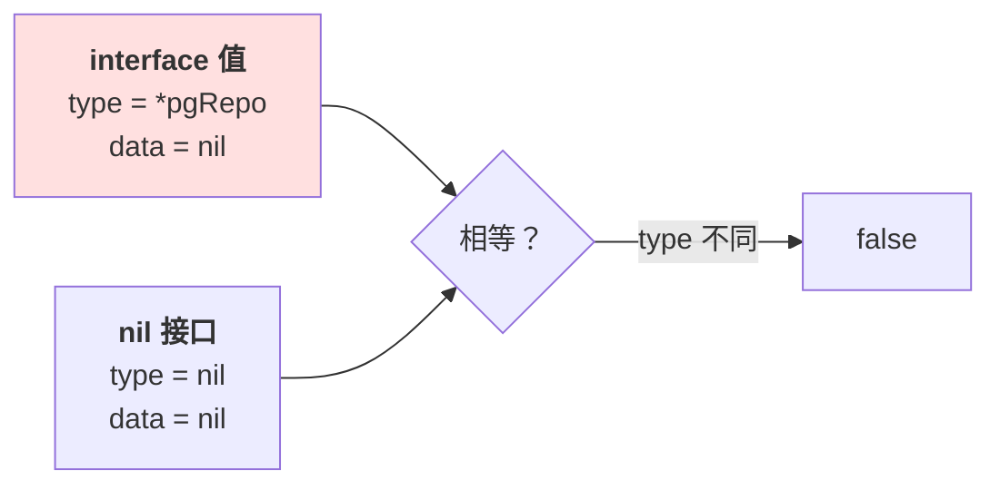

# 第 1 章 值与错误

> **💡 30 秒速览**
> - Go 没有 `undefined`，只有零值 → 「没传」和「传了 0」在类型上长得一样
> - 赋值不是深拷贝 → slice/map 共享底层数据，`append` 能写坏调用方
> - 错误是返回值不是异常 → 不处理就丢，不包装就查不到
> - 接口判空可能失效 → `typed nil` 让 `if x == nil` 返回 false

一句话贯穿全章：**Go 把 Node 的两个隐含承诺拿掉了——「数据不会被别人改」和「出错会有人接住」。**

三个知识点：`go.lang.value` / `go.lang.error` / `go.lang.interface`。

---

## 1.1 go.lang.value —— 值、零值与别名

### 结论

**struct 赋值是拷贝，slice/map 赋值是共享。** 零值是合法的空值，不是「不存在」。
凡是需要区分「用户没传」和「用户传了零值」的地方，类型必须显式表达（`*T` / `sql.Null*` / `Optional[T]`）。

### 案例：那个把缓存改坏的过滤器

一个任务列表服务，从 Node 迁到 Go。原来的过滤逻辑：

```js
// Node：filter 返回新数组，cache 不动
const valid = cache.filter(item => !item.deleted);
```

迁过来写成：

```go
func validItems(items []Item) []Item {
    out := items[:0]                    // ← 复用底层数组
    for _, it := range items {
        if !it.Deleted {
            out = append(out, it)       // ← 直接写回原数组前段
        }
    }
    return out
}
```

调用方：

```go
valid := validItems(s.cache)            // 以为拿到一个新切片
s.cache = valid                         // 缓存被截断
```

**实际发生了什么：**

| 步骤 | 底层数组 | `s.cache` 看到的内容 |
|---|---|---|
| 初始 | `[A B C D E]`，len=5 | A B C D E |
| `items[:0]` | 同一块，len=0 cap=5 | 不变 |
| append B、D | `[B D C D E]` | **B D C D E** |
| 返回 len=2 | 前两位是 B、D | 长度截成 2 |

如果此时另一个 goroutine 正在遍历原缓存（比如做统计上报），它看到的是**被覆写到一半的数组**。
日志里没有任何错误，接口也不报错，只是偶尔数量对不上——这种 bug 平均要花两天定位。

**同一个坑的另一种形态：**

```go
func (s *Store) All() []Item { return s.items }   // 把内部切片交出去
```

调用方一句 `sort.Slice(items, ...)` 就把存储层的顺序改了。
Node 里返回数组同样共享引用，但那里大家默认「返回的是副本」；Go 的签名更朴素，更容易让人忘了这回事。

**第二个案例：0 元订单**

```go
type UpdatePriceReq struct {
    Price int64 `json:"price"`
}

if req.Price == 0 {          // 想表达「没传，不改价」
    return nil
}
s.price = req.Price
```

运营把某个商品改成 0 元（免费领取），请求被静默忽略；反过来，如果把判断写成「只要不是 0 就更新」，
一次漏传字段就会把价格改成 0。**类型里没有「存在性」，代码里就判断不出来。**

### 机制

🎯 **struct 像一张快递单，slice 像一张写着「仓库 3 号货架」的取货单。**
复印快递单，东西不会多一份；复印取货单，两个人拿到的还是同一个货架。

**slice 的真实结构是三个字段：**


- 赋值、传参：拷这三个字段（24 字节），数组不拷
- `append` 未超 cap：直接写数组，**所有共享该数组的 slice 都看得见**
- `append` 超 cap：分配新数组并拷贝，此后互不影响——**行为随数据量变化**，这是最阴的地方

**map 更直接**：变量本身就是指针，传参永远共享。并发写会触发
`fatal error: concurrent map writes`——不是返回错误，是**整个进程退出**。

**零值不是空指针**：`var s []int` 是 nil slice，`len` 为 0、可以 `range`，但
`json.Marshal` 出来是 `null` 而不是 `[]`；`var m map[string]int` 是 nil map，
读不 panic，**写 panic**。

**存在性只能靠类型表达**：`*int64`（nil = 没传）、`sql.NullInt64`（Valid 字段）、
或自定义 `Optional[T]{Set bool; Value T}`。`omitempty` 判的是零值，会把 0/false/"" 一起省略，
不能当「可选字段」用。

### 误解靶子

| 错答 | 为什么错 |
|---|---|
| 「Go 的 nil 就是 JS 的 null」 | nil slice 可 range、可 append；nil map 可读不可写；nil 接口和 nil 具体类型不是一回事 |
| 「赋值都是拷贝，所以线程安全」 | struct 里的 slice/map 字段拷的只是描述符，底层数据仍然共享 |
| 「`append` 一定会分配新数组」 | 容量够时原地写。bug 是否出现取决于 cap，取决于数据量——所以它总在线上才出现 |
| 「用 `omitempty` 表示这个字段可选」 | 它省略的是零值，不是「未提供」。改成 0 元、关掉开关时会被静默丢弃 |
| 「返回内部切片没关系，调用方不会改」 | 调用方 `sort`、`append`、`copy` 都会改；半年后的新同事不知道这个约定 |

### 判据

- **这个函数会不会改到调用方的数据？** → 看签名有没有 slice/map/指针，再看函数体有没有
  `append`、写 key、改字段、`sort`。两个都「有」，就是可变入参，必须在注释或命名里写清楚。
- **这个字段能不能区分「没传」和「传了零值」？** → 看类型是不是 `*T` / `Null*` / `Optional[T]`。
  是裸 `int64`/`bool`/`string`，就区分不了。
- **这段并发读写安全吗？** → 问「谁在写、谁在读、有没有锁或 channel」。答不出来就是没保证。
- **JSON 里 `null`、缺字段、零值，我需要区分几个？** → 需要区分两个以上，就必须自定义
  `UnmarshalJSON` 或改用指针。

### 自测题

1. `func topN(items []Item, n int) []Item` 内部做了 `sort.Slice(items, ...)` 再返回 `items[:n]`。
   这个函数对调用方有什么副作用？如果不想有，最小改法是什么？
2. 一个 `PATCH /user` 接口要支持把昵称改成空字符串。字段类型写成 `Nickname string` 会出现什么问题？
   换成 `*string` 后，`null` 和缺字段仍然区分不了，怎么补？
3. 下面两段代码，哪段正常、哪段 panic？为什么？
   ```go
   var s []int
   s = append(s, 1)

   var m map[string]int
   m["a"] = 1
   ```
   如果把 `m` 改成 `m := map[string]int{}`，行为会变吗？如果把 `s` 改成 `s[0] = 1` 呢？

---

## 1.2 go.lang.error —— 错误是返回值

### 结论

**错误必须被处理或被显式丢弃；要判断就 `errors.Is/As`，不要比字符串；要定位就 `%w` 包装，
日志只在最外层打一次。**

### 案例：被重试的「余额不足」

一个支付回调服务，失败重试三次：

```go
for i := 0; i < 3; i++ {
    err := charge(ctx, orderID, amount)
    if err == nil {
        break
    }
    time.Sleep(time.Second << i)
}
```

上线后客服收到两类投诉：

1. 用户余额不足，被连续扣了三次失败记录，风控标记为「异常交易」
2. 真正的网络抖动，第一次其实已经扣款成功，后两次又各扣一次

**根因不是重试次数，是错误没分类。** `charge` 返回了三种东西，代码把它们当成一种：

| 实际结果 | 该不该重试 | 代码行为 |
|---|---|---|
| 连接超时（不知道扣没扣） | 先查状态，不能盲目重试 | 重试 |
| 余额不足（确定性失败） | 不重试 | 重试 |
| 扣款成功但响应丢了 | 绝对不能重试 | 重试 |

正确的形状是先分类，再决定动作：

```go
var (
    ErrInsufficient = errors.New("insufficient balance")   // 哨兵：确定性失败
    ErrNotFound     = errors.New("order not found")
)

type RetryableError struct{ Err error }                    // 类型：可重试
func (e *RetryableError) Error() string { return "retryable: " + e.Err.Error() }
func (e *RetryableError) Unwrap() error { return e.Err }

switch {
case errors.Is(err, ErrInsufficient):
    return nil                       // 不重试，按业务失败处理
case errors.As(err, new(*RetryableError)):
    // 退避重试，但先按幂等键查一次状态
default:
    return err
}
```

**第二个案例：查不到的那 200 条日志**

```go
if err != nil {
    return err          // 只传上去，不加任何上下文
}
```

日志里是 200 条 `record not found`。不知道该查哪个订单、哪张表、哪一步。
把包装补上：

```go
return fmt.Errorf("load order %s for refund: %w", orderID, err)
```

一行代码，故障定位时间从「翻代码猜」变成「看日志知道」。

**反过来也有坑**：每一层都 `log.Printf("error: %v", err)`，同一个错误打五遍，
日志量翻五倍，真正的原因被淹没。**日志只在最外层打一次，中间层只包装、不打印。**

### 机制

🎯 **error 是一个接口值，不是控制流。** 它跟 `string` 一样可以被返回、被存进结构体、被丢掉。
编译器不会提醒你「这个错误没处理」——只有 linter 会。



**`%w` 与 `%v` 的区别**：`%w` 把原错误包进链里，`errors.Is/As` 能穿透；
`%v` 只是拼字符串，链断了，判断只能靠文本匹配。

**`errors.Is` 判「是不是这个哨兵（或它包的）」，`errors.As` 判「链里有没有这个类型」**。
`As` 的第二个参数必须是指向目标类型的指针：`var e *RetryableError; errors.As(err, &e)`。

**panic 不是 throw。** handler 里的 recover 只会把 panic 变成 500；panic 之后的**正常语句**不会执行
（同一函数里已注册的 `defer` 仍会在栈展开时跑完），而调用方拿不到任何错误值，也没法按类型区分。
能返回的错误一律返回，panic 只留给「程序状态已经不可信」的情况（如 nil map 写、数组越界）。

### 误解靶子

| 错答 | 为什么错 |
|---|---|
| 「Go 的 error 就是 JS 的异常」 | 异常会自动向上冒泡；error 不处理就消失了，且编译器不拦 |
| 「用 `panic` + `recover` 统一处理业务错误」 | recover 拿不到调用栈语义，也无法区分业务失败与 bug；还会跳过 defer 之外的清理 |
| 「用 `err.Error()` 包含某段文字来判断类型」 | 驱动或依赖升级改一个字，判断就失效；文案不是契约 |
| 「包装会丢失原始错误」 | `%w` 保留整条链；丢链的是 `%v` 和 `errors.New(err.Error())` |
| 「每层都打日志，信息更全」 | 同一个错误打 N 次，噪声放大 N 倍，真正原因更难找；包装已经带上了上下文 |
| 「重试是安全的默认动作」 | 超时只说明你没收到响应；对不可逆操作，盲目重试就是重复扣款 |

### 判据

- **这个错误到线上，只看日志能不能定位到「哪个对象、哪一步、什么原因」？**
  → 看链里有没有业务 ID、动作、原始错误。
- **这个 `if err != nil` 之后，调用方能不能区分「可重试」和「不可重试」？**
  → 看返回的是哨兵/类型，还是裸 `errors.New`。
- **有没有同一个错误被打了两遍以上？** → 搜 `log.*err`，中间层出现就是重复。
- **这个判断依赖错误文案吗？** → 出现 `strings.Contains(err.Error(), ...)` 就是错的。

### 自测题

1. 一个写入接口在事务提交时超时。调用方重试之前必须先做什么？为什么「查一下」也可能不可靠？
2. 下面两种写法在 `errors.Is` 下有什么区别？分别在什么场景用？
   ```go
   fmt.Errorf("load user: %w", err)
   fmt.Errorf("load user: %v", err)
   ```
3. 服务里 5 个包都在错误发生时打了日志。线上一次故障产生 40 万行日志。
   改成一个包打，应该改哪一层？依据是什么？

---

## 1.3 go.lang.interface —— 隐式实现与 typed nil

### 结论

**Go 的接口是隐式实现的，判空看的是「类型 + 值」两个字段。**
把 `nil` 具体类型赋给接口，接口不为 nil；接口应该定义在消费方，不是实现方。

### 案例：那个通过了判空的 nil

```go
type Repo interface {
    Get(ctx context.Context, id string) (*Order, error)
}

type pgRepo struct{ db *pgxpool.Pool }

func (r *pgRepo) Get(ctx context.Context, id string) (*Order, error) { ... }

func newRepo(cfg Config) Repo {
    var r *pgRepo
    if cfg.DSN != "" {
        r = &pgRepo{db: mustPool(cfg.DSN)}
    }
    return r          // ← DSN 为空时，返回的是 (*pgRepo)(nil)
}

func handler(repo Repo) {
    if repo == nil {  // ← false！接口里 type 字段是 *pgRepo，值字段是 nil
        return
    }
    repo.Get(ctx, "1") // ← 方法内解引用 nil 指针 → panic
}
```

**为什么 `repo == nil` 不成立：**



接口值只有在**类型和值都为 nil** 时才等于 nil。只要塞进了一个具体类型（哪怕值是 nil），
它就不等于 nil。这是 Go 里最典型的「判空判了个寂寞」。

**第二个形态：接口定义在实现方，导致包循环依赖**

```
repo 包定义了 Repo 接口 + pgRepo 实现
service 包 import repo 来用类型
repo 需要 service 的 Order 类型 → import service
→ 循环依赖，只能把 Order 挪到 model 包，越挪越乱
```

正确方向：**接口跟着使用方走**。service 定义自己需要的最小接口，repo 只提供具体实现：

```go
// service 包
type orderStore interface {           // 只声明自己用到的
    Get(ctx context.Context, id string) (*Order, error)
}
```

这样 repo 不需要知道 service，测试也只需要一个 20 行的 fake。

### 机制

**接口值 = 两个字（type, data）。** 方法调用时通过 type 找到方法表；`== nil` 要求两个字都为空。

**方法集决定谁能实现接口：**

| 接收者 | `T` 的方法集 | `*T` 的方法集 |
|---|---|---|
| `func (t T) M()` | ✅ 含 M | ✅ 含 M |
| `func (t *T) M()` | ❌ 不含 | ✅ 含 |

所以 `*T` 能赋给接口、`T` 不能（如果方法是指针接收者），这也是为什么构造函数通常返回 `*T`。

**返回值也要小心**：`func f() error { var e *MyErr; return e }` 返回的 error 不为 nil。
任何「可能返回具体指针类型」的函数，都不要直接 `return e`，要么 `return nil`，要么保证 e 非 nil。

### 误解靶子

| 错答 | 为什么错 |
|---|---|
| 「`if x == nil` 对所有 nil 都有效」 | 只对 nil 接口、nil 指针、nil map/slice 等具体类型成立；接口里装着 nil 指针时不等 |
| 「接口要在实现包里定义，方便复用」 | 这会让实现方反向依赖使用方；接口应跟着消费方，越小越好 |
| 「先抽接口，以后好换实现」 | 只有一个实现时，接口只是多一层跳转和一份 fake；等到第二个实现出现再抽 |
| 「`error` 返回 nil 就是成功」 | 如果返回的是 typed nil，`err != nil` 成立，调用方会当成失败处理（或反过来 panic） |

### 判据

- **这个判空拦得住吗？** → 变量是接口还是具体类型？接口的话，赋值处有没有可能塞进
  一个 nil 的具体指针？
- **这个接口有几个实现？** → 只有一个，先别抽；抽的话，接口定义在**使用方**的包里。
- **这个接口有几个方法？** → 超过 5 个，大概率是把整个实现搬过来了，按调用点拆小。
- **这个函数会不会返回 typed nil？** → 看 `return` 的变量是不是指针类型，且可能为 nil。

### 自测题

1. `var p *bytes.Buffer; var w io.Writer = p` 之后，`w == nil` 是什么？往 `w` 写数据会怎样？
2. 一个 service 需要 repo 的 3 个方法，但 repo 有 12 个方法。接口应该怎么定义？定义在哪个包？
3. 构造函数 `func New(cfg Config) (*Client, error)` 在 cfg 缺失时返回 `(nil, nil)`。
   调用方 `c, err := New(cfg); if err != nil { ... }; c.Do()` 会发生什么？谁的责任？

---

## 本章小结

| 从 Node 带来的直觉 | Go 的事实 | 补在哪 |
|---|---|---|
| 赋值就是拷贝 | struct 拷贝，slice/map 共享 | 可变入参要写清楚；返回内部数据要拷贝 |
| 没有值就是 undefined | 零值是合法值，无法表达「不存在」 | `*T` / `Null*` / `Optional[T]` |
| 出错会 throw | 错误是返回值，不处理就丢 | 显式处理 + `%w` + `errors.Is/As` |
| 接口是类型标注 | 隐式实现 + typed nil | 判空看具体类型；接口定义在消费方 |

下一章：这些值一旦被多个 goroutine 同时碰，问题就从「数据不对」升级成「进程直接死」。
