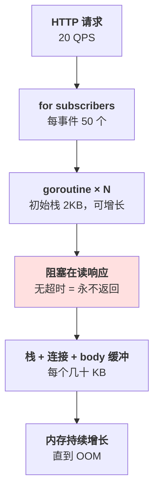
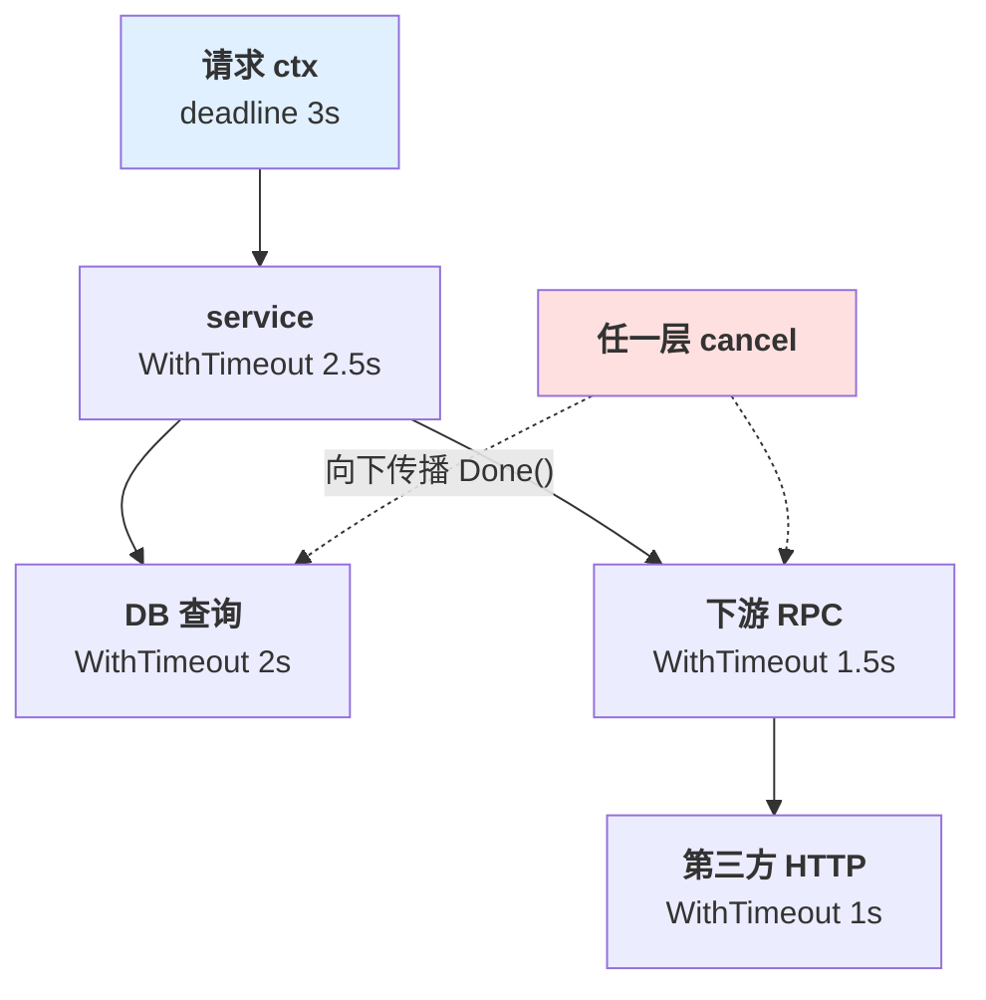
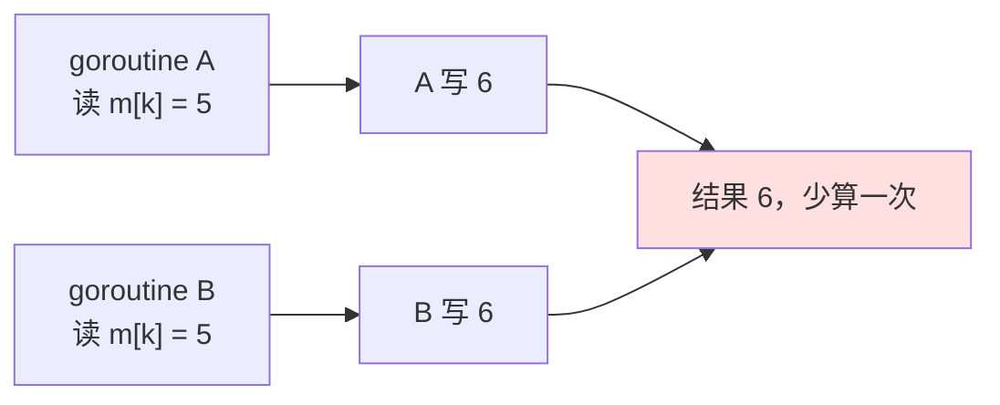
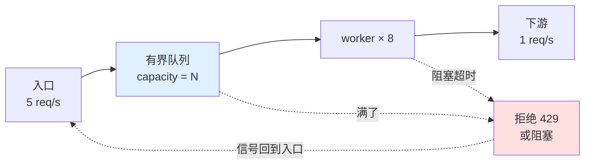

# 第 2 章 并发与生命周期

> **💡 30 秒速览**
> - goroutine 便宜但有栈 → 卡住不退出的一样占内存，4 万个连带连接和缓冲能吃掉近 2GB
> - `go f()` 没有返回值 → 错误不会自己回来，必须显式收集
> - context 是取消树 → 不传给 DB/HTTP，上层超时等于没设
> - 没有上限的并发 = 把入口流量放大成下游故障

一句话贯穿全章：**并发的关键不是「怎么开」，是「谁负责关、最多开多少」。**

四个知识点：`go.conc.goroutine` / `go.conc.context` / `go.conc.race` / `go.conc.backpressure`。

---

## 2.1 go.conc.goroutine —— 起一个协程很容易，让它退出很难

### 结论

**每个 goroutine 都必须有明确的退出条件；没有退出路径的 goroutine 就是内存泄漏。**
`go` 关键字不返回错误、不返回结果、不保证执行完——三件事都要自己补。

### 案例：40,000 个等不到响应的 goroutine

一个消息分发服务，收到事件后给订阅方推 webhook：

```go
func (s *Server) handleEvent(w http.ResponseWriter, r *http.Request) {
    var ev Event
    _ = json.NewDecoder(r.Body).Decode(&ev)

    for _, sub := range s.subscribers {
        go s.push(sub, ev)          // ← 每个订阅方一个 goroutine
    }
    w.WriteHeader(202)
}

func (s *Server) push(sub Subscriber, ev Event) {
    resp, err := http.Post(sub.URL, "application/json", body(ev))  // ← 无超时
    if err != nil {
        return                      // ← 错误直接丢掉
    }
    defer resp.Body.Close()
}
```

流量不大：每秒 20 个事件，每个事件 50 个订阅方，每秒最多 1000 次推送。

上线两周后，一个客户端的 webhook 地址挂了（TCP 能连上，但不返回）。`http.Post` 默认**没有超时**，
发给这个订阅方的 goroutine 全部永久卡在读响应上。**每秒 20 个事件，就是每秒泄漏 20 个 goroutine**，
半个小时后：

| 指标 | 数值 |
|---|---|
| goroutine 数 | 41,872（20/s × 约 35 分钟） |
| RSS | 1.9 GB |
| 容器 limit | 2 GB |
| 现象 | OOMKilled，重启后半小时再挂 |

**三个错误叠在一起：**

1. `http.Post` 没超时——goroutine 永远不退出
2. `go` 出去的协程没有上限——入口 QPS 直接变成下游并发
3. 错误被 `return` 吞掉——客户三天后才发现没收到通知

### 机制

🎯 **goroutine 像便利店里的临时工：招一个人很便宜，但他站在那儿不走，工位就一直被占。**



**goroutine 的开销分两块：**

- **固定部分**：栈（初始约 2KB，按需增长到 MB 级）、调度信息
- **可变部分**：它持有的连接、缓冲、闭包引用——往往比栈大得多

所以「goroutine 只要 2KB」这句话只在「它很快退出」时成立。不退出时，它拖着整条资源链。

**`go` 语句的三个缺失：**

| 你可能期待的 | 实际 |
|---|---|
| 返回值 / 错误 | 没有，要自己用 channel 或 errgroup 收 |
| 执行完成的通知 | 没有，要 `WaitGroup` 或 `done` channel |
| 异常传播 | 没有，panic 会打挂整个进程（除非 recover） |

### 误解靶子

| 错答 | 为什么错 |
|---|---|
| 「goroutine 很轻，多开点没事」 | 轻的是创建成本，不是驻留成本；卡住的协程拖着栈、连接和缓冲 |
| 「下游迟早会返回」 | 没有超时就不会返回；TCP 半开连接可以挂几天 |
| 「`go f()` 里的错误会在某处冒出来」 | 不会。没人接收就永远消失，连日志都没有 |
| 「请求结束了，它起的 goroutine 也会结束」 | 不会。HTTP handler 返回跟子 goroutine 没有生命周期绑定 |

### 判据

- **这个 goroutine 在什么条件下退出？** → 能列出所有分支（成功、失败、超时、取消），
  列不全就是有泄漏路径。
- **这台机器同时最多有多少个？谁在保证？** → 没有信号量/worker 数/队列长度，就是没有上限。
- **它失败时，谁会发现？** → 错误有没有进日志/指标/重试队列；只 `return` 就是没人知道。

### 自测题

1. 一个 handler 里 `go audit.Log(...)` 记录审计日志。进程收到 SIGTERM 时，这条日志一定会写出去吗？
2. 为什么「每个请求起一个 goroutine 去调下游」在下游变慢时会让故障放大，而不是仅仅变慢？
3. 用 `errgroup` 改写上面的 `push`，需要改哪几处？错误应该返回给谁？

---

## 2.2 go.conc.context —— 取消是一棵树

### 结论

**context 携带三样东西：取消信号、超时期限、请求作用域的值。**
它必须从入口一路传到最底层的阻塞调用；中间任何一层换成 `context.Background()`，取消就断在那里。

### 案例：客户端早就走了，查询还在跑

```go
func (h *Handler) ListOrders(w http.ResponseWriter, r *http.Request) {
    ctx, cancel := context.WithTimeout(r.Context(), 3*time.Second)
    defer cancel()

    orders, err := h.svc.List(ctx, r.URL.Query().Get("uid"))
    ...
}

func (s *Service) List(ctx context.Context, uid string) ([]Order, error) {
    return s.repo.List(context.Background(), uid)   // ← 断链
}

func (r *Repo) List(ctx context.Context, uid string) ([]Order, error) {
    rows, err := r.db.Query(ctx, "select ... where uid=$1", uid)
    ...
}
```

看起来超时设了 3 秒，实际行为：

| 场景 | 期望 | 实际 |
|---|---|---|
| 查询 10 秒 | 3 秒取消 | 跑满 10 秒，连接占 10 秒 |
| 用户关掉页面 | 立即取消 | 继续跑完 |
| 高峰期大量慢查询 | 连接池排队 | 池被慢查询占满，所有请求一起超时 |

**为什么 3 秒的 ctx 没生效**：`Service` 里换成了 `context.Background()`，repo 拿到的是一个
永远不会取消的 ctx。handler 的 `cancel()` 只取消了树上那一支，跟 repo 无关。

**第二个形态：把 ctx 存进结构体**

```go
type Service struct {
    ctx context.Context     // ← 反模式
    db  *pgxpool.Pool
}
```

请求 A 的 ctx 被请求 B 复用，A 取消时 B 的查询被莫名中断；或者 A 的 deadline 变成 B 的。
**通常把 ctx 显式作为第一个参数传递，避免将请求 ctx 存入长生命周期对象。** 这是一条生命周期设计建议，不是语言限制；兼容旧 API 等少数场景可以持有 ctx，但必须说明所有权、期限与取消责任。见 [Go 官方说明](https://go.dev/blog/context-and-structs)。

### 机制

🎯 **context 像公司里的项目号：立项时发一个，所有子任务都用它报销；项目一关，所有挂着这个号的
流程都知道该停。**



**三个字段的实际作用：**

| 能力 | 方法 | 用来做什么 |
|---|---|---|
| 取消 | `Done()` / `Err()` | 客户端断开、上层超时、主动中止 |
| 期限 | `Deadline()` | 把剩余时间传给下游（预算递减） |
| 值 | `Value(key)` | trace_id、tenant_id、auth —— **只放请求元数据，不放业务对象** |

**取消是协作式的**：ctx 只是发信号，阻塞中的代码必须自己监听 `ctx.Done()`。
`database/sql`、`net/http`、gRPC 的 `*Context` 方法都监听；自己写的 `time.Sleep`、
`chan recv`、第三方 SDK 不一定——这是「设了超时还卡住」的主要原因。

### 误解靶子

| 错答 | 为什么错 |
|---|---|
| 「handler 上设了超时，全链路就有了」 | 只要中间有一层用 `Background()`/`TODO()`，链就断了 |
| 「ctx 可以存起来复用」 | 它绑定一次请求的生命周期；复用会把别人的取消/期限带进来 |
| 「ctx 里可以放 db、user 对象」 | ctx 值不参与类型检查，取出来还要断言；只放元数据，依赖走构造注入 |
| 「`defer cancel()` 可有可无」 | 不 cancel 会泄漏定时器和父 ctx 的引用，长跑服务里会累积 |
| 「超时时间每层都设 3 秒就行」 | 预算要递减，否则下层可能比上层还晚超时，等于没有 |

### 判据

- **这个阻塞调用能不能被取消？** → 看它有没有 `*Context` 版本，ctx 是不是从入口传下来的。
- **各层超时相加是多少？** → 超过最外层，说明下层永远不会先超时，预算白设。
- **这个 ctx 从哪来、到哪去？** → 不是函数第一个参数、或存进结构体的，都是错的。
- **请求结束后，还有谁拿着这个 ctx？** → 有后台任务复用请求 ctx，就会在请求结束时被误杀。

### 自测题

1. 一个后台任务需要在请求返回后继续跑 5 分钟。直接用 `r.Context()` 会怎样？正确做法是什么？
2. 网关 3s、服务 2.5s、DB 2s、下游 3s。哪里有问题？会导致什么现象？
3. `context.WithValue` 存了 `*User`，三个月后另一个包用同名 key 取，会发生什么？为什么？

---

## 2.3 go.conc.race —— 数据竞争会杀死进程

### 结论

**数据竞争需要同一内存位置的读写或写写冲突，至少一个访问非同步，且两次访问未被happens-before排序。** 两个只读访问或对不同内存位置的访问，不因缺少锁就构成数据竞争。普通map的并发读写或写写可能被运行时检测并触发fatal；没崩溃也不代表安全。
用同步关系审查和 `go test -race` 收集证据；检测器只能发现实际执行路径中的竞争，不能证明所有路径无竞争。

### 案例：那个只在高峰期崩的服务

```go
type Counter struct {
    m map[string]int64
}

func (c *Counter) Inc(key string) {
    c.m[key]++          // ← 读 + 写，非原子
}
```

单测通过，压测通过，上线三周没事。大促当天 QPS 翻十倍：

```
fatal error: concurrent map writes

goroutine 1842 [running]:
...
```

**进程直接退出，没有 500、没有业务日志、没有优雅关闭**——stderr 上只有一行 `fatal error` 和栈。
一半请求被中断，客户端看到连接重置。

即使不崩，`m[key]++` 也是「读-改-写」三步，两个 goroutine 交错会丢计数。
Node 单线程不会遇到这个；Go 里这是默认风险。

**修复的三种选择：**

```go
// 1. 互斥锁：读多写少也够用
type Counter struct {
    mu sync.Mutex
    m  map[string]int64
}
func (c *Counter) Inc(k string) {
    c.mu.Lock()
    defer c.mu.Unlock()
    c.m[k]++
}

// 2. sync.Map：键集合大、读远多于写、且不需要整体遍历
var m sync.Map
m.LoadOrStore(k, int64(0))

// 3. 分片锁 / 原子操作：热点计数
atomic.AddInt64(&shard[idx], 1)
```

**怎么选**：需要「读全量做聚合」→ 用锁保护普通 map；纯 KV 高频读 → `sync.Map`；
单个计数器 → `atomic`。不要一上来就 `sync.Map`，它的遍历和内存开销更大。

### 机制

🎯 **数据竞争像两个人同时改同一张表格：不是谁覆盖谁的问题，是表格本身可能被撕坏。**



**先确认冲突，再判断happens-before**：同一位置的读写或写写、至少一个非同步访问，若没有happens-before排序才构成数据竞争。不能只凭“两个goroutine没加锁”判断；两个只读访问不是数据竞争，规范同步操作也不限于锁。

**`-race` 检测的是「这次执行中真实发生的冲突」**，所以：

- 没检测到 ≠ 没有竞争，只说明这次没触发
- CI 必须跑 `go test -race ./...`；有并发代码的服务，压测也要开
- 生产可以临时部署一个 `-race` 构建，并用 `GORACE=halt_on_error=1` 让第一次冲突就退出；
  [官方给出的典型开销](https://go.dev/doc/articles/race_detector)是内存约增至 5–10 倍、执行时间约增至 2–20 倍；具体依程序而异，部署前需评估容量与退出影响

### 误解靶子

| 错答 | 为什么错 |
|---|---|
| 「只是一次读，不会有问题」 | 读和写并发也是竞争；map 的读在扩容时会看到半成品结构 |
| 「加了 `sync.Mutex` 就安全」 | 锁保护的是「同一把锁下的所有访问」；有代码绕过锁直接读字段，照样竞争 |
| 「`sync.Map` 比普通 map 快」 | 只在特定模式（读多写少、键稳定）下快；泛型场景更慢，且没有类型安全 |
| 「本地跑没问题，线上也不会有」 | 竞争是否触发取决于调度和负载；低并发时几乎必然测不出来 |
| 「用 channel 就不用锁」 | channel 只保护通过它传递的数据；共享状态如果还有别的访问路径，一样要同步 |

### 判据

- **这块共享数据，所有读写路径是不是都在同一把锁/channel 下？** → 有一条绕过，就是没有保护。
- **CI 里有没有 `-race`？** → 没有，就等于没有并发测试。
- **这个字段为什么需要共享？** → 能改成「每个 goroutine 自己算，最后合并」的，优先改掉。

### 自测题

1. `sync.RWMutex` 的 `RLock` 在写锁等待时会阻塞新的读吗？这对读多写少的服务意味着什么？
2. 一个结构体有两个字段总是一起更新，只用一个 `Mutex` 保护够不够？如果拆成两把锁会怎样？
3. 为什么 `for k, v := range m { go func(){ use(k, v) }() }` 在 Go 1.22 之前是 bug，之后不是？
   如果循环体里写的是 `go func(){ use(m) }()` 呢？

---

## 2.4 go.conc.backpressure —— 上限与背压

### 结论

**并发必须有一个显式的上限，且上限满了要有明确策略：阻塞、拒绝、降级、扩容——四选一。**
「先收下来排队」不是策略，是把故障从下游搬到自己内存里。

### 案例：那个无限长的队列

一个导出服务，收到请求后丢进 channel，后台 8 个 worker 处理：

```go
jobs := make(chan Job, 100000)     // ← 10 万缓冲

func (s *Service) Submit(j Job) {
    jobs <- j                       // 满了会阻塞 handler
}
```

某天一个下游（对象存储）变慢，从 200ms 变成 8s。处理速度从 8/秒 掉到 1/秒，
但入口还是 6/秒。净增 5 条/秒，队列在约 5.5 小时内填满 10 万条，每条 Job 带着 20KB payload：

| 时间 | 队列长度 | 内存 | 用户感受（新任务预计等待） |
|---|---:|---:|---|
| T+0 | 0 | 200 MB | 正常 |
| T+2h | 36,000 | 约 900 MB | 36,000 条 ÷ 1 条/秒 ≈ 10 小时 |
| T+5.5h | 100,000 | 约 2.2 GB | 约 28 小时，且还在涨 |
| T+5.5h 后 | 满 | — | handler 阻塞，所有接口超时 |

**问题不在 channel 大小，在于「没有拒绝」。** 队列只是缓冲，不是容量。
缓冲一满，压力原样传回入口，而且带着二十几个小时的延迟和 2.2GB 的内存。

**正确的形状：**

```go
sem := make(chan struct{}, 32)          // 在途上限

func (s *Service) Submit(ctx context.Context, j Job) error {
    select {
    case sem <- struct{}{}:
        defer func() { <-sem }()
        return s.process(ctx, j)
    case <-ctx.Done():
        return ctx.Err()
    default:
        return ErrOverloaded            // 快速失败，返回 429 + Retry-After
    }
}
```

关键不是 32 这个数，是**「满了会发生什么」被写进了代码**。

### 机制

🎯 **背压像水管：下游关小了，上游要么关小、要么爆管，不能假装没看见。**



**四种上限，必须同时存在：**

| 上限 | 在哪 | 满了会怎样 |
|---|---|---|
| 入口并发 | 信号量 / worker 数 | 拒绝或排队 |
| 队列长度 | channel buffer / broker | 拒绝或丢弃 |
| 连接池 | `SetMaxOpenConns` | 请求排队 |
| 下游配额 | 客户端限流器 | 拒绝或降级 |

**只有当「拒绝」是可达的，系统才是可控的。** 如果每一层都选择「先收下来」，
最终总有一层会 OOM——那一层通常是你的进程。

**拒绝要可行动**：返回 429 + `Retry-After` + 错误体里说明是哪个资源满了；
只返回 500，客户端会立刻重试，把压力再放大一倍。

### 误解靶子

| 错答 | 为什么错 |
|---|---|
| 「channel 缓冲大一点就能扛住突发」 | 缓冲只吸收短时抖动；持续过载下，它只是把 OOM 推迟几小时 |
| 「加机器就行」 | 如果瓶颈是下游或数据库，加机器只是把更多并发压过去 |
| 「worker 越多吞吐越高」 | 超过下游并发能力后，worker 只是在等锁/等连接，还增加上下文切换 |
| 「失败了让客户端重试」 | 没有退避和 jitter 的重试是自我 DDoS；必须靠 429 + Retry-After 约束 |
| 「限流放在网关就够了」 | 网关看不到单实例、单租户、单下游的容量，服务内部仍要有保护 |

### 判据

- **队列满了会发生什么？** → 答「阻塞」「拒绝」「丢弃」「扩容」之一；答「不会满」就是没想过。
- **在途请求数的上限是多少？由哪个变量决定？** → 找不到变量，就是没有上限。
- **拒绝时返回什么？** → 429/503 + 可重试提示；返回 500 会把重试压力放大。
- **下游变慢 10 倍时，这个服务多久会挂？** → 用「队列容量 ÷ (入口速率 − 处理速率)」算，
  算不出来说明容量是拍脑袋定的。

### 自测题

1. 一个服务入口 100 QPS，处理能力 80 QPS，队列容量 10,000。多久填满？期间 P99 延迟怎么变？
2. 为什么「把 worker 数从 8 调到 64」在下游已经饱和时可能让吞吐下降？
3. 设计一个按租户限流的方案：共享一个全局信号量够不够？会出什么问题？

---

## 本章小结

| 从 Node 带来的直觉 | Go 的事实 | 补在哪 |
|---|---|---|
| 单线程，不用锁 | 一切共享状态都要同步，map 并发写会 fatal | 锁/channel/atomic + `-race` |
| 事件循环不会阻塞 | 阻塞只阻塞当前 goroutine，但会占住栈和连接 | 超时 + 有界并发 + 退出条件 |
| Promise 自带取消 | 取消靠 ctx 手动传，断一层就失效 | ctx 作为第一参数一路传到底 |
| 请求结束资源自动回收 | goroutine 不随请求结束 | 显式 WaitGroup / errgroup / 信号量 |

下一章：把这些 goroutine 放进一个真实服务，加上超时、连接池、幂等和优雅关闭——
也就是「上线之后不抖」的那一层。
