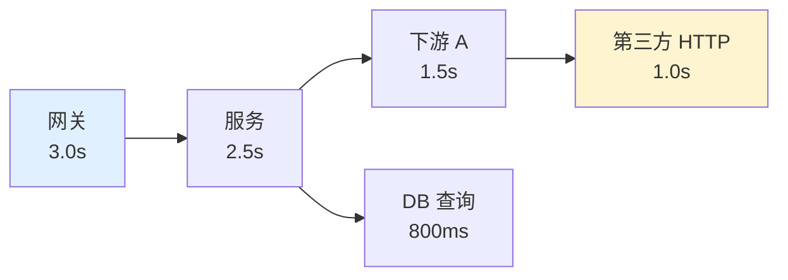
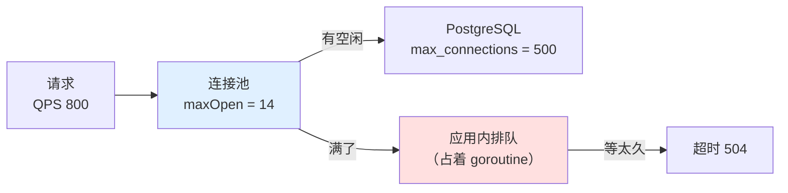
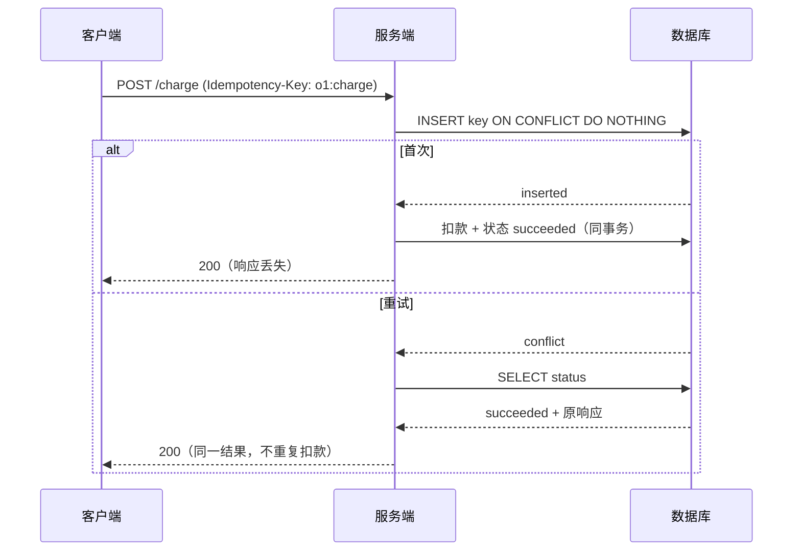
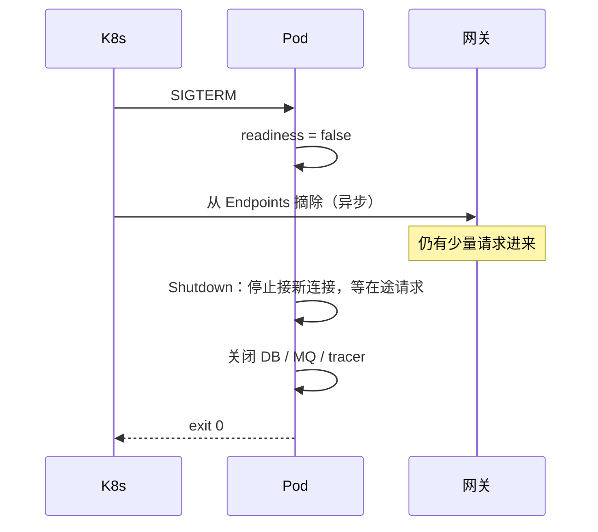

# 第 3 章 服务边界

> **💡 30 秒速览**
> - HTTP Server 和 Client 默认都**没有超时** → 一个卡住的下游能拖死整个服务
> - 连接池是排队的地方，不是性能开关 → 池越大，DB 越容易被打满
> - 超时 ≠ 没执行 → 没有幂等键，重试就是重复副作用
> - SIGTERM 不等于请求处理完 → 不摘流量直接退出，发布必抖

一句话贯穿全章：**服务边界上只有四个数：超时、池大小、幂等键、关闭时间。四个都要有来源。**

四个知识点：`go.svc.timeout` / `go.svc.pool` / `go.svc.idempotency` / `go.svc.shutdown`。

---

## 3.1 go.svc.timeout —— 超时是预算，不是开关

### 结论

**每一层都必须有超时，且下层超时之和 ≤ 上层超时。**
`http.Server` 和 `http.Client` 的零值都是「无限等待」——不设就是没有。

### 案例：一个 30 秒的下游，拖垮了 200 个接口

一个聚合服务，对外 200 个接口，依赖 12 个内部服务。上线时只配了网关超时：

```go
srv := &http.Server{
    Addr:    ":8080",
    Handler: mux,          // 没有 ReadHeaderTimeout / ReadTimeout / WriteTimeout
}

client := &http.Client{}   // 没有 Timeout

resp, err := client.Do(req) // 用 context.Background() 构造的 req
```

某个内部服务（用户画像）发布后变慢，从 80ms 变成 30s。现象：

| 时间 | 现象 | 根因 |
|---|---|---|
| +1min | 画像接口 P99 从 90ms 到 30s | 下游慢 |
| +3min | 调画像的 3 个接口开始 504 | 网关 3s 超时，但服务还在等 |
| +5min | 全站 P99 从 200ms 到 9s | 调画像的 goroutine 占满连接池与内存 |
| +8min | 所有接口 5xx | 健康检查也超时，实例被摘除；剩余实例压力翻倍 |

**注意链条**：没有超时的调用不会「失败」，它会**一直占着资源**。
占着 goroutine、占着连接、占着内存；当资源被占满，与画像无关的接口也开始排队。

**正确的配置形状：**

```go
// 1. Server：防慢连接和慢客户端
srv := &http.Server{
    Addr:              ":8080",
    Handler:           mux,
    ReadHeaderTimeout: 2 * time.Second,   // 防 Slowloris
    ReadTimeout:       5 * time.Second,
    WriteTimeout:      10 * time.Second,
    IdleTimeout:       60 * time.Second,
}

// 2. Client：必须设，且小于本服务的处理预算
client := &http.Client{
    Timeout: 2 * time.Second,
    Transport: &http.Transport{
        MaxIdleConns:        100,
        MaxIdleConnsPerHost: 20,
        IdleConnTimeout:     90 * time.Second,
    },
}

// 3. 每个出站请求再带一层 ctx，预算是「本层剩余时间 - 处理余量」
ctx, cancel := context.WithTimeout(ctx, 1500*time.Millisecond)
defer cancel()
req = req.WithContext(ctx)
```

### 机制

🎯 **超时像接力赛的交接时间：每一棒都必须在上一位到达前留出余量，否则最后一棒永远跑不完。**



**预算是减法，不是并列**：

- 服务总预算 2.5s
- 其中调用下游 A 最多 1.5s
- 下游 A 内部再调第三方，最多 1.0s
- 剩下的 1s 留给本地处理、序列化、重试

如果第三方设成 3s，它永远比服务晚超时——服务已经返回 504，第三方还在跑，
资源全白占。**下层的超时必须严格小于上层剩余预算。**

**三个默认值的坑：**

| 对象 | 零值行为 | 后果 |
|---|---|---|
| `http.Server` | 所有超时 0 = 不限制 | 慢连接、慢客户端可长期占用 goroutine |
| `http.Client` | `Timeout: 0` = 不限制 | 下游不返回就永远等 |
| `database/sql` 查询 | 取决于 ctx | 不传 ctx 就等 DB 自己超时；PostgreSQL 的 `statement_timeout` 默认是 0（不限），可能永远不返回 |

### 误解靶子

| 错答 | 为什么错 |
|---|---|
| 「网关设了 3s，服务就不用设」 | 网关超时只是断开客户端连接；服务仍在跑，资源仍在占 |
| 「超时越短越安全」 | 太短会把正常慢请求误杀，重试又把压力放大；要有 P99 依据 |
| 「每层都设 3s 就行」 | 外层 3s、内层也 3s，内层永远来不及返回，等于没设 |
| 「重试能提高成功率」 | 没有预算和退避的重试，在故障时会把成功率打得更低 |
| 「流式接口不需要超时」 | 首字节、空闲、总时长要分别设；否则一个挂住的 SSE 能占一整天 |

### 判据

- **这个请求最坏情况下要多久？** → 把各层超时加起来；超过上层，就是有层白设。
- **哪个超时是拍脑袋定的？** → 没有 P99/P999 依据的，都是。
- **下游不返回时，本服务多久释放资源？** → 答不出具体秒数，就是没设。
- **流式接口的空闲超时是多少？** → 没有单独设置，长连接会被中间层静默掐断。

### 自测题

1. 网关 3s，服务 handler 里 `context.WithTimeout(ctx, 5*time.Second)`。会发生什么？
2. 一个接口要串行调 3 个下游，每个 1s 超时，服务总超时 2s。第 3 个调用还有多少预算？应该怎么改？
3. 为什么 `http.Server` 的 `ReadHeaderTimeout` 单独存在？只设 `ReadTimeout` 不够吗？

---

## 3.2 go.svc.pool —— 连接池是排队区

### 结论

**连接池不是越大越快。** 池上限 × 实例数必须小于数据库的 `max_connections`；
池满时请求会在应用内排队，队列必须有界且可观测。

### 案例：20 个 Pod 打满了数据库

```go
db, _ := sql.Open("pgx", dsn)     // 没有 SetMaxOpenConns
```

`database/sql` 的默认值：

| 参数 | 默认 | 含义 |
|---|---:|---|
| `MaxOpenConns` | 0 | **无限制** |
| `MaxIdleConns` | 2 | 空闲连接只有 2 个，频繁建连 |
| `ConnMaxLifetime` | 0 | 连接永不过期 |

服务部署 20 个 Pod，每个 Pod 在高峰期开到 40+ 连接，数据库 `max_connections=500`。
某次扩容到 30 个 Pod：

```
FATAL: sorry, too many clients already (SQLSTATE 53300)
```

**所有 Pod 同时开始报错**，重试又加剧连接建立，形成雪崩。更隐蔽的后果是：
数据库为每个连接分配内存，连接打满后，连管理员都连不进去排查。

**正确的做法是先算，再设：**

```
DB 可用连接 = max_connections - 管理保留（约 20） - 其他服务占用
单实例上限 = 可用连接 / 最大实例数（按 HPA 上限算，不是当前副本数）
```

例如 500 - 20 - 80 = 400，HPA 最多 25 个 Pod → 每实例 `MaxOpenConns = 16`。
再留一点余量，设 12–14。

```go
db.SetMaxOpenConns(14)
db.SetMaxIdleConns(14)                    // 与 MaxOpen 接近，避免频繁建连
db.SetConnMaxLifetime(30 * time.Minute)   // 短于 DB/LB 的空闲断开时间
db.SetConnMaxIdleTime(5 * time.Minute)
```

### 机制

🎯 **连接池像停车场：车位不是越多越好，出口（数据库）一次只能放行这么多车。**



**池子解决的是「复用连接」，不是「提高并发」。**
数据库的并发能力由 CPU、内存、锁、IO 决定；池子只是把等待位置从 DB 内部搬到应用内，
让等待可观测、可超时。

**排队必须能被取消**：`QueryContext` 而不是 `Query`，否则排队中的请求在客户端断开后仍占着位置。

### 误解靶子

| 错答 | 为什么错 |
|---|---|
| 「池子开大点，吞吐就上去了」 | 超过 DB 能力后，吞吐不变、延迟上升，还可能触发 `too many clients` |
| 「默认值应该够用」 | `MaxOpenConns=0` 是无限制，`MaxIdleConns=2` 会导致频繁建连 |
| 「每个请求开一个连接最公平」 | 建连成本（TCP + TLS + 认证）远高于复用；高 QPS 下直接打爆 DB |
| 「连接永不过期更省事」 | 中间 LB/DB 会主动断开空闲连接；不过期会拿到半死连接，报 `broken pipe` |

### 判据

- **池上限 × 最大副本数 ≤ DB 上限吗？** → 算一遍；按 HPA 上限算，不是当前副本。
- **池满了，请求会怎样？** → 排队多久、能否取消、有没有指标；答不出就是黑盒。
- **连接空闲多久会被中间层断掉？** → `ConnMaxLifetime` 必须短于它。
- **有没有连接泄漏？** → 看 `pg_stat_activity` 的连接数与 QPS 是否同步增长。

### 自测题

1. `MaxOpenConns=100`、20 个 Pod、DB 上限 500。哪个数字错了？可能的两种故障是什么？
2. 为什么 `SetMaxIdleConns` 设成 0 会让延迟变高，但吞吐未必下降？
3. 一个慢查询把池占满，如何在不加连接数的前提下缓解？给出两种手段。

---

## 3.3 go.svc.idempotency —— 超时不是失败

### 结论

**「没收到响应」和「没执行」是两件事。** 对任何有副作用的操作，重试前必须有幂等键或状态查询；
否则重试就是重复扣款、重复发消息、重复建单。

### 案例：一次超时，扣了两次款

```go
func (c *Client) Charge(ctx context.Context, orderID string, amount int64) error {
    return c.post(ctx, "/charge", map[string]any{
        "order_id": orderID,
        "amount":   amount,
    })
}
```

调用方：

```go
if err := client.Charge(ctx, id, amt); err != nil {
    return retry(3, func() error { return client.Charge(ctx, id, amt) })
}
```

第一次请求到达支付服务，扣款成功，但在返回路上网络超时。客户端认为失败，重试两次。
**用户被扣三次。** 支付服务没有幂等键，每次都当成新请求。

**修复不是「别重试」，是让重试安全：**

```go
// 客户端：同一个业务动作，永远用同一个键
req.Header.Set("Idempotency-Key", orderID+":charge")

// 服务端：唯一索引 + 状态机
// idempotency_keys(key PK, request_hash, status, response_body, created_at)

func (s *Service) Charge(ctx context.Context, key string, req ChargeReq) (Resp, error) {
    // 1. 先占位（INSERT ... ON CONFLICT DO NOTHING）
    inserted, err := s.store.InsertKey(ctx, key, hash(req))
    if err != nil { return Resp{}, err }

    if !inserted {
        // 2. 已存在：要么返回上次结果，要么告诉调用方「处理中」
        rec, err := s.store.GetKey(ctx, key)
        if err != nil { return Resp{}, err }
        switch rec.Status {
        case "succeeded":
            return rec.Response, nil          // 结果复用
        case "processing":
            return Resp{}, ErrInProgress      // 让调用方稍后查
        case "failed":
            // 允许重试，但要保证状态转换是原子的
        }
    }

    // 3. 真正执行，结果与状态在同一事务里落库
    return s.doCharge(ctx, key, req)
}
```

**关键点：**

- 键由**客户端按业务动作生成**，不是服务端随机生成
- 占位与执行要么同事务，要么用状态机 + 补偿
- 「处理中」必须是一个明确状态，不能当成失败

### 机制

🎯 **超时像寄快递没收到签收回执：包裹可能已经到了，也可能还在路上，你不能直接再寄一份。**



**幂等键的三个要素：**

| 要素 | 作用 | 常见错误 |
|---|---|---|
| 键 | 标识「同一个业务意图」 | 用随机 UUID，每次重试都不同 |
| 请求指纹 | 防止同键不同参数被误复用 | 不校验，键冲突时直接返回旧结果 |
| 状态 | 区分成功/处理中/失败 | 只有成功/失败，处理中被当失败重试 |

**幂等 ≠ 去重**：去重是「相同请求只处理一次」，幂等是「处理多次，效果与一次相同」。
后者可以用唯一索引、状态机、版本号实现，不一定需要去重表。

### 误解靶子

| 错答 | 为什么错 |
|---|---|
| 「超时就是失败了」 | 请求可能已到达并执行，只是响应丢了 |
| 「让客户端生成 UUID 就行」 | 每次重试都生成新 UUID，等于没有幂等键 |
| 「加了唯一索引就幂等」 | 唯一索引只能防重复插入；更新、扣款、发消息不会触发唯一冲突 |
| 「重试三次，每次间隔 1s」 | 没有退避和 jitter，故障时三次重试会在同一秒打到同一个实例 |
| 「幂等只对写接口重要」 | 读接口重试无害，但读接口触发计费/审计/缓存写入时同样有副作用 |

### 判据

- **这个接口被原样重放两次，会发生什么？** → 能说出「第二次返回什么、副作用几次」才算清楚。
- **幂等键从哪来？** → 由业务动作决定，且重试时不变；随机生成的都不算。
- **同键不同参数怎么处理？** → 返回 409 或明确错误，不能静默复用旧结果。
- **「处理中」状态存在吗？** → 没有它，超时重试一定会撞上「正在执行」。

### 自测题

1. 支付接口的超时时间 3s，实际扣款平均 2.8s。这个设计有什么系统性风险？
2. 幂等键用 `userID + amount` 生成，有什么问题？举一个会被误判为重复的场景。
3. 一个消息消费失败后重投，消费逻辑是「给用户加 100 积分」。怎么保证不重复加？

---

## 3.4 go.svc.shutdown —— 发布不抖的顺序

### 结论

**优雅关闭是一个顺序问题：先让流量不再进来（readiness），再等在途请求结束，最后关连接池。**
顺序错了，发布期间必然出现 5xx。

### 案例：每次发布 30 秒的 502

服务用 K8s 滚动发布，副本 10 个。每次发布，监控上都会出现一小段 5xx：

```
deployment:  user-service  rollout  ✔
5xx rate:    0.3% → 4.1% → 0
持续时间:     ~40s
```

代码：

```go
func main() {
    srv := &http.Server{Addr: ":8080", Handler: mux}
    go srv.ListenAndServe()
    signal.Notify(ch, syscall.SIGTERM)
    <-ch
    os.Exit(0)          // ← 直接退出
}
```

**发生的事：**

1. Pod 进入 Terminating：从 Endpoints 摘除和发 SIGTERM **几乎同时**发生，摘除是异步的，通常更慢
2. 容器收到 SIGTERM，`os.Exit(0)` 立刻杀死进程
3. 仍在处理中的请求、仍指向这个 Pod 的 Service 连接，全部断开
4. readiness 也没摘干净，网关继续转发几百毫秒

**正确的顺序：**

```go
ctx, stop := signal.NotifyContext(context.Background(), syscall.SIGTERM)
defer stop()

go srv.ListenAndServe()

<-ctx.Done()

// 1. 先让 readiness 返回失败（K8s 停止转发），给 Endpoints 同步留时间
ready.Store(false)
time.Sleep(5 * time.Second)      // 与下面的 preStop 二选一，不要两处都 sleep

// 2. 等在途请求结束；超时后强制关
shutdownCtx, cancel := context.WithTimeout(context.Background(), 25*time.Second)
defer cancel()
if err := srv.Shutdown(shutdownCtx); err != nil {
    srv.Close()
}

// 3. 最后关依赖（DB、MQ、tracer），确保缓冲刷盘
db.Close()
```

K8s 侧配套：

```yaml
terminationGracePeriodSeconds: 40     # ≥ 摘流量等待 + Shutdown 超时 + 余量（如 5 + 25 + 10）
lifecycle:
  preStop:
    exec:
      command: ["sh", "-c", "sleep 5"]   # 代码里已有 sleep 时删掉这段，否则会叠加
```

### 机制

🎯 **关闭像关店：先挂「停止营业」的牌子，再请店内客人离开，最后关灯锁门。**
先关灯，客人会被困在里面。



**两个容易漏的点：**

- `Shutdown` 不会等被 `go` 出去的 goroutine（比如异步写审计），它们不在 `http.Server` 的管理范围
- `defer cancel()` 在 `main` 里要显式调用；`os.Exit` 不会执行 defer

### 误解靶子

| 错答 | 为什么错 |
|---|---|
| 「K8s 会保证请求不丢」 | 摘除 Endpoints 是异步的，Pod 退出前仍有流量进来 |
| 「收到 SIGTERM 立刻退出最快」 | 最快，也最容易 5xx；发布抖动全部由用户承担 |
| 「`Shutdown` 会等所有 goroutine」 | 只等 HTTP 连接；后台任务要自己用 WaitGroup 管理 |
| 「grace period 设大一点就行」 | 不摘 readiness、不调 Shutdown，设多大都是直接杀 |
| 「本地 Ctrl+C 没问题，线上也一样」 | 本地是交互终止，线上是滚动发布 + 负载均衡，链路不同 |

### 判据

- **SIGTERM 到进程退出，中间有几步？顺序是什么？** → 少于三步（摘流量、等在途、关依赖），就是没做。
- **最长请求要多久？grace period 够吗？** → `grace > preStop + shutdown timeout + 余量`。
- **后台 goroutine 由谁等？** → 没有 WaitGroup，就会在关闭时丢任务。
- **关闭时缓冲有没有刷盘？** → 日志、trace、消息都要显式 flush。

### 自测题

1. `terminationGracePeriodSeconds=30`，preStop sleep 5s，Shutdown 超时 30s。哪里不对？
2. 一个 SSE 接口持续 10 分钟。滚动发布时，优雅关闭应该怎么处理这类连接？
3. 为什么「先关 DB 再 Shutdown HTTP」会导致一批 500？画出顺序。

---

## 本章小结

| 边界 | 必须有的数 | 没有会怎样 |
|---|---|---|
| 超时 | 每层预算，且下层 < 上层 | 一个慢依赖拖垮所有接口 |
| 连接池 | maxOpen × 副本 ≤ DB 上限 | `too many clients`，全站雪崩 |
| 幂等 | 业务动作级键 + 状态机 | 重试造成重复扣款/发货 |
| 关闭 | 摘流量 → 等在途 → 关依赖 | 每次发布固定比例 5xx |

下一章：请求能进来了，也能安全退出了。接下来是**数据本身**——事务边界、
索引、以及跨系统「至少一次」怎么不重复。
