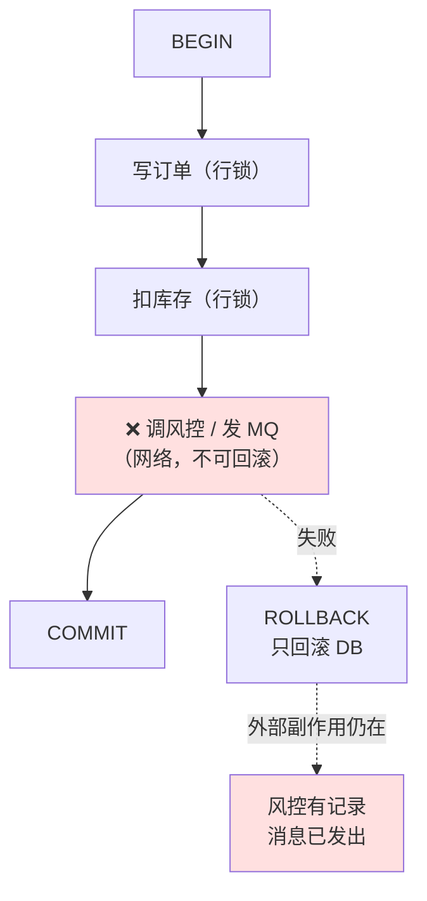
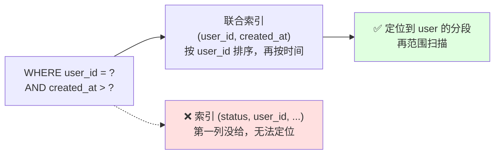
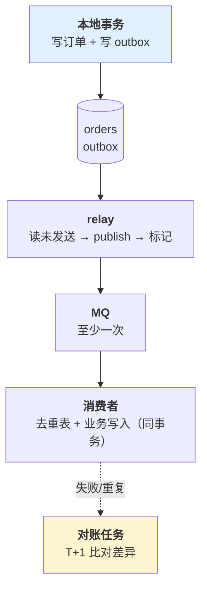

# 第 4 章 数据与一致性

> **💡 30 秒速览**
> - 事务只保证「同库、同事务内」原子 → 事务里调外部接口，回滚不撤销副作用
> - 事务越长，锁越久、WAL 越大、vacuum 越追不上
> - 索引不是「加了就走」→ 函数、隐式类型转换、最左前缀都会让它失效
> - MQ 是至少一次 → 没有幂等的消费，重投一次就是重复一次

一句话贯穿全章：**数据库能保证的只有「一个事务内」；跨出这个边界，就要靠消息、幂等和对账。**

三个知识点：`go.data.tx` / `go.data.index` / `go.data.consistency`。

---

## 4.1 go.data.tx —— 事务边界

### 结论

**一个业务动作一个事务；事务内只做数据库操作；事务外才发出站请求。**
事务的正确性由「哪些操作必须一起成功」决定，不由「代码写在哪个函数里」决定。

### 案例：事务里调了一次 HTTP

```go
func (s *Service) CreateOrder(ctx context.Context, req CreateOrderReq) error {
    tx, err := s.db.Begin(ctx)
    if err != nil { return err }
    defer tx.Rollback(ctx)          // 标准写法：已提交后再 Rollback 返回 pgx.ErrTxClosed（database/sql 是 sql.ErrTxDone），无害

    orderID, err := s.repo.InsertOrder(ctx, tx, req)
    if err != nil { return err }

    // 占用优惠券（同一库，应该留在事务里）
    if err := s.repo.LockCoupon(ctx, tx, req.CouponID); err != nil {
        return err
    }

    // ❌ 通知风控（外部服务，网络调用）
    if err := s.riskClient.Check(ctx, orderID); err != nil {
        return err                  // 回滚订单，但风控那边已经收到了一条记录
    }

    // ❌ 发消息（MQ）
    if err := s.mq.Publish(ctx, "order.created", orderID); err != nil {
        return err
    }

    return tx.Commit(ctx)
}
```

**三个问题，一个比一个严重：**

| 问题 | 后果 |
|---|---|
| 事务里调风控（平均 120ms，P99 3s） | 订单行锁持有 3s；同一商品的库存更新全部排队 |
| 风控成功、订单回滚 | 风控有一条不存在的订单；对账时永远对不上 |
| 消息先发、事务后提交 | 事务回滚后，下游已经按「订单已创建」发货 |

**正确顺序：先在事务内完成所有本地状态变更并提交，再发出站动作；出站失败用补偿或对账，不靠回滚。**

```go
func (s *Service) CreateOrder(ctx context.Context, req CreateOrderReq) (string, error) {
    // 1. 本地事务：订单 + 库存 + 优惠券 + outbox 事件，一起提交
    orderID, err := s.tx.WithinTx(ctx, func(tx pgx.Tx) (string, error) {
        id, err := s.repo.InsertOrder(ctx, tx, req)
        if err != nil { return "", err }
        if err := s.repo.DeductStock(ctx, tx, req.SKU, req.Qty); err != nil { return "", err }
        if err := s.outbox.Append(ctx, tx, "order.created", id); err != nil { return "", err }
        return id, nil
    })
    if err != nil { return "", err }

    // 2. 事务外：风控是异步的，失败不回滚订单，进人工/补偿队列
    _ = s.risk.Enqueue(ctx, orderID)

    return orderID, nil
}
```

**第二个案例：长事务把库拖死**

一个批量导入，循环里每 1000 条 `INSERT`，整个循环包在一个事务里，处理 50 万行。
事务持续 8 分钟：

- 持有大量行锁，其他写入排队
- WAL 暴涨，磁盘告警
- `autovacuum` 被长事务阻塞，表膨胀
- 一旦失败，8 分钟全部白做

**改法**：按批提交（每 1000 条一个事务），记录进度，可断点续跑。
代价是「部分成功」，需要业务接受或补偿——这是明确的取舍，不是偷懒。

### 机制

🎯 **事务像一间只能锁一次的房间：你在里面待得越久，外面排队的人越多；而且房间里做的事，
出了门就不受它保护了。**



**ACID 是「一个事务管理器」给出的承诺；跨系统后没有共同的提交点。**
各库只能保证自己的 A（原子性）和 I（隔离性），谁也不保证「两个库一起成功」；
C（一致性）变成应用责任，要靠补偿推进；D（持久性）取决于每个系统自己的落盘与复制策略。
跨系统的原子性不存在（除非两阶段提交，代价极高），只能用「本地事务 + 消息 + 幂等 + 对账」逼近。

**事务内的三条禁令：**

1. 不做网络调用（HTTP/RPC/MQ/LLM）
2. 不做耗时计算（图片处理、加密大文件）
3. 不等待用户输入（审批、确认）

**隔离级别要能讲清**：PostgreSQL 默认 `READ COMMITTED`，同一事务内两次查询可能看到不同结果；
需要「读到的版本不变」用 `REPEATABLE READ`；计数器更新用行锁或原子 SQL，不要「先查再改」。

### 误解靶子

| 错答 | 为什么错 |
|---|---|
| 「包在事务里就安全了」 | 只对同库操作成立；外部调用、消息、文件写入都不受事务控制 |
| 「事务里发消息，失败一起回滚」 | 消息已经投递出去，回滚不会撤回；消费者可能已经开始处理 |
| 「事务越大越原子」 | 原子性没变，锁持有时间和失败代价变大了 |
| 「先查再更新不会有并发问题」 | 两个事务都读到旧值，后写的覆盖前写的（lost update）；要 `UPDATE ... SET x = x - 1 WHERE x >= 1` |
| 「回滚了就等于没发生」 | 序列、自增 ID、外部副作用、日志都不会回滚 |

### 判据

- **这个事务里有没有网络调用？** → 有就拆出去，改用 outbox/补偿。
- **这个事务最长持有多久？** → 超过 100ms 就要问为什么；超过 1s 基本不可接受。
- **回滚时，哪些副作用不会撤销？** → 列不出来，说明边界没想清。
- **两个并发请求改同一行，最终值是什么？** → 用「先查再改」实现的，答案是不可预期。

### 自测题

1. 一个「下单 + 扣库存 + 发短信」的流程，短信必须在下单成功后发。事务应该怎么划？
2. `SELECT ... FOR UPDATE` 和 `UPDATE ... WHERE stock >= n` 都能防超卖，各自的代价是什么？
3. 批量导入 50 万行，要求「失败可重试且不重复」。设计提交粒度和进度记录。

---

## 4.2 go.data.index —— 查询与索引

### 结论

**索引是否生效，只能由 `EXPLAIN (ANALYZE, BUFFERS)` 回答，不能靠猜。**
最常见的失效原因：索引列上做函数/类型转换、联合索引不满足最左前缀、区分度太低。

### 案例：加了索引，查询还是 3 秒

```sql
-- 表 orders 有 800 万行，已建索引 idx_orders_created_at
SELECT id, user_id, amount
FROM orders
WHERE date(created_at) = '2026-11-01'
  AND status = 'paid';
```

`EXPLAIN ANALYZE` 显示 `Seq Scan on orders (cost=0..180000 rows=... actual time=2840ms)`。

**原因**：`date(created_at)` 在索引列上套了函数，B-tree 索引无法用于过滤。

改成范围查询，索引立刻生效：

```sql
WHERE created_at >= '2026-11-01 00:00:00+08'
  AND created_at <  '2026-11-02 00:00:00+08'
```

**第二个案例：联合索引顺序反了**

```sql
CREATE INDEX idx ON orders (status, user_id, created_at);

-- 查询只带 user_id + created_at，没有 status
SELECT * FROM orders WHERE user_id = $1 AND created_at > $2 ORDER BY created_at DESC LIMIT 20;
```

联合索引 `(status, user_id, created_at)` 的 B-tree 先按 status 排，`user_id` 不是第一列，
无法直接定位。要么补 `status` 条件，要么建 `(user_id, created_at)`。

> **版本提醒**：PostgreSQL 18 起 B-tree 支持 skip scan——前导列缺少等值条件（或只有非等值条件）、
> 而后续列有具体条件时，索引仍可能被使用（前导列基数越低越容易生效）。官方原文：
> *"when there are no restrictions on the first or early indexed columns (or there are non-equality ones),
> and there are useful restrictions on later indexed columns"*。
> 这是优化器多了一条路，不改变「索引要按查询设计」的结论：不要指望它救一个前导列基数和查询形态都不对的索引，
> 而且 PG 16/17 上没有这个能力。

**第三个案例：循环里的 N+1**

```go
for _, o := range orders {                 // 100 条订单
    items, _ := repo.ItemsByOrder(ctx, o.ID)  // 100 次查询
    o.Items = items
}
```

单次 2ms，100 次 200ms；加上网络往返，接口 P99 从 30ms 到 400ms。
改成一次 `WHERE order_id = ANY($1)` 批量查，再在内存里分组。

### 机制

🎯 **索引像书的目录：按「章节 → 小节 → 页码」排序。你只给「页码」，目录帮不上忙。**



**B-tree 索引的适用条件：**

| 条件 | 说明 |
|---|---|
| 最左前缀 | `(a,b,c)` 能服务 `a`、`a+b`、`a+b+c`，不能单独服务 `b` |
| 列上无函数 | `date(col)`、`lower(col)`、`col::text` 都会失效（除非建表达式索引） |
| 类型一致 | PostgreSQL 多半直接报 `operator does not exist`（如 `varchar` 列传 `int`），不会悄悄转换；MySQL 才做隐式转换，代价可能是索引失效。用 `col::text` / `CAST(col AS ...)` 把**列**包起来，等于在索引列上套函数，照样用不上索引 |
| 区分度足够 | 只有两种值的列（如 `is_deleted`）单独建索引意义很小 |
| 选择性 vs 回表 | 返回行数占比高时，全表扫描反而更快，优化器会放弃索引 |

**读 `EXPLAIN` 只看三件事：**

1. 是 `Seq Scan` 还是 `Index Scan`（或 `Bitmap Heap Scan`）
2. `rows` 估算与实际差多少（差 10 倍以上，统计信息可能过期，跑 `ANALYZE`）
3. `actual time` 花在扫描还是回表（`Buffers: shared read` 高说明没命中缓存）

### 误解靶子

| 错答 | 为什么错 |
|---|---|
| 「加了索引查询就会快」 | 函数、类型转换、最左前缀、低区分度都会让它失效 |
| 「索引越多越好」 | 每个索引都增加写入成本和磁盘；优化器选择也变多 |
| 「`LIKE '%xx%'` 加索引就行」 | 前置通配符无法走 B-tree；需要全文检索或 trigram 索引 |
| 「`ORDER BY` 随便加」 | 排序字段不在索引顺序里，会触发外部排序（`Sort Method: external merge`） |
| 「分页 `OFFSET 100000` 没问题」 | 越翻越慢，因为要扫描并丢弃前 10 万行；用游标（keyset）分页 |

### 判据

- **这条 SQL 走哪个索引？** → `EXPLAIN (ANALYZE, BUFFERS)` 给出答案，不猜。
- **`rows` 估算和实际差多少？** → 差一个数量级，先 `ANALYZE` 再看。
- **索引列上有没有函数或类型转换？** → 有就改成范围条件或表达式索引。
- **这个接口的查询次数是常数吗？** → 随列表长度增长的，就是 N+1。

### 自测题

1. `WHERE created_at::date = $1` 为什么用不上 `created_at` 上的索引？改写成什么？
2. 联合索引 `(tenant_id, status, created_at)`，查询 `WHERE tenant_id=? AND created_at>? ORDER BY created_at`。
   能走索引吗？能走多少？怎么建更合适？
3. 深分页 `LIMIT 20 OFFSET 200000` 慢在哪？keyset 分页的 WHERE 条件长什么样？

---

## 4.3 go.data.consistency —— 至少一次与最终一致

### 结论

**消息系统默认至少一次：不丢，但会重复。**
消费必须幂等；跨系统的「业务成功 + 消息发出」必须用 Outbox 或事务消息；最后必须有对账。

### 案例：部署窗口里丢掉的 280 单

```go
func (s *Service) CreateOrder(ctx context.Context, req CreateOrderReq) error {
    if err := s.repo.Insert(ctx, req); err != nil {
        return err
    }
    return s.mq.Publish(ctx, "order.created", req.ID)   // ← 两步，非原子
}
```

发布期间，进程在 `Insert` 成功后、`Publish` 前被滚动重启。每次发布 10 个 Pod，
每个 Pod 有约 **2 秒**的窗口（被 SIGKILL，或 `defer` 没跑完就退出），合计 20 秒暴露时间。
按 2 万单/天（约 0.23 单/秒）算，一次发布丢 4～5 单；一天发 5 次，就是二十几单。
某个大促当天订单涨到 10 万单/天（约 1.16 单/秒），又发了 12 次版，
累计丢了约 280 单，直到用户投诉「付款了没发货」才被发现。

估算暴露单量只需要三个数：**单量速率 × Pod 数 × 每 Pod 窗口**。
三者都不起眼，乘起来就是事故；补一个唯一键去重或 outbox，成本远低于事后对账。

**反过来也有问题**：先 `Publish` 再 `Insert`，消息发出后插入失败（唯一键冲突、DB 超时），
下游按「订单已创建」扣了库存，本地却没有订单。

**Outbox 把两步变一步：**

```go
func (s *Service) CreateOrder(ctx context.Context, req CreateOrderReq) error {
    return s.tx.WithinTx(ctx, func(tx pgx.Tx) error {
        if err := s.repo.Insert(ctx, tx, req); err != nil {
            return err
        }
        // 同库、同事务：业务数据和待发消息一起提交
        return s.outbox.Append(ctx, tx, "order.created", req.ID)
    })
}

// 独立 relay：轮询/CDC 读取未发送的 outbox，投递后标记 sent
func (r *Relay) Run(ctx context.Context) {
    for {
        rows := r.outbox.FetchUnsent(ctx, 100)
        for _, m := range rows {
            if err := r.mq.Publish(ctx, m.Topic, m.Payload); err == nil {
                r.outbox.MarkSent(ctx, m.ID)     // 至少一次：可能重复，消费方去重
            }
        }
        time.Sleep(time.Second)
    }
}
```

**消费方还必须幂等**，因为 relay 可能重复投递（投递成功但标记失败）：

```go
func (h *Handler) OnOrderCreated(ctx context.Context, msg Message) error {
    return h.tx.WithinTx(ctx, func(tx pgx.Tx) error {
        // 唯一索引：processed_events(event_id PK)
        inserted, err := h.repo.MarkProcessed(ctx, tx, msg.ID)
        if err != nil { return err }
        if !inserted {
            return nil                  // 已处理过，直接确认
        }
        return h.repo.DeductStock(ctx, tx, msg.OrderID)
    })
}
```

**最后是对账**：每天比对「订单表」与「下游发货表」，把差异写入修复队列。
对账不是承认失败，是一致性方案的最后一道保证。

### 机制

🎯 **Outbox 像「先把要说的话写在日记本上，再出门寄信」：日记和事情在同一个本子上，
即使信没寄出去，第二天也能从本子上找到。**



**三种一致性方案的取舍：**

| 方案 | 保证 | 代价 | 适用 |
|---|---|---|---|
| 本地事务 | 同库原子 | 无法跨系统 | 单库内业务 |
| Outbox + 幂等消费 | 最终一致，不丢 | 有延迟、要维护 relay | 绝大多数跨服务场景 |
| 分布式事务（2PC） | 强一致 | 性能差、协调者单点、实现复杂 | 极少，金融核心才考虑 |

**排序问题**：只有「同一分区 + 单消费者」才有顺序保证，跨分区没有全局顺序。
订单的「创建/支付/取消」要按 `order_id` 做分区键、同分区内串行消费，否则消费者可能先看到「取消」再看到「创建」。
注意分区键选 `order_id` 保证的是**同一订单内**有序，不是全局按时间有序——需要全局顺序的场景，MQ 帮不上忙。

### 误解靶子

| 错答 | 为什么错 |
|---|---|
| 「发消息成功了，业务就成功了」 | 两者不在一个事务里；中间崩溃会丢消息或发出无效消息 |
| 「MQ 保证不重复」 | 主流 MQ 是至少一次；重复是正常现象，不是异常 |
| 「消费失败就无限重试」 | 毒消息会堵住分区；要有重试上限 + 死信队列 + 人工处理 |
| 「最终一致 = 不用管」 | 最终一致需要「谁来推进」：relay、重试、对账，缺一个就停在中间态 |
| 「消息按发送顺序到达」 | 只有同分区且单消费者才近似有序；跨分区没有全局顺序 |

### 判据

- **这条消息重复消费两次，业务会怎样？** → 有唯一键/去重表才算安全。
- **业务提交成功但消息没发出，谁会发现？** → 没有 relay/对账，就是永久丢失。
- **消息发出但业务回滚，下游会怎样？** → 会按不存在的业务执行；需要 outbox 或可撤销设计。
- **毒消息会堵多久？** → 没有最大重试次数和死信队列，会永久堵住分区。

### 自测题

1. Outbox 的 relay 投递成功、标记失败，会发生什么？消费方需要什么保证？
2. 订单和支付两个服务都要发「订单已支付」消息，怎么保证下游只处理一次？
3. 对账发现「下游有、上游没有」和「上游有、下游没有」两种差异，修复策略有什么不同？

---

## 本章小结

| 从 Node/ORM 带来的直觉 | 事实 | 补在哪 |
|---|---|---|
| 事务里可以随便调接口 | 外部副作用不受事务控制 | 事务内只做 DB，出站走 outbox/补偿 |
| 加了索引就快 | 函数/类型/最左前缀会让索引失效 | `EXPLAIN (ANALYZE, BUFFERS)` |
| 消息发出去就一定会处理一次 | 至少一次，可能重复、可能乱序 | 幂等消费 + 分区键 + 死信 |
| 最终一致是自动的 | 需要 relay、重试、对账推进 | Outbox + 对账任务 |

下一章：系统能正确写入了。但**出了问题你怎么知道、怎么定位**——这是可观测性要解决的。

## 保证范围补充

本章“至少一次+幂等”只指明确业务键、去重保留期和同一原子存储边界内的效果。不自动保证外部邮件、支付或其他资源恰好一次；这些副作用需要独立幂等、状态查询与对账。执行计划示例以PostgreSQL为例，ANALYZE会实际执行语句，应在安全环境使用；表达式索引等机制使“索引列上函数必然不走索引”不成立。
