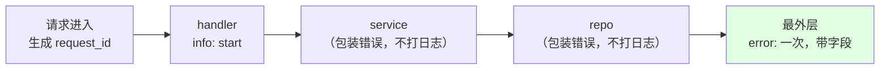
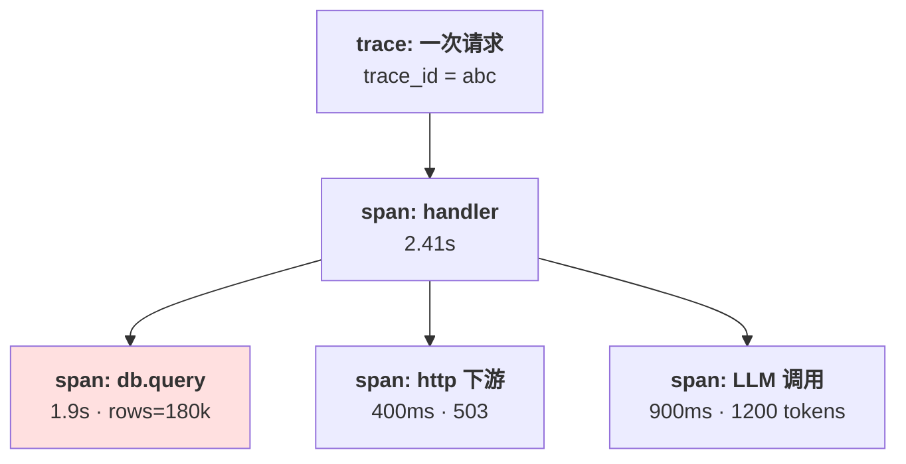
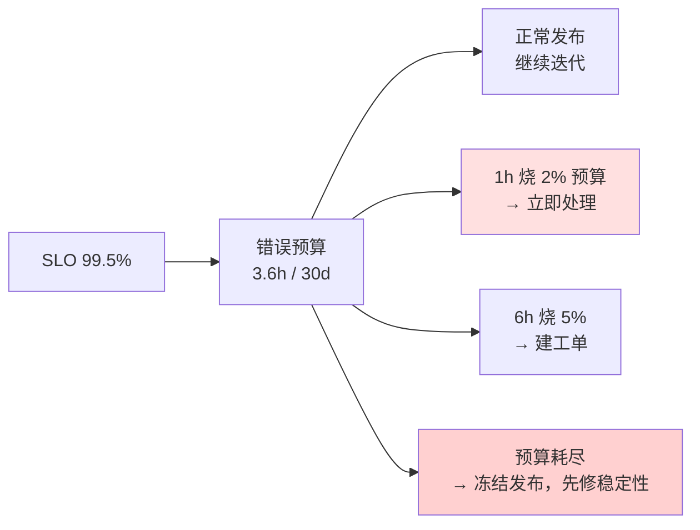

# 第 5 章 可观测性

> **💡 30 秒速览**
> - 日志回答「发生了什么」，指标回答「整体多差」，trace 回答「慢在哪一段」——三者不能互相替代
> - 没有 request_id / trace_id 的日志，在故障时等于没有
> - 平均值会骗人 → 看 P95/P99 和直方图，不看均值
> - 告警要按「用户是否受损」设计，不按 CPU 是否高

一句话贯穿全章：**可观测性不是「有监控」，是「5 分钟内能回答一个没预想过的问题」。**

三个知识点：`go.obs.log` / `go.obs.trace` / `go.obs.slo`。

---

## 5.1 go.obs.log —— 结构化日志

### 结论

**日志要能被机器筛选，字段固定、每个请求可串联、错误只打一次。**
「多打点日志总没错」是错的——日志的成本在检索，不在写入。

### 案例：200 万行日志里找不到一个订单号

一个下单接口报 500，用户提供了订单号。运维在日志平台搜索：

```
grep "order" app.log | grep "500"     → 18,432 条
grep "o_8f3a..." app.log              → 0 条
```

**代码是这样的：**

```go
log.Printf("create order failed: %v", err)             // handler
log.Printf("insert error: %v", err)                    // repo
log.Printf("db error: %v", err)                        // dao
```

三个问题：

1. **没有订单号**——不知道是哪一单
2. **同一个错误打了三遍**——一条真实故障产生三条噪声
3. **没有 request_id**——无法把这三条和其他日志串起来

结果只能复现、猜、再试。平均定位时间 40 分钟。

**改成结构化日志：**

```go
logger := slog.With(
    "request_id", reqID,
    "trace_id", traceID,
    "tenant_id", tenantID,
)

// 中间层：只包装，不打日志
if err != nil {
    return fmt.Errorf("insert order %s: %w", orderID, err)
}

// 最外层：打一次，带全部上下文
logger.ErrorContext(ctx, "create order failed",
    "order_id", orderID,
    "user_id", userID,
    "amount", amount,
    "err", err,
)
```

一条日志，包含：哪个请求、哪个租户、哪一单、什么错、错误链。搜索订单号直接命中。

### 机制

🎯 **日志像快递面单：不是写得越多越好，是**每一单都能凭单号查到全程**。**



**日志的三个层次：**

| 层次 | 内容 | 频率 |
|---|---|---|
| 请求级 | 入口参数摘要、结果、耗时、用户/租户 | 每请求 2 条 |
| 依赖级 | 下游名称、耗时、状态码、重试次数 | 每次调用 1 条（可采样） |
| 事件级 | 状态变更、关键决策、外部副作用 | 每事件 1 条 |

**字段命名要统一**：`request_id` / `trace_id` / `tenant_id` / `user_id` / `order_id` / `duration_ms` / `err`。
字段名不统一，日志平台就没法聚合。

**`err` 直接传 `error` 值，不要先 `err.Error()` 拼进消息。**
`slog` 的内置 handler 对「属性值本身是 `error`」有特殊处理：调用它的 `Error()` 写成字符串（Text 和 JSON 都一样），
不需要你自己转。但有两件事它不做：

- 只处理顶层属性值；嵌在 struct/map/slice 里的 `error` 还是按普通值序列化
- 不会展开 `Unwrap` 链，最终留下的仍是一行 message

要在日志里保留错误类型、堆栈或告警级别，就给错误类型实现 `LogValue()`，或自己包一层 handler；
要错误链，就在包装时用 `%w` 并在最外层只打一次。

**级别要克制**：`Info` 给「业务上值得记的事件」，`Debug` 给排查细节（生产默认关），
`Warn` 给「能自愈但值得关注」，`Error` 给「用户受损或需要人处理」。
全部打成 `Error`，等于没有级别。

### 误解靶子

| 错答 | 为什么错 |
|---|---|
| 「日志越多，排查越快」 | 噪声会淹没信号；检索成本和存储成本都线性增长 |
| 「每层都打一遍，信息更全」 | 同一个错误重复 N 次，且中间层没有请求上下文，串不起来 |
| 「打 `fmt.Sprintf` 拼好的字符串」 | 字段丢失，无法按 `order_id` 聚合；也不利于脱敏 |
| 「日志里放完整请求体最方便」 | 会写入密码、token、身份证；合规风险和存储成本都高 |
| 「有日志就不用指标」 | 日志无法回答「P99 是多少、错误率趋势如何」 |

### 判据

- **随便给一个订单号，能不能在 1 分钟内查到它的完整链路？** → 不能，就是字段或 ID 缺失。
- **同一个错误在日志里出现几次？** → 超过 1 次（不含重试），就是中间层在重复打。
- **这条日志能不能被结构化查询？** → 是拼接字符串就只能全文搜。
- **日志里有没有不该出现的敏感字段？** → 有就立即脱敏，并检查采集链路。

### 自测题

1. 一个请求经过 gateway → service → repo → DB，每一层都打了 `error`。故障时你会看到几条？应该保留哪条？
2. 为什么 `slog` 的 `With` 比每条日志重复传字段更好？它对性能和一致性各有什么影响？
3. 日志采样（如 1% 成功请求）会带来什么风险？哪些日志不能采样？

---

## 5.2 go.obs.trace —— 指标与追踪

### 结论

**指标告诉你「有问题」，trace 告诉你「问题在哪一段」。**
每次外部调用（DB、HTTP、RPC、LLM、工具）都应该是一个 span，且能串到同一个 trace 下。

### 案例：5% 的慢请求，查了两周

监控大盘：

```
http_server_duration_p99   = 2.4s   （基线 300ms）
error_rate                 = 0.8%   （基线 0.1%）
db_query_duration_p99      = 2.1s   （基线 40ms）
```

三个指标都指向「DB 慢」，但：

- 哪条 SQL？—— 慢查询日志里有 200 条不同的语句
- 为什么只有 5% 的请求慢？—— 不是所有实例、不是所有租户
- 慢请求的共同点是什么？—— 不知道

**加 trace 之后**（一次请求一条链路）：

```
POST /orders                          2.41s
├─ auth.verify                         3ms
├─ order.create                       2.38s
│  ├─ db.insert_order                  1.9s   ← 这里
│  ├─ db.deduct_stock                 420ms
│  └─ cache.invalidate                  2ms
└─ response.serialize                   5ms
```

再看 span 属性：`db.statement` 是 `select ... where tenant_id=$1 and status=$2 order by created_at desc`，
`db.rows_examined=180000`。**根因是某个大租户的联合索引顺序不对**，只有它的数据量触发了全表扫描。

**没有 trace，你只能看到「DB 慢」；有 trace，你能看到「哪条 SQL、哪个租户、扫了多少行」。**

### 机制

🎯 **指标像体温计，trace 像 CT：体温计告诉你发烧了，CT 告诉你哪里发炎。**



**三者的分工：**

| 信号 | 回答 | 典型问题 |
|---|---|---|
| 日志 | 发生了什么 | 这个订单为什么失败 |
| 指标 | 整体多差、趋势 | P99 是否恶化、错误率是否超预算 |
| trace | 慢/错在哪一段 | 这 2.4s 花在 DB 还是下游 |

**指标要看分布，不看均值**：`http_request_duration_seconds` 用直方图（Histogram），
算 `histogram_quantile(0.95, ...)`。平均值 200ms 可能藏着一个 P99 5s。

**Agent 场景要多一层 span 语义：**

| span | 关键属性 |
|---|---|
| `agent.step` | step 序号、阶段（plan/act/reflect） |
| `llm.call` | 供应商、模型、输入/输出 token、首 token 延迟、总耗时、是否命中缓存 |
| `tool.call` | 工具名、参数摘要、结果大小、是否重试、是否被拒绝 |
| `agent.task` | 任务 ID、租户、状态、重试次数、人工介入 |

没有这层，你只能看到「这次答错了」，看不到「错在第 3 步、因为检索返回了过期文档」。

### 误解靶子

| 错答 | 为什么错 |
|---|---|
| 「有监控大盘就够了」 | 大盘告诉你比例，不告诉你具体哪条链路 |
| 「看平均延迟」 | 均值被大量快请求稀释；慢请求的用户体验完全看不到 |
| 「trace 只在微服务需要」 | 单体里的 DB、缓存、外部调用同样需要分段；否则慢在哪全靠猜 |
| 「采样 100% 才准」 | 高 QPS 下成本高；错误和慢请求 100% 采样，成功请求低采样即可 |
| 「加了 trace 就能自动定位」 | 没有业务属性（订单号、租户、工具名）的 span，只能看到「某段慢」 |

### 判据

- **线上一个 500，5 分钟内能不能定位到「依赖 / SQL / 工具调用」？** → 不能，就是可观测性不够。
- **这条 trace 能不能串起网关、服务、DB、下游？** → trace_id 有没有跨进程传播。
- **慢请求的 span 里有没有业务维度？** → 只有 `db.query` 没有 `tenant_id`，就无法定位到具体客户。
- **P99 和均值差多少？** → 差 5 倍以上，说明长尾有独立根因，不能只看均值。

### 自测题

1. 一个接口 P50 80ms、P99 4s。只看均值会得出什么错误结论？应该看哪些指标？
2. 跨服务调用时，trace_id 通过什么传播？如果中间有一个服务没接 OTel，链会怎样？
3. Agent 的一次失败调用，需要记录哪些 span 属性才能在事后复现决策过程？

---

## 5.3 go.obs.slo —— SLO 与告警

### 结论

**SLO 是「用户可感知的成功率/延迟目标」，错误预算是它的反面。**
告警应该按「错误预算消耗速度」触发，而不是按 CPU、内存或瞬时错误率。

### 案例：每天响 30 次的告警，没人看了

```yaml
- alert: HighErrorRate
  expr: rate(http_requests_total{code=~"5xx"}[1m]) > 0.01
  for: 1m
```

结果：

- 每天触发 30+ 次，大部分是单实例抖动或健康检查
- 值班同学把告警静音了
- 真正的一次数据库故障（持续 40 分钟）**没有触发**：告警只看 1 分钟窗口里的 5xx（0.8%），
  没看「变慢但最终成功」的请求——这 40 分钟里其实有 28% 的请求超过 1s

**按错误预算设计：**

```
SLI: 成功请求占比（非 5xx 且 < 1s）
SLO: 99.5% / 30 天
错误预算: 0.5% × 30 天 = 3.6 小时
```

告警规则（多窗口 burn rate）。**burn rate 的定义是「按当前速度，多久烧完 30 天预算」**，
所以 1x 持续 30 天正好烧完；1 小时 14.4x 烧掉 `14.4 × 1h / 720h = 2%`，6 小时 6x 烧掉 `6 × 6h / 720h = 5%`：

```yaml
# 长窗口判「真的在烧」，短窗口判「还没停」；两个都超才触发，避免抖动
- alert: SLOBurnRateFast          # 1h 烧 2% 预算（14.4x）
  expr: |
    (1 - sli_ratio:1h) > 14.4 * 0.005
    and
    (1 - sli_ratio:5m) > 14.4 * 0.005
  for: 2m

- alert: SLOBurnRateSlow          # 6h 烧 5% 预算（6x）
  expr: |
    (1 - sli_ratio:6h) > 6 * 0.005
    and
    (1 - sli_ratio:30m) > 6 * 0.005
```

再补一条更慢的 `3d / 1x（烧 10% 预算）`，专门抓那种「每天错一点、一个月后才发现」的慢性泄漏。

**效果**：告警从每天 30 次降到每周 1–2 次，每次都是真的用户受损。

两档抓的是不同形态。上面的 40 分钟故障让 28% 的请求不达标（5xx 或 >1s），
烧掉 `0.667h × 28% / 3.6h ≈ 5.2%` 预算，1h 窗口的 burn rate 约 37x，14.4x 那档必然触发。
6h 档负责另一种——**不达标率不算高（>3%）但持续几小时**的慢烧，比如下游间歇超时、重试在兜底。
反过来也要接受：40 分钟里只有 1% 的请求失败、延迟正常的抖动，只消耗约 0.2% 预算，
不叫人是对的——阈值本来就定义了「什么值得半夜起床」。

### 机制

🎯 **错误预算像手机流量套餐：偶尔超出没关系，但「这个月还剩多少」决定你该不该继续刷视频。**



**三个概念的分工：**

| 概念 | 定义 | 用途 |
|---|---|---|
| SLI | 实际测量值（成功率、P99） | 客观事实 |
| SLO | 对 SLI 的目标（99.5%） | 团队承诺 |
| SLA | 对客户的合同（含赔偿） | 商业条款 |

**告警分级**：

- **P1（叫人）**：错误预算快速燃烧、核心链路不可用
- **P2（工单）**：慢窗口燃烧、非核心功能退化
- **P3（看板）**：资源水位、趋势，不主动打扰

CPU 80% 不是 P1；CPU 80% + P99 翻倍 + 错误率上升，才是。

### 误解靶子

| 错答 | 为什么错 |
|---|---|
| 「告警越多越安全」 | 告警疲劳会让真故障被静音；信噪比才是关键 |
| 「CPU/内存高就要告警」 | 资源水位是原因，不是用户损害；高水位但 SLO 正常不该叫人 |
| 「SLO 定 100%」 | 100% 意味着不能发布、不能有依赖故障；没有预算就没有取舍 |
| 「1 分钟窗口最灵敏」 | 短窗口抖动大，容易误报；要快慢双窗口配合 |
| 「SLO 是运维的事」 | SLO 决定发布节奏和架构取舍，是研发和产品共同的责任 |

### 判据

- **这个告警响的时候，用户真的受损了吗？** → 答不出「哪部分用户、什么功能」，就是噪声。
- **SLO 是多少、预算剩多少？** → 答不出，就没法决定「现在能不能发布」。
- **告警能不能对应到一个具体动作？** → 不能，就只是通知，不是告警。
- **过去一个月，告警有几次是真故障？** → 低于 30%，说明阈值或窗口有问题。

### 自测题

1. 一个后台任务接口 P99 5s，但用户不直接访问。它应该进核心 SLO 吗？为什么？
2. 错误预算还剩 10%，产品要求上线一个大功能。作为负责人，你的判断依据是什么？
3. 为什么「1 分钟错误率 > 1%」既会误报又会漏报？双窗口怎么解决？

---

## 本章小结

| 问题 | 靠什么回答 | 最小实现 |
|---|---|---|
| 这一单为什么失败 | 结构化日志 + request_id | `slog` + 中间件生成 ID |
| 整体是不是变差了 | 指标（P95/P99、错误率） | Prometheus 直方图 |
| 慢在哪一段 | trace | OTel + 每个外部调用一个 span |
| 该不该叫人 | SLO + 错误预算 | SLI 定义 + burn rate 告警 |

下一章：把前五章拼成一个真实系统——Agent 平台的 Gateway 和任务运行时。
你会看到，前面每一个「判据」在这里都对应一个具体的设计决定。
