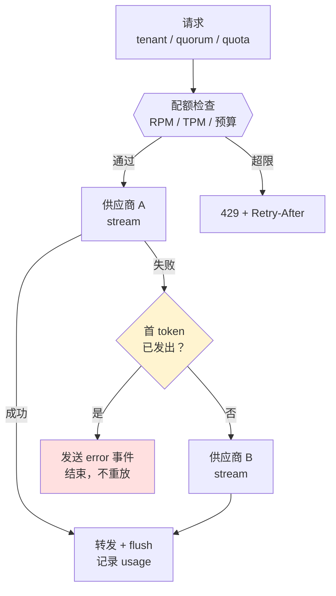
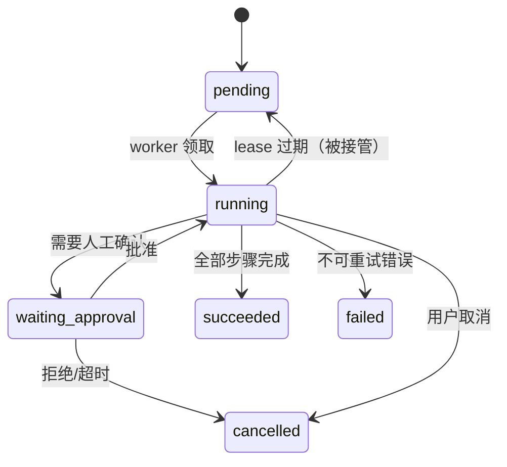

# 第 6 章 Agent 后端

> **💡 30 秒速览**
> - 流式响应有一个不可逆的分界点：**第一个 token 发出去之后，不能再换供应商重放**
> - token 用量的位置因供应商而异：OpenAI 默认不返回、要显式开 `stream_options.include_usage` 才在最后一个 chunk；
>   Anthropic 分散在 `message_start` / `message_delta`；Gemini 每个 chunk 给的是累计值——但客户端提前断开时都可能拿不到
> - 任务状态放在内存 map 里，等于没有任务系统 → `kill -9` 之后全丢
> - 人工审批是一个持久化状态，不是一次弹窗

一句话贯穿全章：**Agent 后端 = 第 3 章的边界 + 第 4 章的一致性 + 第 5 章的归因，套在一个会失败很多次的循环上。**

两个知识点：`go.agent.gateway` / `go.agent.runtime`。

---

## 6.1 go.agent.gateway —— LLM 网关

### 结论

**Gateway 的核心不是转发，是「在不可靠的多个供应商之上，提供可计费、可限流、可归因的稳定接口」。**
本章网关未定义已输出内容的修订与重放协议，因此只允许首token之前透明故障转移；之后需显式中断或由产品协议启动新尝试，不能混接两个供应商的输出。

### 案例：重试导致的重复回答

第一版网关：

```go
func (g *Gateway) Stream(w http.ResponseWriter, r *http.Request) {
    for _, p := range g.providers {          // 主 + 备
        resp, err := p.Stream(ctx, req)
        if err != nil {
            continue                          // 换下一个供应商
        }
        io.Copy(w, resp.Body)                 // 已经开始写给客户端
        return
    }
}
```

`io.Copy` 写到一半，主供应商连接断了。代码没有判断「已经写了多少」，直接进入下一次循环，
备用供应商从头发一遍。用户看到的是：

```
根据您提供的订单信息，这笔退款将在 3 个工作日内到账。根据您提供的订单信息，
这笔退款将在 3 个工作日内到账。……
```

**根因：代码把「流」当成了「普通响应」。** 普通响应失败了可以重发；流一旦开始，
客户端已经消费了前面那段，重发就是重复内容。

**正确的边界：**

```go
func (g *Gateway) Stream(w http.ResponseWriter, r *http.Request) {
    ctx := r.Context()
    req, err := decodeRequest(r)           // 解析细节略
    if err != nil {
        http.Error(w, "bad request", http.StatusBadRequest)
        return
    }
    flusher, ok := w.(http.Flusher)
    if !ok {                               // 不支持 flush 就不能做 SSE
        http.Error(w, "streaming unsupported", http.StatusInternalServerError)
        return
    }
    var wrote bool

    for _, p := range g.providers {
        iter, err := p.Stream(ctx, req)
        if err != nil {
            continue                       // 还没写任何东西，可以换
        }
        for {
            chunk, err := iter.Next()
            if errors.Is(err, io.EOF) {
                break                      // 正常结束
            }
            if err != nil {
                if !wrote {
                    break                  // 首字节之前失败 → 换供应商
                }
                // 首字节之后失败 → 只能发一个错误事件并结束
                writeErrorEvent(w, err)
                flusher.Flush()
                return
            }
            writeSSE(w, chunk)             // 可能只有 tool_call，没有正文
            flusher.Flush()
            wrote = true                   // ← 分界线：字节已经出去了
        }
        if !wrote {
            continue
        }
        return
    }
    http.Error(w, "all providers failed", http.StatusBadGateway)
}
```

**分界线的准确说法是「第一个字节写给客户端之后」，不是「第一个正文 token」。**
纯工具调用 chunk、心跳、`event: start` 都算；`w.Write` 一旦发生，状态码就定死了，
后面再想 `http.Error(..., 502)` 也发不出去了。所以能失败的检查（配额、建连、首 token 超时）
都要放在第一次写之前做完。

`w.(http.Flusher)` 的类型断言也必须判 `ok`：包一层中间件、用某些测试 recorder 时它不成立，
忽略返回值会得到 nil 接口，下一行 `flusher.Flush()` 直接 panic。

**第二个案例：账单比实际用量少 40%**

网关只在上游正常结束时读取最后一个 chunk 的 `usage`。但：

- 32% 的请求是客户端主动断开（用户切走、前端取消）
- 断开后 `ctx` 被取消，上游连接关闭，**最后一个 chunk 永远收不到**
- 这部分调用供应商仍然计费，网关却没有记录

**改法**：

1. 在发起上游请求**之前**决定取消策略。若允许客户端断开后短暂排空，上游请求需从一开始使用独立、带总超时的生命周期；断开后停止向客户端写入，并用定时器在排空窗口结束时取消原上游请求。若上游已绑定被取消的请求 ctx，事后创建新 ctx 无法复活原连接。`WithoutCancel` 还会移除原 deadline，必须重新设定期限，见 [context 官方文档](https://pkg.go.dev/context#WithoutCancel)。
2. 拿不到时，根据本地可观测输入、输出估算并标记 `estimated=true`；字符数只是近似，已转发内容也不包含断开后仍生成的输出。隐藏提示、工具协议和供应商计费口径可能使输入量同样无法精确复算
3. 对账任务每天用供应商账单校准，差异超过阈值告警

**usage 在哪一节，取决于供应商协议**（下面的位置以 2026-11 的官方文档为准）：

| 供应商 | 位置 | 注意 |
|---|---|---|
| OpenAI Chat Completions | 最后一个 chunk 的 `usage` | 默认不返回，请求里要带 `stream_options: {"include_usage": true}`；Responses API 在 `response.completed` 事件里 |
| Anthropic Messages | `message_start` 给输入侧，`message_delta` 给输出侧累计 | 不是单个「最后一块」 |
| Gemini `streamGenerateContent` | 每个 chunk 的 `usageMetadata` | 是累计值，取最后一个即可，别累加 |

### 机制

🎯 **流式网关像直播：开播前可以换演播室，开播后换，观众看到的就接不上了。**



**网关必须有的五个能力：**

| 能力 | 关键点 |
|---|---|
| 供应商抽象 | 统一请求/响应模型；差异（tool call 格式、stop reason、usage 字段）在 adapter 内消化 |
| 路由与故障转移 | 按模型/地域/成本/健康度选；**首 token 前**才允许切换 |
| 配额与计费 | 租户级 RPM/TPM/预算；输入输出分开计价；估算与对账 |
| 流式代理 | SSE 不缓冲、心跳、空闲超时、总时长超时、客户端断开处理 |
| 归因 | 每次调用一个 trace span：供应商、模型、token、首 token 延迟、是否重试 |

**超时要分四段**：建连、首 token、chunk 间隔（空闲）、总时长。
只设总时长，会在「上游一直吐字但极慢」时占满连接；只设首 token，会在长回答上误杀。

### 误解靶子

| 错答 | 为什么错 |
|---|---|
| 「流式失败就换供应商重试」 | 首 token 之后重试会让用户看到重复内容 |
| 「usage 一定在最后一个 chunk」 | 供应商API及SDK版本的usage交付契约不同，应核对当前官方接口；客户端断开/上游异常时还可能一个都没有 |
| 「客户端断开就不用管了」 | 供应商可能已经计费；不排空就拿不到用量 |
| 「限流按请求数就够了」 | 一个 100k token 的请求和一个 1k 的请求，成本差 100 倍 |
| 「网关只做转发，计费放业务层」 | 业务层拿不到准确的 usage 和重试信息；会重复计费或漏计 |

### 判据

- **第一个 token 发出后上游失败，客户端会看到什么？** → 必须是明确的错误事件，不能是重复内容。
- **客户端在第 3 秒断开，这次调用账单上是多少 token？** → 答不出估算规则，就是会漏计。
- **租户超限时返回什么？** → 429 + `Retry-After` + 明确维度（RPM/TPM/预算）。
- **这次调用慢，是慢在建连、首 token，还是生成？** → trace 里有没有分段。

### 自测题

1. 为什么「首 token 之前」和「之后」要区别对待？如果产品要求「无论如何都要给用户一个完整回答」，怎么设计？
2. 一个租户的 TPM 配额是 100k，单次请求可能用 80k。按请求数限流会出什么问题？
3. 客户端断开后继续排空 2 秒，会带来什么代价？什么场景下不该排空？

---

## 6.2 go.agent.runtime —— 持久化任务运行时

### 结论

**任务状态必须落库，步骤必须可恢复，副作用必须幂等。**
评价标准只有一条：`kill -9` 之后，任务能不能在另一个进程里继续，且不重复执行已完成的步骤。

### 案例：重启丢了 1,200 个任务

第一版运行时：

```go
type Runtime struct {
    tasks map[string]*Task     // ← 内存
    mu    sync.Mutex
}

func (r *Runtime) Submit(t *Task) {
    r.mu.Lock()
    r.tasks[t.ID] = t
    r.mu.Unlock()
    go r.run(t)
}
```

一次发布（滚动重启），1,200 个进行中的任务全部消失：

- 已经调用过工具、产生副作用的步骤，没人知道做没做
- 用户看到任务永远停在「运行中」
- 重试提交后，部分任务重复发通知、重复建单

**核心错误不是「用了内存」，是「没有把执行过程建模成可恢复的状态」。**

**正确的模型：**

```sql
-- 任务：当前状态 + 版本（乐观锁）
CREATE TABLE agent_tasks (
    id            text PRIMARY KEY,          -- 客户端提供，天然幂等
    tenant_id     text NOT NULL,
    status        text NOT NULL,             -- pending/running/waiting_approval/succeeded/failed/cancelled
    current_step  int  NOT NULL DEFAULT 0,
    input         jsonb NOT NULL,
    lease_until   timestamptz,
    worker_id     text,
    version       bigint NOT NULL DEFAULT 0,
    created_at    timestamptz NOT NULL DEFAULT now(),
    updated_at    timestamptz NOT NULL DEFAULT now()
);

-- 步骤：每步的结果就是 checkpoint
CREATE TABLE agent_steps (
    task_id     text NOT NULL REFERENCES agent_tasks(id),
    step_no     int  NOT NULL,
    kind        text NOT NULL,               -- llm/tool/approval
    status      text NOT NULL,
    output      jsonb,
    effect_key  text,                        -- 副作用幂等键
    started_at  timestamptz,
    ended_at    timestamptz,
    PRIMARY KEY (task_id, step_no)
);
```

**Worker 领取任务（多实例安全）：**

```sql
UPDATE agent_tasks
SET status = 'running',
    worker_id = $1,
    lease_until = now() + interval '30 seconds',
    version = version + 1
WHERE id = (
    SELECT id FROM agent_tasks
    WHERE status = 'pending'
       OR (status = 'running' AND lease_until < now())   -- 接管失联任务
    ORDER BY created_at
    FOR UPDATE SKIP LOCKED
    LIMIT 1
)
RETURNING *;
```

**恢复逻辑**：进程启动后不加载「所有任务」，只领取「pending 或 lease 过期」的任务；
从 `current_step` 之后继续，已完成的步骤直接读 checkpoint，不重跑。

### 机制

🎯 **任务运行时像快递分拣：包裹每过一个站点就扫一次码。车坏了，下一个站点凭扫码记录接着送，
不会从发货地重发。**



**四个必须落库的东西：**

| 数据 | 为什么 |
|---|---|
| 任务状态 + 版本 | 防止两个 worker 同时推进；重启后知道从哪继续 |
| 每步结果（checkpoint） | 避免重复调用 LLM/工具；也是审计证据 |
| 副作用幂等键 | 恢复时同一工具调用不会执行两次 |
| 审批状态与操作人 | 进程重启后审批不丢；可追责 |

**`SKIP LOCKED` 是并发的关键**：多个 worker 同时领取，不会拿到同一条；
没有它，要么串行（吞吐低），要么重复执行（更糟）。

**租约（lease）而不是「运行中」标记**：worker 可能被 kill -9，没机会把状态改回去。
租约到期自动可被接管，是唯一不依赖「优雅退出」的恢复机制。

### 误解靶子

| 错答 | 为什么错 |
|---|---|
| 「任务状态放 Redis 就够了」 | 可以，但必须持久化 + 有租约 + 可恢复；纯内存 map 不行 |
| 「重启后从头再跑一遍」 | 有副作用的步骤会重复执行；LLM 调用也会重复计费 |
| 「用一个全局锁保证不重复」 | 单锁串行化所有任务，吞吐归零；要用行级锁 + SKIP LOCKED |
| 「审批用前端弹窗，用户点了再继续」 | 进程重启/用户关闭页面后，任务永久卡住；审批必须是持久化状态 |
| 「任务失败就标 failed」 | 可重试错误应该回到 pending 并退避；直接 failed 会丢掉本可完成的任务 |

### 判据

- **`kill -9` 之后，这个任务会怎样？** → 能在 30 秒内被其他 worker 接管，且不重复副作用，才算可恢复。
- **同一个 task_id 提交两次，执行几次？** → 主键/幂等键保证一次；没有就是两次。
- **恢复时，怎么知道第 3 步做没做？** → 看 checkpoint 与 effect_key，不靠日志猜。
- **审批中的任务，进程重启后还在吗？** → 状态在库里才在，在内存里就没了。

### 自测题

1. 任务执行到第 3 步调用了一个「发邮件」工具后宕机。恢复时怎么保证不重复发？
2. 为什么用「租约到期」而不是「worker 退出时把状态改回 pending」？后者在什么情况下失效？
3. 一个任务需要人工审批，审批人 3 天后才点。期间系统要保证哪些东西不丢？

---

## 本章小结

| 第 3–5 章的能力 | 在 Agent 后端的具体形态 |
|---|---|
| 超时预算 | 建连 / 首 token / 空闲 / 总时长，四段分别设 |
| 幂等 | 客户端 task_id + 副作用 effect_key |
| 至少一次 + 对账 | 任务通知走 Outbox；token 用量每日对账 |
| 有界并发 | 租户配额 + worker 数 + 队列长度 |
| 可观测 | 每次 LLM/工具调用一个 span，带 tenant/task/step |
| 优雅关闭 | 停止领取新任务 → 等在途步骤 → 释放租约 |

**到这里，六章的判据可以合成一句话**：
**任何一个「应该」，都要能回答「谁在保证、失败时谁发现、怎么恢复」。**

答得出来，才叫后端。
