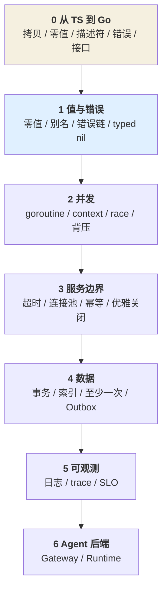

# Go 后端知识小册

> 副标题：**把 Node 的直觉关掉，再开始写服务。**

## 这本册子适合谁

- 你写过多年代码（Node/TS/前端/数据），能交付业务，但服务一上量就出怪问题
- 你会 `go run`、会抄 handler，但说不清「这台机器同时最多有多少个 goroutine」
- 你正在补 Agent 平台后端：Gateway、任务运行时、RAG 服务

如果你还没写过任何 Go 代码——先读第 0 章把 TS 的默认假设换掉，再写一个 HTTP 服务，碰几次壁再回来。这本册子解释的是那些壁。

## 这本册子不是什么

**不是 Go 语法教程，不写框架选型、不写某家云的产品参数。** 这些半年就换。

写的是**结构层**：Go 把 Node 里哪些隐含假设拿掉了，拿掉之后你要在哪一层补回来。
这些结论不随版本变：goroutine 有栈、错误是值、超时不设就是无限、至少一次就要幂等。

**不是「最佳实践合集」。** 每个实践后面都跟一条判据——能对着你的代码问出是/否的问题。
背下来的实践会在下一个场景失效，判据不会。

## 每个知识点固定六段

| 段 | 作用 |
|---|---|
| **结论** | 一句话，能背的部分 |
| **案例** | 一个具体的翻车现场，带数字、带日志、带代价。先让你在错的那一层停留一次（案例为复合场景，数字用于说明量级，不是某次线上事故的统计） |
| **机制** | 为什么是这样。缺了这段，前面就只是背书 |
| **误解靶子** | 最常见的错答，以及它为什么错（多为从 Node 直接搬过来的直觉） |
| **判据** | 一个能对着具体代码问出答案的事实问题 |
| **自测题** | 不给答案。答不出来说明前面五段没吃进去 |

## 全书主线：把「应该没事」换成「谁在保证」

Node 里很多事由运行时替你兜底：单线程不共享、事件循环不阻塞、异常会冒泡、
`Array.filter` 返回新数组。到了 Go，这些兜底**全部消失**，而且大多数错误**能编译通过**。

所以 Go 卷每一章的判据都在问同一个问题：

| 形容词式判断（问不出答案） | 事实问题（能问出答案） |
|---|---|
| 并发量应该没问题 | 这台机器同时最多有多少个 goroutine？谁在保证上限 |
| 接口应该够快 | 这个请求最坏要多久？每一层超时相加是多少 |
| 重试一下应该能好 | 这次调用超时，是对端没收到，还是收到了没返回？重试会重复扣款吗 |
| 数据最终会一致 | 外部写失败后谁会发现？多久发现？发现后怎么修 |
| 有日志就能排查 | 线上这个 500，5 分钟内能不能定位到依赖 / SQL / 工具调用 |

「应该」描述的是你的期望，不是系统的属性。

## 章节

| 章 | 文件 | 知识点 | 回答的问题 |
|---|---|---|---|
| 0 | `00-从TS到Go.md` | copy / zero / slice / error / interface | 为什么用 TS 的直觉写 Go，会一路踩坑（前置，不计知识点） |
| 1 | `01-值与错误.md` | value / error / interface | 为什么这段代码改到了别人的数据、错误还找不着 |
| 2 | `02-并发与生命周期.md` | goroutine / context / race / backpressure | 为什么一上量 goroutine 就涨到几万 |
| 3 | `03-服务边界.md` | timeout / pool / idempotency / shutdown | 为什么下游慢了一下，整个服务雪崩 |
| 4 | `04-数据与一致性.md` | tx / index / consistency | 为什么事务没报错，数据却对不上 |
| 5 | `05-可观测性.md` | log / trace / slo | 为什么线上出问题只能靠猜 |
| 6 | `06-Agent后端.md` | gateway / runtime | 前面五章怎么拼成一个 Agent 平台服务 |

## 读的顺序

第 0 章是前置：不引入新知识点，只把 Node/TS 的默认假设逐条换掉。跳过它，后面每一章都会退化成「背规则」。

**不要从第 6 章开始。** 没有前三章，Gateway 会退化成「转发请求 + 记日志」；
没有第 4、5 章，Runtime 会退化成「内存里一个 map 加几个 goroutine」。

## 配套

- [`knowledge-map.md`](knowledge-map.md) —— 19 个知识点、依赖链、36 项自检
- [进度模板](../../skills/knowledge-interviewer/templates/progress.md) —— 个人计划仅存本机 `.local/learning/serve/`
- [错题模板](../../skills/knowledge-interviewer/templates/mistakes.md) —— 共享结构，不共享真实错答
- Agent 卷：[`../agent/README.md`](../ai-agent/README.md)
- Skill 规则版：[`../../skills/README.md`](../../skills/README.md)（`go-backend-expert`）
