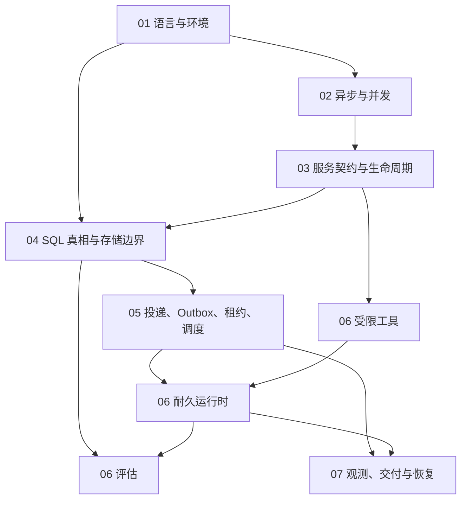

# Python 后端知识图谱：30 点主链、6 点工程底座与跨卷桥梁

这里是公共阅读地图，不记录真实学习成绩，不预填 A 或其他掌握档位。定位器以编号章中的 `## py.xxx — 中文标题` 为准；下表链接到唯一对应文件，进入后搜索稳定 ID。新增解释不另造 ID。主链 30 点是五天项目的硬前置；工程底座 6 点按需查阅，不改变主链 DAG。[返回入口](README.md) · [五天路线](sprint-5-days.md)

## 30 点主链唯一归属与硬前置

“硬前置”表示理解该点的机制需要先能解释所列点；`—` 表示本卷内无硬前置，不表示不需要任何编程基础。每条边都从表中靠前项指向靠后项，因此这是 **DAG**，不存在互相要求先掌握的循环。按表序是一个可行的拓扑顺序；同层可交换。

| 稳定 ID | 唯一章节 | 真正要解释的故障 | 硬前置 | 路线首次归属 |
|---|---|---|---|---|
| `py.lang.objects` | [01](01-python-foundations.md) | 浅拷贝污染别的任务 | — | Day 1 |
| `py.lang.collections` | [01](01-python-foundations.md) | 生成器被提前消费、去重丢顺序 | py.lang.objects | Day 1 |
| `py.lang.functions` | [01](01-python-foundations.md) | 默认列表/闭包保留跨请求状态 | py.lang.objects | Day 1 |
| `py.lang.types` | [01](01-python-foundations.md) | 注解未拒绝非法参数与越权 | py.lang.functions | Day 1 |
| `py.lang.resources` | [01](01-python-foundations.md) | 回滚发生但连接未关闭 | py.lang.objects, py.lang.functions | Day 1 |
| `py.lang.environment` | [01](01-python-foundations.md) | 解释器错位、发现零项测试 | — | Day 1 |
| `py.async.eventloop` | [02](02-async-and-concurrency.md) | async endpoint 被同步调用卡住 | py.lang.functions, py.lang.environment | Day 2 |
| `py.async.cancellation` | [02](02-async-and-concurrency.md) | 子任务失去所有者、超时未停止效果 | py.async.eventloop, py.lang.resources | Day 2 |
| `py.async.backpressure` | [02](02-async-and-concurrency.md) | 信号量内等待任务无界增长 | py.async.cancellation, py.lang.collections | Day 2 |
| `py.async.execution` | [02](02-async-and-concurrency.md) | 线程不能按预期加速纯 Python CPU | py.async.eventloop, py.lang.environment | Day 2 |
| `py.svc.contract` | [03](03-api-and-lifecycle.md) | 受理成功但没有耐久记录 | py.lang.types, py.async.backpressure | Day 2 |
| `py.svc.lifecycle` | [03](03-api-and-lifecycle.md) | 长任务借用已关闭的请求 session | py.svc.contract, py.async.cancellation, py.lang.resources | Day 2 |
| `py.svc.idempotency` | [03](03-api-and-lifecycle.md) | 多 worker 同键重复创建、异内容误复用 | py.svc.contract, py.lang.objects | Day 2 |
| `py.svc.streaming` | [03](03-api-and-lifecycle.md) | 断流被当成功，重放重复投影 | py.svc.lifecycle, py.svc.idempotency | Day 2 |
| `py.data.model` | [04](04-storage-and-retrieval.md) | 无 tenant 条件、旧状态覆盖终态 | py.lang.types, py.svc.contract | Day 3 |
| `py.data.transactions` | [04](04-storage-and-retrieval.md) | 两次写不能共同回滚、网络占事务 | py.data.model, py.lang.resources | Day 3 |
| `py.data.indexes` | [04](04-storage-and-retrieval.md) | 领取任务查询扫描和排序失控 | py.data.model, py.data.transactions | Day 3 |
| `py.data.cache` | [04](04-storage-and-retrieval.md) | Redis 成功投影与 SQL 真相分离 | py.data.transactions, py.svc.idempotency | Day 3 |
| `py.data.objects` | [04](04-storage-and-retrieval.md) | 签名 URL 泄露、引用提交留下孤儿 | py.data.model, py.data.transactions, py.svc.contract | Day 3 |
| `py.data.retrieval` | [04](04-storage-and-retrieval.md) | 未授权 chunk 入上下文、引用版本失配 | py.data.model, py.data.objects, py.data.indexes | Day 3 |
| `py.jobs.delivery` | [05](05-jobs-and-distribution.md) | commit 后 ack 前崩溃造成重投 | py.svc.idempotency, py.data.transactions | Day 4 |
| `py.jobs.outbox` | [05](05-jobs-and-distribution.md) | 任务已提交但跨库发布遗漏 | py.jobs.delivery, py.data.transactions | Day 4 |
| `py.jobs.leases` | [05](05-jobs-and-distribution.md) | 接管后旧 worker 又写终态/外部效果 | py.jobs.delivery, py.data.model, py.data.transactions | Day 4 |
| `py.jobs.scheduling` | [05](05-jobs-and-distribution.md) | 租户饥饿、毒消息无限重试、停机重复领取 | py.jobs.leases, py.async.backpressure | Day 4 |
| `py.agent.tools` | [06](06-python-agent.md) | 未知工具、合法参数越权、执行前撤权 | py.lang.types, py.svc.contract, py.svc.idempotency | Day 5 |
| `py.agent.runtime` | [06](06-python-agent.md) | 重启后重做未知效果、预算被每层重置 | py.agent.tools, py.jobs.leases, py.jobs.outbox, py.async.cancellation | Day 5 |
| `py.agent.evaluation` | [06](06-python-agent.md) | stub 通过率被冒充模型质量 | py.agent.runtime, py.data.retrieval | Day 5 |
| `py.ops.observability` | [07](07-operations-and-delivery.md) | POST 全成功但队列一直老化 | py.jobs.scheduling, py.agent.runtime | Day 5 |
| `py.ops.deployment` | [07](07-operations-and-delivery.md) | 多 worker 资源翻倍，新旧协议不兼容 | py.svc.lifecycle, py.jobs.delivery, py.ops.observability | Day 5 |
| `py.ops.recovery` | [07](07-operations-and-delivery.md) | 数据还原后索引/对象/效果不收敛 | py.ops.deployment, py.jobs.leases, py.agent.runtime, py.data.objects | Day 5 |

Day 归属是**首次接触**，不是当天全部实现或掌握。比如 Day 2 先定义幂等契约，Day 3 用 SQL 事务落实，Day 4 再检验重放；这属于迭代强化，不是 DAG 的反向硬前置。Day 3 的索引/缓存/对象/检索只要求选型边界阅读，真实实现和质量验证列为后续未完成项。

## 6 点工程底座（按需，不占五天必做）

这 6 点横切主链，解决“实验是否可重复、故障是否可定位、服务是否把能跑误当可靠”。它们不进入五天必做，也不改变上面 30 点的硬前置；可以在 Day 1 前先读依赖与测试，也可以在遇到相应故障时回来查。

| 稳定 ID | 唯一章节 | 真正要解释的故障 | 硬前置 | 路线首次归属 |
|---|---|---|---|---|
| `py.eng.dependencies` | [08](08-engineering-foundations.md) | 同一份代码在开发、CI、部署装出不同依赖 | py.lang.environment | 按需 |
| `py.eng.testing` | [08](08-engineering-foundations.md) | 测试互相污染、只测成功路径、覆盖率虚高 | py.lang.functions, py.eng.dependencies | 按需 |
| `py.eng.errors` | [08](08-engineering-foundations.md) | 不可重试错误被重试、超时被当未执行 | py.async.cancellation, py.svc.idempotency, py.jobs.delivery | 按需 |
| `py.eng.time` | [08](08-engineering-foundations.md) | 时区、墙钟与浮点金额造成租约和对账错误 | py.jobs.leases, py.data.model | 按需 |
| `py.eng.security` | [08](08-engineering-foundations.md) | 请求字段冒充身份、跨租户、SSRF、反序列化 | py.svc.contract, py.data.model, py.agent.tools | 按需 |
| `py.eng.profiling` | [08](08-engineering-foundations.md) | 加线程或缓存无效，尾延迟和内存增长找不到来源 | py.async.execution, py.data.indexes, py.ops.observability | 按需 |

工程底座内部也按硬前置排列：依赖先于测试，测试为错误/性能实验提供可重复证据；错误分类要接住取消与幂等，时间精度要接住租约，安全要复用契约、数据模型与工具授权，性能诊断要依赖执行模型与观测数据。

## 不覆盖什么

这张图不是“Python 语言大全”，也不承诺覆盖所有后端生态。以下内容不在 30+6 点内：

- 元编程、描述符、`__getattr__` 高级用法、装饰器框架设计等语言进阶专题；
- C 扩展、FFI、CPython 源码、字节码与内存分配器内部实现；
- PyPI 包发布、版本号治理、开源维护流程；
- 数据科学、机器学习、Jupyter、pandas/NumPy 生态；
- FastAPI、Django、SQLAlchemy 等框架的全量教程与所有扩展；
- 前端模板、浏览器渲染、CSS 与服务端渲染；
- 分布式共识、跨地域多活、Kubernetes 平台工程与云产品全量配置。

这些主题需要时另开专题或领域包，不把“没在这张图里”误读成“不重要”，也不把 30+6 点当成 Python 面试或生产的完整认证。

## 模块级 DAG 与实现反馈

图表达硬依赖。故障练习可返回前面的章节补判据，但不要把“反馈复习”变成一个要求全卷先学完的循环。生产 API 的 SQL 适配、真实检索 eval 和发布恢复需要额外实证，不能仅凭阅读图判定完成。

## 诊断跳过规则

已经会 Python 可以先回答 01 的六道自测，用一个反例或最小测试解释机制后，跳过相应正文精读；环境、非零测试集和项目验收仍要检查。只答出术语或凭“工作多年”不能自动跳过。工程底座的 6 点不参与首诊跳过判定，答对也不自动证明主链掌握；反过来，主链答得顺也不代表依赖锁定、测试隔离或安全边界已经会了。这里不写任何人的答案或评分；自行记录时留空起步，未执行项写“未验证”，不预填 A。

## 与其他三卷的连接：共享故障，不互设入门门槛

| 本卷入口 | 外卷入口 | 共享机制 | 不可直接搬用的部分 |
|---|---|---|---|
| py.agent.tools / runtime / evaluation / py.data.retrieval | [AI Agent 卷](../ai-agent/README.md) | 提议与授权分离、checkpoint、上下文预算、检索与生成分层评估 | 模型提示不等于 Python 执行器权限；stub 不证明真实模型能力 |
| py.async.cancellation / backpressure / py.svc.idempotency / py.jobs.leases | [Go 后端卷](../go-backend/README.md) | 生命周期所有者、有界并发、未知效果、条件写与接管 | goroutine/context 不能直接等同 asyncio Task；CPython 构建、executor、session 需单独分析 |
| py.svc.contract / streaming / py.agent.tools / py.ops.deployment | [前端卷](../frontend/README.md) | 任务状态投影、断线恢复、当前审批、旧客户端兼容 | 关页面不是取消任务；前端隐藏按钮不是后端鉴权；CDN 不保证所有标签页同步更新 |

**不要求先读 Java 或完整 Go。** 可先在 Python 小项目建立具体故障，再沿以上桥梁比较机制。跨卷已有掌握不自动迁移成 Python 档位。

## 公共完成判据

- 30 个主链点与 6 个工程底座点都有一个具体故障、机制、取舍边界与自测；编号章中每个 ID 只有一个二级标题。
- 五天最小验证只形成五个可验收改动；其他内容读过、选学、未完成要分开，不把“归属 Day 3”写成已部署全套存储，也不把工程底座当成第六天必做。
- demo、HTTP 设计契约、生产验证三层分开；执行测试要报告数量与实际覆盖，不能把 0 项测试或未执行代码称作实测。
- [官方证据](../../skills/knowledge-interviewer/references/domains/python-backend/sources.md)由独立来源文件维护；链接不是本文声称已核验所有版本/部署的证明。
