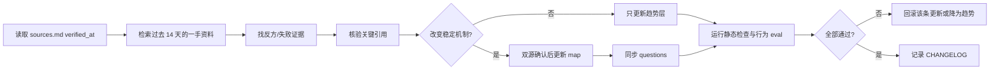

# AI Agent 知识域每周维护流程

## 目标

每周刷新快变化事实，同时保护稳定知识点 ID、学习进度和已验证教学判据。更新对象是技能知识，不是学习者状态。

## 分层

| 层 | 内容 | 更新门槛 |
|---|---|---|
| 结构层 `map.md` | 长期机制、设计权衡、稳定 ID | 两个独立来源支持，且至少一个 Tier 1/2；或一份正式规范直接定义 |
| 教学层 `questions.md` | 追问链、A 档要点、错误识别 | 必须能从结构层推出；不能把单次实验数字当 A 档必答项 |
| 趋势层 `sources.md` | 协议版本、模型能力、基准、数字 | 每周核验；记录版本、日期、条件和过度概括风险 |
| 学习状态 | `.local/learning/**` | 本维护流程禁止修改；只在真实陪练会话后更新 |

## 每周执行



### 1. 研究范围

固定检查：Agent 架构、上下文、记忆、工具协议、RAG、循环/多 Agent、评测、可观测性、安全、成本与延迟。

优先级：正式规范和官方研究 > 同行评审论文 > 有方法和数据的工程复盘 > 厂商营销或社区讨论。趋势/工具来源原则上不超过 18 个月；基础方法允许更早，但标 `foundational`。

### 2. 证据规则

- 每个重要新结论至少两个独立来源；正式规范只证明“规范定义了什么”，不能证明生态已普遍实现。
- 必须主动搜索失败、反例或限制。
- 厂商实验数字保留语料、模型、指标、基线和日期；缺任一条件就不进入题库答案。
- 论文预印本最高作为趋势证据，不独立触发结构层修改。
- 引用核验至少覆盖本周最重要的 5 个 claim-source 对。
- **版本先于内容**：趋势层每个协议/标准（MCP、A2A、OpenTelemetry GenAI、NIST 等）先打开官方版本索引或 changelog 确认“当前最新版本”，再核验内容。只核验已引用版本会漏掉整版替换（2026-10-08 曾漏掉 MCP 2026-07-28 GA）。
- 检索词不得锚定已知版本号；同时用“latest specification”“changelog”“deprecated”检索。

### 3. 兼容规则

- 不删除或重命名已有知识点 ID；需要替换时保留旧 ID 并标注迁移关系。
- 新知识点只能追加；依赖变化可以调整排序，但不能篡改历史学习档位。
- 不复用 `mistakes.md` 明确禁止的场景；新题优先考新增机制，而不是给旧题换名词。
- 趋势失效时从 `sources.md` 移除或标 stale，不把它改写成结构层“反例”。

### 4. 自测门禁

全部通过才允许安装：

1. `python scripts/check_ai_agent_domain.py`：ID 唯一、问题引用有效、来源锚点完整、日期格式合法。
2. 旧版兼容：旧 `progress.md` 中所有 `agent.*` ID 仍存在，新增 ID 不伪造学习档位。
3. 行为 eval：
   - 用户问当前 MCP/A2A 时会读取趋势层并保留版本边界。
   - 用户说继续学习时仍按到期复习优先，不因图谱更新跳过错题。
   - 每轮只问一个问题，问题本身不泄漏答案。
   - 补课按表格/流程图承载，不堆重复段落。
4. 引用抽查：至少 5 个关键 claim 均能在来源中找到直接支持；PARTIAL 必须收窄表述。
5. 变更审计：对比旧版，确认只改技能文件和测试工作区，未触碰学习状态。

## 更新记录格式

在 `CHANGELOG.md` 追加：

```markdown
## YYYY-MM-DD
- 研究窗口：YYYY-MM-DD..YYYY-MM-DD
- 新增：...
- 修订：...
- 降级/移除：...
- 来源核验：N supported / N partial / N unsupported
- 自测：静态 N/N；行为 N/N；旧状态兼容 pass/fail
```

## 失败处理

- 搜索或引用核验失败：保留旧内容，将候选写入“待核验”，不更新题库。
- 新来源与旧结论冲突：并列保留适用条件，不静默选择一方。
- 行为 eval 失败：不安装新版；先修 skill，再使用同一测试集复测。
- 定时任务只能创建研究与更新会话；未经自测不得自动覆盖已安装 skill。
