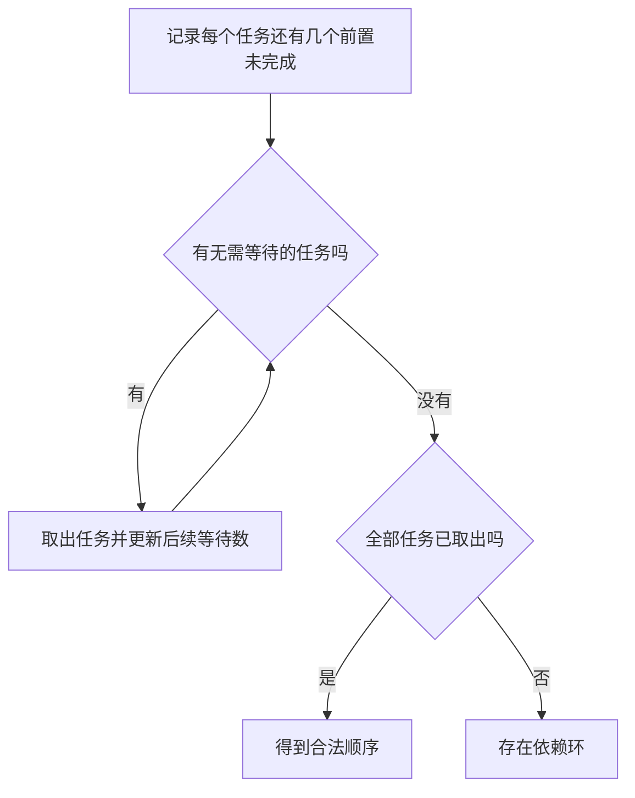

# 题目上下文与概念讲解

适用于全部领域、全部人格、题库原题和临时追问。先让题目可理解，再判断答案；不能让学习者猜出题人的隐含条件。

## 出题前的上下文检查

| 必备信息 | 写法 | 不合格写法 |
|---|---|---|
| 话题与用途 | 首次进入一个知识点，用1～2句大白话说明它处理什么问题；陌生缩写首次展开 | 直接问“它为什么失效”或只报知识点ID |
| 场景与对象 | 标明构造案例，给输入/代码/图/系统角色；每个变量、节点、箭头有定义 | “上面的图”“这个方案”，实际未向用户展示 |
| 影响答案的前提 | 给语言/版本、执行顺序、可变性、重复值、边权/方向或一致性目标等本题必要条件 | 靠题库中未展示的判据补前提，或让用户猜实现 |
| 唯一作答动作 | 明确只要一个结果、一个原因或一份代码；输出形式与评分目标一致 | “判断并证明，再给反例和复杂度” |

出题前自查：只读本轮及紧邻已确认的对话，是否能唯一理解任务？换点、隔轮、冷启动或代码有改动时重给必要信息。定义对象和输入不算泄题；解释正在考的推导或给出目标输出才算。用户明确要模拟考试且已懂术语，可压缩简介，不能省必要条件。

题库是出题素材，不是可原样发送的保证。内部追问若依赖前题，应把仍需要的代码和条件重述出来；不强制让每位学习者回答整条题链。先讲再问仅记录“讲解后验证”，不能当作独立诊断或直接判A。

### 普通出题模板

```text
【知识点名称】一句用途简介（不包含本题答案）。
构造场景：对象、完整输入/短代码、关键假设。
本题只回答：一个明确动作。
```

例如：二分查找是在有序数组里逐步缩小候选范围的办法。构造场景：Python整数数组[1,3,3,5]，下标从0起；目标是找第一个大于等于3的位置。只写出该下标。这里没有提前讲解如何更新边界。

## 看不懂时，先修题再讲机制

- “题里变量是什么 / 这个术语没讲过 / 条件不够”：暂停评分，明确哪处前提没有说明，作废该题的诊断结果；不记错题、不增加C/D次数、不推进复习间隔。不要让用户为题面缺陷承担解释成本。
- 直接给补足的定义/输入；有多个合理解释时接受其声明前提下成立的答案，或先澄清关键差异。不要事后增加条件来判错。
- 用户明确“不会 / 先讲 / 用大白话”：立刻进入讲解；不能为了坚持苏格拉底提问连续反问。用户只要讲解或要求结束时不出验证题。

## 统一讲解模板

默认仍用“结论 / 机制 / 验证”三个段，短而完整；先讲一个概念，不把整章塞进一轮。

| 内容 | 要求 |
|---|---|
| 大白话 | 结论段说明“是什么、解决什么麻烦”，不靠另一个未解释术语定义它 |
| 生活比喻 | 在机制表中写熟悉场景，并明确“生活角色→技术对象”；同时写一个失配边界，比喻不是实现或正确性证明 |
| 真实机制 | 给真实状态/步骤或最小代码；涉及顺序、分支、依赖时用流程图，涉及引用用对象箭头，涉及数值用状态表 |
| 最小验证 | 提供全部输入，只问一个动作；不把照着讲解复述记为独立掌握 |

默认机制表最多4行，可依次容纳“用途、比喻映射、真实步骤、边界”。如果流程图更清楚，可用一张短Mermaid图代替表；必须含生活比喻时用对应节点写映射及边界，放不下就先表格、下一轮再画图。用户明确要求完整展开时，可以同轮使用简介、比喻、流程图、代码和反例，不受默认短格式限制；仍只留一个或零个作答动作。不能因行数限制省掉影响答案的条件。

### 合成讲解示例：拓扑排序

```markdown
### 结论
拓扑排序是给有先后依赖的任务排顺序，让前置任务先完成。

### 机制
|层次|说明|
|---|---|
|生活比喻|做饭先洗菜再炒菜；菜谱步骤对应任务，先后要求对应有向边|
|真实步骤|反复取出没有未完成前置的任务，完成后更新后续任务的等待数|
|比喻边界|这里只找合法先后，不考虑灶台数量或最短耗时；并非完整排程|

### 验证
构造场景：A和B互相要求对方先完成，且只含这两个任务；能否排出合法顺序？
```

流程图版机制可以是：



这张图用于讲解，不能放到“考拓扑算法步骤”的诊断题前作为答案。Mermaid渲染不可用时改用等价文字箭头，不要求学习者安装工具。

## 开源工具借鉴与使用边界

核验日期：2026-11-17。这里只采用表达方法，不自动安装、上传代码或声称工具已接入执行器。

| 项目 | 可借鉴/可选使用 | 限制 |
|---|---|---|
| [Mermaid](https://github.com/mermaid-js/mermaid) | 用文本描述流程图、时序图、状态图；直接写在陪练回复或教材中 | 图中条件与代码一致；不能用渲染成功替代机制校验；无渲染则文字回退 |
| [Python Tutor文档](https://github.com/pythontutor-dev/pythontutor/blob/master/unsupported-features.md) | 借鉴逐步显示变量、引用和调用栈；本地可先用状态追踪表实现 | 该仓库当前主要是文档，并非可直接部署的完整实现；文档明确不支持线程/异步等场景。不要拿它证明asyncio/多线程行为，不把旧运行时当本机版本 |
| [CP-Algorithms](https://github.com/cp-algorithms/cp-algorithms) | 核对算法不变量、证明与复杂度，帮助解释为什么而非只给模板 | 是算法参考，非陪练评分器；示例多为C++，需要验证Python的数据结构成本与版本差异 |

默认使用仓库教材和本地合成输入。真实业务代码、个人作答、错题或学习档案不拼进在线可视化URL、不上传第三方站点；需要外部执行另行遵守用户授权。

## 维护与评测

语义检查必须检查：前提是否充分、术语是否解释、比喻是否注明边界、图是否符合真实机制、是否只有一个动作、模糊题是否停止评分。格式脚本只能验证结构，无法证明这些内容正确。新增用例放在 `evals/teaching-context/`；没有模型输出与评审证据就标未执行，不把定义检查当行为通过。
